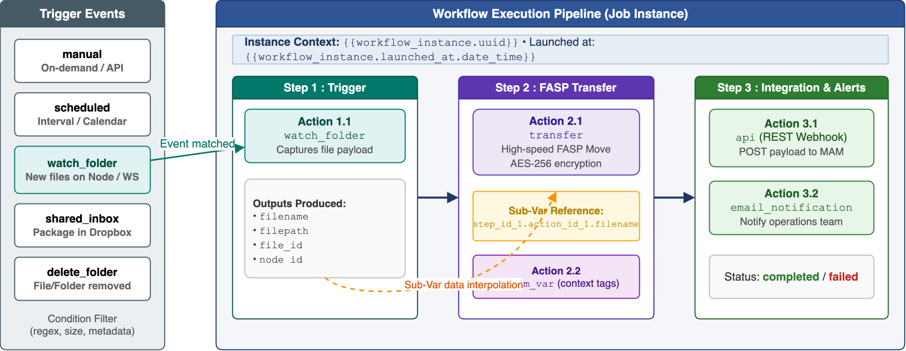
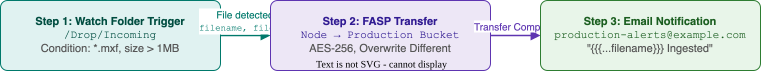

<!-- gfm2pdf
common:
  metadata:
    title: "IBM Aspera on Cloud Automation Development Guide"
    author: "Laurent Martin, IBM"
-->

# IBM Aspera on Cloud Automation Development Guide

> [!IMPORTANT]
> This guide covers workflow development and automated operations using the **IBM Aspera on Cloud (AoC) Automation API** and the **IBM Aspera CLI (`ascli`)**.
> It applies to IBM Aspera on Cloud Automation API 1.0.5 and higher.

## Concepts

This chapter explains the execution model of AoC Automation, its terminology, and the states of workflows and jobs.

### Introduction

IBM Aspera on Cloud (AoC) Automation provides cloud-native workflow orchestration for fast, reliable, and secure data movement across hybrid and multi-cloud storage tiers.

It is designed for workflow authors, systems integrators, and AI assistants building automated file pipelines with IBM Aspera on Cloud.

> [!NOTE]
> The Automation app is available on the **Standard Plus** and **Premium** editions of Aspera on Cloud.
> Concurrent job limits: **5** (Standard Plus) / **10** (Premium). Queue size limits: **5,000** (Standard Plus) / **10,000** (Premium).
> It is not enabled by default: an org admin must enable it under **Admin > Applications > Automation** and add members.
> A member of the Automation app can use all its features and see all its content, whatever their workspace membership.

Prerequisites, before a user can run workflows:

* The **Activity** app is enabled, and the node attached to Aspera on Cloud sends data to it: create a node configuration policy (**Nodes and storage > Node policies > Configuration policies**) with **AEJ logging** checked, and apply it to the node.
* A tethered node needs HSTS 4.0 or higher (Windows is not supported) and the complete tethering procedure, including monitoring and metering configuration.
* The IP address of the transfer node is in the firewall allowlist.

Reference documentation of the Automation API: [IBM API Hub](https://api.ibm.com/explorer/catalog/aspera/product/ibm-aspera/api/automation-api/spec/automation-api).

#### Where to start

| Goal | Read |
| --- | --- |
| Understand the AoC execution model | [How AoC Automation works](#how-aoc-automation-works), [Terminology](#terminology), [States and statuses](#states-and-statuses) |
| Configure event and schedule triggers | [Triggers](#triggers), [Trigger conditions and filtering](#trigger-conditions-and-filtering) |
| Configure transfers, API calls and actions | [Actions](#actions) |
| Pass data dynamically between steps | [Substitution variables](#substitution-variables) |
| Manage workflows from the command line | [Managing workflows with ascli](#managing-workflows-with-ascli) |
| Implement common end-to-end patterns | [Design recipes and patterns](#design-recipes-and-patterns) |
| Check requirements before deployment | [Practices checklist](#practices-checklist), [Common pitfalls and resolutions](#common-pitfalls-and-resolutions) |

#### Typographic conventions

| Format | Use | Example |
| --- | --- | --- |
| Bold | A label of the web interface: button, menu, tab, field. | **Run Now**, **Active**, **Save** |
| Code | A literal of a file or code: attribute, status, action type, command, JSON/YAML fragment. | `watch_folder`, `transfer`, `completed` |
| Italic | A term where it is defined, or a workflow/step name chosen by the author. | *Ingest pipeline*, *Archive Drop* |
| Double quotes | A message or text that AoC displays. | "Package received" |
| `<PLACEHOLDER>` | A value that the reader replaces. | `<WORKFLOW_ID>` |

### How AoC Automation works



A workflow is an ordered sequence composed of **Steps**, each containing one or more **Actions**:

1. **Definition**: An administrator or user defines a workflow with a single **Trigger** followed by one or more sequential **Steps**.
2. **Step Execution**: Steps run sequentially in the order defined by `step_order`.
3. **Action Execution**: Within each step, the actions run in parallel; `action_order` only gives their display order.
4. **Data Propagation**: Actions pass information downstream using mustache-like **Substitution Variables** (`Sub-Vars`), allowing dynamic destination paths, file names, API payloads, or email bodies.
5. **Instance Lifecycle**: When a trigger condition is met (or when triggered manually), AoC creates a **Workflow Instance** (Job) tracked in the Job Queue.

### Terminology

| Term | Meaning | In the web interface |
| --- | --- | --- |
| Workflow | The definition of an automated business process. Identified by UUID. Contains any number of steps. | Workflow |
| Workflow Instance | A single execution run of an active workflow (a Job). | Job |
| Step | A logical stage containing one or more ordered actions. Steps run sequentially; actions within a step run in parallel. | Step |
| Action | An individual operational task: Transfer, Send a Package, Call an API, Notify, Custom Variables, Create a Folder. | Action |
| Trigger | The first action of Step 1 that defines the conditions for launching a workflow instance. | Trigger |
| Sub-Var (Substitution Variable) | A dynamic placeholder resolved at runtime from prior action outputs or global workflow context. | Variable |
| Job Queue | The list of running and queued jobs. Beyond the concurrent maximum, jobs queue in FIFO order. | Job Queue |
| Permissions | Sharing rules allowing another user to view the workflow and manage (start, cancel, delete) its jobs. | Share |

### States and statuses

#### Workflow states

* `draft`: The workflow is under configuration. Automatic triggers are disabled.
* `inactive`: The workflow configuration is completed but execution is paused.
* `active`: The workflow is live. Automatic triggers spawn jobs when triggered.

#### Workflow instance statuses

The status names below are those of the Automation API; the web interface label is in parentheses.

* `initiating` ("Initiating"): The job is being started.
* `queued` ("Queued"): The job is waiting to run because the concurrent maximum has been reached.
* `executing` or `resumed` ("Running"): The job is currently executing steps and actions.
* `paused` ("Paused").
* `complete` ("Completed"): All steps and actions finished successfully.
* `failed` ("Failed"): An action encountered an unrecoverable error (transfer failure, for example).
* `timeout` ("Timed out"): An action did not complete within its timeout.
* `canceled` ("Cancelled"): The instance was aborted by a user or administrator.

The workflow itself also has a status: `not_started`, `submitted` or `error`.

In the Automation API, a workflow instance also exposes `current_status` (human-readable description), `queue_position` (when `queued`), `workflow_trigger_type`, `action_id` (current action) and `action_statuses` (status and outputs of each action, per step). The `status` query parameter of `GET /workflow_instances` accepts any of the status names above.

---

## Triggers

Every workflow requires exactly one trigger defined as the first action of the first step.

### Manual trigger

* Type: `manual`
* Trigger condition: Triggered on-demand via the Web UI (**Run Now**) or through the REST API (`POST /workflows/:id/launch`) and CLI (`ascli aoc automation workflows launch <id>`).
* Outputs: `workflow_instance.uuid`, `workflow_instance.launched_at.*`.
* **Constraint**: A workflow with a manual trigger must contain at least one `transfer` or `package_transfer` action.

### Scheduled trigger

* Type: `scheduled`
* **Constraint**: A workflow with a time-based trigger must contain at least one `transfer` or `package_transfer` action.
* Configuration parameters:
  * `repeat_interval.repeat_type`: `minutes`, `hours`, `days`, `weeks`, `months`.
  * `repeat_interval.repeat_number`: Interval count (e.g., every `2` hours). Web interface limits: minutes 5–60, hours 1–24, days 1–7, weeks 1–4, months 1–12.
  * `repeat_interval.days_of_the_week`: Boolean flags (`monday` through `sunday`), for `weeks` only; at least one is required.
  * `repeat_interval.day_of_the_month`: Number (1–31), for `months` only; required.
  * `start_date`, `end_date`: ISO 8601 timestamps bounding the schedule. The start must be in the future; `end_date` is optional and cannot precede the start.

> [!NOTE]
> The recurrence interval begins when the **previous run completes**, not at the scheduled start time.
> For example: start at 01:00, repeat every 6 h, run takes 2 h → next run starts before 09:00 (3:00 AM + 6 h).

### Watch folder trigger

* Type: `watch_folder` (labeled **File addition event** in the UI)
* Monitored location:
  * `source.type`: `node` (requires node secret) or `workspace`.
  * `source.node_id` or `source.workspace_id`.
  * `source.file_id`: Root folder ID to monitor.
  * `source.paths`: Monitored sub-paths.
  * With a workspace, the list contains the workspaces where you are a member; an org admin can also browse all shared folders of the workspace. To monitor a workspace where you are not a member, select the folder through the node.
* `recursive_trigger`: Boolean (**Include sub folders**) — also trigger on files added to sub-folders.
* Condition filter (`conditions_type`): `all_new` (**Any file is added**, default) or `custom` (name, extension or size conditions, see [Trigger conditions and filtering](#trigger-conditions-and-filtering)).
* This trigger has no archive settings: archiving or deleting the source after the transfer is configured on the `transfer` action (`source_archive`).

### Shared inbox trigger

* Type: `shared_inbox` (labeled **Shared inbox event** in the UI)
* Monitored location:
  * `source.type`: `workspace`.
  * `source.workspace_id`: Workspace of the shared inbox.
  * `source.inbox_id`: UUID of the Aspera on Cloud Shared Inbox (Dropbox).
  * An org admin can choose to view the workspaces as **Admin** or as **User**.
* Condition filter (`conditions_type`): `all_new` (**Any file is added**, default) or `custom` — one or more metadata field conditions (field, operator, value). `custom` is only available when the inbox has usable metadata fields.
* Metadata extraction: Outputs package metadata fields filled by the package sender (accessible as Sub-Vars in downstream actions).

### Delete folder trigger

* Type: `delete_folder` (labeled **File or folder deletion event** in the UI)
* Configuration:
  * `source`: Monitored folder, on a node or in a workspace (same selection as the watch folder trigger).
  * `conditions_type`: `all_new` (**This folder is deleted**) or `custom` (conditions on `file_name`, `folder_name`, `extension_name`).
  * With `all_new`: `trigger_on_file_deletes` (**Include top level files**) and `trigger_on_folder_deletes` (**Include top level sub-folders**) also trigger the workflow when a top-level file, or sub-folder, of the monitored folder is deleted.
  * `source.access_key`: Node access key for delete event monitoring.

### Trigger conditions and filtering

Watch folder and shared inbox triggers support granular condition lists:

```yaml
conditions_type: custom          # all_new (any file added) | custom
conditions:
  - field_name: "file_name"      # file_name | extension_name | file_size (watch folder); file_name | folder_name | extension_name (delete folder)
    field_type: "string"
    match_type: "regex"          # includes | excludes | matches | regex
    value: ".*\\.mp4$"
  - field_name: "file_size"
    field_type: "byte"
    match_type: "greater_than"   # greater_than_or_equal | less_than_or_equal | greater_than | less_than | equal
    value: 1048576               # bytes (> 1 MB)
join_type: "and"                 # and | or (default or for watch folder and delete folder triggers)
```

For the shared inbox trigger, conditions apply to the metadata fields of the inbox: `value` is a list, and the web interface always sets `join_type: and`.
Date metadata fields use `on`, `after`, `before`, `on_or_before`, `on_or_after`; list and checkbox fields use `matches`, `does_not_match`.

---

## Actions

Each action step performs one specific task. Multiple actions can run **in parallel** within the same step (click the **+** icon below an existing action in the UI). Available action types: `transfer`, `package_transfer`, `api`, `email_notification`, `custom_var`, `folder`.

> [!NOTE]
> The `type` enumeration of the Automation OpenAPI document also lists `telestream_qc` and `antivirus`, in addition to the trigger types. No request schema is published for `antivirus`.

### File transfer

Transfers files and directories between nodes, workspaces, or cloud buckets using IBM Aspera high-speed FASP protocol.

```yaml
type: transfer
data:
  source:
    type: node                  # node | workspace; in the UI, "Same as trigger" (watch folder and shared inbox triggers only) leaves node_id and file_id null
    node_id: "00000000-0000-0000-0000-000000000001"
    file_id: "12345"
    paths:
      - source: "/"             # path to transfer, relative to file_id
  destination:
    type: workspace
    workspace_id: "00000000-0000-0000-0000-000000000002"
    file_id: "67890"
    paths:
      - destination: "{{workflow_instance.uuid}}"  # optional: folder created at the destination when the workflow runs (supports Sub-Vars); blank = use the destination folder
  rate_policy: high             # high | fair | low | fixed (default fair; the more restrictive of node and workflow settings applies)
  target_rate:
    rate: 100000                # Kbps (100 Mbps), UI range 10000 to 5000000; the lower of node setting and this value is used
    allow_retry: true           # true when retry_attempts > 0
    retry_attempts: 3           # 0 to 30; 0 means no retry
    retry_interval: 10          # seconds
  resume_policy:
    resume_partials: true
    difference_check: attrs
    destination_file_options: overwrite_newer # overwrite_always | overwrite_never | overwrite_newer | overwrite_different | overwrite_both_newer_different
  content_encryption:
    encryption: aes-256         # none | aes-128 | aes-192 | aes-256; the higher key-length of node vs. workflow wins
    apply_protection: true      # true when a content protection password is set
    password: "SECRET"          # encrypts the content at the destination; the recipient needs it to decrypt
  file_attributes: true         # preserve source timestamps at destination
  timeout: 86400000             # milliseconds, default 24 h, 1 h to 48 h
  source_archive:               # post-transfer source handling
    archive_option: archive     # none | archive | delete
    move_after_transfer: "/archive"  # archive path, on the same node as the source
```

With `archive_option: delete`, the three boolean options below apply. The web interface sets all three to `true` when `delete` is selected.

```yaml
  source_archive:
    archive_option: delete
    remove_skipped: true             # delete files skipped because they already exist at the destination
    remove_empty_directories: true   # delete empty nested folders (forced to true by remove_empty_source_dir)
    remove_empty_source_dir: true    # delete the source folder itself if empty after transfer
```

> [!NOTE]
> The archive options are not offered when the source is "same as trigger", or when the source is the shared inbox of the trigger.
> The OpenAPI document of the Automation API (`createActionTransfer`) lists the names used above (`remove_skipped`, `remove_empty_directories`, `remove_empty_source_dir`, `overwrite_both_newer_different`). It also keeps the older names `delete_empty_subdirectories` and `overwrite_both_newer_and_different`, which the web interface does not send.
> The OpenAPI document describes `timeout` in seconds and `target_rate.rate` in bytes per second; the web interface sends milliseconds and Kbps. Check the unit against your own organization before relying on it.

When the source is a workspace folder, browsing for the archive folder starts from the workspace home. When the source is a shared folder, the archive folder is selected from the top of that shared folder.

> [!CAUTION]
> When `remove_empty_source_dir` is enabled and the workflow has multiple transfer actions, ensure each action uses a **different** source folder to avoid unintended deletions.
>
> `rate_policy` and `target_rate` interact with the node settings: the actual behavior always obeys the **more restrictive** setting.

### Package transfer

Sends digital packages using Aspera Packages application.

```yaml
type: package_transfer
data:
  source:                       # same structure as for the transfer action; "same as trigger" is allowed
    type: node
    node_id: "00000000-0000-0000-0000-000000000001"
    file_id: "12345"
    paths:
      - source: "/"
  source_archive:
    archive_option: none        # none | delete only: archiving the source is not available for this action
  package:
    workspace_id: "00000000-0000-0000-0000-000000000002"
    name: "Automated Package Delivery"
    note: "Package generated by AoC Automation"
    content_retention_duration: 2592000 # seconds (30 days); the workspace or shared inbox limit applies, minimum 86400
    recipients:
      - id: "user_uuid_here"
        type: User
      - id: "group_uuid_here"
        type: Group
```

The transfer settings (`target_rate`, `content_encryption.encryption`, `resume_policy.resume_partials`, `file_attributes`, `timeout`) apply as for `transfer`.
`rate_policy`, content protection password and `resume_policy.destination_file_options` are not available for this action.

### REST API call

Executes HTTP REST requests against internal or third-party web services with complete payload interpolation.

```yaml
type: api
data:
  method: post                  # get | post | put | delete
  endpoint: "https://api.example.com/v1/ingest"
  authentication:
    type: bearer                # none | bearer | basic (basic uses username and password instead of token)
    token: "YOUR_API_TOKEN"
  headers:
    - key: "Content-Type"
      value: "application/json"
  payload: '{"job_id": "{{workflow_instance.uuid}}", "file": "{{{step_id_1.action_id_1.filename}}}"}'  # post and put only
  verify_ssl: true
  callback: false               # post and put only; set true to enable API callback (see Configuring API callback)
  timeout: 300000               # milliseconds; the web interface accepts 1 min (60000) to 24 h (86400000), default 5 min
```

### Email notification

Dispatches formatted notification emails on workflow milestones.

```yaml
type: email_notification
data:
  send_as_type: Organization    # Organization (default sender of the org base template) | User (the workflow owner)
  subject: "Workflow Complete: {{{step_id_1.action_id_1.filename}}}"
  message: "The file was successfully processed and moved.\nJob UUID: {{workflow_instance.uuid}}"
  recipient_hashes:
    - id: "user_uuid_1"
      type: User                # User | Group | Email
    - id: "qa_team@example.com"
      type: Email
  timeout: 300000               # milliseconds (default 5 min, 1 to 60 min in the UI)
```

### Folder creation

Dynamically creates directory trees on target nodes prior to file transfer.

```yaml
type: folder
data:
  folder_name: "{{workflow_instance.launched_at.YYYY}}-{{workflow_instance.launched_at.MM}}"
  parent_folder:
    type: node
    node_id: "00000000-0000-0000-0000-000000000001"
    file_id: "root_folder_id"
```

### Custom variables

Instantiates named key-value pairs stored in workflow context for downstream consumption.
Values can combine literal text, global variables (`{{workflow_instance.uuid}}`), and Sub-Vars from previous steps.

> [!IMPORTANT]
> Custom variable names accept only letters, digits, `_`, `-` and `.` (they **cannot contain spaces**).

### Telestream quality control

Integrates with Telestream cloud services for automated media quality verification.
This action is only offered when the `telestreamQc` feature flag is enabled for the organization; it is not part of the public Aspera on Cloud documentation.

```yaml
type: telestream_qc
data:
  endpoint: "https://qc.example.com/api"   # API URL
  api_key: "YOUR_API_KEY"
  body: '{"file": "{{{step_id_1.action_id_1.filename}}}"}'
  timeout: 3600000               # milliseconds (default 1 h, 1 to 60 min in the UI)
```

### Action timeout defaults

If the Automation app does not receive an update from the node within the configured timeout, the action fails and the job fails.

| Action | Default | Minimum | Maximum |
| --- | --- | --- | --- |
| `transfer` | 24 h | 1 h | 48 h |
| `package_transfer` | 24 h | 1 h | 48 h |
| `api` (no callback) | 5 min | 1 min | 24 h |
| `api` (with callback) | 24 h | 1 h | 48 h |
| `email_notification` | 5 min | 1 min | 60 min |
| `custom_var` | 5 min | 1 min | 60 min |
| `folder` | 5 min | 1 min | 60 min |

---

## Substitution variables

Substitution variables (Sub-Vars) let workflow actions consume dynamic values at runtime — from the global job context or from outputs of preceding actions. They use mustache-style double or triple curly braces: `{{global}}` for global variables, `{{{step.action.field}}}` for action outputs.

### Global workflow instance variables

These variables are available in every workflow action regardless of trigger type.

| Variable Syntax | Description | Example Value |
| --- | --- | --- |
| `{{workflow_instance.uuid}}` | Unique identifier (UUID) of the current job instance. | `a1b2c3d4-e5f6-7890-abcd-ef1234567890` |
| `{{workflow_instance.launched_at.YYYY}}` | 4-digit launch year in UTC. | `2026` |
| `{{workflow_instance.launched_at.MM}}` | 2-digit launch month in UTC. | `11` |
| `{{workflow_instance.launched_at.MMM}}` | 3-letter month name in UTC. | `Nov` |
| `{{workflow_instance.launched_at.DD}}` | 2-digit launch day in UTC. | `08` |
| `{{workflow_instance.launched_at.hh}}` | 2-digit launch hour in UTC (24 h). | `14` |
| `{{workflow_instance.launched_at.mm}}` | 2-digit launch minute in UTC. | `30` |
| `{{workflow_instance.launched_at.date_time}}` | Full ISO 8601 timestamp in UTC (GMT). | `2026-11-08 14:30:00TZD` |
| `{{workflow_instance.launched_at.Month}}` | Month, listed as "Month" by the web interface (format not documented). | n/a |

### Action output references

Values produced by previous steps and actions are referenced with triple curly braces:

`{{{step_id_<STEP_ID>.action_id_<ACTION_ID>.<FIELD>}}}`

| Output Field | Produced By | Description |
| --- | --- | --- |
| `filename` | `watch_folder`, `transfer` | Base name of the file or folder. |
| `filepath` | `watch_folder`, `transfer` | Full source path of the file. |
| `parent_path` | `watch_folder` | Path to the parent folder. |
| `file_ext` | `watch_folder` | Extension without leading dot (e.g. `mxf`, `mp4`). |
| `file_id` | `watch_folder`, `folder`, `transfer` | Aspera node file identifier. |
| `node_id` | `watch_folder`, `transfer` | Node UUID. |
| `timestamp` | `watch_folder` | Time of the event. |
| `status` | `transfer` | Status of the transfer. |
| `transfer_uuid` | `transfer` | Transfer session UUID. |
| `response_code` | `api` | HTTP status code (e.g. `200`, `201`). |
| `response_body` | `api` | HTTP response body. |
| `package_id` | `package_transfer` | UUID of the sent package. |

The web interface also knows these keys, for outputs of the shared inbox trigger and package actions: `metadata`, `shared_inbox_name`, `dropbox_id`, `name`, `sender_name`, `sender_email`, `sender_type`, `sender_id`, `message`, `package_status`, `package_subject`, `package_message`, `parent_file_id`.
The variables offered for an action are limited to the trigger and actions in the steps above it.

### Path-based substitutions schema

In workflow definitions, substitutions are mapped explicitly using the `substitutions` array in action `data`:

```json
{
  "substitutions": [
    {
      "template": "Archive/{{{step_id_step1.action_id_act1.filename}}}",
      "path": [
        {"name": "destination", "type": "map"},
        {"name": "paths", "type": "array"},
        {"index": 0, "type": "input_map"},
        {"name": "destination", "type": "map"}
      ]
    }
  ]
}
```

---

## Managing workflows and jobs

The **Workflows** page lists all your workflows and their current state. The **Job Queue** page shows all running and queued jobs across your workflows. The actions below are available from the overflow menu (**⋮**) on each row.

### Workflow lifecycle

From the overflow menu (**⋮**) next to a workflow name in the Workflows page:

| Action | Effect | New Status |
| --- | --- | --- |
| **Activate** | Workflow starts launching jobs automatically (event triggers) or on **Run Now** (manual). API: `update_state` with `event: activate`. | `active` |
| **Deactivate** | No new job is launched; running and queued jobs complete (or can be canceled). Org admins can deactivate other users' workflows. API: `event: deactivate`. | `inactive` |
| **Edit** | Puts the workflow back into edit mode (`event: save_as_draft`). Only possible when the workflow has no running jobs; an active workflow is deactivated first, after confirmation. | `draft` |
| **Duplicate** | Creates a copy in `draft` state. Org admins can duplicate other users' workflows. The copy may fail at run time if you do not have access to the resources it references (shared inbox, shared folder). API: `POST /workflows/:id/copy` with the mandatory `name` of the copy. | `draft` |
| **Delete** | Cancels all current and future jobs; removes workflow from the list. | — |
| **Run Now** | Manually launches one job instance (any trigger type). | job `running` |
| **Share** | Grants another user **Manage jobs** permission (view, start, cancel, delete jobs). | no change |
| **Rename** | Renames the workflow; no operational effect. | no change |
| **Email notifications** | Configures per-event email alerts (started, completed, failed) for the workflow. | no change |
| **Job queue** | Jumps to the job queue filtered to this workflow. | no change |

> [!NOTE]
> Org admins can deactivate and duplicate workflows created by other users.

Listing workflows (`GET /workflows`) accepts the query parameters `q` (filter by name), `show_org_workflows` (all organization workflows instead of your own), `admin` (admin mode), `user_id`, `organization_id` and `response_type` (`short`, default, or `long` to include the full steps and actions). Listing workflow instances accepts `status`, `user_id` and `organization_id`.

#### Automatic deactivation after failures

The organization-level Automation settings are read with `GET /app_permissions/:organization_id` and updated with `PUT /app_permissions/:organization_id`. The only documented setting is `failed_count_to_deactivate`: the number of consecutive failed runs of a workflow before it is deactivated automatically.

### Job lifecycle

From the **Job Queue** page (check the job row, then click the action):

| Action | Effect | New Status |
| --- | --- | --- |
| **Cancel running jobs** | Sends an async cancel to the node for in-progress transfers; reports job as `canceled`. All queued jobs are canceled automatically. | `canceled` (displayed "Cancelled") |
| **Delete jobs** | Removes the job from the list. | — |

Job step indicators: **green** = success, **blue** = in progress, **red** = failed.

---

## Managing workflows with ascli

`ascli` covers the full Automation lifecycle: CRUD on workflows, state transitions, job management, export/import for version control, and permissions. All commands start with `ascli aoc automation`.

### CLI commands reference

`ascli` provides full command-line lifecycle management for AoC Automation:

```bash
# Workflows CRUD and operations
ascli aoc automation workflows list [--query.show_org_workflows=@val:true]
ascli aoc automation workflows show <workflow_id>
ascli aoc automation workflows details <workflow_id>
ascli aoc automation workflows create @json:'{"name":"My Workflow"}'
ascli aoc automation workflows update_state <workflow_id> @json:'{"event":"activate"}'   # activate | deactivate | save_as_draft
ascli aoc automation workflows delete <workflow_id>
ascli aoc automation workflows duplicate <workflow_id> [--name="New Name"]
ascli aoc automation workflows export <workflow_id>
ascli aoc automation workflows import @yaml:my_workflow.yml

# Execution and instances
ascli aoc automation workflows launch <workflow_id>
ascli aoc automation workflows cancel_instances <workflow_id>
ascli aoc automation instances list [--query.workflow_id=<workflow_id>]
ascli aoc automation instances show <instance_id>
ascli aoc automation instances cancel <instance_id>

# Permissions and sharing
ascli aoc automation workflows permissions <workflow_id> list
ascli aoc automation workflows permissions <workflow_id> create @json:'{"user_id":"...","manage_jobs":true}'
```

### Exporting and importing workflows

Workflows can be fully exported to portable YAML/JSON files for Git version control and CI/CD promotion across environments.

#### Exporting a workflow

```bash
ascli aoc automation workflows export 00000000-0000-0000-0000-000000000001 --format=yaml --out.file=workflow_backup.yml
```

#### Portable manifest format example

```yaml
name: "Ingest and Distribute Video"
trigger_type: "watch_folder"
allow_notifications: true
workflow_notifications:
  failed:
    - id: "admin@example.com"
      type: "Email"
steps:
  - ref_id: "step_1"
    name: "Watch Drop Folder"
    actions:
      - ref_id: "act_trigger"
        name: "Watch Drop Folder"
        type: "watch_folder"
        data:
          source:
            type: "node"
            node_id: "11111111-1111-1111-1111-111111111111"
            file_id: "100"
          conditions:
            - field_name: "extension_name"
              field_type: "string"
              match_type: "matches"
              value: "mp4"
  - ref_id: "step_2"
    name: "Transfer to Cloud Archive"
    actions:
      - ref_id: "act_transfer"
        name: "FASP Transfer"
        type: "transfer"
        data:
          source:
            type: "node"
            node_id: "11111111-1111-1111-1111-111111111111"
            file_id: "100"
          destination:
            type: "workspace"
            workspace_id: "22222222-2222-2222-2222-222222222222"
            file_id: "200"
          resume_policy:
            destination_file_options: "overwrite_newer"
          substitutions:
            - template: "Archives/{{{step_id_step_1.action_id_act_trigger.filename}}}"
              path:
                - name: "destination"
                  type: "map"
                - name: "path"
                  type: "map"
```

#### Importing a workflow

```bash
ascli aoc automation workflows import @yaml:workflow_backup.yml
```

`ascli` automatically creates the workflow, steps, and actions in sequence and remaps all internal substitution variable IDs.

---

## Configuring API callback

When `callback: true` is set on an `api` action, after sending its HTTP request the workflow **pauses** and waits for the external service to call back.

**Prerequisites** — your API server must:
1. Include the **static callback endpoint** `https://api.ibmaspera.com/automation/v1/external/api_callback` in its response.
2. Echo back the **token** that AoC injects into the payload (parse it from the incoming request body).

**Enabling in the UI**:
1. Open or create a workflow → select the **Call an API** action.
2. Set **Request type** to `POST` or `PUT`.
3. Check **Add an API callback**.
4. Save and activate the workflow.

**Sequence of events** (once the action is triggered):

1. AoC sends the configured JSON payload to your API, with a unique `token` field injected automatically.
   The workflow pauses (default timeout: **24 h**).
2. *(Optional)* Your service may send **in-progress** status notifications to the callback endpoint:
   ```json
   { "token": "<TOKEN>", "status": "in_progress", "progress": 42 }
   ```
   Progress (0–100) is displayed in the Automation UI.
3. When your service finishes, it sends a **completion** response:
   ```json
   { "token": "<TOKEN>", "status": "success" }
   ```
   or `"status": "failed"` to fail the job.
4. On `success`, the workflow proceeds to the next step.

---

## Design recipes and patterns

Common end-to-end workflow patterns combining triggers, transfers, API calls, and notifications. Each recipe is illustrated with a diagram showing the data flow.

### Watch folder to multi-destination transfer

**Goal**: Automatically ingest incoming media files, replicate them to production storage with AES-256 encryption, and notify the production team.



---

### Shared inbox package to MAM webhook

**Goal**: Listen for client deliveries in a Shared Inbox (Dropbox), notify an external MAM system via REST API, and transfer the payload into deep archive.


---

### Scheduled sync with differential overwrite

**Goal**: Run a nightly differential sync every midnight from an on-premise node to cloud storage, then move processed files to an archive folder.


---

## Best practices and troubleshooting

Guidelines to build reliable production workflows, and a table of common failure modes with their root causes and resolutions.

### Practices checklist

- [ ] **Trigger Isolation**: Keep the trigger step dedicated solely to event capture. Perform heavy transfer or API operations in subsequent steps.
- [ ] **Prevent Trigger Loops**: When configuring a `watch_folder` trigger with destination on the same node, configure `source_archive` (archive or delete) on the `transfer` action, or ensure destination paths are excluded from watch rules. The `source_archive` setting belongs to the transfer action, not to the trigger.
- [ ] **Distinct Source and Destination**: The web interface refuses a `transfer` action whose source and destination are the same folder.
- [ ] **Transfer Idempotency**: Use `overwrite_newer` or `overwrite_different` rather than `overwrite_always` to prevent unnecessary bandwidth consumption during retries.
- [ ] **Secrets Handling**: Do not hardcode static credentials in API action bodies. Use bearer tokens or scoped access keys.
- [ ] **Error Notifications**: Always define `workflow_notifications.failed` recipients on production workflows so the operations team is alerted immediately on failures.

### Common pitfalls and resolutions

| Issue | Root Cause | Resolution |
| --- | --- | --- |
| Workflow cannot be activated | Missing trigger action, or a step with no actions, or `manual`/`scheduled` trigger with no transfer action. | Ensure Step 1 has a valid trigger; every step has at least one action; `manual` and `scheduled` triggers include a `transfer` or `package_transfer` action. |
| Cannot edit workflow | A workflow can only be made editable (`save_as_draft`) when it has no running jobs. | Run `ascli aoc automation workflows cancel_instances <id>`, or **Deactivate** from the UI and wait for the running and queued jobs to complete, then **Edit**. |
| Substitution variable not resolving | Target step or action ID mismatch, or referencing a downstream step. | Verify that Sub-Vars only reference steps positioned **above** the current step in `step_order`. |
| Transfer action fails on permission | Aspera on Cloud service user lacks write permissions on destination node. | Ensure the node access key configured in AoC has read/write privileges on the destination storage path. |
| Transfer files are not re-transferred | Files already present at the destination are skipped (resume policy). | Use `overwrite_always` to force re-transfer, or `overwrite_newer`/`overwrite_different` for differential sync. |
| Cancel does not stop the node transfer | Automation sends an async cancel; the node may not honour it immediately. | The job is reported `canceled` by Automation even if the underlying FASP session is still active on the node. Monitor the node logs if immediate cancellation is critical. |
| Job stays in `queued` indefinitely | Concurrent job maximum reached (5 Standard Plus, 10 Premium). | Wait for running jobs to complete, cancel them from the Job Queue, or upgrade the subscription edition. |
| API callback never received | External server not configured to call back, or wrong token. | Verify that the server POSTs to `https://api.ibmaspera.com/automation/v1/external/api_callback` with the original `token` value and `"status": "success"` or `"failed"`. |
