<!-- gfm2pdf
common:
  metadata:
    title: "Aspera Orchestrator Development Guide"
    author: "IBM Aspera"
-->

# Aspera Orchestrator Development Guide

## Concepts

### Introduction

This guide explains how to develop for IBM Aspera Orchestrator: how to design and write workflows, and how to extend Orchestrator with action plugins and portlets.

It is written for people and for AI assistants.

#### Chapters

- [Concepts](#concepts) defines the terms and statuses used in all chapters.
- [Workflow development practices](#workflow-development-practices) collects the rules and pitfalls of workflow development: how to design a workflow, how to use the designer, how to pass data, how to branch, handle errors, detect files, limit concurrency, interact with operators and monitor executions.
  Most rules are stated as **do** or **do not**, followed by the reason.
- [Workflow authoring](#workflow-authoring) explains how to write a workflow as a file, import it, publish it and run it, without the graphical designer and without exporting an existing workflow first.
  Each rule gives the exact element, attribute or value expected by Orchestrator.
- [Plugin development](#plugin-development) explains how to write an action plugin (a Ruby class, its database table, its template form and its metadata), and how to install, test and update it.
  Each rule gives the exact name, method or value expected by Orchestrator.
- [Portlet development](#portlet-development) explains how to write a portlet, a widget of the Orchestrator dashboard (a Ruby class, a view, a configuration partial and a metadata file), and how to install, test and update it.
  Each rule gives the exact name, method or value expected by Orchestrator.
  Portlets and plugins share several mechanisms, listed in [Comparison with plugins](#comparison-with-plugins).

#### Valid and wise

Workflow authoring says what is valid: what Orchestrator accepts and how it behaves.
Workflow development practices says what is wise: among the valid choices, which one to make and why.
A workflow can be valid and still be a poor design.

If the two chapters differ on how Orchestrator behaves, follow Workflow authoring: it is derived from Orchestrator 4.1.6 and its examples were executed on 4.1.6.

Workflow development practices describes the graphical designer.
Workflow authoring shows the same objects as XML (for example `Synch_factor` for the OR operator).

#### How each chapter was verified

- **Workflow development practices:** the rules come from field experience of workflow design on Orchestrator 3.x and 4.x.
  A few facts were checked against Orchestrator 4.1.6; they are marked *(4.1.6)*.
  The screenshots show Orchestrator 4.1.6: the user interface and some option names differ in other versions.
  The concepts and rules do not.
- **Workflow authoring:** the content is derived from Orchestrator 4.1.6.
  The examples in [Recipes](#recipes) were imported, published and executed on Orchestrator 4.1.6.
- **Plugin development:** the content is derived from Orchestrator 4.1.6.
  The example plugin of [Plugin quick start](#plugin-quick-start) was installed, enabled, and executed in a workflow on Orchestrator 4.1.6, and the steps of [Installing a plugin](#installing-a-plugin) and [Updating a plugin](#updating-a-plugin) were done on that server.
- **Portlet development:** the content is derived from Orchestrator 4.1.6.
  - On an Orchestrator 4.1.6.2036 server: the example portlet of [Portlet quick start](#portlet-quick-start) was imported with **Import Portlet**, chosen and configured in a dashboard frame, displayed, and its action called with GET and POST. In Chrome, the **Ping** link (`ajaxUpdate`) and the automatic refresh worked with no JavaScript error. The behaviors of import (file name, collision), enable, disable, restart, the version API and the CSRF token described in that chapter were reproduced on this server.
  - From Orchestrator: the security notes, the custom portlets, the legacy upgrade script, and the counts of the [Portlet annex](#portlet-annex).

#### Reference documents

These documents are separate from this guide:

- [Action Template Reference](https://github.com/laurent-martin/aspera-orchestrator-plugins-doc/blob/main/docs/action-template-reference.md): attributes, inputs and outputs of every shipped action plugin (generated from Orchestrator).
- [Plugin specifications](https://github.com/laurent-martin/aspera-orchestrator-plugins-doc/blob/main/docs/plugins.yml) (`plugins.yml`): the same as data (YAML), with the allowed values of attributes and the template settings each input and output depends on.
  Its header describes its fields.
  Read one plugin with [`yq`](https://github.com/mikefarah/yq): `yq '.AmazonS3Operation' plugins.yml`.
- [Plugin Manual](https://github.com/laurent-martin/aspera-orchestrator-plugins-doc/blob/main/docs/Orchestrator_Plugin_Manual.md): functional description of each shipped action plugin.

### Terminology

This table is the only definition of the terms used in the chapters.
The last column gives the label that the web interface shows, when it differs.

| Term | Meaning | In the web interface |
|------|---------|----------------------|
| Workflow | A named process definition: steps, links and conditions, identified by an integer `id` and a `portable_id` (UUID). Like a class in object-oriented programming. | Workflow |
| Whiteboard | One revision of the design of a workflow: the graph, stored as XML in attribute `xml_export`. | Revision |
| Publish | Build the runnable workflow (steps, inputs, outputs, parameters, branches) from a whiteboard. Only a published revision runs. | **Publish** |
| Work order | One execution of a published workflow. Like an object, an instance of the class. | Work order |
| Step | A node of the graph that executes an action. | Step |
| Work step | One execution of a step in a work order. | Work step |
| Action plugin, plugin | The type of a step, for example `CustomRuby` (step type, action type). In development, a Ruby class that includes module `Action`, and its folder. The designer shows display names, listed in [Plugin display names](#plugin-display-names). | Action |
| Action template, template | A configured instance of an action plugin: a database record holding the plugin settings (its attributes). Each step references one template by `Step_type` and `Action_id`. | Template |
| Embedded template | A template that belongs to one workflow, named `W<workflow id>__<step name>`. | Configuration (**New configuration**) |
| Global template | A template shared by several workflows, identified by its name. It is created in **Workflows > Workflow Actions**. | Template |
| Attribute | A setting of a template: a column of the plugin table, edited in the template form. | Field of the form |
| Input, Output | Named values consumed and produced by a step, as declared by the action plugin (`inputs_spec`, `outputs_spec`). | Inputs, Outputs tabs |
| Parameter | A named value of the workflow. A runtime parameter can be set when starting the workflow. Linked to **Start**, it is global. | Parameter |
| Carry through | Option of a step output that passes it to the step after the next one. | Carry Thru? |
| Trigger, watcher | A step that waits for an event (file, transfer, message, schedule) and starts the processing. | Trigger |
| Work order group | The work orders cloned from one trigger started with **Continue monitoring**. | History scope: by workorder group |
| Worker | A process of Orchestrator that executes steps: synchronous (busy until the step ends) or asynchronous (polls). | - |
| Stock folder | The source of a plugin (`/opt/aspera/orchestrator/actions/<folder>`) or of a portlet (`/opt/aspera/orchestrator/portlets/<id>`). | - |
| Load folder | `<config_dir>/actions/<folder>`, by default `/opt/aspera/var/config/orchestrator/actions/<folder>`: the copy of the stock folder made when the plugin is enabled, from which Orchestrator loads it. | - |
| Portlet | A Ruby class that inherits from `Portlet`, for example `HelloBanner`, and its folder. Displays one widget. | Portlet |
| Portlet ID | The folder name in snake_case, for example `hello_banner`. The class name is `portlet_id.camelize`. | - |
| User folder | `<config_dir>/portlets/<id>`, by default `/opt/aspera/var/config/orchestrator/portlets/<id>`: portlets written or imported by the user. | - |
| Frame | A zone of a dashboard page. A frame shows one portlet, or is split horizontally or vertically into sub-frames. Stored in table `frames`. | Frame |
| Dashboard | The frames of a user or of a group. | Menu **Dashboard** |
| Portlet parameter | A named, typed setting of a portlet, edited in the configuration of the frame and stored in the frame, not in the portlet. Not a workflow parameter. | Frame configuration |
| Runtime value | The value of a portlet parameter during one display: the frame value, or the default. | - |
| Portlet action | A public method of the portlet controller, called from the view with an HTTP request, for example to load a table page. | - |
| Custom portlet | A portlet defined in the web interface (Ruby and ERB text in the database) instead of files. See [Custom portlets](#custom-portlets). | Custom portlet |

Template wording: Workflow authoring says *embedded template* and *global template* where Workflow development practices, which follows the designer, says *configuration* and *template*.
Plugin development says *template* for both.
Where a text only says *template*, it means either kind.

### Plugin display names

The designer shows the plugin display names.
This guide uses the plugin class names, as in [plugins.yml](https://github.com/laurent-martin/aspera-orchestrator-plugins-doc/blob/main/docs/plugins.yml):

| Display name | Plugin |
| -------------- | -------- |
| Stored parameter set (formerly mass parameter set) | `MassParameterSetter` |
| Lookup table | `SimpleParameterLookup` |
| Array fan-out (+), funnel-in (−) | `ArrayFanout`, `Funnelin` |
| Sub-workflow, workflow launcher | `SubWorkflow`, `WorkflowLauncher` |
| Work order metadata | `WorkOrderMetaData` |
| Exit status | `ExitStatus` |
| Custom action (Ruby), custom Ruby trigger | `CustomRuby`, `CustomTrigger` |
| Queue stager, load manager, resource manager | `QueueStager`, `LoadManager`, `ResourceManager` |
| Journal log entry, alert entry | `FileJournalLogEntry`, `OrchestratorAlertEntry` |
| Path conversion, file generator, file information | `ConvertPath`, `FileGenerator`, `FileInfo` |

### Statuses

A work step ends with one of the following statuses, which are matched by the `status` of prerequisites:

| Status | Meaning |
|--------|---------|
| `Complete` | Success. |
| `Failed` | Functional failure (for example a filter evaluated to false). |
| `Error` | Technical error (exception, timeout with `On_timeout` set to `Error`). |

While running, a work step can also be `Inactive`, `In Progress`, `Paused`, `Canceling`, and so on.
A work order is `Complete`, `Failed` or `Error` when it reaches `End`, `Fail` or `Error`, and `Canceled` when canceled.

## Workflow development practices

### Rules at a glance

The most important rules, each detailed later:

1. Spend most of the design time away from the designer: split the problem into blocks, and ask for each block "what if something goes wrong?" ([Method](#method)).
2. Separate the **trigger** (when to act) from the **processing** (what to do): the processing workflow takes the detected element as a parameter, and the trigger workflow starts it ([Separate the trigger from the processing](#separate-the-trigger-from-the-processing)).
3. Only one step with **Continue monitoring** from start to end, sub-workflows included ([Rules for triggers](#rules-for-triggers)).
4. Never combine **Continue monitoring** with persistency scope **none** ([Persistency scope](#persistency-scope)).
5. Several links into a step mean AND.
   Mutually exclusive links (complete and failed of a step, if and else) must go through an OR, otherwise the work order never ends ([AND and OR](#and-and-or)).
6. In the designer, a step can map only the outputs of the steps linked to it: carry other outputs through, or use global parameters ([Output visibility](#output-visibility-and-carry-through)).
7. Centralize configuration in templates (stored parameter set, lookup table, remote nodes); never hard-code values in steps or in Ruby code ([Configuration](#configuration)).
8. Exactly one step between a fan-out and its funnel-in: use a sub-workflow for more ([Fan-out and funnel-in](#fan-out-and-funnel-in)).
9. Make every outcome readable: work order label, exit status messages, journals ([Meaningful status](#meaningful-status)).
10. Use `CustomRuby` only when no plugin does the job, or when it saves many steps ([Custom code](#custom-code)).
11. Between the allocation and the release of a resource, put one step or one sub-workflow, and release on every exit ([Resource management](#resource-management)).
12. When a load manager and its queue are in the same work order, map the **expected queued item** ([Queue](#queue)).
13. Test each block alone, and test after each change ([Testing](#testing)).
14. After changing the structure of a workflow, run new work orders (relaunch); reset reruns the old revision ([Changes and revisions](#changes-and-revisions)).

### Designing a workflow

#### Method

A workflow automates an end-to-end process that is usually described in one sentence by the person who requests it.
That sentence is not enough to build the workflow.

- Spend most of the time (up to 90 %) at a whiteboard or on paper, not in the designer.
- Break the end-to-end process into macro-actions, and each macro-action into smaller actions, until each block is simple.
  In Orchestrator, a macro-action becomes a sub-workflow, like a function in a program.
  Iterate: the breakdown changes when you learn more.
- For each block, write down its inputs, its outputs and its specifications (file patterns, files to ignore, polling interval).
- For each step, ask **"what if something goes wrong?"**: folder missing, server down, bad content.
  Decide which failures to handle and how (notify, retry, move the file to an error folder), and which ones you accept.
  You cannot handle everything, but an unhandled foreseeable failure is the call you get at 3 a.m.
- Identify the steps that are heavy or long (transcoding, checksum, transfer) and ask what happens if hundreds run in parallel: put resource control around them ([Resource management](#resource-management)).
- Identify what can run in parallel: operations on independent storage, or the same operation on each element of a list.
- Identify where an operator is needed: a decision after an error (retry, skip, fail), or missing information (manual quality control).
  Keep these exceptional.
- Identify what operators need to see: labels, messages, journals, dashboards ([Monitoring and operations](#monitoring-and-operations)).
- Plan the clean-up: move or delete detected files and temporary folders, or the file system fills up.
- Check the network layout: where the remote systems are (safe zone, DMZ, cloud), which side opens connections, which ports, Windows or Linux (paths).
  Triggers poll from Orchestrator: the watched system must be reachable from Orchestrator.
- Identify third-party interfaces early: existing plugin, generic REST or SOAP request, remote command, or Ruby code.
- Run heavy processing on dedicated machines, not on Orchestrator or on transfer servers: Orchestrator coordinates.
- Do not over-engineer: if 10 transfers happen per day, no queue or resource pool is needed.
- Do not use Orchestrator only to start scripts: write the logic as a workflow, so that it is visible, monitored and restartable.

Most integrations need few plugins.
With the generic plugins (REST request, SOAP request, database query, local and remote command execution, file operations) you can do almost everything.
The other plugins wrap the same techniques with a simpler interface.

#### Automation levels

| Level | Description | Started by |
| ------- | ------------- | ------------ |
| Fully automated | No human interaction. Every foreseeable error has a way out, even if it is a clean failure. | A trigger. |
| Semi-automated | Automatic, but asks an operator in some cases (decision, missing data, error). | A trigger. |
| One-shot | Runs when called, does its job and ends: maintenance, fix of one file, call from another system. | An operator, another workflow or an application. |

A workflow can be started:

- by a trigger step (file, transfer, message queue, database, e-mail, schedule, REST polling);
- from **Work Orders > New Work Order**, or from the start button of the designer;
- by another workflow: `SubWorkflow`, `WorkflowLauncher`, or `FederatedWorkflow` (on another, standalone Orchestrator);
- by a monitor (auto-start of a workflow that stopped);
- from a dashboard page or a direct start page ([Human interaction](#human-interaction));
- by the REST API ([Integration API](#integration-api));
- by Aspera inline validation, during a transfer ([Inline validation](#inline-validation)).

One-shot workflows are often forgotten but useful: a "fix" workflow that reruns one part of the processing on one file avoids resubmitting the file through the whole chain.

#### Separate the trigger from the processing

The first split of any workflow: the **trigger** (when to act: a file arrives) and the **processing** (what to do: process the file).

- Build the **processing workflow** first: it processes one element, received as a runtime parameter (for example `p_file_path`).
- Build the **trigger workflow** last: it detects elements and starts the processing workflow with `WorkflowLauncher`, one work order per element.
  The trigger is the hardest part to test; when you add it, everything else is ready.

Benefits:

- You test the processing with any file, even outside the production folders, without uploading files or writing database rows to fire the trigger.
- You rerun the processing of one element (reset or relaunch of its work order) without touching the trigger.
  In a single workflow, a reset restarts at the first step, the trigger.
- Each work order has its own label and status: operators find an element directly.

A `SubWorkflow` step inside the trigger workflow does not separate the **trigger** from the **processing**: it runs in the same work order, and a relaunch restarts the trigger.

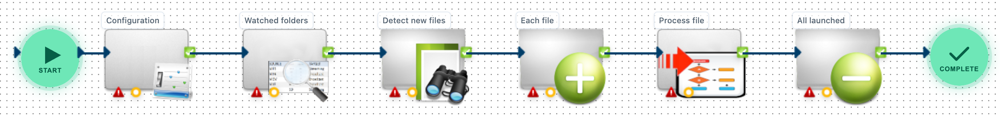

#### Sub-workflow or workflow launcher

| | `SubWorkflow` | `WorkflowLauncher` |
| - | --------------- | -------------------- |
| Waits for the called workflow | Yes: blocking, like a function call. | No: fire and forget (an option can wait for completion). |
| Outputs | The outputs of the called workflow that you expose in the step configuration. | The id of the launched work order; its status when waiting. |
| Status | Failure or error of the called workflow fails the step. | Success once launched, error if the launch fails. When waiting: a failure fails the step only with **Fail if launched work order fails**; an error or a cancel always fails it *(4.1.6)*. |
| Work order | Child work order, shown inside the parent. | Independent work order, with its own label. |
| Use for | A block of a larger processing; error handling at the caller level. | Splitting trigger and processing; starting independent workflows. |

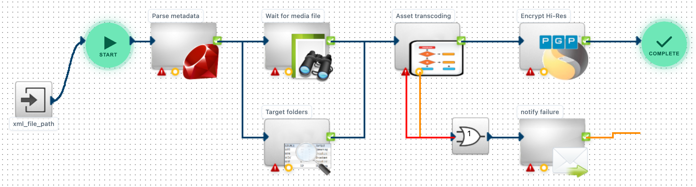

Rules:

- A sub-workflow is a black box: the caller gives inputs and gets the outputs it needs.
  Expose only those outputs.
- Select **End with workorder status** in the sub-workflow step to report the status detail of the called work order, rather than the status of its last step.
- Select **Use true name** to show the workflow name without "launched by ... at ..." in the title.
- With `WorkflowLauncher`, set the label of the launched work order (for example the file name), and set **Master id** to a fixed value (a negative number does not clash with work order ids) to group launched work orders on one line in **View by work order**.
- When the caller must handle the failure of the called workflow (for example to release a resource), use `SubWorkflow`, or a launcher with **Wait for completion** and **Fail if launched work order fails**: without them, a launcher reports success once the work order is started.
- A republished sub-workflow is used by the next execution of its callers; no need to republish them.
- Refer to the called workflow by its UUID (`portable_id`) rather than its numeric id when workflows move between servers by import in the user interface or with `import_with_constraints`: the import keeps the `portable_id` of the file, unless a workflow of the target already has it *(4.1.6)*.
  The `import_workflow` API (`ascli orchestrator workflows import`) always generates a new `portable_id`: there, refer by id (see [Referring to existing entities](#referring-to-existing-entities) in the Authoring Guide).
- Parameters of `WorkflowLauncher` are a hash: `{"param1"=>"value1", "param2"=>true}`; `CollectionManager` can build it.
- Never put a trigger with **Continue monitoring** in a sub-workflow: the sub-workflow is cloned at each event.
  Put it in the top-level workflow, or in a workflow started by a launcher.

#### Reusable building blocks

Build a library of tested workflows, each solving one problem: transcoding with a given product, checksum, Aspera transfer, notification.
A new end-to-end workflow is then an assembly of tested blocks plus a trigger and some glue, and is ready quickly.

- Include a block with `SubWorkflow` when it is part of a processing, with `WorkflowLauncher` when it is started by a trigger.
- Make blocks configurable with parameters and lookup tables, so that the same block serves several cases (for example, the transcoding profile chosen from the source folder or from the media properties).
- Keep a workflow to 15 or 20 steps: easier to read, change and troubleshoot, fewer mappings.
- Do not create a sub-workflow for a single step: each call creates a work order.
  Share the step configuration with a template instead.
- Some teams run automated tests of their building blocks continuously against the current revisions.
- Duplicating a production workflow for a one-off variant can be the right choice: it avoids the risk of changing a workflow in production.
  Weigh that risk against the cost of maintaining two copies.

#### Naming conventions

Conventions save time, especially when several people work on the same workflows.

- **Workflows**: meaningful names, with a level marker for the call chain, and folders (like a file system) rather than everything at the root.

  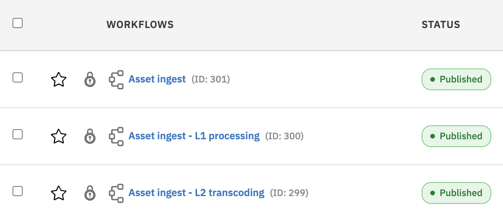

- **Steps**: meaningful titles, unique in the workflow.
  Letters, digits, spaces, dashes and underscores only, no accents.
  **Rename the step before creating its configuration**: the configuration takes the name of the step and cannot be renamed later.
- **Variables and parameters**: ASCII letters, digits and underscore (`A-Za-z0-9_`), no spaces, accents or dashes.
  Do not start a variable name with a capital letter: Ruby treats it as a constant.
  Prefix parameters with `p_`, so that a mapping list shows at once what comes from a parameter and what comes from a step, and write the names of configuration values in UPPERCASE.
- **Inputs**: names that mean something in the context of the workflow (`remote_base_folder` rather than `input_mount_point`).
- **Work order labels**: include the processed element (file or package name) ([Meaningful status](#meaningful-status)).
- **Revision comments**: what changed and who changed it.

### Working in the designer

#### Changes and revisions

- **Save** creates a revision, with a comment: write what changed.
  Save often: even a workflow with errors is saved, which protects against browser crashes.
- **Publish** makes the last revision the one that runs.
  Publish also saves, without a comment; the comment of the last change can be edited later in the history.
- A workflow is not checked for logic errors when saved, only for mapping errors (for example a required input not mapped).
  A wrong type conversion, a starvation or a missing value appears only at run time.

Step configurations and workflow revisions are versioned separately.
A workflow revision shows the current values of its steps, not the values at the time of the revision; the history of a configuration or template is in its own **Revision log**.

| What you changed | What to do |
| ------------------ | ------------ |
| A value in a step configuration or a template | Save the step. Effective at the next execution of the step, without publishing. A running trigger uses the new value at its next clone; reset its work order to apply it at once. |
| Steps, links, mappings, retries, timeouts, inputs or outputs | Save and publish. Run **new** work orders (new work order or relaunch). |
| Custom inputs or outputs of a step (for example of `CustomRuby`) | Saved with the step, but the workflow does not know them until you publish. |
| A sub-workflow | Publish it. Its callers use it at their next execution. |
| The designer says there is nothing to publish | Move a step slightly, then publish. |

**Reset** reruns an existing work order with the revision it started with: it ignores new steps and mappings.
**Relaunch** starts a new work order with the latest published revision and asks again for the runtime parameters; it exists only for top-level workflows.
**Bulk restart** (in **View by workflow**) resets a group of work orders.

#### Configuration or template

Double-clicking a step offers **New configuration** (settings for this step of this workflow) or an existing template (settings shared by all the steps that select it).

- Use a template for what must be identical everywhere: configuration values, resource allocation and release, connection settings.
  Change it once and all workflows follow, without restart.
  A template survives the deletion of the workflows that use it.
- Use a configuration for settings specific to one step of one workflow (a watcher with its folder and pattern).
  A template that is too specific is dangerous: someone reuses it and changes it for another workflow.
- To change a template from a workflow, you must click **Modify**: a reminder that you change a shared object.
- **Workflows > Workflow Actions** lists the templates of each plugin; hover over the name of a template, or select **Use** in its menu, to see the workflows and steps that use it.
  A new configuration appears there after the workflow is published.

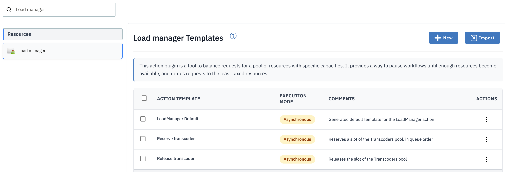

- To turn a configuration into a template: right-click the step, **Change Action Template**, and click **Make Global Template** (globe icon) on the current configuration (its name is shown between stars).
- To detach a step from a template: **Change Action Template**, then **Copy Template** on the template: the step gets an independent configuration.

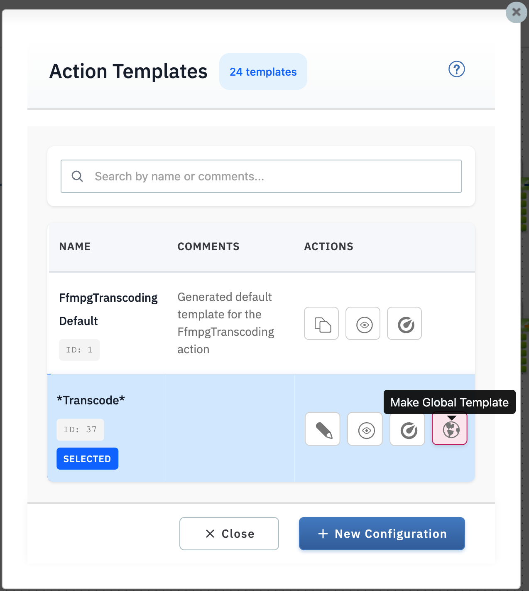

**Duplicate** a workflow (workflow list menu):

- Without **Deep copy**, the copy uses the same templates as the original: changing one changes the other.
- With **Deep copy**, configurations and templates are copied: the two workflows are independent.
  Sub-workflows called by the workflow are not copied; copy them yourself if needed.
- To experiment with a production workflow that you do not fully understand, use a deep copy.
  Otherwise, a deep copy defeats the single point of configuration.

#### Testing

- Test each block alone, with parameters, before adding the trigger and the callers.
- Test after each change.
  Link each new step to **Complete** and run the workflow before adding the next one: an error is then easy to locate.
- A step can be tested alone: in its configuration, enter input values, save them as a named test case, and **Execute**.
  The step really runs: a file is really moved, a REST call is really sent.
- To run a workflow up to a step without running the next one (for example a move), leave the next step waiting on a condition that is never met, check the outputs, then cancel the work order.
  Or route around the step with an OR to **Complete**.
- The work order view shows the inputs that a step not yet started will receive: check them before letting it run.
- Use test folders that no production watcher scans.
- Prefer a test server (for example a copy of the production VM with a temporary license and triggers disabled).
  Developing new workflows on a production server is acceptable if production workflows are not touched.

#### Designer tips

- The **?** of each step opens the help of its plugin, with all its options.
- Add comments in the **Comments** field of steps: they appear in the printable documentation (**Generate printable documentation**: the workflow and all step settings on one page).
- A **Note** (sticky note) can be placed on the canvas, for example to flag something to discuss.
  It has no effect on execution.
  Do not clutter the canvas with notes.
- Right-click a link to change its line style: **Manhattan Router** (right angles, the default), **Bezier Router** (curve), **NULL Router** (straight line), **Fan Router** (straight lines spread apart when several links join the same two nodes).
  Manhattan links that share a path overlap, and the last one drawn hides the others; a Manhattan line can also cross a step.
  Use a Bezier curve where it makes the graph easier to read: this depends on the graph, it is not a rule.
  Give the failed and error exits of a step the same style: a curve beside a right-angle line looks odd.
- Use absolute paths, and end directory paths with `/`: a directory name without slash can be taken as a file name.
- When several users edit the same workflow, the last save wins.
  Lock the workflow (only administrators can unlock).
- A workflow can be deleted only when none of its work orders runs.
- **Export** the workflow after each major change, as a backup; the export takes the published revision.
- Enable only the plugins you use: the palette is easier to search and the memory footprint is lower.
  After enabling a plugin, click **Engine > Force maintenance**, so that the workers (not only the designer) know it.
- Browser password managers may fill credential fields of step and remote node forms without showing it, which causes authentication failures that are hard to explain.

### Passing data between steps

#### Inputs and mappings

The **Inputs** tab of a step (or right-click > **Map inputs**) maps each input to a value, a parameter, or an output of a previous step.

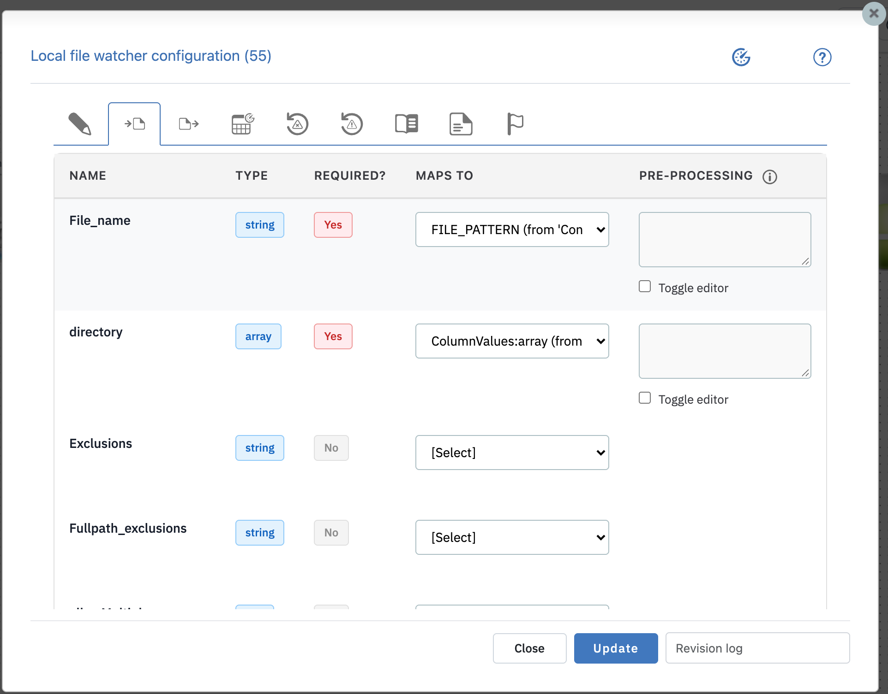

- A value is given either in the step configuration or in the input mapping, not both.
  When both exist, the mapping wins, even when it is no longer displayed (older versions); remove the mapping first.
- The mapping list of a step shows the outputs of the steps linked to it, the outputs they carry through, and the global parameters.
  When an output is missing from the list, check the links first.
- Required inputs must be mapped: the save reports the unmapped ones.
- Removing a step or a link loses the mappings of the following steps.
  To remove a step in the middle of a workflow, change its type to a neutral step and keep its mappings.
  Adding a step does not break mappings, but see [carry through](#output-visibility-and-carry-through).
- When exclusive branches join, map the outputs needed after the join on every branch.
- When two steps produce outputs with the same name, check which one you map.

#### Output visibility and carry through

**In the designer, an output is offered only to the step immediately after the step that produces it.**
This keeps mapping lists short.

To pass an output further, open the next step, **Outputs** tab (right-click > **Map outputs**), and tick **Carry Thru?** for that output.
Repeat on each step along the way.

This is a rule of the designer, not of the engine *(4.1.6)*: a workflow written as a file can map an output of any previous step without carry through (see [Outputs](#outputs) in the Authoring Guide).

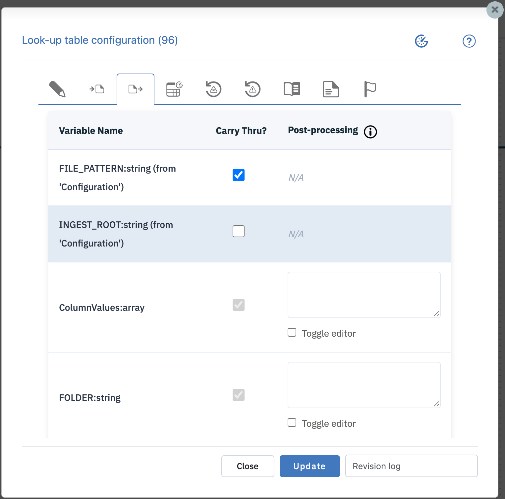

Inserting a step in an existing workflow breaks the chain of carried outputs.
In the new step, tick **Select All Variables** so that all carried outputs continue (except the step information outputs, which are rarely needed).

#### Practices parameters

A parameter has a name, a type and a value.
A runtime parameter is given when the work order starts; it is optional when it has a default value.

- **Link parameters to Start**: they become global, visible to all steps without carry through.
  A parameter linked to a step appears only in the mappings of that step (older workflows); its value is the same for all steps *(4.1.6)*.
- Global parameters are read-only.
  To change a value, produce a new output (for example in `CustomRuby`).
- Give a default value when the parameter has the same value 99 % of the time.
- For an empty default value, leave the field empty; do not write `""`.
- Do not use parameter default values as constants shared by several workflows: use a global template ([Configuration](#configuration)).

#### Practices placeholders

In many fields, `<%= expression %>` is replaced at run time by the value of the expression.

- A variable used in a placeholder becomes an input of the step, of type string, to be mapped (for example `<%= p_file_path %>` in a label).
- A suffix in the name gives another type: `_int`, `_float`, `_date`, `_array`, `_hash`, `_flag`, `_pwd` (for example `<%= start_date %>`); the input keeps the suffix in its name.
- A typing error creates an extra input: check the **Inputs** tab after editing.
- Do not name the variable like an input of the plugin (use `<%= recipients1 %>` for a field `recipients`): it would not appear as an input.
- Useful methods: `File.basename(path)` (name with extension), `File.nakedname(path)` (name without extension, an Orchestrator extension), `File.dirname(path)`, `File.join(dir, name)`.
- The variables are found only in simple forms *(4.1.6)*: `<%= name %>`, a call whose arguments are all variable names (`<%= File.join(dir, name) %>`), and `var(name)` in any expression.
  `<%= File.join(dir, 'sub') %>` (a literal argument) or `<%= File.basename(path).upcase %>` creates no input: the value is `nil` at run time (error "no implicit conversion of nil").
  Write `<%= File.join(var(dir), 'sub') %>`.
  Some fields are not scanned at all: see [Placeholders](#placeholders) in the Authoring Guide.
  Check the **Inputs** tab after editing.
- `RestRequest` does not support conditions (`<% if %>`) or method calls such as `gsub` in its body; prepare the values in a previous step.
- Computing a value in a field (for example a target folder `<%= File.dirname(package_dir) %>/transferring/`) saves a step, but the value is visible only when the step runs, and is tested only with real files and servers.
  A dedicated step (`ConvertPath`, `MassParameterSetter`, `FileInfo`) shows the computed value as an output and can be tested alone: prefer it when readability matters.
- The rules of placeholders in template attributes are in the Authoring Guide ([Placeholders](#placeholders)).

#### Types and conversions

Orchestrator is strongly typed: string, integer, date, flag (boolean), hash, array, password.
Conversions are not automatic.
They are needed mostly between a single value and a list: a watcher returns a path (string) and the next plugin wants an array; a lookup table returns strings and the next step wants a flag.

**Pre-processing** code on an input converts the value: the variable `input_value` holds the value and can be reassigned.

| Conversion | Pre-processing |
| ------------ | ---------------- |
| String to integer | `input_value = input_value.to_i` |
| Value to array of one element | `input_value = [input_value]` |
| First element of an array | `input_value = input_value[0]` |
| Element of a hash | `input_value = input_value['key1']` |
| Empty to empty array | `input_value = [] if input_value.blank?` |
| String generated as a Ruby hash | `input_value = eval(input_value)` |

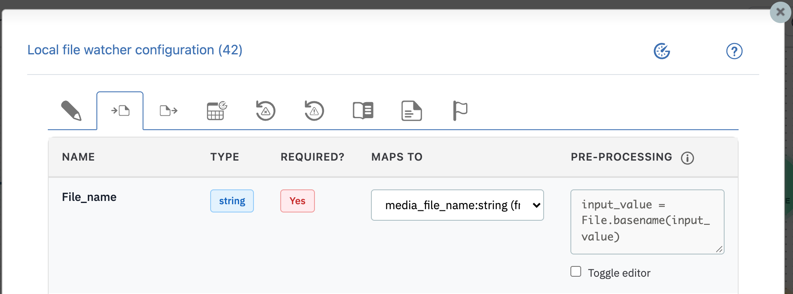

- Keep pre-processing short: it is hidden in the mapping.
  For more, use a step (`CustomRuby`, `InputManipulation`).
- Pre-processing must have no side effect.
  In the work order view, an input with pre-processing has a mark; **Show result of pre-processing** runs the code again.
- Wrong conversions fail at run time, not when saving.
- Inputs are read-only: changing `inputs['myhash']['key']` in Ruby has no effect.
  Produce a new output.
- In a fixed runtime value of a step input, avoid backslashes, quotes and double underscores (`test__1.xml`): put such a value in a `MassParameterSetter` and map it.
- Lookup tables return strings, unless typed outputs are enabled ([Lookup table](#lookup-table)).

#### Keep data small

All inputs and outputs of all work steps are stored in the database.

- Do not pass large hashes (for example a global configuration) from step to step and to sub-workflows: use small hashes per workflow, or read the configuration where needed.
- Keep the elements of fan-out lists short (paths, identifiers), and the lists short.
- Many variables or large values make the database and the work order view slow.

### Configuration

A workflow must be configurable: IP addresses, credentials, folders, e-mail lists, patterns, profiles.
**Never bury constants in step settings, in pre-processing or in Ruby code**: when a folder or a server changes, you must find every occurrence.

| Need | Use |
| ------ | ----- |
| Values identical for all executions (folders, e-mail addresses, URLs) | `MassParameterSetter` (stored parameter set), as a template. |
| Values that depend on a key (source folder, customer, variant, server) | `SimpleParameterLookup` (lookup table), as a template. |
| Address and credentials of a server | A remote node. |
| Values that differ between test and production servers | Environment variables in `MassParameterSetter` ([below](#stored-parameter-set)). |
| A secret | See [Secrets](#secrets) in the Authoring Guide. |

#### Stored parameter set

`MassParameterSetter` defines named values with a type.
The following steps map the names; the values come from the step at run time.

- Make it a template, so that all workflows share it.
  A workflow may use a couple of configuration steps (for example one per subsystem).
- A value can contain placeholders, computed at run time from inputs, for example `VIDEO_FILE` = `<%= File.basename(package_path) %>`.
  Such a step replaces a `CustomRuby` that only derives paths and names, and a reader sees at once that it is configuration.
  A value cannot refer to another value of the same step: repeat the expression.
- The values can be read from a file under `/opt/aspera/var/config/orchestrator/actions_config/mass_parameter_setters/`, re-read at each execution, with lines `key: value`, the type in the name if needed (`count_int: 1`, `name_string: "222"`, `enabled_flag: true`).
- `<%= ENV["NAME"] %>` reads an environment variable declared in `orchestrator.yml` (`env_vars:`): the same workflow then runs on test and production servers with different values.
- Changing a name, or replacing a configuration by a template, requires redoing the mappings of the following steps.
- At the top level, read the configuration once; in the sub-workflows, use runtime or global parameters rather than carrying all values through.
- Prefer it to a lookup table when you are almost sure that there will be only one set of values: it is easier to read (one value per line) and to edit.

#### Lookup table

`SimpleParameterLookup` is one of the most useful plugins of Orchestrator.
The first row holds the column names.
The step searches the rows whose key column matches the input value, and returns the values of the first matching row as outputs.

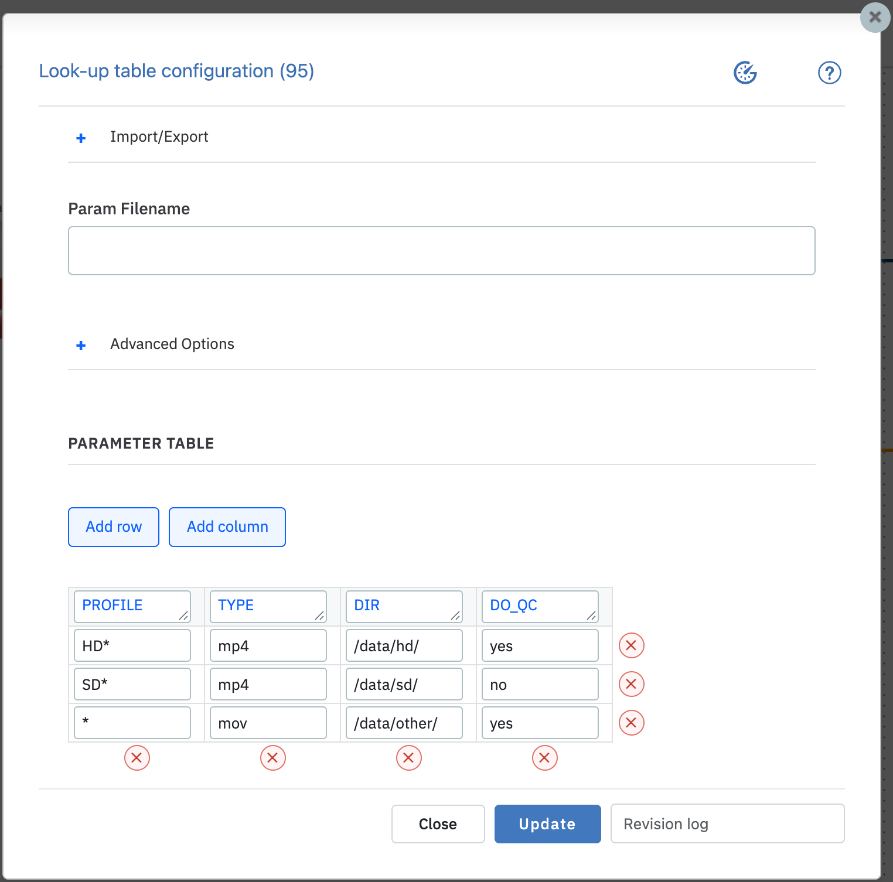

- Map the input of the key column (for example `workflow_prefix`): **without a key, no row matches and the step fails** (`No configuration match`).
- The key is compared as a string: spaces count.
  Glob and regular expressions are supported; `*` as the last row gives a default.
- It replaces nested if-then-else, like a case statement.
- Typical uses: transcoding profile from the source folder or from media properties (height, bit rate, codec from `MediaInfo`), one workflow for several sites or variants (one row per variant), directories to watch.
- `ColumnToListValueFrom` returns all the values of a column as an array (output `ColumnValues`): give it to a watcher with multi-folder search, and add a folder by adding a row.
  Without a key, check **Return array of rows?**: the step then completes (with no row).
- `KeyForTableIndexing` returns the whole table as a hash indexed by a column (`IndexedTable.values` gives one hash per row).
- Fill every cell: empty cells are not handled well (use a default or `NA`).
- Values are strings, unless **Support typed outputs** is set and the column names have a type suffix (`value_int`, `value_flag`, `value_array`, `value_date`); the input stays a string.
- Do not use column names identical to the names of a previous `MassParameterSetter`.
- To add a value, add a column rather than change the meaning of an existing one: existing mappings stay valid.
- For large tables, edit a CSV file: export and import CSV, or set **Param Filename** to a file on the Orchestrator server, re-read at each execution (the UI then shows it read-only).
  Such a file is not in the database backup nor in the workflow export: keep it under `/opt/aspera/var`, which is backed up anyway.
- Write the first row in UPPERCASE, to recognize configuration values in mappings.

#### Remote nodes

Define each server once in **Workflows > Remote Nodes**: id, name, address, SSH or API credentials.
Steps and lookup tables refer to the node, not to its address: when the address changes, you change it once.

- Refer to the node by its name or id, not by address.
  As a runtime input of a step, give the node id.
- Do not create two nodes for the same server.
- **Secondary addresses** turn a node into a simple load balancer: random, round robin, or primary/secondary (fallback).
  A **keep-alive port** is checked before use (for example SSH 33001, or the Node API port); without it, each use opens an SSH connection to check the node, which costs time and connections.
  A node has one login for all its addresses.
- With round robin or random, an asynchronous plugin that polls a remote job may poll the wrong node.
- **Generate Certificate** creates an SSH key pair, stored under `/opt/aspera/var/config/orchestrator/certificates/`.
- An SSH user with shell `/bin/aspshell` cannot run remote commands; use `/bin/bash`.
- With Windows nodes, the health check of balancing can leave SSH connections in `CLOSE_WAIT` until the SSH server refuses new ones: set the keep-alive port to `0`.
- In a high-availability setup, check connectivity (TCP, SSH, FASP) from both Orchestrator nodes.

#### Values in step settings

- Password masking: the work order view masks values according to type and name; see [Where a secret is displayed](#where-a-secret-is-displayed).
  In Orchestrator 3.x and 4.0, `password_field_definition_regex` added name patterns (`pwd`, `secret`, `key`).
- Do not put credentials in a JSON body or a payload file: map them from a remote node or a runtime parameter.

### Control flow

#### Exits and statuses

Each step has one entry and three exits (the statuses are in [Statuses](#statuses)):

| Exit | Status | Meaning | Example |
| ------ | -------- | --------- | --------- |
| Green | Complete | Success. | |
| Yellow | Failed | Expected functional failure: the application says no. | Quality control rejects the file; transcoder cannot convert the format; filter returns false; no row in a lookup table. |
| Red | Error | Unexpected technical error. | Server unreachable; required input missing; Ruby syntax error. |

- The green exit of each step must be linked; the designer requires a path from **Start** to **Complete**.
- Failed and error exits are optional.
  An unlinked failed exit ends the work order as **Failed** with "No behavior defined for step status change to failed" (as if all unlinked failed exits went to **Failed** through an OR); same for errors.
- 80 to 90 % of the time, failure and error are handled the same way.
  The difference helps to notify the right people: the content owner for a failure, IT support for an error.
- Each plugin defines what is a failure and what is an error; check its help.
- Base decisions on the status, not on the text of the status message.
- The position of icons on the canvas has no effect: only links matter.
  Steps linked to the same exit run in parallel, in no guaranteed order.

#### AND and OR

**Several links into a step (or an end node) mean AND: the step starts when all of them are activated.**
The OR operator (palette **Connectors**) starts the next step when one of its entries is activated.
Double-click the OR to set how many entries must be activated ("n of m"); `0` means all (the symbol then becomes an AND) *(4.1.6)*.

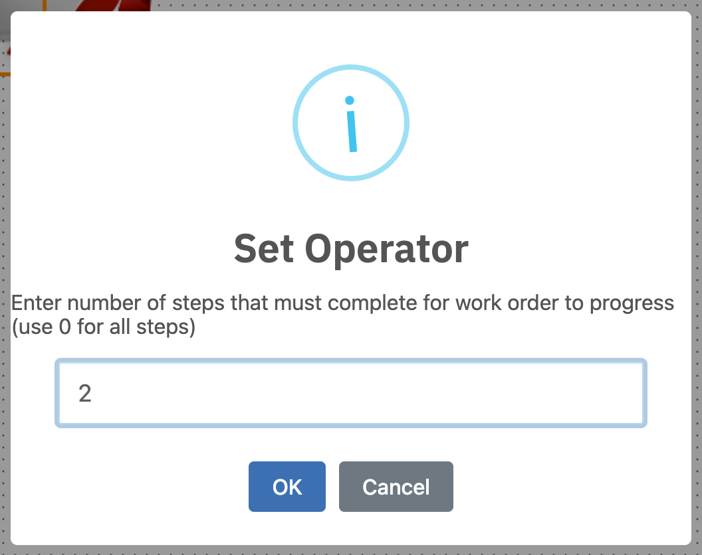

**Starvation**: a step waits on an AND of links that can never all be activated, for example the complete and the failed exits of the same step.
The workflow is published without error, the work order starts, and it never ends.
Almost every workflow developer makes this mistake at least once.
It is the first thing to check when a work order does not complete.
`ascli orchestrator workflows check_import` reports it in a workflow file (`graph.starvation`).

Two exits of a step, joined without OR (never ends), and with an OR (correct):

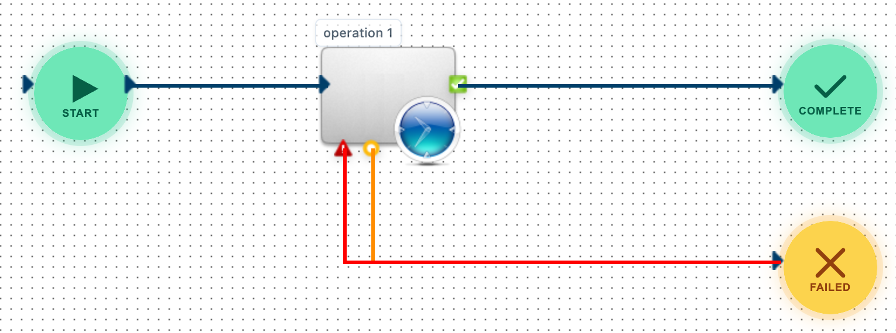

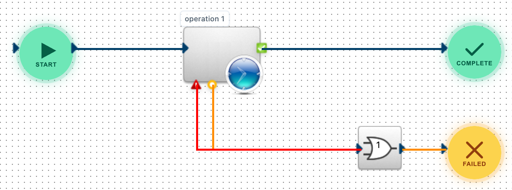

A bypass: the filter skips operation 1 on failure.
Both paths must join through one OR before **Complete**:

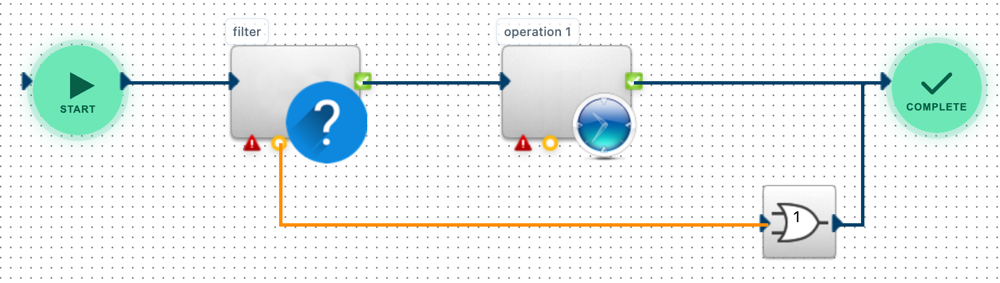

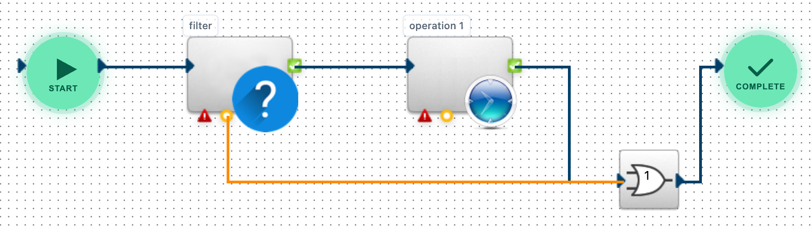

Rules:

- Join mutually exclusive branches (if and else, complete and failed, success path and error path) with an OR.
- All the entries to join go into the same OR: not one into the OR and another directly into the next step.
- Do not chain several ORs into one step: use one OR with the "n of m" setting.
- The designer refuses the last two cases *(4.1.6)*: **Workflow saved with errors** ("Step '...' is connected to a preceeding operator and can not also be connected to preceeding steps", "cannot be connected to more than one preceeding operator"), the links of the step to its other predecessors are not saved, and the workflow cannot be published until it is fixed.

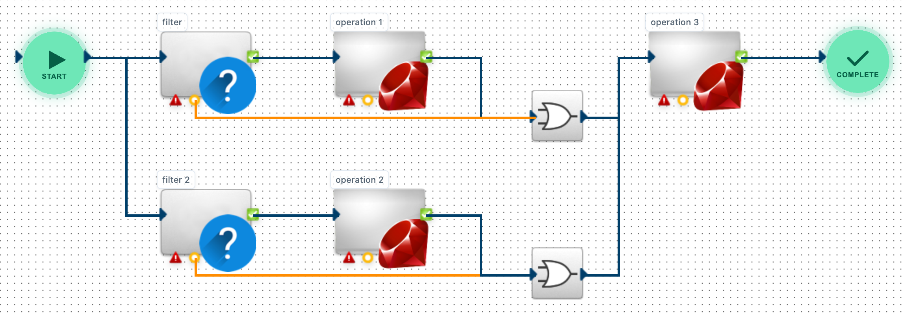

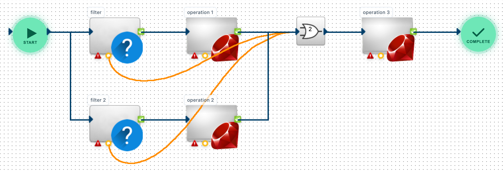

Choose the join by the pattern of the incoming branches:

- **Parallel branches, all of which run** (a fan-out where several tasks run at the same time): leave the join step as an AND (`Synch_factor` `0`). It waits until all the branches have completed.
- **Mutually exclusive branches** (an if and else condition, a route decision between alternative lanes, a nominal branch and an error branch): only one branch runs per execution. An AND would wait forever for the branches that did not run and the work order would never end. Use an OR with `Synch_factor` `1` on the join step (or on `End` or `Fail`), so that it proceeds as soon as any one of the incoming branches completes.

In XML, the OR and its setting are the `Synch_factor` of the following node: see [Prerequisites and branches](#prerequisites-and-branches).

#### Conditions

`Filter` is the if-then-else: its Ruby code returns `true` (complete exit) or `false` (failed exit).
Inputs are read with `inputs['name']` and declared as required inputs with a type.
Placeholders also work, but are replaced by text before the code runs: see [Filter](#filter) in the Authoring Guide.

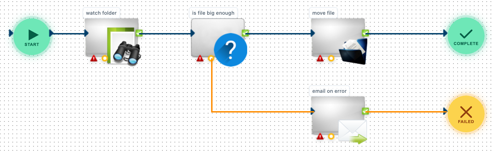

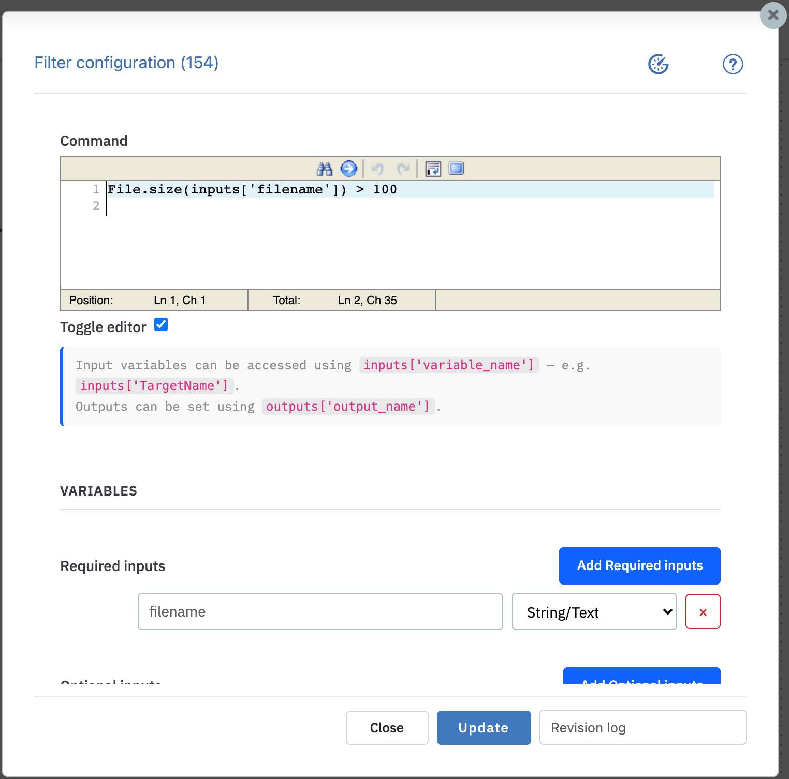

- Name the filter after the question it answers.
  Returning a flag named `should_fail` requires a negation (`return !inputs['should_fail']`), which is easy to get wrong.

  

- The failed exit of any step is also a condition: "if the transcoding fails, do this".
- A lookup table is the case statement ([Lookup table](#lookup-table)).

#### Parallel branches

Steps linked to the same exit start in parallel.
"Parallel" means put in execution: the actual concurrency depends on the free workers.

| Join | Success | Failure or error of a branch |
| ------ | --------- | ------------------------------ |
| AND (no operator) | Waits for all branches. | The first unhandled failure ends the work order. Other branches become obsolete. |
| OR | The first branch to complete continues; the others become obsolete. | The first unhandled failure ends the work order, even if the other branch would succeed. |
| OR "n of m" with all exits linked | Waits for all branches, whatever their result. | Same. Add a consolidation step that reads the step information of each branch. |

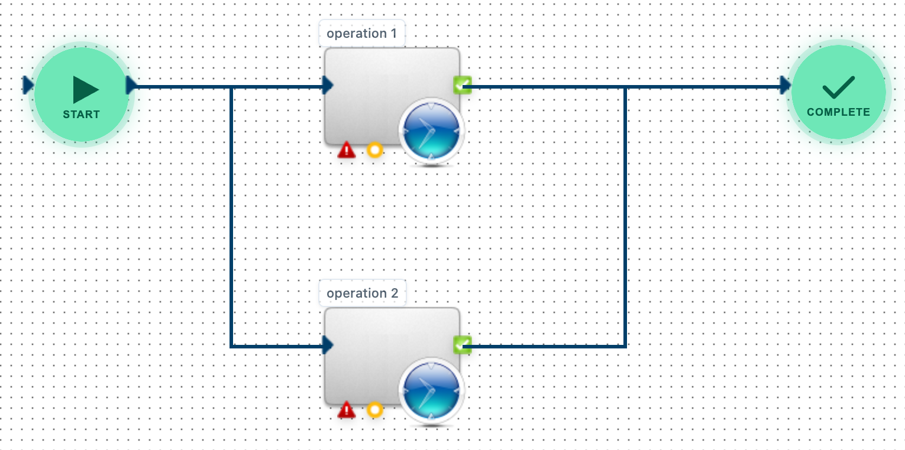

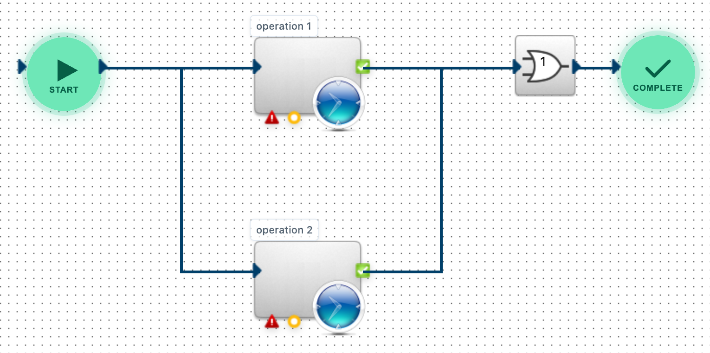

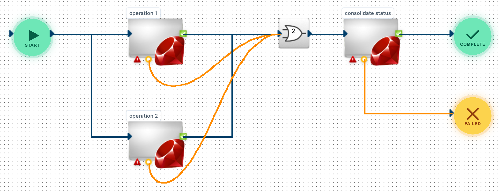

- An obsolete step is no longer followed, but its action is not stopped: a remote job or a synchronous operation goes on.
  An obsolete sub-workflow stops where it is.
- With an OR followed by more steps, a slow branch may still finish while the next steps run.
  To stop the slow branch when the fast one completes, put both branches and the OR in a sub-workflow.

#### Loops

**A step that has run cannot run again in the same work order: do not link back to a previous step.**


Alternatives:

| Need | Use |
| ------ | ----- |
| The same action on each element of a list | Fan-out and funnel-in ([below](#fan-out-and-funnel-in)). |
| Repeat until a condition is met | A sub-workflow that ends **Failed** while the condition is not met, with retries on failure in the caller. |
| Wait for a condition | A trigger without **Continue monitoring**, or `RestRequest` with a polling stop condition. |
| Wait for a condition with simple code | `CustomTrigger` (repeats Ruby code until it returns a final status); see [Custom code](#custom-code). |
| Re-process a detected file | Change it (for example its modification date): the watcher detects it again. |

Re-queuing an element with a delay to retry later creates many work orders: avoid it for frequent retries.

#### Fan-out and funnel-in

`ArrayFanout` (+) runs the step that follows it once for each element of an array input; `Funnelin` (−) waits for all executions and continues.

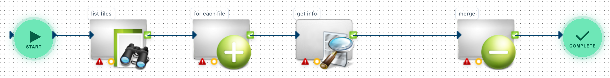

**Exactly one step between the fan-out and the funnel-in.**
With a second step after it, only the first step runs for each element: the second one runs once, after all executions of the first, with the first element, and the funnel-in sees one execution; the work order completes without error, and the other elements are skipped *(4.1.6)*.
To run several steps per element, put them in a sub-workflow and call it between the two.
The sub-workflow is then testable with one element, and the main workflow stays readable.

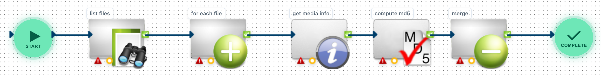

Configuration:

- Fan-out: **Fan-out variable** (the array input, for example `file_paths`) and **Fanned as** (the element, for example `file_path`, with its type).
- Funnel-in: declare the same variable as the fan-out (`file_path`), carry it through the middle step so that the designer offers it, and map it.
  The funnel-in outputs a hash of the status of each execution.
  This is mechanical: declare in the funnel-in what you declared in the fan-out.

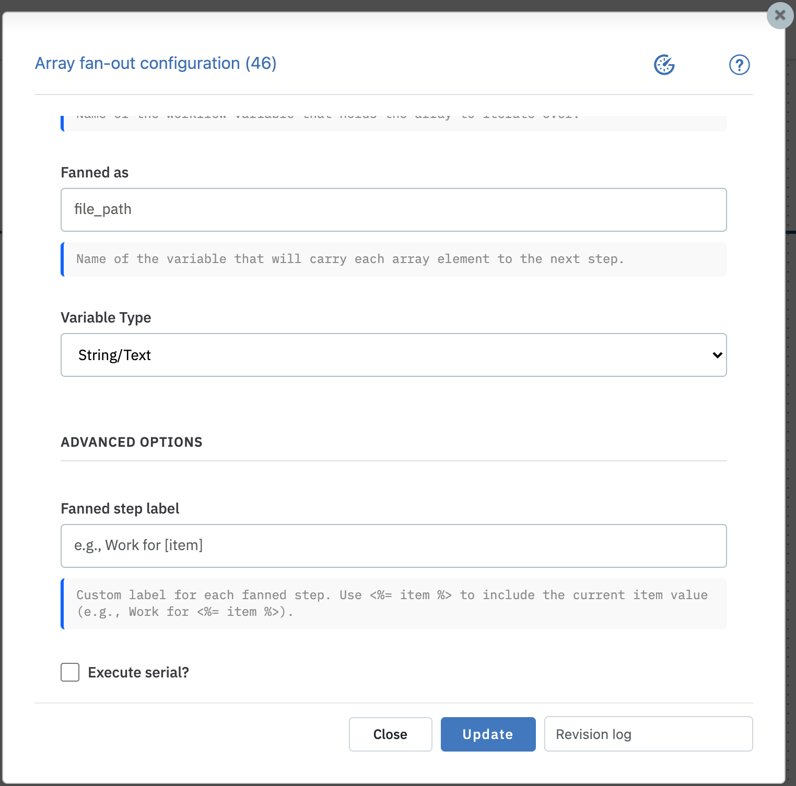

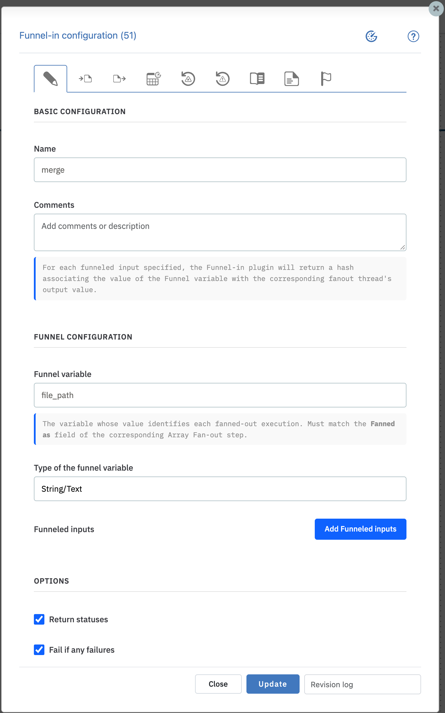

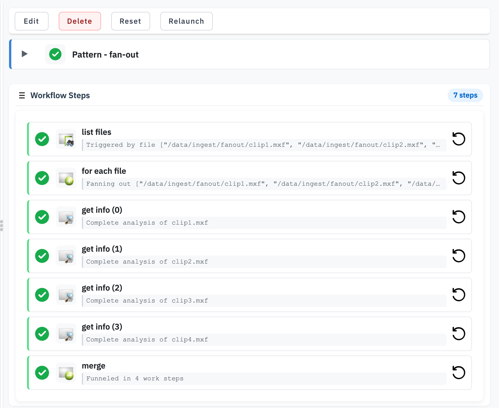

Rules:

- By default the executions run in parallel; **Execute serial** runs them one by one, for heavy steps.
- By default (AND), the first failure ends the loop and the others become obsolete.
  To let all executions finish, link the complete, failed and error exits of the middle step to an OR before the funnel-in, then decide after the funnel-in (fail if one failed, or ignore).
  Select **Fail if any failure** in the funnel-in to report a failure.

  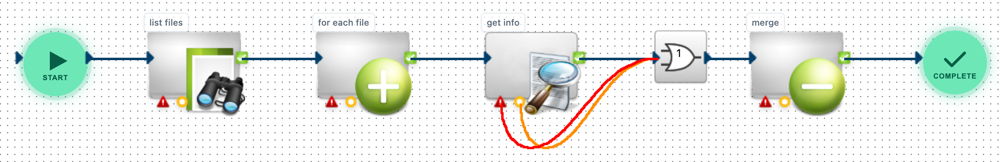

- Handle the errors of each element inside the sub-workflow, not on the links of the sub-workflow step.
- An empty array makes the fan-out fail: test the list before (for example a filter `!inputs['asset_list'].blank?`).
- Several values per element: an array of arrays or an array of hashes.
- A label such as `Processing <%= item %>` shows the element in the step title.
- Do not fan out hundreds or thousands of elements: each creates steps and database rows.
  Split the list, or queue the elements and process them with a resource pool ([High volume](#high-volume)).
- Do not give large lists (hundreds of kilobytes) to a fan-out.
- With `WorkflowLauncher` as the middle step without **Wait for completion**, no OR and no consolidation are needed: it succeeds once each work order is started, unless the launch itself fails.
- With a trigger that returns all matching files as a list, a fan-out processes them in parallel instead of one per polling period.

#### Waiting and timeouts

`ScheduleTrigger` has two uses:

- with **Continue monitoring**: a periodic workflow (every hour, every day at 5 p.m.), like cron;
- without: a delay inside a workflow (for example "20 second(s) from now").

Several rules (lines) combine as an AND; for example "20 seconds from now" and "second 1 of the minute".

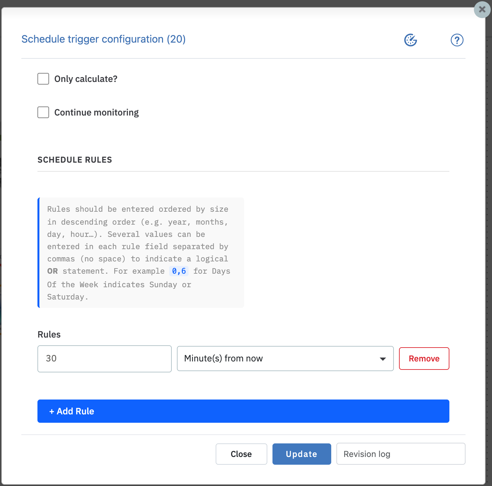

The **timeout** of a step limits one execution of the step: the time without a status update.
For a watcher, one execution is one scan of the folder: the timeout fires only if the scan does not return, never because the file does not arrive.
To limit a wait, or the total duration of several steps, run a `ScheduleTrigger` in parallel:

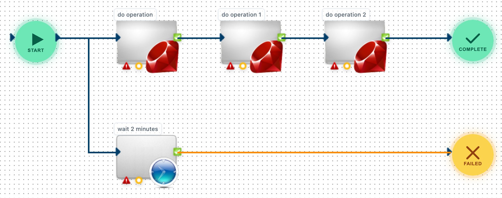

The first branch to reach an end node ends the work order and stops the other branch.
Orchestrator is not a real-time scheduler: do not expect precision to the second.

Escalation: a media file is expected after its XML side file.
After 2 minutes, a reminder is sent and the wait goes on; after one hour, the work order fails:

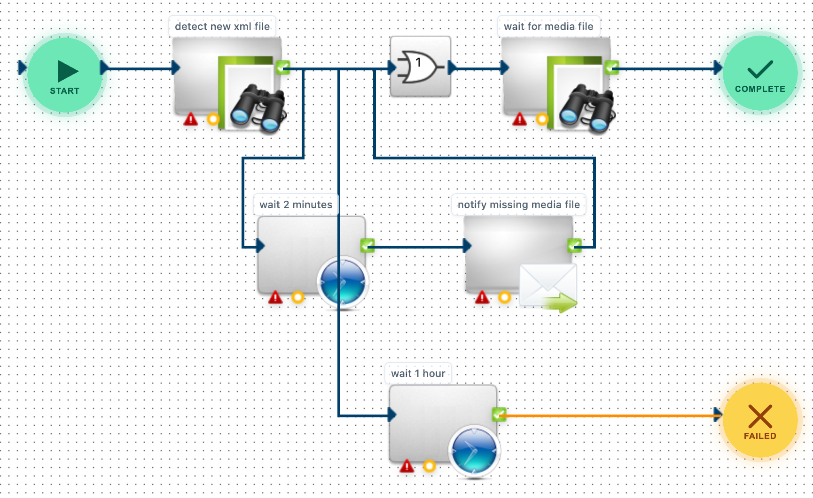

- The step that waits receives several links: if they are exclusive, join them with an OR (in the figure, the OR before "wait for media file").
- The timer runs until the work order ends: the steps after the watched step must not take longer than the timeout, or the timer fires anyway.
  In that case, use the timeout of the step itself.
- When the timer is cancelled because the other branch completed, the timer step ends as failed: link its failed exit so that this does not conflict with the completion.

  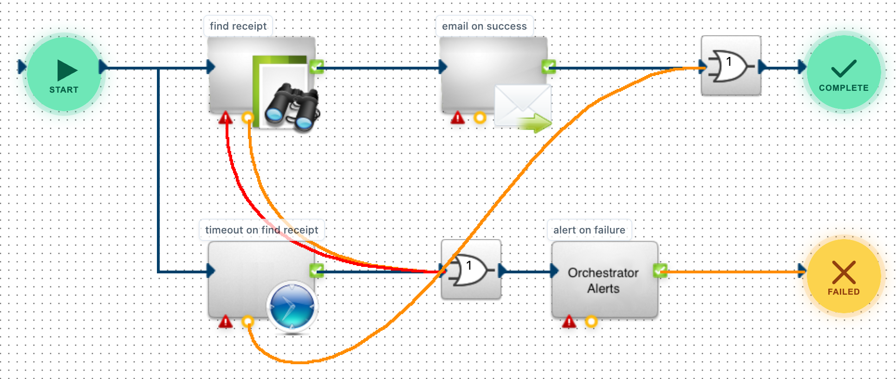

- Do not overuse a periodic `ScheduleTrigger`: each run creates a work order.
  To detect files, use a file watcher.

### Error handling

#### Design for exceptions

Plan for the worst: the goal is a workflow that recovers by itself, or fails clearly, without calling support.
If there is one rule to remember: protect yourself.

Ways to report an issue: e-mail, Slack, Jira ticket, journal entry, alert, log file read by a log collector (Splunk, Elastic), metrics database (InfluxDB with Grafana), custom table shown in a dashboard, REST call.
Ways to recover: retry, move the file to an error folder (operators can drop it back), an operator decision ([Human interaction](#human-interaction)), a fallback resource ([Resource management](#resource-management)).

#### Practices retries

The **retry** tabs of a step (one for failure, one for error) set:

| Setting | Meaning |
| --------- | --------- |
| Maximum number of attempts | `0` means unlimited. |
| Retry duration (retry for) | Total time for retries; empty or `0` means no limit. |
| Delay between attempts | Minimum delay in seconds. |

The most restrictive setting wins: 10 attempts, retry for 30 seconds, 10 seconds between attempts makes 3 attempts.

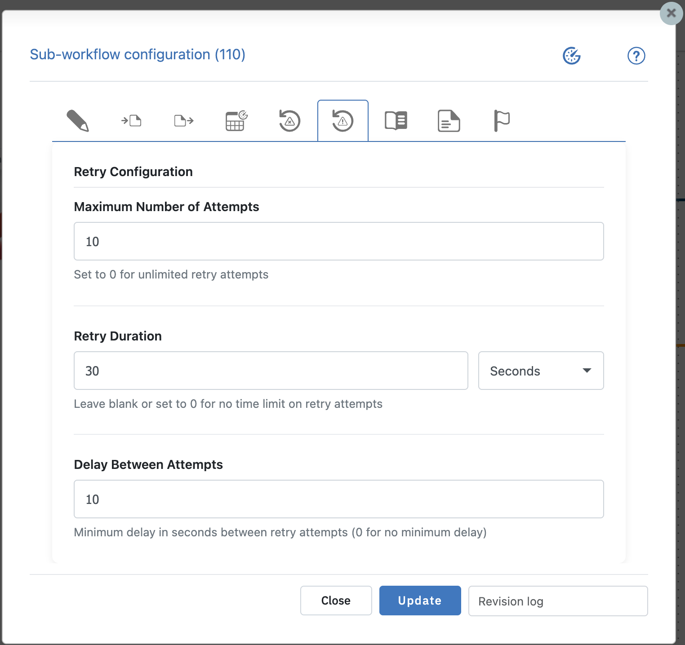

*(4.1.6)* The designer opened from the list of workflows shows **Retry Duration** empty, and saving the workflow there drops it (attempts and delay are kept).
Enter it again before saving, and check it in the **Revisions** tab, which shows it.

- **A retry happens only if the exit is linked**, at least to an OR that leads to an end node.
- A notification linked to the failed exit is sent once, after the last attempt.
  The work order view shows the attempts (for example "Failed (5)").
- Retrying a functional failure is usually useless: the transcoder will reject the same file again.
  Retry errors (network, server restart).
- Synchronous steps interrupted by a restart of Orchestrator cannot resume ("Recovery after partial execution is not supported"): a retry on error covers this case.
- To retry depending on a status code or message, put the action and a filter on the code in a sub-workflow, and set the retries on the sub-workflow step.

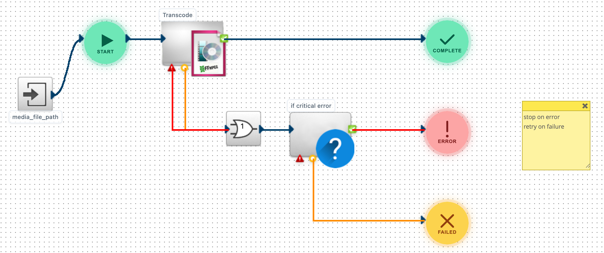


- Some versions retried forever when a required input was missing with retry on error set.
  The workaround is `input_value = "" if input_value.blank?` in the pre-processing of required inputs.

#### Practices timeouts

- Set the timeout of synchronous steps above their expected duration; `0` means no timeout.
  The default is the timeout of the plugin, else 60 seconds (engine setting `default_step_timeout`) *(4.1.6)*.
- On timeout, a step ends as failed by default, or as error.
  For triggers, choose error: a failed trigger with **Continue monitoring** starts a new work order, and a timeout loop follows.
- An absolute timeout cannot be set on a sub-workflow step with retries: use a parallel `ScheduleTrigger` ([Waiting and timeouts](#waiting-and-timeouts)).
- A trigger without **Continue monitoring** with an absolute timeout waits at most that time.

#### Cancel

- Cancelling a step stops its action only if the plugin implements cancel (for example `RemoteExecution` with **Is cancelable**, not the FTP plugins); the step and the work order then end as failed, and the failed exit is followed.
- Cancelling the work order does not follow the failed exits of its steps.
- A remote command is not stopped when its work order is destroyed or cancelled, unless it is cancelable.

#### Meaningful status

By default, the work order list shows only "Work order ended with status complete", or "No behavior defined for step status change to failed", and the reason of a failure is deep in the sub-workflows.
**Exposing the right information at the right time is as important as getting the job done**: for support, for changes, and for the person who takes over.

**Work order label.**
`WorkOrderMetaData` changes the label (title) and tags of the work order, for example `Processing <%= File.basename(file_path) %>`.
The work order list shows the workflow name and the status message; the label follows the workflow name in the work order view, and the filter **Title** searches it.

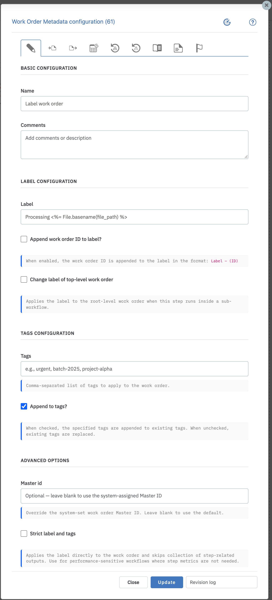

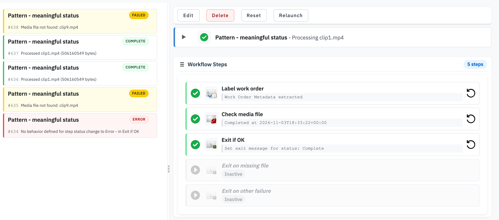

- Filtering the work orders by **title** is fast, even with 100 000 work orders.
  Filtering by **keyword** searches every input and output of every step, and can take minutes.
- In a sub-workflow, select **Change label of top-level work order**: filters see only top-level work orders.
  Do not add tags from sub-workflows called many times when tags are appended (option): the tag field of the top-level work order fills up.
- The label is limited to 255 characters: truncate with `[0...254]`.
- With `WorkflowLauncher`, set the label in the launcher instead.
- Outputs: `master_id` is the id of the top-level work order, `work_order_id` the id of the current one.
- Goal: from the work order list and its filters alone, know which element, which variant and which workflow: name the element in the label and in the status messages ([exit status](#meaningful-status)).

**Exit status.**
`ExitStatus` sets the status message of the work order for complete, failed and error ends (255 characters, with placeholders).

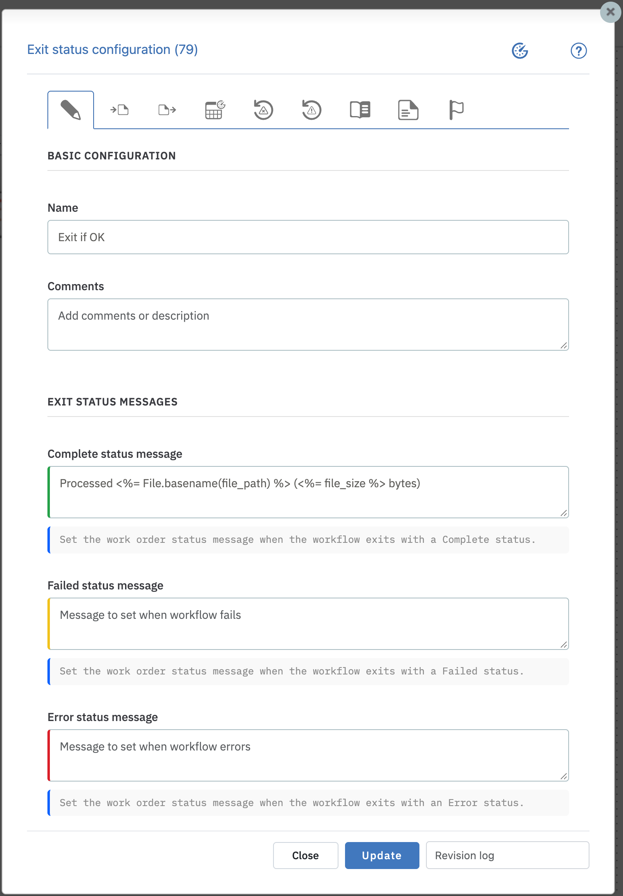

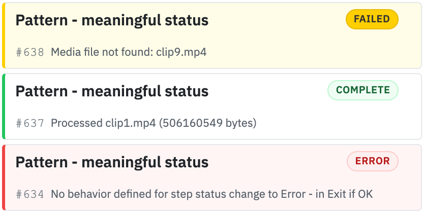

- The message applies only if the `ExitStatus` step ran before the end: a step placed after a failing step never runs.
- Either place one `ExitStatus` early, once the outcomes are known, or (usually clearer) place one before each end: one for complete, one per failure reason.
  Do not multiply them (10 or 15 become confusing).
- Fill only the box that matches the end it precedes.
- In sub-workflows, use **End with workorder status** on the caller and an explicit link to the failed or error end with an `ExitStatus`, so that the message goes up the chain.
- Adding an `ExitStatus` at the end of an existing workflow is low risk: the processing is done before it.
  Changing the beginning of a production workflow is high risk.

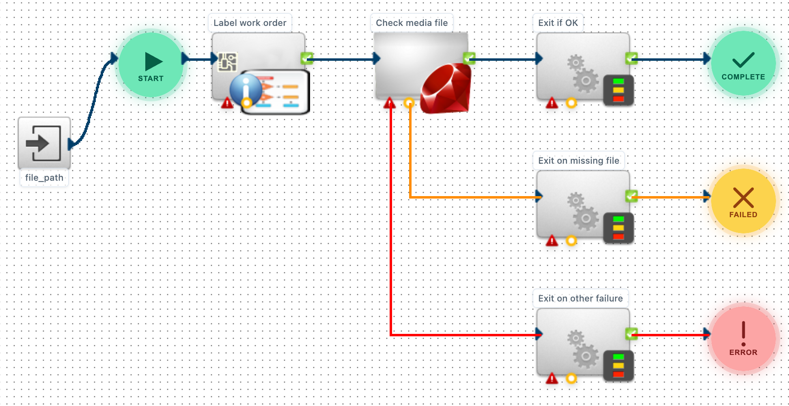

The step information output of a step (`Step_information`) can be customized in its output post-processing, for example `output_value['step_status_details'] = "a message"`, and consolidated in a final step.

#### After a failure

- Restart a work order from the work order view: **Reset** (same revision), **Relaunch** (latest revision), or restart from a step (error-prone in a single when-and-what workflow) ([Changes and revisions](#changes-and-revisions)).
- Fix the cause of a work order manually, then **change its status** (work order view: **Edit**, then **Change Status**): this documents the case in Orchestrator instead of e-mails.

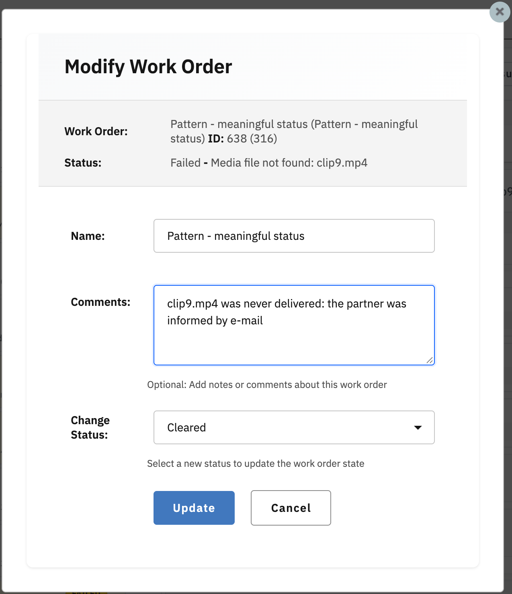

| Status | Use |
| -------- | ----- |
| Cleared | The failure was handled manually; write the resolution in the comment. This is the status used in almost all cases. Do not set Complete when not all steps ran: it is misleading. |
| Flagged | Keep the work order: it is never purged, even with a workflow purge of 0 days. Use it rarely and write down why: thousands of old flagged work orders made a database slow. |
| Rolled-back | The action was undone (for example the file was moved back to the watch folder to be detected again). Rarely used. |

- External monitoring through the API may require a manual status change, for example during maintenance.
- Non-administrators need the permission `Aspera:Orchestrator:WorkOrder:edit` to reset work orders.

### Practices triggers

#### Continue monitoring

All triggers have the option **Continue monitoring** (**Keep trigger ongoing** in older versions).

- **Not selected**: the step waits for its condition, fires once, and the workflow continues.
  Use it inside a workflow to wait for something, for example a folder whose full path is known (even for days).
- **Selected**: when the condition is met, the work order continues with the detected element, and a clone of the work order waits for the next event at the trigger step.
  All these work orders form a work order group.

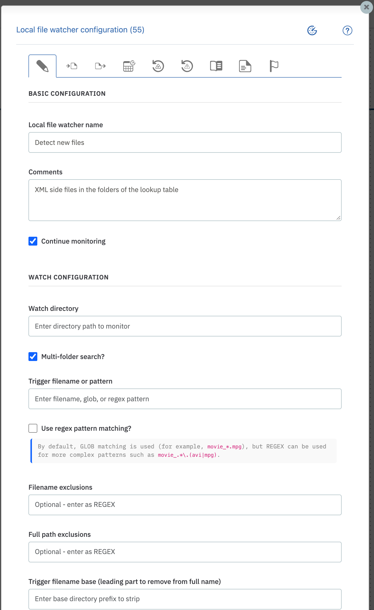

- With **Return all matching files** (or **return elements as a list**), one work order receives all the elements detected in one scan; without it, one work order per element, started one after the other (about two polling periods apart).
  With a long polling period, prefer the list and a fan-out.
- A file watcher detects a file when it is stable: same size and modification date during the stability time (by default the polling period).
  **Trigger on partial** continues as soon as the file exists.
- Polling every 2 seconds is too often, especially for remote watchers (one SSH connection per scan); keep the default (5 seconds) or use 10 seconds.
- A watcher runs forever: only a manual action (cancel, pause, destroy) stops it.
  Add a workflow monitor to restart it ([Monitors](#monitors)).
- After a restart of Orchestrator, watchers start again automatically, and running work orders continue from where they were.

#### Persistency scope

The persistency scope sets the memory of a trigger: which elements it has already detected, so that it does not detect them again.
The history is keyed by the element (for example the file path); a file with the same name but a new modification date or content is detected again.

| Scope | History shared by | Use |
| ------- | ------------------- | ----- |
| by workorder group (default) | The work orders cloned from one start of the trigger. A new start (new work order, relaunch) has an empty history. | Files moved out of the watched folder after detection. To reprocess the files left in the folder (after a failure), restart the trigger. |
| by workflow | All the work orders of the workflow. A restart does not detect again. | Files that stay in the folder. Touch a file to detect it again. |
| by step | One step. | Two watchers on the same folder in one workflow, with separate histories. |
| by action template *(4.1.6)* | All the steps that use the same template. | Steps that share a watcher template must not process the same element twice. |
| absolute | All workflows. | Two workflows on the same folder must not process the same file. |
| none | Nothing: the element is detected at each scan while it is present. | Only a trigger **without** Continue monitoring that waits for a file that may already be there. |

**Never use scope none with Continue monitoring**: the same file is detected at each scan, and each detection creates a work order.
In one real case, 15 000 work orders were created for one file within an hour; the server stopped responding, and the license had to be removed so that Orchestrator would start without processing.

- `LocalFileWatcher` keeps a history only when **Remove trigger file** is not selected *(4.1.6)*: a removed file needs none.
  A template written as a file with this option blank (null) has no history at all, whatever the scope: with Continue monitoring, it behaves like scope none.
  See [LocalFileWatcher](#localfilewatcher) in the Authoring Guide.
- Changing the scope erases the history: existing files are detected again.
- The history is stored on disk, or in the database with `persistence_mode: db`, which is needed when several Orchestrator servers share the work.
- Two triggers in the same work order group see the same history: a second trigger on the same element (for example the start and the end of the same transfer) needs scope none, and no Continue monitoring.

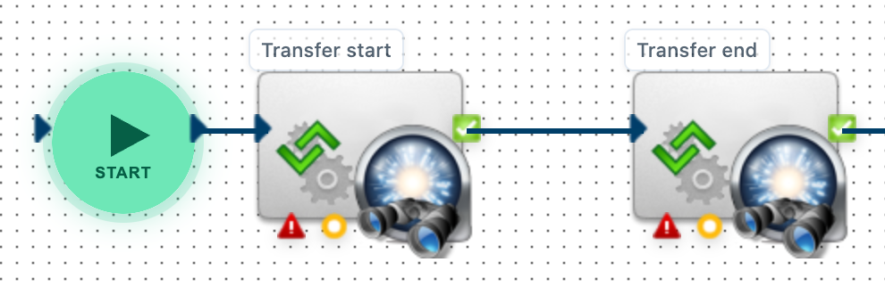

- A trigger called several times in a sub-workflow (without Continue monitoring) returns a different element each time with scope by step.

#### Rules for triggers

- **Only one trigger with Continue monitoring from start to end**, in the workflow and all its sub-workflows.
  Two of them clone each other: 1, 2, 4, 8 work orders, and the server collapses.
  Several independent watcher workflows started by a launcher are fine.
- **Only one watcher in progress per detection point**: two watchers on the same folder detect the same files (unless scope absolute).
- Move the detected files out of the watched folder: detection folder, in-progress folder, and one folder per outcome (done, failed, error).
  This is an extremely good design habit.
  If files must stay (existing process), use scope by workflow.
- Ignore files being written: exclude their temporary extensions (`.partial`, `.aspx`) in the pattern.
- When your workflow writes into a folder watched by another system, write the file with a temporary extension or in another folder of the same file system, then rename or move it (atomic on the same file system).
- Handle duplicates if needed (a marker file or a database record): copying the same file again into the folder makes it newer, so it is detected again.
- A trigger with Continue monitoring is usually the first step of a workflow.
  It can be followed by triggers without Continue monitoring that wait for dependent files (`DependencyChecker` checks that all files of a list exist).
- To accept one file or another, link the failed exit of a first `DependencyChecker` to a second one, and join their complete exits in an OR: the work order fails only if both files are absent *(4.1.6)*.
  Set `timeout_in_sec` on both: a `DependencyChecker` fails only on its timeout, and without one (the default) it waits for ever.
  The second check starts when the first one times out.

  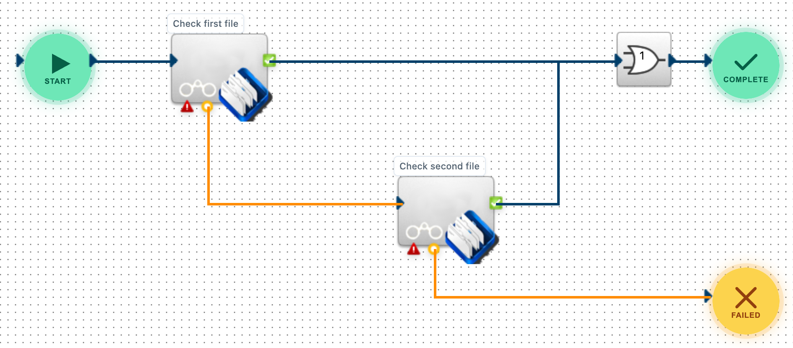

- A watcher configuration change applies to the next clone; reset the waiting work order to apply it at once.
  A code change (new steps) requires cancelling the waiting work order and starting a new one; files still in the folder are then detected again with the default scope.

#### Choosing a watcher

| Watcher | Requirements | Notes |
| --------- | -------------- | ------- |
| `LocalFileWatcher` | The folder is local or mounted on Orchestrator (mount manager, `/etc/fstab`). | Glob by default (`**` for subfolders), regular expressions optional; one file by default; multi-folder search. The user that runs Orchestrator (`aspweb` in 4.1.6) must be able to read the folder, and to delete or move the files. |
| `RemoteFileWatcher` | SSH access and the Aspera transfer software (`ascmd`), no transfer license needed. | Regular expressions; **Descend in sub directories**; returns a list; multi-folder search. Paths are relative to the docroot of the SSH user. One SSH connection per scan and per folder. |
| `AsperaNodeFileWatcher` | Node API user on a licensed, running HSTS (HTTPS). | No SSH port to open; REST calls. In 4.0, one folder only. Paths relative to the docroot of the node user. |
| `AsperaNodeApiTransferMonitor` | Node API (HTTPS). | Transfers on a node; tag filters (for example Faspex inboxes). For uploads by clients, direction `receive` and type `download.ended`. May fire again after a relaunch (events are kept). |
| `AsperaCentralWatcher` | Central API (port 40001) or Node API credentials (preferred, HTTPS). | Transfer start or end; can filter error sessions. Needs a monitored remote node. |
| Faspex, Aspera on Cloud package watchers | Application credentials. | Aspera packages, not folders. For a folder that forms a package (for example an `.itmsp` folder), watch for new folders. |
| FTP, SFTP, e-mail, database, message queue triggers | Access to the system. | E-mail when the e-mail is the contract with the provider; database when an application writes orders in a table. |
| `RestRequest` with Continue monitoring | A REST API that lists new items. | Set a record id, else the same records start new work orders forever. |
| `ScheduleTrigger` | | Periodic workflows. |

- Prefer local or Node API watching to SSH watching for performance and security.
  When possible, ask for an SSH user whose docroot is `/`: absolute paths are easier to write and read.
  SSH connection sharing (multiplexing) at the operating system level reduces the cost of SSH watchers.
- A local or remote watcher should not scan more than about 20 folders, especially network mounts, and more than about 20 remote watchers degrade performance.
- One watcher per region with a lookup table of folders is easier to maintain than one watcher per folder.
- A watcher does not detect transfers done by Aspera Sync or Drive (transfer monitors); on a shared storage behind several servers, watch the storage once rather than each server.
- An external application can call the API instead of being watched ([Integration API](#integration-api)): no watcher, no polling.

### Files, transfers and remote execution

#### File operations

| Method | Requirements | Notes |
| -------- | -------------- | ------- |
| `LocalFileOperation` | Source and target visible on Orchestrator (mounted). | Synchronous, no progress. |
| `RemoteFileOperation` | SSH and `ascmd` (Aspera transfer software) on the remote host. | Paths relative to the docroot of the SSH user. |
| `AsperaNodeApi` operations | Node API user. | Application-level authentication, REST, no SSH: preferred. |
| `RemoteExecution` of a command | SSH only. | Any command (copy, `ftp`, `sftp`, `robocopy`). |
| `FaspTransfer`, `AsperaNodeApiTransferOperation` | Aspera nodes. | For transfers between servers. |
| `ArchiveManager` | | Delete files older than a period in a folder. |

| Remote plugin | Authentication | Shell | Docroot applies to paths | Uses `ascmd` | Aspera software on the host | Aspera license |
| --------------- | ---------------- | ------- | -------------------------- | -------------- | ----------------------------- | ---------------- |
| Remote file or folder watcher | SSH | `/bin/bash` or `/bin/aspshell` | Yes | Yes | Yes | No |
| Remote file operation | SSH | `/bin/bash` or `/bin/aspshell` | Yes | Yes | Yes | No |
| Remote execution | SSH | `/bin/bash` | No | No | No | No |
| FASP transfer | Node API user (none with Central) | | Yes | No | Yes | Yes |

Pitfalls:

- Copying or moving a folder into an existing folder of the same name nests it: copying `/root/a/` into `/a/` gives `/a/a/`.
  A target ending with `/` moves the source folder into the target folder.
- A move across file systems is a copy and a delete (slow); within a file system it is immediate.
- A local move can report success while the source file remains (no right to delete it on a mount): check with `FileInfo` if needed.
- The output of a remote move is an array of paths: take the element you need.
- On Windows nodes with an SSH docroot `C:\`, refer to `C:\temp\file.txt` as `/temp/file.txt`.
- The FTP plugin runs on Orchestrator and can be slow: running the `ftp`, `ncftp` or `sftp` client of a remote system with `RemoteExecution` spares Orchestrator.

#### Transfers

- In `FaspTransfer`, the node is the one that **performs** the transfer (upload or download), not necessarily the destination.
- `FaspTransfer` offers a generic form with all transfer options, or a predefined XML payload file for special cases; after choosing a payload, refresh the step so that its inputs and outputs follow the variables of the payload.
  Keep destinations and credentials as variables, not in the payload.
- Use Node API credentials, and source paths relative to the docroot of the transfer user tied to the node user.
- `AscpClient` reports progress but runs only on Orchestrator.
- Console smart transfers can be started with `ConsoleSmartTransferOperation`; transfers that are not Aspera can be reported to Console with `ConsoleNotification`.
- When a node transfers to itself in a high-availability setup, use the address of one node, not a name that resolves to either.

#### Remote execution

`RemoteExecution` runs a command over SSH on a remote system (Linux or Windows with an SSH server), or on Orchestrator itself.

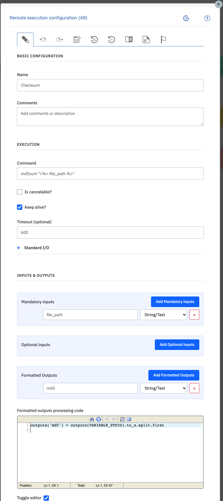

- It is synchronous: a worker is busy for the whole duration, even if Orchestrator does nothing.
  A one-hour command holds a worker for one hour.
- `AsyncRemoteExecution` (Linux targets only) starts the command in the background, disconnects, and polls every few seconds: much more scalable.
  The script can be written in the step.
  In asynchronous mode the exit code is always 0: report errors in the output (for example a line `Error : 1 - text`) and parse it.
- Exit code 0 means success; any other code is an error.
- Set a timeout above the expected duration.
- The whole output is returned as text: parse it in the output processing, for example `outputs['id'] = JSON.parse(outputs[VARIABLE_STDIO])['id'] rescue ""`, and set `@status = STATUS_FAILED` with `@status_details` when needed.
  The script can also print lines that Orchestrator shows as progress (`-#Workflow running -#--progress 50#-`); add `2>&1` to capture errors.
- `{ :keepalive => true }` in the connection options helps when SSH disconnects.
- Arrays and JSON can be passed to a shell script through placeholders, with careful quoting.

#### Generating text and calling services

**`FileGenerator`** writes a text file (XML, JSON, text, not binary) from a template with placeholders, or returns the text as an output (**return file content**, no target path).

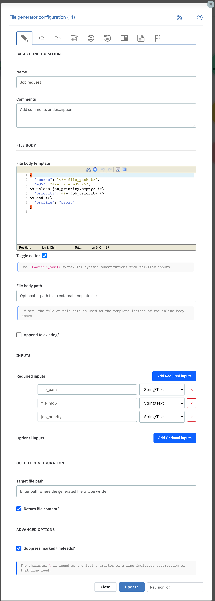

- Prefer it to Ruby code that builds JSON through hash manipulation: anyone reads and edits the payload, and the generated payload is visible in the work order (copy it, send it to the support of the third party: "this is what I'm sending").
  Writing the body directly in `RestRequest` saves a step but hides the payload.
- In templates, end lines of Ruby tags with `%>\` and select **Suppress marked linefeeds** to avoid blank lines; do not indent the tags.
- Required inputs of `FileGenerator` accept empty values.
- The template is ERB (`<%= variable %>`), although the form mentions a `{{variable_name}}` syntax *(4.1.6)*.
- Do not start input names with a capital letter, and do not name an input like a Ruby or Orchestrator method: for example an input `md5` calls the method `md5` of Orchestrator, and the step fails with "wrong number of arguments".

**`RestRequest`** sends one HTTP request (XML or JSON), optionally repeated at a polling frequency until the **polling stop condition** (Ruby) is true.

- To start a job and wait for it: two steps, a start request and a check request with polling.

  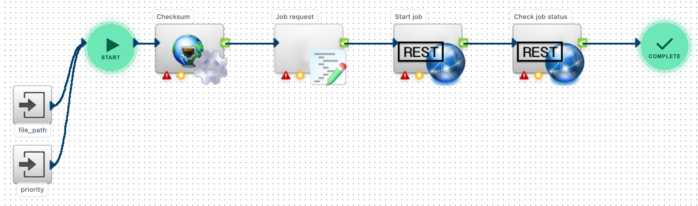

  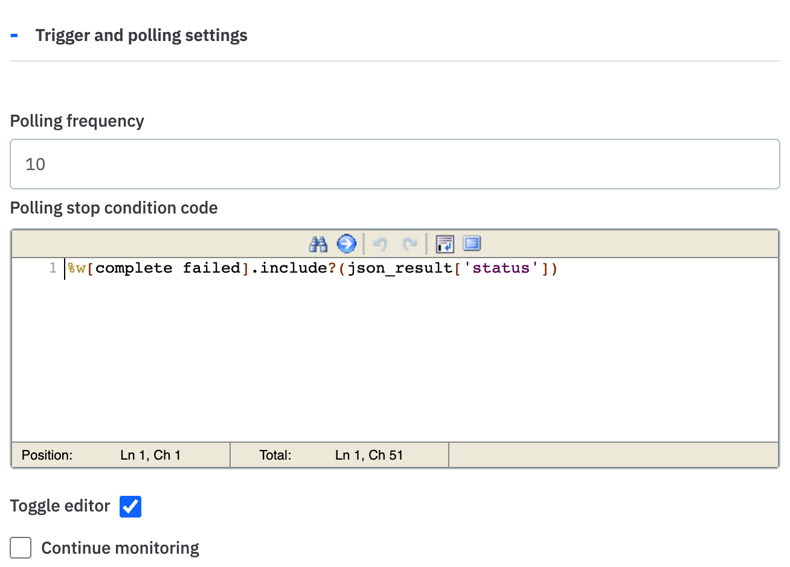

- Extract values from the response in the output processing (additional outputs), rather than in a following `CustomRuby`: one step less, and the request step is self-contained when reused.
- Set `@status = STATUS_FAILED` and `@status_details` in the output processing when the response reports an error: an HTTP 200 can carry an error in the body.
- With **Continue monitoring**, `RestRequest` is a REST watcher: set a record id.
- File uploads (`curl -F`) are not supported: use `RemoteExecution` with `curl`.
- `CollectionManager` converts a JSON string into a hash and extracts elements (one level per step in 4.0).
- `XmlParsing` extracts values with XPath.

Other helpers:

- `ConvertPath`: converts paths between Windows and Linux, or between mount points (for example a transcoder that sees the storage under another path); accepts arrays; does not fail when the path does not match.
  Most transcoders run on Windows and expect Windows or UNC paths; Vantage, for example, expects folder paths that end with a backslash.
- `FileInfo`: base name, name without extension, folder, size, dates, existence, from a path (size and dates for local files only).
- `UuidGenerator`: unique identifiers.

### Custom code

`CustomRuby` runs Ruby code in a step: inputs in `inputs['name']`, outputs in `outputs['name']`, declared with their types.

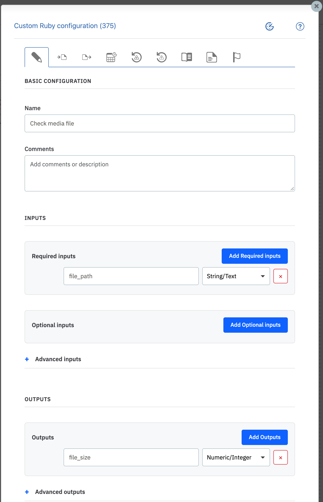

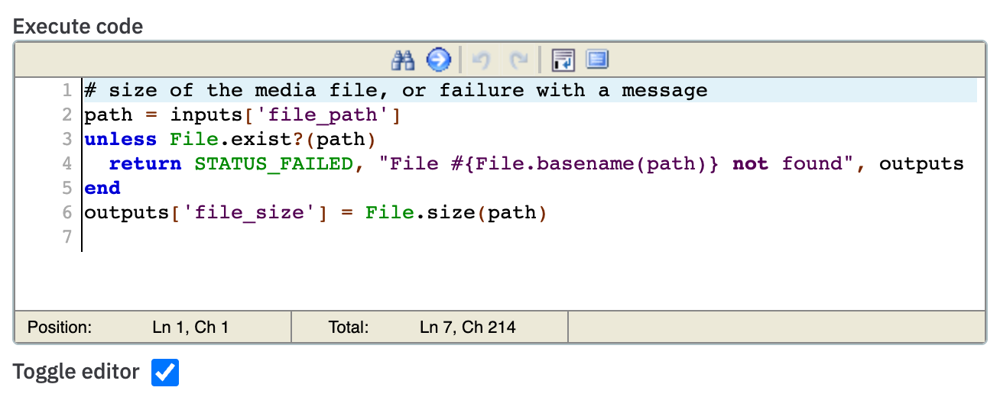

When to use it:

- when no plugin does what you need (often string or path manipulation, or complex rules);
- when it replaces many steps (about 10, or a variable number of steps in a fan-out): fewer steps, smaller database, faster Orchestrator.

When not to:

- to merge two standard steps: standard steps are readable, and their bugs are fixed by Aspera support.
- for constants: use a [configuration](#configuration) step.
- to parse JSON or build payloads: `CollectionManager`, `RestRequest` output processing, `FileGenerator`.

Workflows that put all their logic in Ruby steps are the hardest to support.

Rules:

- Comment the code: what it does, which outputs it produces.
- Use the full-screen editor.
- `CustomRuby` is synchronous: a `sleep` keeps a worker busy.
- `return STATUS_FAILED, "File #{inputs['file_path']} is not a .tar file", outputs` ends the step as failed with a message; use input variables, not placeholders, in the code.
  Without `outputs` as third value, the outputs set before are lost *(4.1.6)*.
- Add `rescue` to expressions that may fail: `outputs['serie'] = xml['Content'][0]['Series'][0]['SeriesTitle'][0] rescue ''`.
- `Rails.logger.info "#{myhash.inspect}"` writes to `orchestrator.log`.
  There is no method `debug` in 4.1.6: calling it ends the step in error.
- Do not name a variable with a capital letter: `WorkOrder = WorkOrder.find(...)` replaces the class.
- A class defined in one step is not available in another step (different workers): define shared code in a capsule (**Engine > Capsules > Import**).
- Use forward slashes in paths, even for Windows paths; `File.windows_to_unix` converts.
- Ruby accepts single and double quotes: choose one style.
- `/opt/aspera/orchestrator/script/cmd.sh` opens a console to try code.
- Since 4.0, `CustomPython` runs Python.
- `CustomTrigger` repeats Ruby code until it returns a final status.
  Avoid it except in rare cases: it is hard to manage.
- `CustomProgressNotifier` runs code when the status of an earlier step changes.

Processing code also exists on inputs (pre-processing), outputs (post-processing) and steps; see [Processing code](#processing-code).

### Resource management

Resource management limits how many times a part of a workflow runs in parallel: "not more than 5 transcodings at a time".
It is the most complex part of Orchestrator, and the only one that requires real thinking; everything else is mechanical.

#### Resource concepts

- A resource is a ticket, not a machine: Orchestrator does not check, ping or monitor anything.
  Naming a resource after a server is only a convention of the workflow.
  Orchestrator guarantees that **it** sends no more than N jobs; jobs submitted to the server by other means are not counted.
- Resource control is also useful without any server: to protect Orchestrator from too many checksums in parallel, for example.
- Load balancing (`LoadBalancer`, or secondary addresses of a remote node) distributes requests (a, b, c, a, ...) without limit or lock.
  Enough for many quick operations.
- Mutual exclusion locks a capacity until it is released: `LoadManager` (current) or `ResourceManager` (legacy).
  **For new workflows, use `LoadManager`**; migrate old workflows when possible.
  `ResourceManager` is supported but gets no new features (queue tags, for example).
  Both use the same resource pools.
- A pool has resources, each with a capacity (number of slots); a request reserves a number of slots (1 by default).

#### Resource pools

**Create the pool first, in Workflows > Resources**, before designing the workflow.
Do not create it ad hoc from the workflow step: a pool is not a workflow-level object.
Create it as **Custom** to be able to change resource names and capacities later.

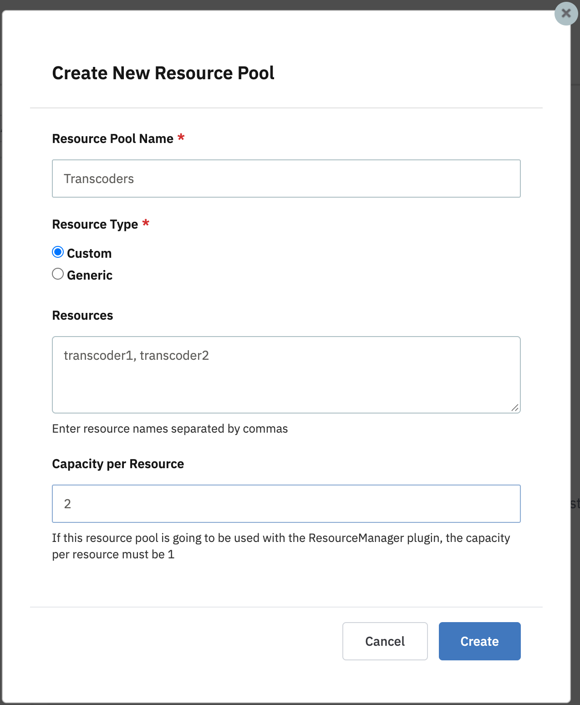

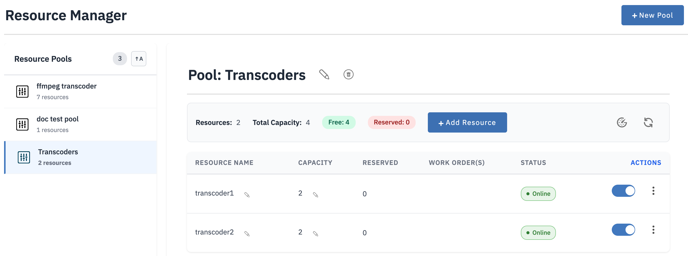

The pool view shows the reservations and the work orders that hold them (by their allocation label), and allows releasing a slot by hand (menu of a resource: **Release a capacity**, **Release all capacities**), taking a resource offline, changing a capacity, or adding a resource; changes apply at once.
A pool cannot be deleted while slots are reserved.
The allocation history shows how busy the pool was: if it is always full, the resource is the bottleneck.

#### The pattern

Always the same layout:

1. `QueueStager` (add): puts the element in the queue (optional, see [Queue](#queue)).
2. `LoadManager` (reserve): waits for a slot.
3. **One step, or one sub-workflow** with all the work that needs the resource.
4. `LoadManager` (release) on success, then **Complete**.
5. On failure or error of step 3: OR, `LoadManager` (release), then **Failed**.


- Every path after the reservation must release, or the slot is never freed: **starvation**.
  New work orders wait forever ("No resource to allocate"), and a manual release only delays the next starvation.
  With several steps between reserve and release, every failed and error exit must reach a release: unreadable and fragile.
  With one sub-workflow, the pattern stays the same whatever the sub-workflow does.
- Map the **allocation token** output of the reserve step to **Allocation token to release** of both release steps, carried through the middle step.
  Also select the pool in the release steps, for readers.
- Create templates for reserve and release when a pool is used in several workflows.
- Set an **Allocation label** with the element (for example `Transcoding <%= File.basename(file_path) %>`): the pool view then shows what holds each slot.
- The **Allocation policy** chooses among the resources that have enough free slots: **Fair Distribution** takes one at random, **Sequential Distribution** takes them in turn (round robin).
  Neither fills the first resource before using the next one.
  To use a second server only when the first one is busy (for example the first server has a perpetual license and the second is paid per use), put each in its own pool, and reserve from the second pool after a wait timeout on the first one ([Timeouts and capacity](#timeouts-and-capacity)).


The legacy layout with `ResourceManager` is the same:


#### Timeouts and capacity

| Setting | Meaning | Use |
| --------- | --------- | ----- |
| Wait timeout | Maximum wait for a slot; then the step passes (more parallel work than the capacity) or fails (**On wait timeout action**). | Service level: after 50 minutes without a local transcoder, use an expensive cloud transcoder. |
| Hold timeout | The slot returns to the pool after this time, even if not released. The work goes on. | Protection against forgotten releases (cancelled or destroyed work orders). Set it above the longest possible hold (for example twice that time), or more work runs in parallel than allowed. |
| Allocation block size | Number of slots to reserve. | Big files reserve 2 slots, small files 1. |
| Use weight for allocation | The weight of the queued element is the number of slots. | Same, set when queuing. |

- If the element at the top of the queue needs more slots than any resource has free, nothing proceeds until enough slots are free: the queue does not skip to a smaller element.
- Most workflows need neither wait nor hold timeout.

Handling a server failure: when the work on a resource ends in error, the server is probably down.
Releasing the resource sends the next elements to the same server, and they all fail.
Not releasing it limits the failures, but if all servers fail (for example the automatic update of all Windows servers at 3 a.m.), all slots stay taken.
A compromise: on error, notify IT ("resource paused for 30 minutes") and do not release, with a hold timeout of 30 minutes; the slot comes back by itself and is tried again.
Do it only when needed: simpler workflows are easier for operators to understand.

Fallback to another resource when one fails:


#### Queue

Without a queue, nobody sees what waits for a slot, the order is not controlled, and nothing can be prioritized.
A queue (FIFO with priorities) between the work and the pool fixes this.

- Create the queue in the **Queues** view (Scheduler group), not ad hoc from the step.
- `QueueStager` with action **add** (90 % of uses) puts a **string** in the queue (a path, not the file).
  Set a **Queued item description** that helps operators: by default it is the item; for example `<%= File.basename(queued_item) %> <%= workflow_description %>` (variables become inputs).


- **Bind the load manager to the queue**: **Advanced parameters > Queue** (by id, or **runtime**), and map **Expected queued item** to the **queued item** output of the add step (and the queue to the queue id when runtime).
  Mechanical rule: select runtime and map both.
  The load manager then waits until its element is at the top of the queue and a slot is free, then removes the element and reserves.


- **Expected queued item is not a required input, but forgetting it in the same work order is a serious bug**: a work order processes the element of another work order ("inversion of context"), which is very hard to detect.
- **Set Auto-purge: On work order stop** on the queue.
  Otherwise, when someone cancels or destroys a work order, its element stays at the top of the queue, and all other work orders wait forever, even with free slots: a very common case.
  A workflow can also remove the element explicitly (`QueueStager` with action remove), for example after a wait timeout.


- **Priority**: 0 is the highest (like process priorities); for example a priority per source folder.
  There is no preemption: priority orders the queue, it does not stop running work.
- **Weight**: an estimate of the work of an element (size, duration); it does not change the order.
  The total weight ahead of a priority (action `list_all`) tells whether a deadline can be met, for example to send an urgent file another way.
- **Tags** (4.0 and later, `LoadManager` only): a tag set on a queued item and on a resource makes the load manager take the first item that matches the tag of a free resource, even if it is not at the top of the queue.
- Operators with the Scheduler group and membership of the queue can reorder, remove and pause elements from the **Queues** view or a dashboard.
- In the **Queues** view, **Delete** deletes the queue definition; **Clear** removes its elements.


#### Operating with queues and pools

- **Pause the queue** to stop the work after the queue (maintenance of the transfer or transcoding servers): everything before the queue goes on (watchers, preparation), elements accumulate, and resuming processes them in order.
  This alone is worth adding a queue.
- Take one resource offline (or lower its capacity) to work on one server.
- Add a resource to a pool at any time: it is used at once.
- After destroying work orders by hand, release their slots and remove their queue elements, or set a hold timeout and auto-purge.

#### High volume

With the pattern above, each element in the queue is a running work order that waits.
A thousand is manageable; 10 000 or a million overload Orchestrator (for example when a whole storage is migrated to the cloud).

Split into two workflows:

- Workflow 1 detects the elements, adds them to the queue, and **ends**.
- Workflow 2 starts with a `LoadManager` with **Continue monitoring**, bound to the queue **without** expected queued item: each time a slot is free, it takes the element at the top and starts a work order.


- The number of running work orders follows the number of slots (5 slots: at most 6 work orders), not the number of elements.
- No expected queued item, and no auto-purge: the element is not tied to the work order that queued it.
- The load manager polls the queue (every 5 seconds by default): with very short processing, the pool may look idle while the queue is full.
- Try it on a test workflow first: do not put it in production without understanding it.

### Human interaction

#### User input

`UserInput` stops the work order and creates a task for users or groups: data to display (mandatory inputs) and data to request (outputs).


- Add at least one user or group; otherwise the step does not wait and its outputs are empty.
  Users see tasks in the **Tasks** tab (Contributor group) and in dashboards.
- Restrict a task to one user by setting only a user.
  With a group, the first user who submits wins; for exclusive work, use two tasks: one to take the task (visible to the group), one to fill it (visible to the user who took it, an output of the first task).
- Assign users or groups at run time with `SingleUserAssignment`, `UserAssignmentsArray`, `SingleRoleAssignment`, `RoleAssignmentsArray`.
- The event description (task title) can use the displayed inputs (`<%= %>`).
- Do not leave tasks open for long: each open task is a waiting work order.
  Set a timeout.
- A task can be completed through the REST API.
- A custom form is an `.html.erb` file named `_<name>.html.erb` in `/opt/aspera/var/config/orchestrator/actions_config/user_inputs/`.
  It is part of an HTML form that already has the submit and cancel buttons.
  Read displayed data from `received_parameters['name']`, and write requested data as `outputs[name]` fields, or with the helpers `draw_input('outputs', 'name', 'string', 'default')`, `draw_input_string`, `draw_input_flag` (types flag, int, string, date, attachment).


See the recipe [operator decision](#recipe-operator-decision) and its [custom form](#custom-form), with a sample, in the Authoring Guide.

#### Direct start

A workflow with runtime parameters can have a custom start page: `/opt/aspera/var/config/orchestrator/workflow_start_views/_start_<WORKFLOW_ID>.html.erb`, with fields `external_parameters[<name>]` (`draw_input_string("external_parameters", "<name>")`, or a list built on the server, for example the files of a folder with `Dir.glob`), and an optional JavaScript function `validate_workflow_<WORKFLOW_ID>()` that is called before the start (return `false` to stay on the page).
The page shows these fields after the standard ones (description, comments, execution priority).


- The page is opened at `https://<ORCHESTRATOR_HOST>/aspera/orchestrator/work_orders/direct_start/<WORKFLOW_ID>`, from the work order creation, from a dashboard, or from a link in a custom portlet.
- It starts the work order and does not report its result.
  For a page that starts and follows work orders (a "fast track" page for editors, for example), write a portlet that calls the API ([Portlet Development Guide](#portlet-development)).
- Avoid credentials in URLs (`login=`, `password=`, with `inline_auth_allowed: true`): URLs are logged.

### Monitoring and operations

#### Journals

Journals are a log of workflow activity for operators, in their language, grouped by file and package: the first level of troubleshooting, before the work order view.
They are essential when the processing of one file spans several work orders (launchers, queues).


- Journaling must be on: **Journal On** in **Engine > Configuration** (Journal & Cleanup).
  Otherwise the journal steps end in error and the **Journals** view is not in the menu.
- Create journal books in **Workflows > Journals** before running the workflow: a journal step does not create its book (the entries are written without a book), and an import creates only the books of inline journals.
- Map the file to `<%= File.basename(file_path) %>` and the file path to `<%= file_path %>`.
- A package name groups entries; it is created when it does not exist.
  Here, the package is the folder of the file: `<%= File.basename(File.dirname(file_path)) %>`.
- **Journal milestone** is the progress of the file, in percent: 10 when received, 100 at the end.
- The journal status (in progress, complete, failed) is independent from the step status: write a final entry on success and on failure.
- Map the outputs `journal_file_ID` and `actual_package_ID` of the first entry to the inputs `file_ID` and `package_ID` of the later ones: they append to the same file entry.
  **New file** creates a new entry for the same file (each work order gets its own).
- Do not mix inline journals (step menu **Journal**) and journal steps.
- Packages whose files have all ended (complete, failed or error) are deleted after 7 days by default (**Journal Kept Duration**, `journal_kept_duration`); files still in progress are kept.
  **Delete Journal with Work Order** (`delete_journal_with_workorder`) deletes the entries with their work order.


Alternatives: logs collected by an external tool, a custom database table shown in a dashboard, metrics in InfluxDB with Grafana.
Do not use the Orchestrator database for heavy external monitoring.

#### Alerts

`OrchestratorAlertEntry` adds an alert in the **Alerts** tab under the bell icon of the user interface, for the users subscribed to its category (a new user is subscribed to all).


- Put everything in the alert message, which can contain placeholders: 4.1.6 does not save the **Header**.
- Raise an alert for what needs an action of an operator, not for each failure.
  Alerts are shared: deleting one, or **Delete all**, in the bell menu removes them for every user.

#### Monitors

| Monitor | Checks | Action |
| --------- | -------- | -------- |
| Workflow | Whether a work order of the workflow runs. | Auto-start the workflow, with given runtime parameters; call a notification workflow. |
| Work order | Work orders of a workflow that complete, fail, end in error or are canceled. | Call a workflow for each (for example to send an e-mail). |
| Folder | Age and number of files (local, mounted, or on a remote node). | Call a workflow (for example to delete old files). Does not detect a missing folder. |
| Script | A command run on a remote node, which prints `<code> <message>`: 0 OK, 2 warning, another code an alert. | Disk, CPU, memory, processes, also on remote servers. |
| Remote node | Reachability. | |


- **Add a workflow monitor to each trigger workflow**: watchers are supposed to run forever.
- Set the **Work Order Name** of the auto-start: the monitor then checks and starts only the work orders of that name,
  so that several monitors can watch the instances of one workflow started with different runtime parameters.
- The runtime parameters of the workflow are listed under the work order name: without a value for a required one, the auto-start is skipped.
- A paused work order is not restarted (the monitor shows a warning).
- **Suppress duplicate events** avoids a notification at each check.
- Turning a monitor off does not stop the work orders it started.
- A notification workflow receives `NotificationType` (`WARNING` or `ALERT`), `NotificationMessage`, `MonitorType` and `MonitorID`.
- **Alert Processing Code** and **Warning Processing Code** are Ruby code run by Orchestrator when the workflow does not run, or stays in another status than in progress: a corrective action.
- A script monitor command must exit with 0 and write nothing on its standard error: otherwise the monitor shows a warning with the error.

#### Dashboards

Dashboards are pages of portlets (frames), per user or group: work order statistics, step activity, queues and pools, lookup table editor, custom tables, custom portlets.

- Do not put too many frames on a page, and deactivate unused pages: each open page polls Orchestrator.
  Set a logon timeout.
- To see workflow statistics in a dashboard, a user needs the run permission on the workflow.
- Users see dashboards assigned by an administrator, after activating them.

#### Work order view

- **View by workflow** groups work orders by workflow; **View by work order** groups the work orders of a group on one line.
- By default the view shows the last day of completed and failed work orders (`default_filter_days_back`); a filter without status also shows older work orders still in progress.
- Filter by title, not by keyword ([Meaningful status](#meaningful-status)).
- Only top-level work orders can be filtered: put the outcome of sub-workflows in the top-level label.
- Tags can be set when creating a workflow or a work order, and used to filter or to cancel a group.
- **Clean Up** in **View by workflow** removes ended work orders, except flagged ones.
- Elapsed time includes retries; `processingTime` of the step information counts only the last attempt.
- Steps of a work order are not always shown in chronological order; inactive steps have not run (and may never run).
- A work order that stays **Initializing** probably needs its workflow to be republished; one that stays **Created** is probably throttled (workflow throttle setting) behind other work orders of the same workflow.

#### Workers and capacity

Steps run in workers.
A **synchronous** worker runs one step until it ends: file operations, script execution, `Md5Checksum` (computed on Orchestrator), `MediaInfo`, FTP transfers, `CustomRuby`.
An **asynchronous** worker starts a job and polls its status, serving many steps: triggers, `FaspTransfer`, transcoder jobs.

- Prefer asynchronous plugins (for example `AsyncRemoteExecution`).
- Limit the number of synchronous steps that run in parallel with resource pools or the workflow throttle: when all synchronous workers are busy, the other steps wait.
- More workers allow more parallel work; each takes 200 to 500 MB of memory.
  Size them for the CPU and memory of the server.
- The engine decides what runs next; if it stops, the workers stay idle.
- The workflow and engine settings **purge after** (workflow) and `purge_cutoff`, `cleanup_cutoff` (engine) delete old work orders; keep them short on busy servers.
  Flagged work orders are never purged.
- Install the third-party tools used by workflows (for example `mediainfo`) on all Orchestrator servers of a cluster.

#### Users and permissions

- The groups give access to the tabs: Developer (**Workflows**), Operator (**Work Orders**, **Monitors**), Contributor (**Tasks**), Scheduler (**Queues**), System (**Engine**).
  Only administrators destroy and reset work orders by default.
- To start and follow a workflow, a user needs the run and view permissions on the workflow **and on its sub-workflows**.
- A non-administrator does not get the run permission on the workflows they create: add it.
- A developer who also runs workflows needs the Developer and Operator groups.
- Queues, user input tasks and dashboard pages have their own user and group permissions.
- `WorkflowLauncher` can run the launched work order as a given user, who then sees it without permissions on the workflow.

### Integration API

An external application can start and follow work orders through the REST API, with XML or JSON responses: no watcher needed, which saves polling.

- `initiate` starts a work order, with runtime parameters as `external_parameters[name]`, synchronously or asynchronously.
- Other calls list work orders of a workflow (by status and date), return the status, steps and outputs of a work order, cancel or reset work orders, import workflows, and take resources online or offline.
- **Workflows > API tutorial** in the user interface tests the calls.
- Encode special characters in URLs.
- Pass credentials in the `Authorization` header, never in the URL, and parameters that hold secrets in the body: see [REST API](#rest-api) and [Secrets](#secrets) in the Authoring Guide.
- `ascli` wraps the API: `ascli orchestrator workflows start <WORKFLOW_ID> @json:'{"file_path":"<FILE_PATH>"}'`.
- With several Orchestrator servers, call them through one address (load balancer or DNS).

#### Inline validation

An Aspera transfer server can call a workflow for each file it receives, at start, after a number of bytes (threshold) and at end, and reject the file with a message shown to the user.


- The validation URL is `https://<ORCHESTRATOR_HOST>/aspera/orchestrator/external_calls/validate?id=<WORKFLOW_ID>`, with the credentials of a user who has the run permission on the workflow (basic authentication).
- The work order gets two runtime parameters: `File`, the request of `ascp` (a hash: `startstop` is `start`, `running` at the threshold, or `stop`; `file`, `size`, `user`...), and `File_path`, the path of the file.
  Declare them as runtime parameters of the workflow, and test the event with a `Filter` (`inputs['File']['startstop'] == 'start'`).
- The answer is the status message of the work order: set it with `ExitStatus` before **Failed** (the reason of the rejection).
  A work order that ends in error also rejects the file.
- **IFV Skip Start Event** (Orchestrator configuration) answers the start events without starting a work order, when the workflow does nothing at start.
- **4.1.5 and 4.1.6 refuse the call**: the request of `ascp` has no CSRF token, and Orchestrator answers with a redirection to the logon page instead of starting the work order (checked on 4.1.6).
  `ascp` takes any answer other than HTTP 200 as a rejection: with `validation_uri` set, every upload fails.
  On these versions, validate after the transfer instead (`AsperaOtfv`, or a trigger workflow).
- Configure it in the `aspera.conf` of the server: `validation_file_start`, `validation_threshold`, `validation_file_stop` set to `uri`, `validation_uri` set to the validation URL of the workflow, `validation_threshold_kb`.
- The user sees the transfer at 99 % until the validation ends: a slow workflow looks like a stuck transfer.
  Without an answer after `session_timeout_sec` (`aspera.conf`, default 60 seconds), the call fails and `ascp` rejects the file: increase it for long checks such as antivirus.
- Each file of each transfer creates up to three work orders: tune Orchestrator for the HTTP load, or validate after the transfer instead (`AsperaOtfv`), which does not block `ascp`.
- A file does not start before the answer to its start call, and does not end before the answer to its end call; the other files of the transfer go on (`validation_threads` parallel calls, default 5).
- The threshold call does not pause the transfer: a rejection stops it only when the answer arrives.
  If the last block is already written by then, the file stays complete, and the user still gets the error.
  A file smaller than `validation_threshold_kb` gets no threshold call.
- A rejection ends the whole transfer session, not only the file: the files not yet received are not transferred.
- `ascp` does not delete a rejected file: after a rejection at the end, the complete file stays under its final name, and the workflow must move or delete it.
- Rejecting at start (for example on the file name) saves the bandwidth and storage of a file that would be refused.
- Not available with HTTP fallback.
- With a partial file suffix (`partial_file_suffix`), the calls give the final name, but during the transfer the file is on disk with the suffix: at the threshold, a step that reads the file adds the suffix to `File_path`.

### Deploying and changing workflows

- Plan workflow changes: one day before changing a trigger workflow, pause watchers and queues and let running work orders finish.
  A changed sub-workflow may receive wrong inputs from a running parent.
- Move workflows between servers by export and import, or with the deploy feature (3.x), Git integration (4.x), or snapshots.
- An export does not contain the external files of a workflow: parameter set and lookup table files, user input forms, direct start pages, payload files, images, portlets.
  Copy them.
- At import, refer to existing templates and remote nodes rather than overwriting them: overwriting creates a second version of the template, used only by the imported workflow.
- A safe procedure: rename the existing workflows with a backup suffix (or move them to a backup folder), import the new versions keeping existing templates and remote nodes, and start the new top-level workflows with new work orders, not relaunches of the old ones.
- The plugin code is not in the export: the target uses its own plugin versions.
  Import or enable the plugins first.
- Plugins and capsules (hot fixes) are installed by hand; subscribe to the notifications of new capsules, which may fix critical bugs, and force maintenance after installing one.
  Importing a plugin does not activate it: upgrade it to the imported version, and archive the running version first to be able to revert.
  On a cluster, import on one server, then reload the plugins and force maintenance on each server.
- Keep a test server, with the same versions as production.

### Practices checklist

Design:

- [ ] The **trigger workflow** and the **processing workflow** (with parameters) are separate.
- [ ] Each foreseeable error has a way out, and unhandled cases end with a clear message.
- [ ] Heavy or long steps are protected by a resource pool, when volume requires it.
- [ ] Workflows have 20 steps at most; repeated blocks are sub-workflows or templates.

Trigger:

- [ ] One trigger with Continue monitoring from start to end.
- [ ] Persistency scope chosen; never none with Continue monitoring.
- [ ] Detected files are moved out of the watched folder; temporary files are excluded.
- [ ] Polling period of 5 seconds or more.
- [ ] A workflow monitor restarts the trigger workflow.

Graph:

- [ ] Each join of exclusive branches (if and else, complete and failed, error paths) has an OR.
- [ ] No link back to a previous step.
- [ ] One step between each fan-out and its funnel-in; empty lists are handled.
- [ ] Retries are set only on linked exits.
- [ ] Every path after a resource reservation releases it.

Data and configuration:

- [ ] Parameters are linked to Start.
- [ ] Outputs needed later are carried through; inserted steps carry everything through.
- [ ] No constant, address or credential in steps or code: parameter sets, lookup tables, remote nodes.
- [ ] Lookup tables have their key mapped and no empty cells.
- [ ] Load managers in the same work order as their queue have the expected queued item mapped; queues have auto-purge on work order stop.

Readability:

- [ ] Steps and configurations named before creation; conventions followed.
- [ ] Work order label shows the processed element.
- [ ] Exit status messages for each end.
- [ ] Journal entries or other reports for operators.
- [ ] Comments in steps and Ruby code.

Tests and changes:

- [ ] Each block was tested alone, with test folders.
- [ ] After a structural change, new work orders were started (relaunch, not reset).
- [ ] External files and plugin versions are deployed with the workflow.

## Workflow authoring

### Quick start

The following file is a complete workflow with one step that returns a message.
It uses the [plain format](#plain-format), which is the simplest to write.

```yaml
---
- !ruby/object:Workflow
  attributes:
    name: hello
    run_as: SYSTEM
- !ruby/object:Whiteboard
  attributes:
    error_free: true
    xml_export: |
      <?xml version="1.0" encoding="UTF-8"?>
      <Workflow id="0">
      <Start x="100" y="50" id="start"><Parameters></Parameters></Start>
      <Error x="900" y="350" id="error"><Synch_factor>0</Synch_factor><Prerequisites></Prerequisites></Error>
      <End x="900" y="50" id="end"><Synch_factor>0</Synch_factor><Prerequisites><Prerequisite id="step1" status="Complete"/></Prerequisites></End>
      <Fail x="900" y="200" id="fail"><Synch_factor>0</Synch_factor><Prerequisites></Prerequisites></Fail>
      <Steps>
      <Step x="400" y="50" id="step1"><Action_id>1</Action_id><Step_name>Say hello</Step_name><Step_type>CustomRuby</Step_type><Synch_factor>0</Synch_factor><Prerequisites><Prerequisite id="start" status="true"/></Prerequisites><Parameters></Parameters><Inputs></Inputs><Outputs></Outputs></Step>
      </Steps>
      <Parameters></Parameters><Notes></Notes>
      </Workflow>
- CustomRuby__1: !ruby/object:CustomRuby
    attributes:
      name: W0__Say hello
      execute_code: "outputs['message'] = 'Hello'"
      typed_outputs: "{'message'=>'string'}"
- CustomRuby__1: []
- {}
- CustomRuby: 0.7.0
```

Import, publish and run it with the [IBM Aspera CLI](https://github.com/IBM/aspera-cli) (`ascli`):

```shell
ascli orchestrator workflows import hello.yml          # displays the new workflow, including its id, for example 239
ascli orchestrator workflows publish 239
ascli orchestrator workflows start 239 @json:'{}' @json:'{"step":"Say hello","variable":"message"}'
```

The last command waits for the work order to finish and displays `Hello`.
The same operations with the REST API are described in [REST API](#rest-api).

### Lifecycle

1. **Write** a workflow file (`.yml`), or a package (`.wkf`) that also contains sub-workflows and remote nodes.
2. **Import** it: Orchestrator creates a new workflow with a new `id`.
   Each step's action template is created (or mapped to an existing global template).
   Whether the workflow is created in draft state or as a published revision depends on the server option `publish_api_imported_workflow` (default: published, `revision_id = 1`).
3. **Publish** it: Orchestrator builds the runnable workflow from the last whiteboard revision.
4. **Start** it: Orchestrator creates a work order.
   Runtime parameters are given at this point.
5. **Read** the work order status and outputs.

Rules:

- Import and publish do **not** validate the graph.
  Publish only requires the whiteboard attribute `error_free` to be set.
  An invalid graph is published and fails at run time, or never ends.
  Use the [authoring checklist](#authoring-checklist).
- An import through `import_workflow` always creates a new workflow.
  If the name is already used, Orchestrator appends a space and `(import_1)`, `(import_2)`, and so on.
  The `portable_id` of the file is ignored and a new one is generated.
  The import in the web UI and `import_with_constraints` keep it instead, unless a workflow of the server already has it.
- To add a revision to an existing workflow instead, use `import_with_constraints` with `add as revision`.
  See [Update an existing workflow](#update-an-existing-workflow).
- The API has no operation to delete a workflow: delete it in the user interface.
- **Web UI**: opened from the list of workflows, the designer draws the published revision from the published steps and from the positions in its XML (`WorkflowsController#edit`).
  The **Revisions** tab draws the XML of the chosen revision (`WhiteboardsController#show`).
  If the designer shows an empty canvas, the graph is not lost, and importing again does not help: a `Synch_factor` other than `0` has no position (see [Prerequisites and branches](#prerequisites-and-branches)); the **Revisions** tab still shows the graph.
  **Never click "Publish" on an empty canvas**: this publishes an empty graph.
  A revision imported through the API is shown as created by *Unknown user*.

### Workflow file

#### File types

| Extension | Content |
|-----------|---------|
| `.yml` | One workflow, as described in this guide. |
| `.wkf` | A gzipped tar archive containing a manifest file `<name>.txt` and the files it lists. The manifest is a YAML list of file names: the first one is the main workflow (`.yml`), the others are its dependencies: sub-workflows (`Workflow_*.yml`) and remote nodes (`Remote_node*.node`). `export_workflow` produces this format when dependencies are exported. |

The file name given to `import_workflow` must end with `yml` or `wkf`.

#### Structure

A workflow file is a YAML sequence of exactly six elements, in this order:

| # | Element | Content |
|---|---------|---------|
| 1 | Workflow | Workflow attributes: name, description, ... See [Workflow attributes](#workflow-attributes). |
| 2 | Whiteboard | The graph (`xml_export`) and its state. See [Whiteboard attributes](#whiteboard-attributes). |
| 3 | Action templates | A map: key `<StepType>__<N>`, value the template object. See [Action templates](#action-templates). |
| 4 | Dependency list | A map: same keys as element 3, value the list of external entities used by the template (written by `export_workflow`). |
| 5 | Packed dependencies | A map of dependencies included in a `.wkf` package. `{}` for a `.yml` file. |
| 6 | Plugin versions | A map: plugin name to version. Informational: not checked on import. |

Rule for element 4 and 5: element 4 is used only for the dependencies packed in element 5.
When element 5 is empty (a `.yml` file), element 4 is ignored, and template attributes are imported as written: see [Referring to existing entities](#referring-to-existing-entities).
In a hand-written file, use `{}` or empty lists in element 4.

The file can be written in two encodings.
Both are accepted by the import.

#### Plain format

The plain format is the old (Orchestrator 4.0) format.
It is the simplest to write, and the one used in this guide.

A file is in plain format when **no line** matches `concise_attributes:`.
On import, Orchestrator converts it to the current format, line by line, and then loads it (`Compatibility::WorkflowYmlUpdater`).
That converter is line-based, so the layout rules matter:

- An optional first line `---`.
- Each of the six elements starts with a dash and a space (`-` then space) at column 0.
  - Element 1 starts with `- !ruby/object:Workflow`.
  - Element 3 starts with `- <StepType>__<N>: !ruby/object:<StepType>` for the first template.
    Each next template starts with a line `<StepType>__<N>: !ruby/object:<StepType>` (any indentation).
    The separator must be exactly `: !ruby/object:`.
- A line `attributes:` is optional and ignored.
- The other lines of a section are its attributes, one `name: value` per line, with the same indentation within a section.
  Block scalars (`|`) are allowed, for example for `xml_export`, and for template attributes such as `execute_code` (Ruby code) or a private key in PEM format.
  In a double-quoted value, YAML escapes apply, for example `\r\n` between lines of `parameters_associations` of [`SimpleParameterLookup`](#simpleparameterlookup).
- The class of a template is the part of its key before `__`.
- An unknown attribute name makes the import fail.
- In element 1, attributes with a null value are ignored.
- In element 3, attributes with a *blank* value are ignored: `null`, empty string, and also `false`.
  For a boolean attribute, write `1` or `0`, not `true` or `false`: `0` is kept, `false` is dropped (the database default then applies).
- Elements 4, 5 and 6 are required, even when empty.

On the server, the uploaded file is rewritten in the current format.

#### Rails format

This is the format produced by `export_workflow`: YAML serialization of Rails objects.
Each attribute is an item of `concise_attributes`:

```yaml
- !ruby/object:Workflow
  concise_attributes:
  - !ruby/object:ActiveModel::Attribute::FromDatabase
    name: name
    value_before_type_cast: My workflow
  - !ruby/object:ActiveModel::Attribute::FromDatabase
    name: label
  new_record: false
  active_record_yaml_version: 2
```

An attribute without `value_before_type_cast` is null.
In element 3, each template has the same form, under its key (`- CustomRuby__2: !ruby/object:CustomRuby`).

To read an exported workflow, look for the attribute names given in this guide.
To write a workflow, prefer the plain format.

#### Workflow attributes

Columns of a workflow, and how `import_workflow` uses them:

| Attribute | Type | On import |
|-----------|------|-----------|
| `name` | string | Used. Suffixed with a space and `(import_N)` if already used. |
| `description` | text | Used. |
| `run_as` | string | Used. One of `SYSTEM`, `CREATOR`, `OPERATOR`. |
| `label` | string | Used. |
| `tags` | text | Used. Stored as `\|tag1\|tag2\|`. |
| `templates` | text | Used. |
| `max_running` | integer | Used. Maximum number of running work orders of this workflow. |
| `cleanup_after_days` | integer | Used. |
| `purge_after_days` | integer | Used. |
| `user_lock`, `locked_by` | boolean, integer | Used. |
| `created_by` | integer | Replaced by the importing user. |
| `portable_id` | string | Replaced by a new UUID. |
| `source_revision` | string | Replaced by `<name>\|<revision>`. |
| `comments` | text | Replaced by `Imported from file <path>`. |
| `id`, `folder_id`, `revision_id`, `generated_from`, `created_at`, `updated_at` | | Ignored. The folder is given by the import request. |

The minimum is `name`, and `run_as` is recommended.

#### Whiteboard attributes

| Attribute | Type | Rule |
|-----------|------|------|
| `xml_export` | text | **Required.** The graph. See [Graph XML](#graph-xml). |
| `error_free` | boolean | **Required to publish.** Publish returns `false` if it is null. Set it to `true`: it is not computed on import. |
| `revision_id` | integer | Optional. Defaults to 1. |
| `created_by`, `workflow_id`, `revisions_log`, `id`, `created_at`, `updated_at` | | Ignored or replaced. |

#### Action templates

Element 3 maps each key `<StepType>__<N>` to an action template.

- `<StepType>` is the plugin class name, for example `CustomRuby`, and must be the `Step_type` of the steps using it.
- `<N>` is a number unique within the file for that type, and must be the `Action_id` of the steps using it.
  On import, the template gets a new database id and the graph is updated: `Action_id` of steps, and `action_id` of `Map_to` and `Carry_thru` of type `output`.
- The value holds the template attributes: the plugin settings.
  The attribute names of each plugin are listed in the [Action Template Reference](https://github.com/laurent-martin/aspera-orchestrator-plugins-doc/blob/main/docs/action-template-reference.md).
- Attribute `name` decides how the template is imported:
  - `W<any number>__<step name>`: **embedded** template. It is created for the new workflow and renamed `W<new workflow id>__<step name>`.
    Use this form, with `W0__` and the step name.
  - Any other name: **global** template.
    If a template of the same class and name exists and has the same attributes, it is reused.
    If it differs, a new template named `<name> (import_N)` is created.
    If none exists, it is created.
- Plugins that are not enabled on the server are enabled automatically by `import_workflow`.
  If that fails, the import returns the list of missing plugins.

How a template defines the inputs of its step is explained in [Inputs of a step](#inputs-of-a-step).

#### Referring to existing entities

A template refers to an entity of the server (a workflow, a remote node, a journal book...) by the value of one of its attributes.
In a `.yml` file, element 4 is ignored (see [Structure](#structure)): the import keeps the value written, and does not check that the entity exists.
So write the reference in the attribute, as the entity is known on the target server, and leave element 4 empty.

| Entity | Template attribute | Value |
|--------|--------------------|-------|
| Workflow | `SubWorkflow`: `workflow_id`, `workflow_portable_id` | Id of the workflow (see below for the portable id). |
| Workflow | `WorkflowLauncher`: `workflow_id` | Id of the workflow. Or `workflow_id` blank, `use_portable_id` set to `1`, and `portable_id`: the portable id of the workflow, looked up at execution. |
| Remote node | `remote_node`, and other attributes with widget `remote_node` in the plugin specification | Name of the node. |
| Journal book | Step element `Journaling` of the graph | Name of the book. The import creates it if missing. |
| Journal book | `FileJournalLogEntry`: `journal_book` | Name of an existing book. It is not created: the entries are then written without a book. |
| Mailer | `EmailNotification`, `UserInput`: `mailer_name` | Name of a mailer configuration. Blank: the first active one. |
| Global action template | Element 3 | A template with the same class, name and attributes: see [Action templates](#action-templates). |

Ids and portable ids of workflows are given by `ascli orchestrator workflows list`.
No API lists the other entities: ask the administrator of the server.

`SubWorkflow`: each time its template is saved, import included, `workflow_portable_id` wins:
if it is the portable id of a workflow of the server, `workflow_id` is set to the id of that workflow;
otherwise, if `workflow_id` is the id of a workflow, `workflow_portable_id` is set to its portable id.
`import_workflow` gives a new portable id to each workflow it creates (see [Workflow attributes](#workflow-attributes)): a portable id read on another server does not match.
Write `workflow_id`, and leave `workflow_portable_id` blank.
The import in the web UI and [import_with_constraints](#import_with_constraints) keep the portable id of the file, unless a workflow of the server already has it (`ImportExporter.import_new`): with them, a portable id written in the template matches the workflow imported from the same file.

Packages (`.wkf`): with dependencies, `export_workflow` lists in element 4 each entity a template uses, for example `{entity: Workflow, id_key: id, id_value: 4, dependent_field: workflow_id}`, and packs sub-workflows and remote nodes (element 5).
On import, each packed sub-workflow is imported first, and the attribute named by `dependent_field` is set to the `id_key` of the new entity.
With `import_workflow`:

- Remote nodes of the package are not imported: the attribute keeps the node name, and the node must exist on the server.
  `import_with_constraints` imports or maps them (see [import_with_constraints](#import_with_constraints)).
- Field `link_to_subworkflows` set to `true`: a packed sub-workflow that was already imported (a workflow with the same name and a `source_revision` equal to `<name>|<revision_id>` of the packed file) is used instead of a new copy.
  The value is evaluated as Ruby code: only `true` links, and in a package with sub-workflows, a word other than `true` or `false` makes the import fail.

### Graph XML

The whiteboard attribute `xml_export` holds the graph as XML.
Validate a workflow file before import with the IBM Aspera CLI:

```shell
ascli orchestrator workflows check_import my_workflow.yml
```

#### Skeleton

```xml
<?xml version="1.0" encoding="UTF-8"?>
<Workflow id="0">
<Start x="100" y="50" id="start"><Parameters></Parameters></Start>
<Error x="900" y="350" id="error"><Synch_factor>0</Synch_factor><Prerequisites></Prerequisites></Error>
<End x="900" y="50" id="end"><Synch_factor>0</Synch_factor><Prerequisites>...</Prerequisites></End>
<Fail x="900" y="200" id="fail"><Synch_factor>0</Synch_factor><Prerequisites></Prerequisites></Fail>
<Steps>
  <Step ...>...</Step>
</Steps>
<Parameters>...</Parameters>
<Notes></Notes>
</Workflow>
```

General rules:

- The root element name is free, `Workflow` by convention.
  Its attribute `id` is replaced on import: use `0`.
- The elements `Start`, `End`, `Fail` and `Error` are required, exactly once each.
- At least one `Step` is required.
- `Parameters` (top level) and `Notes` are optional.
- Attribute `id` of every node is a string, unique in the graph, used to link nodes.
  The designer uses UUIDs; any unique string works, for example `start` or `step1`.
- Attributes `x` and `y` are the position of the node in the designer.
  They do not change execution.
- Usual XML escaping applies (`&amp;`, `&lt;`, `&quot;`).
  Values of parameters and of inputs mapped to a value are also URL-decoded: `%XX` and `%uXXXX` sequences are decoded.
  Write `%25` for a literal `%` followed by two hexadecimal digits.
- On import, the graph is parsed and stored written again: root element `opt`, one element per line with indentation, attribute values in double quotes, and the new template ids in `Action_id` and in `action_id` of `Map_to` and `Carry_thru`.
  This is observed with both formats of file, and with `import_with_constraints`: the export of an imported workflow shows this form, not the one of the file.

#### Terminal nodes

| Element | Required children | Meaning |
|---------|-------------------|---------|
| `Start` | none (`Parameters` optional) | Entry point. Its `Parameters` links declare the global parameters (see [Parameters](#parameters)). |
| `End` | `Synch_factor`, `Prerequisites` | Reached: the work order is `Complete`. |
| `Fail` | `Synch_factor`, `Prerequisites` | Reached: the work order is `Failed`. |
| `Error` | `Synch_factor`, `Prerequisites` | Reached: the work order is `Error`. |

`Fail` and `Error` are also reached **implicitly**: when a work step ends with status `Failed` (or `Error`) and no step is connected to it for that status, the work order goes to `Fail` (or `Error`).
So only success paths need to be connected to `End`; failures do not need explicit links.
The status details of the work order are then `No behavior defined for step status change to <status> - in <step name>`.
The reason of the failure is in key `step_status_details` of output `<step name>:Step_information`: `ascli orchestrator workorders output <work order id>` shows it.

#### Step

Each `Step` element has attributes `id`, `x`, `y`, and these children:

| Child | Required | Content |
|-------|----------|---------|
| `Action_id` | yes | Number `<N>` of the template key `<Step_type>__<N>`. |
| `Step_name` | yes | Name of the step, unique in the workflow. Used to name outputs (`<Step_name>:<output>`) and in `Map_to` of type `output`. |
| `Step_type` | yes | Plugin class name, for example `CustomRuby`. |
| `Synch_factor` | yes | Number of prerequisites to meet. See [Prerequisites and branches](#prerequisites-and-branches). When it is not `0`, attributes `x` and `y` (position of the join symbol) are needed by the designer. |
| `Prerequisites` | yes (to be valid) | Links from previous nodes. |
| `Inputs` | yes (may be empty) | Inputs of the step. See [Inputs](#inputs). |
| `Outputs` | yes (may be empty) | Output settings and carry-throughs. See [Outputs](#outputs). |
| `Parameters` | no | Links to step parameters. See [Parameters](#parameters). |
| `Version` | no | Plugin version, informational. |
| `Pre_processing` | no | Ruby code run before the action. See [Processing code](#processing-code). |
| `Post_processing` | no | Ruby code run after the action. |
| `Timeout` | no | Execution timeout in seconds, `0` for none. Default: timeout of the plugin, else the engine setting `default_step_timeout` (60 by default). |
| `On_timeout` | no | Status on timeout: `Pass` (Complete), `Fail` (Failed, the default), `Error` (Error), `Raise` (Error, and the work order timeout action runs). |
| `Error_attempts` | no | Maximum attempts when the step ends with `Error` and a branch with status `Error` leaves it. |
| `Error_retryFor`, `Error_retryForUnit` | no | Retry period: value multiplied by unit (seconds). |
| `Error_retryDelay` | no | Delay between attempts, in seconds. |
| `Failed_attempts`, `Failed_retryFor`, `Failed_retryForUnit`, `Failed_retryDelay` | no | Same, for status `Failed`. |
| `comments` | no | Description of the step. |
| `weight` | no | Integer, used for progress display. |
| `Journaling` | no | Journal entry settings (`Book`, `Event`, `Package`, `File`, `File_path`, `File_status`, `JournalStepMilestone`, `JournalProcessingTimeout`). A missing journal book is created on import. |

Element names are case-sensitive and must be written exactly as above.
The parser ignores unknown elements: a misspelled optional element has no effect.

#### Prerequisites and branches

A `Prerequisite` element links a previous node to the current one:

```xml
<Prerequisites><Prerequisite id="check" status="Complete"/></Prerequisites>
```

| Attribute | Content |
|-----------|---------|
| `id` | `id` of the previous node. |
| `status` | Status of the previous node that activates the link. `true` for a link from `Start`. Otherwise the final status of the previous step: `Complete`, `Failed` or `Error` (compared case-insensitively). |
| `router` | Line style of the link in the designer (no effect on execution), chosen with a right-click on the link: `draw2d.ManhattanConnectionRouter` (right angles, the default when the attribute is absent), `draw2d.BezierConnectionRouter` (curve), `draw2d.NullConnectionRouter` (straight line), `draw2d.FanConnectionRouter` (straight lines spread apart when several links join the same two nodes). The designer uses the value as a JavaScript class name: no other value. Use Manhattan for step prerequisites and Bezier for parameter links; use Bezier on a step prerequisite only where the graph reads better, for example when a Manhattan line would cross a step. |

`Synch_factor` sets how many prerequisites must be met:

| Value | Meaning |
|-------|---------|
| `0` | All prerequisites (AND). |
| `N` > 0 | At least `N` prerequisites. `1` is OR: for example `End` after alternative branches. |
| negative | Never met: do not use. For a value of `-N`, the engine requires the number of prerequisites **plus** `N`, which is more than exist, although "all but `N`" was intended. For "all but `N`", set the positive value: number of prerequisites minus `N`. The designer refuses negative values. |

When `Synch_factor` is not `0`, the designer draws a join symbol, at the position given by attributes `x` and `y` of `Synch_factor`.
Write them, on steps and on `End`, `Fail` and `Error`: `<Synch_factor x="920" y="70">1</Synch_factor>`.
The engine ignores them, but without them, the workflow opened from the list of workflows shows an empty canvas (see [Known issues](#known-issues)).

A link from `Start` always counts as met.

A step can have several outgoing links (several steps referencing it): steps whose prerequisites are met run in parallel.

To branch on a condition, make a step end with `Complete` or `Failed`, and connect different steps to each status.
The `Filter` plugin does exactly that with a Ruby expression; a `CustomRuby` step can set `@status`.
See [Recipe: branch on a status](#recipe-branch-on-a-status).

#### Inputs

```xml
<Inputs>
  <Input name="person"><Map_to type="parameter" name="who"/></Input>
  <Input name="text"><Map_to type="output" name="greeting" step_type="CustomRuby" action_id="1" step_name="Greet"/><Processing>input_value = input_value + '!'</Processing></Input>
</Inputs>
```

Attribute `name` of `Input` is the name of an input of the step, as declared by the action template (see [Inputs of a step](#inputs-of-a-step)).
An `Input` whose name is not declared by the template is **silently ignored**.

`Map_to` gives the source of the value:

| `type` | Other attributes | Source |
|--------|------------------|--------|
| `value` | `name`: the literal value | A constant. For an input of type `array`, a value not starting with `[` is wrapped into a one-element array. |
| `parameter` | `name`: parameter name | A parameter (see [Parameters](#parameters)). |
| `global` | `name`: parameter name | Same as `parameter`. |
| `output` | `name`: output name, `step_name`, `step_type`, `action_id` | An output of a previous step. `step_name`, `step_type` and `action_id` must be the `Step_name`, `Step_type` and `Action_id` of that step. |

Optional child `Processing`: Ruby code that transforms the value (see [Processing code](#processing-code)).

Every required input of the template must have an `Input` element.

#### Outputs

The outputs of a step are those declared by its action template, plus `Step_information`.
They all exist, whether or not the `Outputs` element lists them.
Each output is a variable named `<Step_name>:<output name>`.

The `Outputs` element only adds settings:

```xml
<Outputs>
  <Output name="file_name"><Processing>output_value = output_value.upcase</Processing></Output>
  <Carry_thru type="output" name="file" step_type="ArrayFanout" action_id="33" step_name="Fan out"/>
</Outputs>
```

| Element | Content |
|---------|---------|
| `Output` | Attribute `name`. Optional children: `Processing` (Ruby code transforming the value), `Global` (name of a global variable that also receives the value). |
| `Carry_thru` | Makes a variable available as an input of this step without the plugin declaring it: at run time, the value is in `@inputs` under `<name>` and `<step_name>/<name>`. Attributes: `type` (`output` or `parameter`), `name`, and for `output`: `step_name`, `step_type`, `action_id`. |

An input can be mapped to an output of **any** step of the graph, not only of a step linked to it: the recipes [queue](#recipe-queue-and-resource-pool), [one work order per file](#recipe-one-work-order-per-file) and [operator decision](#recipe-operator-decision) map outputs of the step before the previous one, without `Carry_thru`.
The designer has a narrower rule: the mapping list of a step offers only the outputs of the steps linked to it, the variables they carry through, and the global parameters (`WhiteboardsController#input_mappings`).
There, `Carry_thru` is the way to offer an output to the step after the next one.
In a file, map the output directly.

Output `Step_information` is a `hash` with keys `step_id`, `step_name`, `step_status`, `step_status_details`, `attempts`, `processingTime`, `elapsedTime`, `completionTime`.

#### Parameters

A parameter is defined once in the top-level `Parameters` element, and linked to `Start` (global parameter) or to a step (step parameter):

```xml
<Start x="100" y="50" id="start"><Parameters><Parameter id="p_who"/></Parameters></Start>
...
<Parameters>
  <Parameter x="100" y="200" id="p_who">
    <Name>who</Name><Value>world</Value><Value_type>string</Value_type>
    <Runtime_override>true</Runtime_override><Runtime_optional>true</Runtime_optional>
  </Parameter>
</Parameters>
```

Definition (`Parameter` with attributes `id`, `x`, `y`):

| Child | Content |
|-------|---------|
| `Name` | Name, used in `Map_to` of type `parameter` and when starting the workflow. |
| `Value` | Value at design time, or default value of a runtime parameter. Use JSON for `array` and `hash`, for example `["/tmp/a", "/tmp/b"]`. |
| `Value_type` | One of the [value types](#value-types). |
| `Runtime_override` | `true`: the value can be given when starting the workflow. Default `false`. |
| `Runtime_optional` | `true`: a runtime value is optional, and `Value` is used when absent. Default `false`. |
| `Comments` | Description. |

Link (`Parameter` with attribute `id`, and `router="draw2d.BezierConnectionRouter"` for the designer) in `Start/Parameters` or `Step/Parameters`.

Rules:

- A parameter that is not linked to `Start` or to a step does not exist after publish: inputs mapped to it are silently not created.
- Runtime parameters are the inputs of the workflow: `workflow_inputs_spec` lists them, and `initiate` receives them as `external_parameters`.
- A **step parameter** is a parameter linked to a step instead of (or in addition to) `Start`.
  Linking a parameter to a step does not change its value or scope: the engine sets all parameters when the work order starts (`Variable.generate_all`), and an input of any step maps to the parameter by name.
  The designer uses step parameter links to draw the parameter node near the step, and offers a step parameter only in the mappings of the steps it is linked to.
  In practice, link a parameter to `Start` and map the input directly.

#### Value types

| Type | Content |
|------|---------|
| `string` | Text. |
| `int` | Integer. |
| `float` | Floating point number. |
| `flag` | Boolean. |
| `date` | Date and time. |
| `array` | List (JSON array). |
| `hash` | Map (JSON object). |
| `object` | Any serializable value. |
| `pwd` | Password, hidden in the user interface, and encrypted in the published workflow and in work orders. The `Value` of a `pwd` parameter is in clear in the graph XML and in exports: give secrets at run time. See [Secrets](#secrets). |
| `attachment` | File attachment. |

#### Notes

`Notes` holds designer notes: `<Note id="..." note_id="..." x="..." y="..." collapsed="..."><Text>...</Text></Note>`.
They do not change execution.

### Inputs of a step

The inputs of a step are declared by its action template, in method `inputs_spec` of the plugin: a map of required inputs and a map of optional inputs, each from name to [value type](#value-types).
The [Action Template Reference](https://github.com/laurent-martin/aspera-orchestrator-plugins-doc/blob/main/docs/action-template-reference.md) lists them for each plugin.

Many plugins derive inputs from some of their template attributes (`ActionTools#default_inputs_spec`):

- A text attribute **left blank** in the template becomes an input, so its value can come from the graph at run time.
  The [Action Template Reference](https://github.com/laurent-martin/aspera-orchestrator-plugins-doc/blob/main/docs/action-template-reference.md) gives its name in column **Input if blank**.
  - Input name: the value of the plugin constant `VAR_<ATTRIBUTE>` if it exists, else the attribute name with its first letter in upper case (for example `file_path` gives `File_path`).
  - The input is optional if the plugin defines a constant `DEFAULT_<ATTRIBUTE>`, else required.
  - An attribute name ending with `_<type>` (for example `delay_int`) gives an input of that type, named without the suffix.
- A text attribute that is set can contain [placeholders](#placeholders) `<%= variable %>`: each one creates an input.
- A non-text attribute left null becomes an input of the corresponding type.

So the same plugin can have different inputs depending on its template.
For example, `LocalFileWatcher` with `directory` left blank has a required input `directory`.

Plugins that let the template declare its inputs and outputs explicitly (for example `CustomRuby` and `Filter`) take them as a type map in text: JSON (`{"person":"string"}`) or Ruby hash syntax (`{'person'=>'string'}`).

Before calling the action, Orchestrator adds these inputs: `OUTPUTS` (names and types of the outputs), `WORKORDER_ID` (the work step id), `ATTEMPT`, `RUNNING_AS`.

#### Placeholders

A text attribute marked `placeholders: true` in [plugins.yml](https://github.com/laurent-martin/aspera-orchestrator-plugins-doc/blob/main/docs/plugins.yml) can contain ERB placeholders.
Each variable they name becomes an input of the step, and the plugin replaces the placeholders with the input values at run time.
For example, an `EmailNotification` template with `template` (the message body) set to `Hello <%= user_name %>, <%= file_name %> is ready.` gives required inputs `user_name` and `file_name`.

Placeholders in an attribute that is not marked create no input.
This is the case of some attributes that give an input when left blank.

These forms create inputs:

| Placeholder | Creates input | Replaced by |
|-------------|---------------|-------------|
| `<%= name %>` | `name` | The value of input `name`. |
| `<%= function(a, b) %>` | `a`, `b` | The result of `function` called with the values of inputs `a` and `b`. Arguments are input names, not literal values. `function` is a method of the plugin (for example `proxy_tag` of `ItunesTransporter`), `xml` (a hash as XML elements: `{'v'=>[1, 2]}` gives `<v>1</v><v>2</v>`), or a method with its class (for example `File.basename`). |
| `var(name)` in an expression | `name` | `var(name)` returns the value of input `name`, for example `<%= var(file_count).to_i + 1 %>`. |

Any other Ruby code in `<%= ... %>` runs, but creates no input: in `<%= file_name.upcase %>`, `file_name` is not an input of the step, unless another placeholder declares it.
Write `<%= var(file_name).upcase %>`.
A function call creates inputs only when the placeholder is the call alone and all its arguments are names (`Payload#parse_payload`): `<%= File.join(dir, 'sub') %>` (a literal), `<%= File.join(File.dirname(path), name) %>` (a nested call) and `<%= File.basename(path).upcase %>` create no input.
Write `<%= File.join(var(dir), 'sub') %>`.
At run time, a variable that is not an input is `nil`, and the code fails, for example with `no implicit conversion of nil into String`.
`var` is only for expressions: `<%= var(file_name) %>` alone fails, write `<%= file_name %>`.

The input created by a placeholder:

- Has the name written in the placeholder: letters, digits and `_`.
- Is a `string`, unless the name ends with `_<type>`: `<%= count_int %>` gives input `count_int` (the suffix is kept) of type `int`.
- Is required, unless the plugin defines a constant `DEFAULT_<NAME>`.
- Is not created if the name is a method of the template that returns a value: `name` (the template name) or another attribute of the template that is set.
  That value is used.

Some plugins scan placeholders with their own code instead of `default_inputs_spec` (for example `Filter`): the input is a required `string`, unless the template declares it otherwise (`mandatory_inputs` and `optional_inputs` of `Filter`).

Placeholders are scanned only in the value set in the template: the ones in `code_default` (attribute left blank) create no input.

At run time:

- An input without a value is replaced by an empty string.
- An array is written in Ruby notation: `[1, 2]`.
- `<% ... %>` tags (code without output, for example `<% if ... %>`) run only when the value also contains an expression such as `<%= var(file_name).upcase %>`: do not rely on them.

`FileGenerator` evaluates its whole template (`file_body_template`) as ERB, `<% ... %>` tags included, with the inputs declared in `required_inputs` and `optional_inputs`.
An input is read through the missing-method mechanism of the plugin: an input named like a method that exists (of Ruby, or a global method of Orchestrator such as `md5`) calls that method instead, and the step fails, for example with "wrong number of arguments (given 0, expected 1..4)" (tested on 4.1.6).
The form of 4.1.6 mentions a `{{variable_name}}` syntax: it is not supported.

#### Plugin specifications

The file [plugins.yml](https://github.com/laurent-martin/aspera-orchestrator-plugins-doc/blob/main/docs/plugins.yml) gives, for each plugin, its template attributes and the inputs and outputs of its steps, with the template settings they depend on.
They were found by calling methods `inputs_spec` and `outputs_spec` of the plugin on templates with one or two attributes changed.
Read one plugin with `ascli orchestrator plugins spec <PluginClass>`, or with `yq '.<PluginClass>' plugins.yml`.

Each plugin is a key, its class name: the `Step_type` of a step, and the class of its template (key `<PluginClass>__<N>`).

```yaml
AmazonS3Operation:
  attributes:
    operation: {type: string, label: File Operation, widget: select, values: [upload, delete, list, ...]}
    aws_key: {type: string, hint: Enter AWS access key ID}
  inputs:
    Aws_key: {type: string, required: true, if_blank: aws_key}
    Local_file_path: {type: string, required: true, if_blank: local_file_path, when: {operation: {in: [upload, download]}}}
  outputs:
    ETag: {type: string, when: {operation: {in: [upload, copy object]}}}
```

Attributes (besides `name` and `comments`, common to all templates):

| Field | Content |
|-------|---------|
| `type` | Database column type. In plain format, write a boolean as `1` or `0`. |
| `label` | Label in the template editor, when it is not the attribute name (`aws_key`: `Aws key`). |
| `widget` | When not text or boolean: `select`, `multiline_text`, `password`, `number`, `remote_node` (name of a remote node), `type_map` (`{'name'=>'type'}`), `list`, `hash`, `file`, `action_template` (name of a template). |
| `values` | Allowed values. |
| `dynamic_values` | `true`: allowed values come from the server or an external system. |
| `run_time_value` | For a `remote_node`: value that makes the node an input of the step. |
| `default` | Database default. |
| `code_default` | Value used by the plugin when the attribute is blank. |
| `hint` | Placeholder text in the template editor. |
| `format` | Language of the value (code editor). |
| `placeholders` | `true`: [placeholders](#placeholders) in the value create inputs (`<%= variable %>`, `<%= function(variable, ...) %>`, `var(variable)` in an expression). Not set: placeholders in the value are not scanned, even if the attribute gives an input when blank. |
| `declares` | The value declares inputs or outputs of the step (`required_inputs`, `optional_inputs`, `outputs`), as a type map or a list. |

Inputs and outputs (a name in angle brackets is the value of that template attribute):

| Field | Content |
|-------|---------|
| `type` | [Value type](#value-types). |
| `required` | Inputs: `true`, `false`, or the condition for which the input is required (`{if_blank: ...}`, `{if_set: ...}`, `{when: ...}`). |
| `if_blank` | Exists only when this attribute is blank (for an input: it replaces the attribute), or when all attributes of the list are blank. |
| `if_set` | Exists only when this attribute (or all of the list) is not blank. |
| `when` | Exists only for some values of attributes: `{<attribute>: {in: [...]}}` (`null`: attribute blank) or `{<attribute>: {not_in: [...]}}` (set to another value). |
| `conditional` | `true`: other template settings also decide whether it exists, the conditions given are not complete. |

`if_blank`, `if_set` and `when` must all match, unless `conditional` is `true`.

### Execution

#### Retries

When a step ends with `Error` (or `Failed`) and a branch with that status leaves it, the step can be retried before that branch is followed: up to `Error_attempts` (or `Failed_attempts`) attempts, within `Error_retryFor` x `Error_retryForUnit` seconds, waiting `Error_retryDelay` seconds between attempts.

Rules (`Prerequisite.retry_needed?`):

- `0` means no limit, for the attempts and for the period.
- Both limits apply: retries stop at the first one reached.
- With `Error_attempts` `1`, or with neither attempts nor period, the step is not retried.

#### Processing code

Ruby code can be attached to a step, an input or an output.
It runs inside Orchestrator: it has full access to the server.

| Location | Runs | Variables |
|----------|------|-----------|
| `Input/Processing` | When the input value is read. | `input_name` (read-only), `input_value` (set it to change the value). |
| `Step/Pre_processing` | Before the action. | `@inputs`: map of all input values, modifiable. `@work_order_id`, `@state_id` (work step id). |
| `Step/Post_processing` | After the action. | `outputs`: map of output values, modifiable. `@status`, `@status_details`: set them to change the step result. `@work_order_id`, `@state_id`. |
| `Output/Processing` | When the output value is stored. | `output_name` (read-only), `output_value` (set it to change the value). |

If processing code raises an exception, a warning is logged and execution continues with the unmodified value, unless the server option `strict_prepost_processing` is set, in which case the step ends with `Error`.

#### Triggers

Some plugins wait for an event instead of executing at once, for example `LocalFileWatcher`.
They do not hold a worker while waiting.

If the template enables continuous monitoring (for example attribute `allow_multiple` of `LocalFileWatcher`, or `keep_ongoing` of `Faspex5InboxWatcher`), the work order is cloned at the trigger step each time the step ends with a status other than `Error` (`WorkStep`, `WorkOrder.clone_at_step`):

- The work order that detected the event continues with the next steps, with the outputs of the trigger.
- The clone is a new work order that waits for the next event.
  Its `comments` are `Derived from WorkOrder <id>, forked at '<step name>' (<step id>)`, and its `derived_from` and `master_id` are the id of the first work order.

So the work order that waits is always the last one, and its id changes after each event.
The work steps of the clones keep the group of the first work order (`WorkStep#group`): with the default history scope `by workorder group`, all the clones share the history of past triggers (see [LocalFileWatcher](#localfilewatcher)).
To stop the monitoring, cancel that work order: `ascli orchestrator workflows workorders <workflow id>` lists the work orders, the waiting one is `In Progress` on the trigger step.
If a workflow monitor auto-starts the workflow (**Monitors**), turn the monitor off first: otherwise it starts a new work order at its next check.
When the trigger step ends with `Error`, no clone is created, and the monitoring stops.

### Secrets

Orchestrator has no secret store for workflows.
A secret (password, API key, token, passphrase) reaches a step from a template attribute, from an input mapped to a value or to a parameter, or from an entity of the server, such as a remote node.
These ways differ in where the value is stored in clear, and in who can read it.
With the plugin `SecretReference`, a workflow holds a reference to a secret of an external store instead of the secret, see [Secret references](#secret-references).

#### Where a secret is stored

| Source of the secret | Storage on the server | In an export (`export_workflow`, export in the web UI) |
|----------------------|-----------------------|--------------------------------------------------------|
| Template attribute, for example with widget `password` in [plugins.yml](https://github.com/laurent-martin/aspera-orchestrator-plugins-doc/blob/main/docs/plugins.yml) | Clear, in the template. | Clear. |
| `Map_to` of type `value` | Clear, in the graph XML of each revision. | Clear. |
| `Value` of a parameter of type `pwd` | Clear, in the graph XML of each revision. Encrypted in the published workflow. | Clear. |
| Runtime parameter of type `pwd`, given when starting the workflow | Encrypted, in the variables of the work order. | Not exported. |
| Remote node, referred to by name (see [Referring to existing entities](#referring-to-existing-entities)) | Encrypted, in the remote node. | The name only. A `.wkf` package contains the node, with its password encrypted with the key of the exporting server. |
| [Secret reference](#secret-references) `secret://...`, in any of the above | The reference only. The secret is in its store: HashiCorp Vault, an encrypted file, or a remote node. | The reference only. |

Encrypted values are prefixed with `~p:`: AES-256-GCM, with a key derived from the `secret_key_base` of the server (`OrchCipher`).
The designer hides the value of a `pwd` parameter, but sends it to the browser: any user who can open the workflow in the designer, or export it, can read it.

**Push to Git** (Orchestrator 4.1.7 and later): option **Protect Passwords on Push** of the Git settings replaces, in the pushed file, the `Value` of `pwd` parameters and the `Map_to` values of inputs of type `pwd`.
The replacement is the value encrypted with the export token of the Git settings (prefix `~gx:`), or an empty string when no token is set.
An import, of any kind, on a server with the same export token decrypts them.
Template attributes are pushed in clear, and `export_workflow` does not use this option.

#### Where a secret is displayed

The work step page of the web UI masks:

- Inputs and outputs of type `pwd`.
  The type of an input is the one declared by the plugin, not the type of the parameter mapped to it.
- Inputs, outputs and carry-throughs whose name contains `password` (any case), when the server option `mask_password_variables` is set (the default).

Other values are displayed in clear, even when they come from a `pwd` parameter.
For example, inputs `Aws_secret` (Amazon plugins), `Files_client_secret`, `Api_token` and `Apikey` are of type `string`: check the type and the name of an input in [plugins.yml](https://github.com/laurent-martin/aspera-orchestrator-plugins-doc/blob/main/docs/plugins.yml).

The API does not mask: it returns the decrypted values to the users who can view the workflow.

| Endpoint | `ascli` command | Values |
|----------|-----------------|--------|
| `work_step_status` | `ascli orchestrator workstep status <WORK_STEP_ID>` | Inputs, outputs and carry-throughs of a work step. |
| `work_order_output` | `ascli orchestrator workorders output <WORK_ORDER_ID>` | Outputs of a work order. |
| `workflow_inputs_spec` | `ascli orchestrator workflows inputs <WORKFLOW_ID>` | `Value` of the optional runtime parameters. |

Logs:

- The request log of Orchestrator writes `[FILTERED]` instead of the value of a request parameter whose name contains `passw`, `secret`, `token`, `_key`, `crypt`, `salt`, `certificate`, `login`, `email`, `otp` or `ssn` (`config/initializers/filter_parameter_logging.rb`).
  This applies to the runtime parameters in `external_parameters`.
- The access log of the web server (nginx) records the URL, with its query string.

#### Secret references

The plugin `SecretReference` (repository `aspera-orchestrator-secret-reference`, for Orchestrator 4.1.6) lets a workflow keep a reference instead of a secret:

```text
secret://<STORE>/<PATH>[?<OPTIONS>][#<FIELD>]
```

- A reference is the whole value of a Password parameter, a step input or a template attribute.
  In a text, a placeholder such as `<%= Db_password %>` adds the input `Db_password` to the step: with a reference as its value, the placeholder is replaced by the secret.
- When a step runs, the plugin reads the secret from its store: the step gets the value, and variables, outputs and saved states keep the reference.
  A secret rotated in the store is used by the next run of a step.
- Stores are named in a configuration file on each server.
  Types: `vault` (HashiCorp Vault KV v2), `file` (encrypted file made by `ascli`), `node` (`login`, `password` or `certificate_passphrase` of a remote node).
- The step **Secret reference** checks that a secret can be read, and gives its reference (output `Reference`) and its version, never its value.

Installation, configuration and the dashboard are described in the README of the repository.

#### Recommendations

1. Do not write a secret in a workflow file, in a template attribute, or in a `Map_to` of type `value`.
   Leave the attribute blank: it becomes an input of the step (see [Inputs of a step](#inputs-of-a-step)), and map this input to a parameter.
2. Give the secret when starting the workflow: a runtime parameter of type `pwd`, required, without `Value`.
   The secret is then in no revision, export or Git push, and `workflow_inputs_spec` does not return it.
3. For the credentials of a server defined as a remote node, refer to the remote node by name.
   For email, refer to a mail server configuration (`mailer_name`).
4. Name a runtime parameter that carries a secret so that the request log filters it: with `password`, `secret` or `token` in its name, for example `db_password`.
5. In `CustomRuby`, declare the inputs and outputs that carry a secret with type `pwd`: they are masked on the work step page, and a `pwd` output is stored encrypted.
   A `pwd` input accepts a `string` value.
6. Pass the secret in the JSON body of `POST api/initiate`, never in the URL.
   `ascli orchestrator workflows start` sends the parameters in the body.
   Do not type the secret on the command line (shell history, process list): read the parameters from a file, or from an environment variable, with `@json:@file:<PARAMS_FILE>` or `@json:@env:<VARIABLE>`.
7. Do not put a secret in an output, in `@status_details`, in an exception message or in a log (`Rails.logger`, `puts`).
   Outputs are returned by the API, and the status details of a step are in its output `Step_information`.
8. Give the permission to view the workflow only to the users who may read its secrets: the API returns them decrypted.
9. With Git, enable **Protect Passwords on Push** and set an export token (Orchestrator 4.1.7 and later).
   It protects `pwd` values, not template attributes.

Example: `DatabaseQuery`, with attribute `database_password` left blank, has a required input `DB_password` of type `pwd`.
Map it to a required runtime parameter:

```xml
<Start x="100" y="50" id="start"><Parameters><Parameter id="p_db_password"/></Parameters></Start>
...
<Inputs><Input name="DB_password"><Map_to type="parameter" name="db_password"/></Input></Inputs>
...
<Parameters>
  <Parameter x="100" y="200" id="p_db_password">
    <Name>db_password</Name><Value></Value><Value_type>pwd</Value_type>
    <Runtime_override>true</Runtime_override><Runtime_optional>false</Runtime_optional>
  </Parameter>
</Parameters>
```

Start it with the parameters read from a file that only its owner can read (`chmod 600`), containing `{"db_password":"<PASSWORD>"}`:

```shell
ascli orchestrator workflows start <WORKFLOW_ID> @json:@file:<PARAMS_FILE>
```

### Main action plugins

The [Action Template Reference](https://github.com/laurent-martin/aspera-orchestrator-plugins-doc/blob/main/docs/action-template-reference.md) lists the attributes, inputs and outputs of all plugins.
This section details the plugins most useful to write workflows.

#### CustomRuby

Runs Ruby code.
Inputs and outputs are declared in the template.

| Attribute | Content |
|-----------|---------|
| `execute_code` | Ruby code of the action. |
| `mandatory_inputs` | Required inputs: type map, for example `{'person'=>'string'}`. |
| `optional_inputs` | Optional inputs: type map. |
| `typed_outputs` | Outputs: type map, for example `{'greeting'=>'string'}`. |
| `inputs_spec_code` | Instead of `mandatory_inputs` and `optional_inputs`: Ruby code returning a map (required inputs) or an array of two maps (required, optional). |
| `outputs_spec_code` | Instead of `typed_outputs`: Ruby code returning the output type map. |
| `validate_inputs_code` | Ruby code returning `true` if the inputs are valid. |
| `use_code_from_github`, `github_*`, `source_control_type`, `use_cached`, `verify_ssl` | Get the code from a GitHub or Bitbucket repository instead of `execute_code`. |

Contract of `execute_code`:

- Input values are in the map `@inputs` (also `inputs`), for example `@inputs['person']`.
  An input can also be read as a method with its name, unless that name is also a method of the template: `name` returns the template name, not an input named `name`.
  Prefer `@inputs[...]`.
- Set outputs in the map `outputs` (or `@outputs`): `outputs['greeting'] = 'Hello'`.
  Only outputs declared in `typed_outputs` are stored.
- Optionally set `@status` to `Complete` (default), `Failed` or `Error`, and `@status_details` to a message.
  Any other status becomes `Error`.
  The message is also kept with `Complete`: it is the `step_status_details` of output `Step_information`.
- `return <status>, <message>, @outputs` ends the code at once, for example `return STATUS_FAILED, "not a .tar file", @outputs` (constants `STATUS_COMPLETE`, `STATUS_FAILED`, `STATUS_ERROR`).
  The code runs with `eval` inside the method of the plugin, so `return` leaves that method: the status is not checked, and without the third value the outputs are not stored.
- An exception ends the step with `Error`.
- Write to the Orchestrator log with `Rails.logger.info`.
  No method `debug` is defined: calling it raises an exception.
- `JSON` is loaded: `JSON.parse` and `JSON.generate` work without `require`.

Available in `execute_code` and in processing code (`Pre_processing`, `Post_processing`, `Input/Processing`, `Output/Processing`):

| Available | Notes |
|-----------|-------|
| Full Ruby stdlib | `require 'net/http'`, `require 'fileutils'`, etc. |
| `File.nakedname(path)` | Orchestrator extension: basename without the last extension. `File.nakedname("/tmp/file.avi")` → `"file"`. `File.nakedname("/tmp/file.avi.old")` → `"file.avi"`. |
| `File.nakeddir(path)` | Orchestrator extension: immediate directory name. `File.nakeddir("/tmp/big/file.avi")` → `"big"`. |
| `File.extension(path)` | Orchestrator extension: last extension without dot. `File.extension("/tmp/file.avi")` → `"avi"`. |
| `XmlSimple.xml_in(xml)` | Requires `require 'xmlsimple'` at the top of the code block. The gem `xml-simple` is bundled with Orchestrator. |
| All gems in the Orchestrator `Gemfile` | `rest-client`, `nokogiri`, `net-ldap`, `rubyzip`, `uuid`, `redis`, etc. Use `require` as usual. |

#### Filter

Evaluates Ruby code.
The step ends with `Complete` if the result is true (any value other than `false` and `nil`), `Failed` otherwise, and `Error` if the code raises an exception.
Output `FilterResult` (`flag`) holds the result.

| Attribute | Content |
|-----------|---------|
| `command` | Ruby code: an expression, or several lines, whose last value, or the value given to `return`, is the result. `@status_details` set in the code replaces the message of the step. |
| `mandatory_inputs`, `optional_inputs` | Additional inputs: type maps. |
| `filter_outputs` | Additional outputs: type map. |

The code reads its inputs in two ways:

- `inputs['name']`, for an input declared in `mandatory_inputs` or `optional_inputs`: the value keeps its type, and needs no quoting.
  For example `!inputs['asset_list'].blank?`.
- [Placeholders](#placeholders): each creates a required `string` input, unless declared.
  They are replaced by text before the code runs: quote a string value, as in `'<%= Status %>' == 'ok'`.
  A value that contains a quote breaks the code.

#### LocalFileWatcher

Waits for files matching a pattern in a directory of the Orchestrator host.
Output `FileName` is the full path of the file (`string`), or the list of paths (`array`) if `return_all` is set; `FileContent` holds the file content if `read_file` is set.

| Attribute | Content |
|-----------|---------|
| `directory` | Directory to watch. Blank: becomes input `directory`. |
| `file_name` | File name pattern (glob, or regular expression if `use_regex_matching`). Blank: becomes input `File_name`. |
| `allow_multiple` | Continuous monitoring: keep watching after a detection (see [Triggers](#triggers)). |
| `remove_file` | `1`: delete the file once detected (move it, with `archive_directory`). `0`: keep it, and remember it (see below). |
| `archive_directory`, `archive_with_timestamp`, `keep_timestamps` | Archive directory: the file is moved there with `remove_file` `1`, copied there otherwise. Output `FileName` is then the path in the archive. |
| `cool_off` | Seconds a file must stay unchanged to be considered stable. |
| `polling_frequency` | Seconds between scans (default 5). |
| `partial_file` | Trigger on files still being written. |
| `return_all` | Return all matching files at once. |
| `trigger_type` | Scope of the history of past triggers: `by workorder group` (default, also when blank), `by workflow`, `by action template`, `by step`, `absolute`, `none`. |
| `exclusions`, `fullpath_exclusions`, `ignore_zero_bytes`, `ignore_readlocked` | Filters. |

History of past triggers: the watcher remembers the files it has detected, with their modification time, only when `remove_file` is `0` and `trigger_type` is not `none` (`LocalFileWatcher#some_persistence?`).

- `remove_file` `0`: a file is detected once per scope of `trigger_type`, and again when its modification time changes.
  With the default scope, the clones of a continuous monitoring share the history, and a new start (a new work order) detects again the files left in the directory.
- `remove_file` `1`: the file leaves the directory, no history is needed.
- `remove_file` blank (the database default; in plain format, also when written `false`): **no history**.
  A file left in the directory is detected again at each scan, by each new clone: with `allow_multiple`, a file that the processing does not remove starts a new processing every polling period.

Write `remove_file` explicitly: `1` to remove the file, `0` to keep it.

#### SimpleParameterLookup

Looks up a row in a table set in the template, and returns its values.

| Attribute | Content |
|-----------|---------|
| `parameters_associations` | The table: one row per line (LF or CR LF), columns separated by `:::`. The first line is the header: the names of the columns. |
| `param_file_name` | Instead of `parameters_associations`: path of a file on the Orchestrator host, with the same format, or CSV if its name ends with `.csv`. |
| `case_sensitive` | Compare values with case (default: ignore case). |
| `strip_spaces` | Remove spaces around values. |
| `disable_glob`, `disable_regex` | Do not match cells as patterns. |
| `return_array_of_rows` | Return all matching rows in output `rows`, instead of the first one. |

Inputs and outputs come from the header:

- Each column name is an optional `string` input, and a `string` output.
- The inputs that have a value select the row: the first row whose cells, in those columns, match the input values.
  A cell matches if it is equal to the value, if it is a glob pattern that matches it (`File.fnmatch`), or if it is written `/<regular expression>/` and matches it.
- The outputs are the cells of that row, for all columns.
- If no row matches, the step ends with `Failed`: `No configuration match for data set: <column>:<value>`.
  With no input value (no key), no row matches.
- With `return_array_of_rows`, the step completes even if no row matches: output `rows` is then empty (and stays empty without a key).
- Input `ColumnToListValueFrom` (a column name) gives all the values of that column in output `ColumnValues` when the step completes:
  to list a column without a key, set `return_array_of_rows`.

Example: the step has input `Profile`, and outputs `FFMPEG Options` and `Target Extension` (plain format, rows separated by `\r\n` in a double-quoted value):

```yaml
  SimpleParameterLookup__5: !ruby/object:SimpleParameterLookup
    attributes:
      name: W0__Transcoding profile
      parameters_associations: "Profile:::FFMPEG Options:::Target Extension\r\nMP4:::-vf scale=1280:720:::mp4\r\nXDCAM HD422:::-target pal-dvd -aspect 16:9:::avi"
```

#### Faspex5InboxWatcher

Waits for packages in a Faspex 5 mailbox.
Each event is one package: the oldest one not seen yet.

| Attribute | Content |
|-----------|---------|
| `server` | URL of Faspex, for example `https://faspex.example.com/aspera/faspex`. |
| `user`, `client_id`, `private_key` | JWT authentication: the user whose mailbox is watched, the id of a Faspex API client with JWT enabled, and the RSA private key (PEM) whose public key is registered for that client. No client secret is used. |
| `mailbox` | `all` ("Global All", used when blank), `inbox` ("My Packages": packages received by the user), `inbox_all` ("All packages"), `shared_inbox` (with `shared_inbox_name`). |
| `keep_ongoing` | Continuous monitoring (see [Triggers](#triggers)). |
| `new_only` | Ignore the packages already in the mailbox when the step starts. |
| `early_trigger` | `1`: trigger before the upload ends. `0`: trigger when the upload is complete and the package is released. |
| `polling_frequency` | Seconds between checks. |
| `get_transfer_spec`, `transfer_type`, `destination_root` | Output `Transfer_spec`: the transfer spec to download the package, for `connect` or `transfer_client`, with `destination_root` replaced by the attribute when it is set. |

Outputs:

- `Id`: the package id, a number (as a `string`). `Package UUID`: its UUID.
- `File_list`: names of the files of the package, without path.
- `Transfer_spec`: JSON text from Faspex, with `direction` `receive`, `remote_host`, `remote_user`, `authentication` `token` and `token`, and one path: `paths[0].source` is the folder of the package on the Faspex storage, `<storage>/<title> - <UUID>.aspera-package/PKG - <title>/`.
  The token is stored in clear in the outputs of the work order.

To download the package to a node, give `Transfer_spec` as payload to [`AsperaNodeApiTransferOperation`](#asperanodeapitransferoperation).

#### AsperaNodeApiTransferOperation

Starts a transfer on a node with the Node API, then checks its status every `polling_frequency` seconds (default 5) until it ends.

- With operation `Submit Transfer Using Payload`, input `Payload` (attribute `payload` blank) is posted as is to `/ops/transfers` of the node: a transfer spec as JSON text.
- The node is `https://<service_node_ip>:<service_node_port>` with `use_ssl` `1` (default port 9092), `http://` and port 9091 with `use_ssl` `0`, or the address of `remote_node`.
  `service_node_ip` can include the port (`<host>:<port>`).
  The certificate of the node is not verified.
- Authentication is Basic, with `user_login` and `user_password`: a node user and its password, or an access key and its secret.
  They are required also with `remote_node`.
  With wrong credentials, the step ends with `Failed`: `Transfer failed: 401 Unauthorized`.
- `destination_root` of the transfer spec is a path in the docroot of the node user, or in the storage root of the access key.

#### WorkflowLauncher

Starts a workflow in a new, independent work order.

| Attribute | Content |
|-----------|---------|
| `workflow_id` | Id of the workflow to start (see [Referring to existing entities](#referring-to-existing-entities)). Each runtime parameter of that workflow is an input of the step, with the same name, required unless the parameter is optional. Blank: input `Workflow_ID` (or the portable id, with `use_portable_id`), and input `Workflow_Parameters`, a hash of runtime parameters. |
| `wait_for_completion` | `1`: the step waits for the end of the launched work order. It polls: no worker is held. |
| `fail_if_failure` | `1`: with `wait_for_completion`, the step ends with `Failed` when the launched work order is `Failed`. |
| `work_order_name`, `master_id` | Label of the launched work order, and its master id, which groups work orders in the work order view. Blank: optional inputs `WorkOrder_Description` and `Master_id`. |

Outputs: `WorkOrder_ID` (`int`), the id of the launched work order, and, when waiting, `WorkOrder_Status` (`string`), its status.

Status of the step (`WorkflowLauncher#execute` and `#check_status`):

| `wait_for_completion` | Launched work order | Step |
|-----------------------|---------------------|------|
| blank or `0` | Started | `Complete` |
| any | Could not be started | `Error` |
| `1` | `Complete` | `Complete` |
| `1` | `Failed` | `Failed` with `fail_if_failure` `1`, else `Complete` |
| `1` | `Error`, `Canceled`, rolled back, deleted | `Failed`, whatever `fail_if_failure` |

#### ArrayFanout and Funnelin

`ArrayFanout` runs the next steps once per element of an array; `Funnelin` waits for all those executions and gathers their results.

- `ArrayFanout`: attribute `fanout_variable` is the name of the input (`array`), `fanned_as` the name of the output holding the current element, `variable_type` its type, `serialize` to run sequentially.
  Output `Fanout_Size` is the number of elements.
- `Funnelin`: attribute `funnel_variable` (and `funnel_type`) is the name of the input collected from each execution, `funneled_inputs` additional inputs (type map), `return_status` to add status outputs, `fail_if_failures` to fail if an execution failed.
  Output `Hash_by_state_id` maps each work step id to its value; each additional input `x` gives an output `x_hash`.

Exactly one step can be between them, and `Funnelin` must be linked to each end status of that step: see [Recipe: one work order per file](#recipe-one-work-order-per-file).

### Recipes

The following workflows were imported, published and run on Orchestrator 4.1.6.

#### Recipe: minimal workflow

See [Quick start](#quick-start).

#### Recipe: runtime parameter and step chaining

Step `Greet` receives the runtime parameter `who`; step `Shout` receives the output of `Greet`, with input processing.

```yaml
---
- !ruby/object:Workflow
  attributes:
    name: greet
    run_as: SYSTEM
- !ruby/object:Whiteboard
  attributes:
    error_free: true
    xml_export: |
      <?xml version="1.0" encoding="UTF-8"?>
      <Workflow id="0">
      <Start x="100" y="50" id="start"><Parameters><Parameter id="p_who"/></Parameters></Start>
      <Error x="900" y="350" id="error"><Synch_factor>0</Synch_factor><Prerequisites></Prerequisites></Error>
      <End x="900" y="50" id="end"><Synch_factor>0</Synch_factor><Prerequisites><Prerequisite id="shout" status="Complete"/></Prerequisites></End>
      <Fail x="900" y="200" id="fail"><Synch_factor>0</Synch_factor><Prerequisites></Prerequisites></Fail>
      <Steps>
      <Step x="300" y="50" id="greet"><Action_id>1</Action_id><Step_name>Greet</Step_name><Step_type>CustomRuby</Step_type><Synch_factor>0</Synch_factor>
        <Prerequisites><Prerequisite id="start" status="true"/></Prerequisites>
        <Parameters></Parameters>
        <Inputs><Input name="person"><Map_to type="parameter" name="who"/></Input></Inputs>
        <Outputs></Outputs></Step>
      <Step x="600" y="50" id="shout"><Action_id>2</Action_id><Step_name>Shout</Step_name><Step_type>CustomRuby</Step_type><Synch_factor>0</Synch_factor>
        <Prerequisites><Prerequisite id="greet" status="Complete"/></Prerequisites>
        <Parameters></Parameters>
        <Inputs><Input name="text"><Map_to type="output" name="greeting" step_type="CustomRuby" action_id="1" step_name="Greet"/><Processing>input_value = input_value + '!'</Processing></Input></Inputs>
        <Outputs></Outputs></Step>
      </Steps>
      <Parameters><Parameter x="100" y="200" id="p_who"><Name>who</Name><Value>world</Value><Value_type>string</Value_type><Runtime_override>true</Runtime_override><Runtime_optional>true</Runtime_optional></Parameter></Parameters>
      <Notes></Notes>
      </Workflow>
- CustomRuby__1: !ruby/object:CustomRuby
    attributes:
      name: W0__Greet
      mandatory_inputs: "{'person'=>'string'}"
      execute_code: "outputs['greeting'] = \"Hello #{@inputs['person']}\""
      typed_outputs: "{'greeting'=>'string'}"
  CustomRuby__2: !ruby/object:CustomRuby
    attributes:
      name: W0__Shout
      mandatory_inputs: "{'text'=>'string'}"
      execute_code: "outputs['result'] = @inputs['text'].upcase"
      typed_outputs: "{'result'=>'string'}"
- CustomRuby__1: []
  CustomRuby__2: []
- {}
- CustomRuby: 0.7.0
```

```shell
ascli orchestrator workflows start <id> @json:'{"who":"Laurent"}' @json:'{"step":"Shout","variable":"result"}'   # HELLO LAURENT!
ascli orchestrator workflows start <id> @json:'{}' @json:'{"step":"Shout","variable":"result"}'                  # HELLO WORLD!
```

#### Recipe: branch on a status

Step `Check` ends with `Failed` when the runtime parameter `value` is empty; one step is connected to each status; `End` waits for any of them (`Synch_factor` 1).

```yaml
---
- !ruby/object:Workflow
  attributes:
    name: branch
    run_as: SYSTEM
- !ruby/object:Whiteboard
  attributes:
    error_free: true
    xml_export: |
      <?xml version="1.0" encoding="UTF-8"?>
      <Workflow id="0">
      <Start x="100" y="50" id="start"><Parameters><Parameter id="p_value"/></Parameters></Start>
      <Error x="1000" y="350" id="error"><Synch_factor>0</Synch_factor><Prerequisites></Prerequisites></Error>
      <End x="1000" y="50" id="end"><Synch_factor x="920" y="70">1</Synch_factor><Prerequisites><Prerequisite id="on_ok" status="Complete"/><Prerequisite id="on_failed" status="Complete"/></Prerequisites></End>
      <Fail x="1000" y="200" id="fail"><Synch_factor>0</Synch_factor><Prerequisites></Prerequisites></Fail>
      <Steps>
      <Step x="300" y="50" id="check"><Action_id>1</Action_id><Step_name>Check</Step_name><Step_type>CustomRuby</Step_type><Synch_factor>0</Synch_factor>
        <Prerequisites><Prerequisite id="start" status="true"/></Prerequisites><Parameters></Parameters>
        <Inputs><Input name="value"><Map_to type="parameter" name="value"/></Input></Inputs><Outputs></Outputs></Step>
      <Step x="600" y="0" id="on_ok"><Action_id>2</Action_id><Step_name>On OK</Step_name><Step_type>CustomRuby</Step_type><Synch_factor>0</Synch_factor>
        <Prerequisites><Prerequisite id="check" status="Complete"/></Prerequisites><Parameters></Parameters><Inputs></Inputs><Outputs></Outputs></Step>
      <Step x="600" y="150" id="on_failed"><Action_id>3</Action_id><Step_name>On Failed</Step_name><Step_type>CustomRuby</Step_type><Synch_factor>0</Synch_factor>
        <Prerequisites><Prerequisite id="check" status="Failed"/></Prerequisites><Parameters></Parameters><Inputs></Inputs><Outputs></Outputs></Step>
      </Steps>
      <Parameters><Parameter x="100" y="200" id="p_value"><Name>value</Name><Value></Value><Value_type>string</Value_type><Runtime_override>true</Runtime_override><Runtime_optional>true</Runtime_optional></Parameter></Parameters>
      <Notes></Notes>
      </Workflow>
- CustomRuby__1: !ruby/object:CustomRuby
    attributes:
      name: W0__Check
      optional_inputs: "{'value'=>'string'}"
      execute_code: "@status = @inputs['value'].to_s.empty? ? 'Failed' : 'Complete'"
  CustomRuby__2: !ruby/object:CustomRuby
    attributes:
      name: W0__On OK
      execute_code: "outputs['result'] = 'value was provided'"
      typed_outputs: "{'result'=>'string'}"
  CustomRuby__3: !ruby/object:CustomRuby
    attributes:
      name: W0__On Failed
      execute_code: "outputs['result'] = 'value was empty'"
      typed_outputs: "{'result'=>'string'}"
- CustomRuby__1: []
  CustomRuby__2: []
  CustomRuby__3: []
- {}
- CustomRuby: 0.7.0
```

With `{"value":"x"}`, only `On OK` runs; with `{}`, only `On Failed` runs.
Both work orders end `Complete`.

#### Recipe: wait for a file

The workflow waits for a file matching `/tmp/ascli_watch_*.txt` on the Orchestrator host, deletes it, and returns its path.

```yaml
---
- !ruby/object:Workflow
  attributes:
    name: wait_for_file
    run_as: SYSTEM
- !ruby/object:Whiteboard
  attributes:
    error_free: true
    xml_export: |
      <?xml version="1.0" encoding="UTF-8"?>
      <Workflow id="0">
      <Start x="100" y="50" id="start"><Parameters></Parameters></Start>
      <Error x="900" y="350" id="error"><Synch_factor>0</Synch_factor><Prerequisites></Prerequisites></Error>
      <End x="900" y="50" id="end"><Synch_factor>0</Synch_factor><Prerequisites><Prerequisite id="wait" status="Complete"/></Prerequisites></End>
      <Fail x="900" y="200" id="fail"><Synch_factor>0</Synch_factor><Prerequisites></Prerequisites></Fail>
      <Steps>
      <Step x="400" y="50" id="wait"><Action_id>1</Action_id><Step_name>Wait for file</Step_name><Step_type>LocalFileWatcher</Step_type><Synch_factor>0</Synch_factor>
        <Prerequisites><Prerequisite id="start" status="true"/></Prerequisites><Parameters></Parameters><Inputs></Inputs><Outputs></Outputs></Step>
      </Steps>
      <Parameters></Parameters><Notes></Notes>
      </Workflow>
- LocalFileWatcher__1: !ruby/object:LocalFileWatcher
    attributes:
      name: W0__Wait for file
      directory: /tmp/
      file_name: ascli_watch_*.txt
      allow_multiple: 0
      remove_file: 1
      cool_off: 2
- LocalFileWatcher__1: []
- {}
- LocalFileWatcher: 1.9.3
```

```shell
ascli orchestrator workflows start <id> @json:'{}' @json:'{"step":"Wait for file","variable":"FileName"}'
```

The command returns when a matching file has been stable for `cool_off` seconds, for example `/tmp/ascli_watch_20261006_230726.txt`.

#### Recipe: sub-workflow with outputs

Workflow `child` upper-cases its runtime parameter `text`: step `Upper`, output `result`.
Workflow `parent` runs it in step `Call child` (`SubWorkflow`), and gets `result` of `Upper` as output `upper` of the step.

Import and publish `child` first, and write its id in `workflow_id` of the `SubWorkflow` template (see [Referring to existing entities](#referring-to-existing-entities)).
The inputs and outputs of the step come from the published `child`:

- One input per runtime parameter of `child`, with the same name: here `text`, required because `Runtime_optional` is `false` in `child`.
- One output per entry of `workflow_outputs`, `{'<output name>'=>'<step name>:<output name in child>'}`, with the type of that output in `child`.

```yaml
---
- !ruby/object:Workflow
  attributes:
    name: child
    run_as: SYSTEM
- !ruby/object:Whiteboard
  attributes:
    error_free: true
    xml_export: |
      <?xml version="1.0" encoding="UTF-8"?>
      <Workflow id="0">
      <Start x="100" y="50" id="start"><Parameters><Parameter id="p_text"/></Parameters></Start>
      <Error x="600" y="350" id="error"><Synch_factor>0</Synch_factor><Prerequisites></Prerequisites></Error>
      <End x="600" y="50" id="end"><Synch_factor>0</Synch_factor><Prerequisites><Prerequisite id="upper" status="Complete"/></Prerequisites></End>
      <Fail x="600" y="200" id="fail"><Synch_factor>0</Synch_factor><Prerequisites></Prerequisites></Fail>
      <Steps>
      <Step x="300" y="50" id="upper"><Action_id>1</Action_id><Step_name>Upper</Step_name><Step_type>CustomRuby</Step_type><Synch_factor>0</Synch_factor>
        <Prerequisites><Prerequisite id="start" status="true"/></Prerequisites><Parameters></Parameters>
        <Inputs><Input name="text"><Map_to type="parameter" name="text"/></Input></Inputs><Outputs></Outputs></Step>
      </Steps>
      <Parameters><Parameter x="100" y="200" id="p_text"><Name>text</Name><Value></Value><Value_type>string</Value_type><Runtime_override>true</Runtime_override><Runtime_optional>false</Runtime_optional></Parameter></Parameters>
      <Notes></Notes>
      </Workflow>
- CustomRuby__1: !ruby/object:CustomRuby
    attributes:
      name: W0__Upper
      mandatory_inputs: "{'text'=>'string'}"
      execute_code: "outputs['result'] = @inputs['text'].upcase"
      typed_outputs: "{'result'=>'string'}"
- CustomRuby__1: []
- {}
- CustomRuby: 0.7.0
```

```yaml
---
- !ruby/object:Workflow
  attributes:
    name: parent
    run_as: SYSTEM
- !ruby/object:Whiteboard
  attributes:
    error_free: true
    xml_export: |
      <?xml version="1.0" encoding="UTF-8"?>
      <Workflow id="0">
      <Start x="100" y="50" id="start"><Parameters><Parameter id="p_text"/></Parameters></Start>
      <Error x="900" y="350" id="error"><Synch_factor>0</Synch_factor><Prerequisites></Prerequisites></Error>
      <End x="900" y="50" id="end"><Synch_factor>0</Synch_factor><Prerequisites><Prerequisite id="use" status="Complete"/></Prerequisites></End>
      <Fail x="900" y="200" id="fail"><Synch_factor>0</Synch_factor><Prerequisites><Prerequisite id="call" status="Failed"/></Prerequisites></Fail>
      <Steps>
      <Step x="300" y="50" id="call"><Action_id>1</Action_id><Step_name>Call child</Step_name><Step_type>SubWorkflow</Step_type><Synch_factor>0</Synch_factor>
        <Prerequisites><Prerequisite id="start" status="true"/></Prerequisites><Parameters></Parameters>
        <Inputs><Input name="text"><Map_to type="parameter" name="text"/></Input></Inputs><Outputs></Outputs></Step>
      <Step x="600" y="50" id="use"><Action_id>2</Action_id><Step_name>Use result</Step_name><Step_type>CustomRuby</Step_type><Synch_factor>0</Synch_factor>
        <Prerequisites><Prerequisite id="call" status="Complete"/></Prerequisites><Parameters></Parameters>
        <Inputs><Input name="value"><Map_to type="output" name="upper" step_type="SubWorkflow" action_id="1" step_name="Call child"/></Input></Inputs><Outputs></Outputs></Step>
      </Steps>
      <Parameters><Parameter x="100" y="200" id="p_text"><Name>text</Name><Value>hello</Value><Value_type>string</Value_type><Runtime_override>true</Runtime_override><Runtime_optional>true</Runtime_optional></Parameter></Parameters>
      <Notes></Notes>
      </Workflow>
- SubWorkflow__1: !ruby/object:SubWorkflow
    attributes:
      name: W0__Call child
      workflow_id: <id of child>
      workflow_outputs: "{'upper'=>'Upper:result'}"
  CustomRuby__2: !ruby/object:CustomRuby
    attributes:
      name: W0__Use result
      mandatory_inputs: "{'value'=>'string'}"
      execute_code: "outputs['result'] = \"child returned #{@inputs['value']}\""
      typed_outputs: "{'result'=>'string'}"
- SubWorkflow__1: []
  CustomRuby__2: []
- {}
- SubWorkflow: 1.3.1
  CustomRuby: 0.7.0
```

```shell
ascli orchestrator workflows import child.yml @json:'{"publish":true}'
ascli orchestrator workflows import parent.yml @json:'{"publish":true}'
ascli orchestrator workflows start <id of parent> @json:'{"text":"abc"}' @json:'{"step":"Use result","variable":"result"}'   # child returned ABC
```

`child` runs in a work order of its own.
The import of `parent` sets `workflow_portable_id` of the template to the portable id of `child`.

#### Recipe: one work order per file

Workflow `watch_folder` watches the folder `/tmp/doc_test_watch/` of the Orchestrator host, and starts workflow `per_file` once per file found:

- `Detect files` (`LocalFileWatcher`): continuous monitoring (`allow_multiple`, see [Triggers](#triggers)), all files found at once (`return_all`): output `FileName` is an array.
  The files are left in the folder and remembered (`remove_file` `0`): `per_file` deletes them.
- `Each file` (`ArrayFanout`): runs the next step once per element of input `all_files`, with the element as output `file`.
- `Process file` (`WorkflowLauncher`): starts `per_file` with `file_path` set to `file`, waits for its end (`wait_for_completion`), and ends with `Failed` if it fails (`fail_if_failure`).
- `Wait all` (`Funnelin`): runs once all executions of `Process file` have ended, and gathers their values.

`per_file` reads the size of the file and deletes it.

```yaml
---
- !ruby/object:Workflow
  attributes:
    name: per_file
    run_as: SYSTEM
- !ruby/object:Whiteboard
  attributes:
    error_free: true
    xml_export: |
      <?xml version="1.0" encoding="UTF-8"?>
      <Workflow id="0">
      <Start x="100" y="50" id="start"><Parameters><Parameter id="p_file_path"/></Parameters></Start>
      <Error x="600" y="350" id="error"><Synch_factor>0</Synch_factor><Prerequisites></Prerequisites></Error>
      <End x="600" y="50" id="end"><Synch_factor>0</Synch_factor><Prerequisites><Prerequisite id="process" status="Complete"/></Prerequisites></End>
      <Fail x="600" y="200" id="fail"><Synch_factor>0</Synch_factor><Prerequisites></Prerequisites></Fail>
      <Steps>
      <Step x="300" y="50" id="process"><Action_id>1</Action_id><Step_name>Process file</Step_name><Step_type>CustomRuby</Step_type><Synch_factor>0</Synch_factor>
        <Prerequisites><Prerequisite id="start" status="true"/></Prerequisites><Parameters></Parameters>
        <Inputs><Input name="file_path"><Map_to type="parameter" name="file_path"/></Input></Inputs><Outputs></Outputs></Step>
      </Steps>
      <Parameters><Parameter x="100" y="200" id="p_file_path"><Name>file_path</Name><Value></Value><Value_type>string</Value_type><Runtime_override>true</Runtime_override><Runtime_optional>false</Runtime_optional></Parameter></Parameters>
      <Notes></Notes>
      </Workflow>
- CustomRuby__1: !ruby/object:CustomRuby
    attributes:
      name: W0__Process file
      mandatory_inputs: "{'file_path'=>'string'}"
      execute_code: "outputs['size'] = File.size(@inputs['file_path']); File.delete(@inputs['file_path'])"
      typed_outputs: "{'size'=>'int'}"
- CustomRuby__1: []
- {}
- CustomRuby: 0.7.3
```

```yaml
---
- !ruby/object:Workflow
  attributes:
    name: watch_folder
    run_as: SYSTEM
- !ruby/object:Whiteboard
  attributes:
    error_free: true
    xml_export: |
      <?xml version="1.0" encoding="UTF-8"?>
      <Workflow id="0">
      <Start x="100" y="50" id="start"><Parameters></Parameters></Start>
      <Error x="1200" y="350" id="error"><Synch_factor>0</Synch_factor><Prerequisites></Prerequisites></Error>
      <End x="1200" y="50" id="end"><Synch_factor>0</Synch_factor><Prerequisites><Prerequisite id="wait" status="Complete"/></Prerequisites></End>
      <Fail x="1200" y="200" id="fail"><Synch_factor>0</Synch_factor><Prerequisites><Prerequisite id="wait" status="Failed"/></Prerequisites></Fail>
      <Steps>
      <Step x="300" y="50" id="detect"><Action_id>1</Action_id><Step_name>Detect files</Step_name><Step_type>LocalFileWatcher</Step_type><Synch_factor>0</Synch_factor>
        <Prerequisites><Prerequisite id="start" status="true"/></Prerequisites><Parameters></Parameters><Inputs></Inputs><Outputs></Outputs></Step>
      <Step x="525" y="50" id="each"><Action_id>2</Action_id><Step_name>Each file</Step_name><Step_type>ArrayFanout</Step_type><Synch_factor>0</Synch_factor>
        <Prerequisites><Prerequisite id="detect" status="Complete"/></Prerequisites><Parameters></Parameters>
        <Inputs><Input name="all_files"><Map_to type="output" name="FileName" step_type="LocalFileWatcher" action_id="1" step_name="Detect files"/></Input></Inputs><Outputs></Outputs></Step>
      <Step x="750" y="50" id="launch"><Action_id>3</Action_id><Step_name>Process file</Step_name><Step_type>WorkflowLauncher</Step_type><Synch_factor>0</Synch_factor>
        <Prerequisites><Prerequisite id="each" status="Complete"/></Prerequisites><Parameters></Parameters>
        <Inputs><Input name="file_path"><Map_to type="output" name="file" step_type="ArrayFanout" action_id="2" step_name="Each file"/></Input></Inputs><Outputs></Outputs></Step>
      <Step x="975" y="50" id="wait"><Action_id>4</Action_id><Step_name>Wait all</Step_name><Step_type>Funnelin</Step_type><Synch_factor x="895" y="70">1</Synch_factor>
        <Prerequisites><Prerequisite id="launch" status="Complete"/><Prerequisite id="launch" status="Failed"/><Prerequisite id="launch" status="Error"/></Prerequisites><Parameters></Parameters>
        <Inputs><Input name="file"><Map_to type="output" name="file" step_type="ArrayFanout" action_id="2" step_name="Each file"/></Input>
        <Input name="WorkOrder_ID"><Map_to type="output" name="WorkOrder_ID" step_type="WorkflowLauncher" action_id="3" step_name="Process file"/></Input></Inputs><Outputs></Outputs></Step>
      </Steps>
      <Parameters></Parameters><Notes></Notes>
      </Workflow>
- LocalFileWatcher__1: !ruby/object:LocalFileWatcher
    attributes:
      name: W0__Detect files
      directory: /tmp/doc_test_watch/
      file_name: "*.txt"
      allow_multiple: 1
      remove_file: 0
      return_all: 1
      cool_off: 2
  ArrayFanout__2: !ruby/object:ArrayFanout
    attributes:
      name: W0__Each file
      fanout_variable: all_files
      fanned_as: file
      variable_type: string
  WorkflowLauncher__3: !ruby/object:WorkflowLauncher
    attributes:
      name: W0__Process file
      workflow_id: <id of per_file>
      wait_for_completion: 1
      fail_if_failure: 1
  Funnelin__4: !ruby/object:Funnelin
    attributes:
      name: W0__Wait all
      funnel_variable: file
      funnel_type: string
      funneled_inputs: "{'WorkOrder_ID'=>'int'}"
      return_status: 1
      fail_if_failures: 1
- LocalFileWatcher__1: []
  ArrayFanout__2: []
  WorkflowLauncher__3: []
  Funnelin__4: []
- {}
- LocalFileWatcher: 1.9.3
  ArrayFanout: 1.2.2
  WorkflowLauncher: 1.6.1
  Funnelin: 1.1.3
```

```shell
ascli orchestrator workflows import per_file.yml @json:'{"publish":true}'
ascli orchestrator workflows import watch_folder.yml @json:'{"publish":true}'
ascli orchestrator workflows start <id of watch_folder> @json:'{}'
```

Observed with the files `a_ok.txt`, `b_ok.txt` and `c_locked.txt`, the last one made impossible to delete (`chattr +i`).
The folder belongs to the user that runs Orchestrator (`aspweb`), so that `per_file` can delete the files:

- One work order of `per_file` per file.
  The executions of the fanned step are named `Process file (0)`, `Process file (1)`, ... in `Step_information`.
- Outputs of `Wait all`, by work step id: `Hash_by_state_id` (value of `file`), `Status_by_state_id`; by value of `file`: `Status_hash`, and `WorkOrder_ID_hash` for the input `WorkOrder_ID` declared in `funneled_inputs`.
  For example `Status_hash` is `{"/tmp/doc_test_watch/a_ok.txt" => "Complete", "/tmp/doc_test_watch/b_ok.txt" => "Complete", "/tmp/doc_test_watch/c_locked.txt" => "Failed"}`.
- `Wait all` ends with `Failed` (`fail_if_failures`: `Funneled in 3 work steps with 1 failures`), and the work order goes to `Fail`.
  When all files are processed, it goes to `End`.
- The work order that detected the files continues; a clone waits for the next files: cancel it to stop the monitoring.
- `c_locked.txt` stays in the folder, and the clone does not detect it again: it shares the history of the first work order.

Rules of this pattern (from `ArrayFanout` and `Funnelin`, and tests):

- Exactly one step between `ArrayFanout` and `Funnelin`.
  `ArrayFanout` ends with `Error` when its `Complete` exit leads to more than one step ("Only one step is supported between fan-out and funnel-in"), or when the `Complete` exit of that step leads to more than one step ("Funneled-step should only exit complete in the funnel-in step").
  A chain of two steps is not refused, but is wrong: observed with `ArrayFanout`, two `FileInfo` steps and `Funnelin`, on three files, the first step ran three times, the second one once (first file), and `Funnelin` reported `Funneled in 1 work steps`; the work order completed.
  For more processing, use a `SubWorkflow` or `WorkflowLauncher` step, as here.
- Connect `Funnelin` to each end status of that step (`Complete`, `Failed`, `Error`), with `Synch_factor` 1: `ArrayFanout` replaces 1 by the number of elements, so `Funnelin` waits for all executions, whatever their status.
  With a link on `Complete` only, a failed execution has no next step, and the work order fails at once (`No behavior defined for step status change to Failed - in Process file (1)`).
- Write `remove_file` `0` (or `1`).
  Left blank, the watcher keeps no history (see [LocalFileWatcher](#localfilewatcher)): a file still in the folder is detected again by each clone.
  This was observed with this recipe without `remove_file`: with `c_locked.txt` left in the folder, each new clone started `per_file` on it again.
- A new start of `watch_folder` has an empty history: it processes again the files left in the folder.
  Move a file whose processing fails to an error folder.

#### Recipe: queue and resource pool

Workflow `queue` runs step `Work` for one work order at a time, in the order the work orders started:

- `Enqueue` (`QueueStager`, operation `Add`): adds the runtime parameter `item` to the queue `doc test queue`, created on first use (`adhoc_queue`).
  With `lifetime` `WorkOrder`, the items of a work order that stopped are removed from the queue.
- `Reserve` (`LoadManager`, action `Reserve`): reserves a resource of the pool `doc test pool`, created on first use (default `is_adhoc`) with one resource of capacity 1 (`max_resources`, `resource_capacity`).
  With `queue_id` set to the queue, and input `Expected_queued_item` mapped to output `Queued_item` of `Enqueue`, it waits until this item is the first of the queue and a resource is free, and then removes the item from the queue.
  The value of an item identifies it: use a value that is unique to the work order, for example a file path.
- `Work` (`CustomRuby`): 10 seconds of work; with `fail` set to `yes`, it raises an exception (`Error`).
- `Release` and `Release on error` (`LoadManager`, action `Release`): release the reservation (input `Allocation_token_to_release` mapped to output `Allocation_token` of `Reserve`), after `Complete` of `Work`, and after `Failed` or `Error` (`Synch_factor` 1).
  A reservation that is not released holds the resource until `resource_hold_timeout` (none by default): the next work orders wait.

```yaml
---
- !ruby/object:Workflow
  attributes:
    name: queue
    run_as: SYSTEM
- !ruby/object:Whiteboard
  attributes:
    error_free: true
    xml_export: |
      <?xml version="1.0" encoding="UTF-8"?>
      <Workflow id="0">
      <Start x="100" y="50" id="start"><Parameters><Parameter id="p_item"/><Parameter id="p_fail"/></Parameters></Start>
      <Error x="1200" y="350" id="error"><Synch_factor>0</Synch_factor><Prerequisites></Prerequisites></Error>
      <End x="1200" y="50" id="end"><Synch_factor>0</Synch_factor><Prerequisites><Prerequisite id="release" status="Complete"/></Prerequisites></End>
      <Fail x="1200" y="200" id="fail"><Synch_factor>0</Synch_factor><Prerequisites><Prerequisite id="release_error" status="Complete"/></Prerequisites></Fail>
      <Steps>
      <Step x="300" y="50" id="enqueue"><Action_id>1</Action_id><Step_name>Enqueue</Step_name><Step_type>QueueStager</Step_type><Synch_factor>0</Synch_factor>
        <Prerequisites><Prerequisite id="start" status="true"/></Prerequisites><Parameters></Parameters>
        <Inputs><Input name="Queued_item"><Map_to type="parameter" name="item"/></Input></Inputs><Outputs></Outputs></Step>
      <Step x="525" y="50" id="reserve"><Action_id>2</Action_id><Step_name>Reserve</Step_name><Step_type>LoadManager</Step_type><Synch_factor>0</Synch_factor>
        <Prerequisites><Prerequisite id="enqueue" status="Complete"/></Prerequisites><Parameters></Parameters>
        <Inputs><Input name="Expected_queued_item"><Map_to type="output" name="Queued_item" step_type="QueueStager" action_id="1" step_name="Enqueue"/></Input></Inputs><Outputs></Outputs></Step>
      <Step x="750" y="50" id="work"><Action_id>3</Action_id><Step_name>Work</Step_name><Step_type>CustomRuby</Step_type><Synch_factor>0</Synch_factor>
        <Prerequisites><Prerequisite id="reserve" status="Complete"/></Prerequisites><Parameters></Parameters>
        <Inputs><Input name="fail"><Map_to type="parameter" name="fail"/></Input></Inputs><Outputs></Outputs></Step>
      <Step x="975" y="50" id="release"><Action_id>4</Action_id><Step_name>Release</Step_name><Step_type>LoadManager</Step_type><Synch_factor>0</Synch_factor>
        <Prerequisites><Prerequisite id="work" status="Complete"/></Prerequisites><Parameters></Parameters>
        <Inputs><Input name="Allocation_token_to_release"><Map_to type="output" name="Allocation_token" step_type="LoadManager" action_id="2" step_name="Reserve"/></Input></Inputs><Outputs></Outputs></Step>
      <Step x="975" y="200" id="release_error"><Action_id>5</Action_id><Step_name>Release on error</Step_name><Step_type>LoadManager</Step_type><Synch_factor x="895" y="220">1</Synch_factor>
        <Prerequisites><Prerequisite id="work" status="Failed"/><Prerequisite id="work" status="Error"/></Prerequisites><Parameters></Parameters>
        <Inputs><Input name="Allocation_token_to_release"><Map_to type="output" name="Allocation_token" step_type="LoadManager" action_id="2" step_name="Reserve"/></Input></Inputs><Outputs></Outputs></Step>
      </Steps>
      <Parameters><Parameter x="100" y="200" id="p_item"><Name>item</Name><Value></Value><Value_type>string</Value_type><Runtime_override>true</Runtime_override><Runtime_optional>false</Runtime_optional></Parameter>
      <Parameter x="100" y="300" id="p_fail"><Name>fail</Name><Value>no</Value><Value_type>string</Value_type><Runtime_override>true</Runtime_override><Runtime_optional>true</Runtime_optional></Parameter></Parameters>
      <Notes></Notes>
      </Workflow>
- QueueStager__1: !ruby/object:QueueStager
    attributes:
      name: W0__Enqueue
      operation: Add
      queue_name: doc test queue
      adhoc_queue: 1
      lifetime: WorkOrder
  LoadManager__2: !ruby/object:LoadManager
    attributes:
      name: W0__Reserve
      manager_action: Reserve
      unique_id: doc test pool
      max_resources: 1
      resource_capacity: 1
      unicity_type: absolute
      queue_id: doc test queue
  CustomRuby__3: !ruby/object:CustomRuby
    attributes:
      name: W0__Work
      optional_inputs: "{'fail'=>'string'}"
      execute_code: "sleep 10; raise 'asked to fail' if @inputs['fail'] == 'yes'; outputs['done_at'] = Time.now.utc.strftime('%H:%M:%S')"
      typed_outputs: "{'done_at'=>'string'}"
  LoadManager__4: !ruby/object:LoadManager
    attributes:
      name: W0__Release
      manager_action: Release
  LoadManager__5: !ruby/object:LoadManager
    attributes:
      name: W0__Release on error
      manager_action: Release
- QueueStager__1: []
  LoadManager__2: []
  CustomRuby__3: []
  LoadManager__4: []
  LoadManager__5: []
- {}
- QueueStager: 0.9.5
  LoadManager: 0.5.3
  CustomRuby: 0.7.3
```

```shell
ascli orchestrator workflows import queue.yml @json:'{"publish":true}'
ascli orchestrator workflows start <id> @json:'{"item":"a"}'
ascli orchestrator workflows start <id> @json:'{"item":"b","fail":"yes"}'
ascli orchestrator workflows start <id> @json:'{"item":"c"}'
ascli orchestrator queues list
ascli orchestrator pools status 'doc test pool'   # taken 0, capacity 1: all released
```

Observed: `Reserve` waited 0 s for `a`, 15 s for `b` and 25 s for `c` (`processingTime` in `Step_information`).
`a` and `c` end `Complete`; `b` ends `Failed`, through `Release on error`.
Generic resources are named `resource_1`, `resource_2`, ... (output `Resource_reserved`).

#### Recipe: lookup table

Workflow `lookup` takes the settings of the runtime parameter `profile` from a table (see [SimpleParameterLookup](#simpleparameterlookup)), and fails for an unknown profile.
Rows are separated by `\n` in a double-quoted value.

```yaml
---
- !ruby/object:Workflow
  attributes:
    name: lookup
    run_as: SYSTEM
- !ruby/object:Whiteboard
  attributes:
    error_free: true
    xml_export: |
      <?xml version="1.0" encoding="UTF-8"?>
      <Workflow id="0">
      <Start x="100" y="50" id="start"><Parameters><Parameter id="p_profile"/></Parameters></Start>
      <Error x="900" y="350" id="error"><Synch_factor>0</Synch_factor><Prerequisites></Prerequisites></Error>
      <End x="900" y="50" id="end"><Synch_factor>0</Synch_factor><Prerequisites><Prerequisite id="build" status="Complete"/></Prerequisites></End>
      <Fail x="900" y="200" id="fail"><Synch_factor>0</Synch_factor><Prerequisites><Prerequisite id="lookup" status="Failed"/></Prerequisites></Fail>
      <Steps>
      <Step x="300" y="50" id="lookup"><Action_id>1</Action_id><Step_name>Profile settings</Step_name><Step_type>SimpleParameterLookup</Step_type><Synch_factor>0</Synch_factor>
        <Prerequisites><Prerequisite id="start" status="true"/></Prerequisites><Parameters></Parameters>
        <Inputs><Input name="Profile"><Map_to type="parameter" name="profile"/></Input></Inputs><Outputs></Outputs></Step>
      <Step x="600" y="50" id="build"><Action_id>2</Action_id><Step_name>Build command</Step_name><Step_type>CustomRuby</Step_type><Synch_factor>0</Synch_factor>
        <Prerequisites><Prerequisite id="lookup" status="Complete"/></Prerequisites><Parameters></Parameters>
        <Inputs><Input name="options"><Map_to type="output" name="Options" step_type="SimpleParameterLookup" action_id="1" step_name="Profile settings"/></Input>
        <Input name="extension"><Map_to type="output" name="Extension" step_type="SimpleParameterLookup" action_id="1" step_name="Profile settings"/></Input></Inputs><Outputs></Outputs></Step>
      </Steps>
      <Parameters><Parameter x="100" y="200" id="p_profile"><Name>profile</Name><Value>MP4</Value><Value_type>string</Value_type><Runtime_override>true</Runtime_override><Runtime_optional>true</Runtime_optional></Parameter></Parameters>
      <Notes></Notes>
      </Workflow>
- SimpleParameterLookup__1: !ruby/object:SimpleParameterLookup
    attributes:
      name: W0__Profile settings
      parameters_associations: "Profile:::Options:::Extension\nMP4:::-c:v libx264:::mp4\nWEBM:::-c:v libvpx-vp9:::webm\n/^AUDIO/:::-vn -c:a libmp3lame:::mp3"
  CustomRuby__2: !ruby/object:CustomRuby
    attributes:
      name: W0__Build command
      mandatory_inputs: "{'options'=>'string','extension'=>'string'}"
      execute_code: "outputs['command'] = \"ffmpeg -i in.mov #{@inputs['options']} out.#{@inputs['extension']}\""
      typed_outputs: "{'command'=>'string'}"
- SimpleParameterLookup__1: []
  CustomRuby__2: []
- {}
- SimpleParameterLookup: 0.8.8
  CustomRuby: 0.7.3
```

```shell
ascli orchestrator workflows start <id> @json:'{"profile":"webm"}' @json:'{"step":"Build command","variable":"command"}'       # ffmpeg -i in.mov -c:v libvpx-vp9 out.webm
ascli orchestrator workflows start <id> @json:'{"profile":"AUDIO_HQ"}' @json:'{"step":"Build command","variable":"command"}'   # ffmpeg -i in.mov -vn -c:a libmp3lame out.mp3
```

- `webm` matches `WEBM`: the comparison ignores case by default (`case_sensitive`).
- `AUDIO_HQ` matches the row `/^AUDIO/`, a regular expression.
- With `{}`, `profile` has its default value `MP4`.
- `PRORES` matches no row: `Profile settings` ends with `Failed` (`No configuration match for data set: Profile:PRORES`), and the work order goes to `Fail`.

#### Recipe: operator decision

Workflow `review` delivers to the runtime parameter `target` if it is valid, and otherwise asks an operator for another target.
Two branches join in a `MergePoint` step:

- `Check target` (`Filter`): `Complete` if `target` starts with `/data/`, `Failed` otherwise.
- `Ask operator` (`UserInput`), after `Failed`: creates a task in the web interface (tab Tasks) for the user `admin` (`assigned_user_logins`), described as `Invalid target for <title>`.
  The task shows `title` and `target` (`mandatory_inputs`), and asks for `new_target` (required, `required_requested_data`) and `rejected` (optional, `user_outputs`): they become outputs of the step.
  For another layout of the task, see [Custom form](#custom-form).
- `Check rejection` (`Filter`): `Failed` if the operator wrote `yes` in `rejected`: the work order goes to `Fail`.
- `Merge target` (`MergePoint`), after `Complete` of `Check target` or of `Check rejection` (`Synch_factor` 1): output `target` is input `target` (mapped to `new_target` of `Ask operator`) when it has a value, and input `target_alternate` (mapped to the parameter `target`) otherwise.
  When `Ask operator` did not run, its outputs have no value.
- `Deliver` (`CustomRuby`): uses `target` of `Merge target`.

```yaml
---
- !ruby/object:Workflow
  attributes:
    name: review
    run_as: SYSTEM
- !ruby/object:Whiteboard
  attributes:
    error_free: true
    xml_export: |
      <?xml version="1.0" encoding="UTF-8"?>
      <Workflow id="0">
      <Start x="100" y="50" id="start"><Parameters><Parameter id="p_title"/><Parameter id="p_target"/></Parameters></Start>
      <Error x="1400" y="350" id="error"><Synch_factor>0</Synch_factor><Prerequisites></Prerequisites></Error>
      <End x="1400" y="50" id="end"><Synch_factor>0</Synch_factor><Prerequisites><Prerequisite id="deliver" status="Complete"/></Prerequisites></End>
      <Fail x="1400" y="200" id="fail"><Synch_factor>0</Synch_factor><Prerequisites><Prerequisite id="check_rejection" status="Failed"/></Prerequisites></Fail>
      <Steps>
      <Step x="300" y="50" id="check_target"><Action_id>1</Action_id><Step_name>Check target</Step_name><Step_type>Filter</Step_type><Synch_factor>0</Synch_factor>
        <Prerequisites><Prerequisite id="start" status="true"/></Prerequisites><Parameters></Parameters>
        <Inputs><Input name="target"><Map_to type="parameter" name="target"/></Input></Inputs><Outputs></Outputs></Step>
      <Step x="500" y="200" id="ask"><Action_id>2</Action_id><Step_name>Ask operator</Step_name><Step_type>UserInput</Step_type><Synch_factor>0</Synch_factor>
        <Prerequisites><Prerequisite id="check_target" status="Failed"/></Prerequisites><Parameters></Parameters>
        <Inputs><Input name="title"><Map_to type="parameter" name="title"/></Input><Input name="target"><Map_to type="parameter" name="target"/></Input></Inputs><Outputs></Outputs></Step>
      <Step x="750" y="200" id="check_rejection"><Action_id>3</Action_id><Step_name>Check rejection</Step_name><Step_type>Filter</Step_type><Synch_factor>0</Synch_factor>
        <Prerequisites><Prerequisite id="ask" status="Complete"/></Prerequisites><Parameters></Parameters>
        <Inputs><Input name="rejected"><Map_to type="output" name="rejected" step_type="UserInput" action_id="2" step_name="Ask operator"/></Input></Inputs><Outputs></Outputs></Step>
      <Step x="1000" y="50" id="merge"><Action_id>4</Action_id><Step_name>Merge target</Step_name><Step_type>MergePoint</Step_type><Synch_factor x="920" y="70">1</Synch_factor>
        <Prerequisites><Prerequisite id="check_target" status="Complete"/><Prerequisite id="check_rejection" status="Complete"/></Prerequisites><Parameters></Parameters>
        <Inputs><Input name="target"><Map_to type="output" name="new_target" step_type="UserInput" action_id="2" step_name="Ask operator"/></Input>
        <Input name="target_alternate"><Map_to type="parameter" name="target"/></Input></Inputs><Outputs></Outputs></Step>
      <Step x="1200" y="50" id="deliver"><Action_id>5</Action_id><Step_name>Deliver</Step_name><Step_type>CustomRuby</Step_type><Synch_factor>0</Synch_factor>
        <Prerequisites><Prerequisite id="merge" status="Complete"/></Prerequisites><Parameters></Parameters>
        <Inputs><Input name="target"><Map_to type="output" name="target" step_type="MergePoint" action_id="4" step_name="Merge target"/></Input></Inputs><Outputs></Outputs></Step>
      </Steps>
      <Parameters><Parameter x="100" y="200" id="p_title"><Name>title</Name><Value>clip 1</Value><Value_type>string</Value_type><Runtime_override>true</Runtime_override><Runtime_optional>true</Runtime_optional></Parameter>
      <Parameter x="100" y="300" id="p_target"><Name>target</Name><Value>/data/default</Value><Value_type>string</Value_type><Runtime_override>true</Runtime_override><Runtime_optional>true</Runtime_optional></Parameter></Parameters>
      <Notes></Notes>
      </Workflow>
- Filter__1: !ruby/object:Filter
    attributes:
      name: W0__Check target
      command: "'<%= target %>'.start_with?('/data/')"
  UserInput__2: !ruby/object:UserInput
    attributes:
      name: W0__Ask operator
      event_description: "Invalid target for <%= title %>"
      assigned_user_logins: admin
      mandatory_inputs: "{'title'=>'string','target'=>'string'}"
      required_requested_data: "{'new_target'=>'string'}"
      user_outputs: "{'rejected'=>'string'}"
  Filter__3: !ruby/object:Filter
    attributes:
      name: W0__Check rejection
      command: "'<%= rejected %>' != 'yes'"
  MergePoint__4: !ruby/object:MergePoint
    attributes:
      name: W0__Merge target
      merged_inputs: "{'target'=>['','','string','required']}"
  CustomRuby__5: !ruby/object:CustomRuby
    attributes:
      name: W0__Deliver
      mandatory_inputs: "{'target'=>'string'}"
      execute_code: "outputs['result'] = \"delivered to #{@inputs['target']}\""
      typed_outputs: "{'result'=>'string'}"
- Filter__1: []
  UserInput__2: []
  Filter__3: []
  MergePoint__4: []
  CustomRuby__5: []
- {}
- Filter: 0.3.1
  UserInput: 0.8.2
  MergePoint: 0.5.2
  CustomRuby: 0.7.3
```

```shell
ascli orchestrator workflows start <id> @json:'{"target":"/data/ok"}' @json:'{"step":"Deliver","variable":"result"}'   # delivered to /data/ok
ascli orchestrator workflows start <id> @json:'{"title":"clip 2","target":"bad/path"}'
```

The second work order waits on `Ask operator`.
In the web interface, the operator fills the form and clicks `Complete Task`.
Observed:

- `new_target` `/data/fixed`, `rejected` empty: `delivered to /data/fixed`, work order `Complete`.
- `rejected` `yes`: `Check rejection` ends with `Failed`, work order `Failed`.
- Output `InputProvider` of `Ask operator` is the id of the user who completed the task (`1` for `admin`).

The [REST API](#rest-api) can also complete a task:

```text
GET api/list_tasks/self                                         # the tasks of the current user: id, event, requested_user_inputs (name, required, value_type)
GET api/task_details/<TASK_ID>                                  # the task, and the values shown to the operator in task_inputs
GET api/submit_task/<TASK_ID>?outputs[new_target]=/data/fixed   # completes the task
```

Observed on 4.1.6:

- Without a required output, `submit_task` refuses with `Missing data for <NAME>` (HTTP 404, in the error description), and the task stays open.
- A step assigned to several groups has one task per group: when one is completed, the others end with status `Preempted`.

##### Custom form

`Ask operator` above uses the default form: the inputs, then one field per requested data.
For another layout, write the content of the form in a file, and give its name in attribute `view_template`.
The file replaces the default content.
The buttons `Cancel` and `Complete Task` stay below it, in the same HTML form: do not add them.

Install the file on the Orchestrator server, with owner `aspweb`: `/opt/aspera/var/config/orchestrator/actions_config/user_inputs/_<NAME>.html.erb`.
The name must start with `_`.
The designer lists the files of this folder in **View template**.

| In the file | Meaning |
|-------------|---------|
| `received_parameters['<NAME>']` | Value of the input `<NAME>` of the step. |
| `requested_user_inputs` | The requested data: a map of name to type. |
| `active_assignment` | The task. |
| A field named `outputs[<NAME>]` | Value of the output `<NAME>` of the step. |
| `draw_input('outputs', '<NAME>', '<TYPE>', <DEFAULT_VALUE>, '<HTML_ATTRIBUTES>')` | Draws a field for the type: `flag`, `int`, `float`, `string`, `pwd`, `array`, `hash`, `object`, `date` or `attachment`. The last two arguments are optional. |

This form shows a file name and a video, and asks for a target, a path, a date with time, and a description.
It is a shorter version of the form in the figure of the [Development Practices](#user-input).

`_external_delivery.html.erb`:

```erb
<%# Inside the task form: the buttons Cancel and Complete Task are already there. %>
<style>
  .delivery .bar { background: #00608f; color: #fff; padding: 0.15em 0.7em; }
  .delivery video { width: 100%; margin: 0.6em 0; }
  .delivery p { margin: 0.6em 0; }
  .delivery label { margin-right: 2em; }
</style>
<div class="delivery">
  <h3>External delivery</h3>
  <div class="bar">File name</div>
  <p><%= File.basename(received_parameters['media_file_path'].to_s) %></p>
  <div class="bar">Preview</div>
  <video controls preload="metadata" src="https://test-videos.co.uk/vids/bigbuckbunny/mp4/h264/360/Big_Buck_Bunny_360_10s_1MB.mp4"></video>
  <div class="bar">Target</div>
  <p>
    <% ['VOD Distrib', 'CABLE Distrib', 'MOBILE Distrib'].each do |target| %>
      <label><input type="radio" name="outputs[target]" value="<%= target %>" required> <%= target %></label>
    <% end %>
  </p>
  <p><label>Media path <input type="text" name="outputs[final_media_path]" value="/export/cable/hi-res/"></label></p>
  <p><label>Offer start <input type="datetime-local" name="outputs[date_start]"></label></p>
  <p><label>Description <%= draw_input('outputs', 'description', requested_user_inputs['description']) %></label></p>
</div>
```

Attributes of the `UserInput` template:

```yaml
view_template: _external_delivery.html.erb
mandatory_inputs: "{'media_file_path'=>'string'}"
required_requested_data: "{'target'=>'string'}"
user_outputs: "{'final_media_path'=>'string','date_start'=>'string','description'=>'string'}"
```

Observed on 4.1.6:

- The file is read each time the task opens: a change applies without a restart.
  If the file is missing, the task does not open (HTTP 500).
- A workflow export contains only the name of the file: copy the file to the target server.
- The Ruby code runs on the server when the task opens.
  The task page has no Content-Security-Policy: a `<script>` in the file runs, and an external video loads.
- The video of this sample is a fixed test file.
  In a real form, pass the URL in an input, for example the output `output_file_path` of a `ConvertPath` step: with `input_mount_point` `/data/ingest/media` and `output_mount_point` `https://<WEB_HOST>/media/`, the file `/data/ingest/media/clip1.mp4` gives `https://<WEB_HOST>/media/clip1.mp4`.
  Use a web server that the browser of the operator can reach: `/aspera/orchestrator/images/` on the Orchestrator server gives HTTP 500.
- Only the outputs declared in the template are stored: a field with another name is ignored.
- A declared output with no field in the submitted form gets the text `nil`, not an empty value: for example `target` when no radio button is selected.
  An empty text field gives an empty value.
  An output not given to `api/submit_task` also gets the text `nil`.
- When the form is submitted, the server does not check the required data: without `target`, the step ends with `Complete`.
  Only the browser can refuse: set the HTML attribute `required`, as in this sample.
  `api/submit_task` does check them.
- `Cancel` only closes the dialog, and the task stays open.
  To let the operator refuse, ask for it in a field, such as `rejected` in the recipe above.
- `draw_input` with type `string` draws a field that is read-only until it has the focus.
- `draw_input` with type `date` has no time.
  For a date with time, use `<input type="datetime-local">` and requested data of type `string`: the value looks like `2026-12-01T08:00`.

#### Update an existing workflow

`import_workflow` always creates a new workflow.
To add a revision to an existing workflow, the file must be on the Orchestrator host, and `import_with_constraints` is called with `add as revision`:

1. Have the file on the server.
   `import_workflow` stores each uploaded file in `<run_dir>/workflows/import/<import_file_name>` (for example `/opt/aspera/orchestrator/var/run/orchestrator/workflows/import/`), but also imports it as a new workflow.
   Upload it with `publish_workflow` set to `false`, so that this copy is not published, and delete the copy in the user interface.
2. Call `import_with_constraints` with the path of the file and the id of the workflow to update (see [import_with_constraints](#import_with_constraints)).
   The response is the workflow; its last revision is the imported one.
3. Publish the workflow: the new revision becomes the running one.

The new revision has its own action templates: an embedded template is named `W<workflow id>__<step name>_1`, because the name `W<workflow id>__<step name>` is used by the template of the previous revision.

With `ascli`:

```shell
ascli orchestrator workflows import_with_constraints @json:'{"filename":"/opt/aspera/orchestrator/var/run/orchestrator/workflows/import/my_workflow.yml","add_as_revision":239}'
ascli orchestrator workflows publish 239
```

### Authoring checklist

Import and publish do not check these rules.
The designer checks most of them (`Whiteboard#parse_workflow`) before setting `error_free`.

File:

- Six elements, in order; elements 4, 5 and 6 present, even empty.
- Plain format: no line matching `concise_attributes:`; booleans of templates written `1` and `0`.
- `error_free: true` in the whiteboard.
- Each template key `<StepType>__<N>` matches the `Step_type` and `Action_id` of its steps.
- Embedded templates named `W0__<step name>`.
- `LocalFileWatcher` templates have `remove_file` `0` or `1`, not blank (else no trigger history).
- No secret in the file: secrets are given by runtime `pwd` parameters, or by remote nodes (see [Secrets](#secrets)).

Graph:

- `Start`, `End`, `Fail`, `Error` present once; at least one `Step`.
- `End`, `Fail`, `Error` and each `Step` have `Synch_factor`; each `Step` has `Inputs` and `Outputs` (may be empty).
- Each step has a name, unique in the workflow, and a type of an enabled plugin.
- Each step has at least one prerequisite (else it never runs: "Step is orphaned").
- Each step is the prerequisite of at least one node with status `Complete` or `true` (else: "Step does not have output").
- At least one prerequisite reaches `End`, `Fail` or `Error` (else: "Workflow does not terminate").
- Each `Map_to` of type `output` refers to an existing step, by `step_name`, `step_type` and `action_id`.
- Each `Map_to` of type `parameter` refers to a defined parameter, linked to `Start` or a step.
- Each required input of each template is mapped.
- Each parameter has a `Name` and a `Value_type`; a parameter that is not a runtime parameter, or that is an optional runtime parameter, has a `Value`.
- Join nodes after mutually exclusive / alternative branches have `Synch_factor` 1; join nodes after concurrent parallel nominal branches have `Synch_factor` 0.
- Each `Synch_factor` other than `0` has attributes `x` and `y`, else the designer shows an empty canvas.
- Each `router`, when present, is one of the four `draw2d.*ConnectionRouter` values: Manhattan on step prerequisites (Bezier only where the graph reads better), Bezier on parameter links.
- Retry settings (`Error_*`, `Failed_*`) only on steps that have an outgoing branch with that status.

### REST API

Base URL: `https://<host>/aspera/orchestrator/api/`.
Authentication: a JWT obtained with `POST api/login`, or query parameters `login` and `password` when JWT authentication is disabled.
The response format is chosen with query parameter `format` (`xml`, the default, or `json`).

Routes: each endpoint below has a route with the given method.
In addition, any endpoint can be called as `api/<endpoint>/<id>`, with any HTTP method, where `<id>` is the main identifier (workflow or work order).
Some endpoints have no other route (for example `export_workflow`, `list_monitors`, `journal_files`, `pool_status`): when they do not use `<id>`, any value works, for example `0`.
The [OpenAPI description](https://github.com/laurent-martin/aspera-api-examples/blob/main/openapi/IBM%20Aspera%20Orchestrator%20API-v1-enhanced.yaml) lists all endpoints and their parameters, checked against Orchestrator with `rake doc:api_check` of this repository.

Errors are returned with the exception message and stack trace in the response body.

#### import_workflow

`POST api/import_workflow`, body `multipart/form-data`:

| Field | Required | Content |
|-------|----------|---------|
| `import_file` | yes | The workflow file (file part). |
| `import_file_name` | yes | File name, ending with `yml` or `wkf`. The upload is stored under this name in `<run_dir>/workflows/import/`. |
| `folder_id` | no | Folder of the new workflow. |
| `link_to_subworkflows` | no | `true`: in a `.wkf` package, use the sub-workflows already imported from the same files instead of importing them again. See [Referring to existing entities](#referring-to-existing-entities). |
| `publish_workflow` | no | `true` or `1`: publish after import. The server option `publish_api_imported_workflow` sets the default. |

Response: the new workflow as JSON (`{"workflow": {"id": ..., "name": ..., ...}}`), in both formats.
Other responses with status 200:

- `{"plugins": [...], "missing_deps": [...]}`: plugins that could not be enabled; nothing is imported.

Orchestrator also has a response `{"dependencies": ..., "file": ..., "workflow": ...}` for dependencies that are not packed, but its condition is never met (see [Known issues](#known-issues)).

On error: status 500 with `{"error": ..., "message": ..., "details": ...}`.

#### export_workflow

`GET api/export_workflow/<id or portable id>` (no route without the id in the path)

Returns the workflow file (`.yml`, Rails format).
With parameter `export_with_dependencies`, returns a `.wkf` package with sub-workflows and remote nodes.
Any non-empty value of `export_with_dependencies`, including `false`, enables it.

#### publish_workflow

`POST api/publish_workflow?id=<id or portable id>`, or `api/publish_workflow/<id or portable id>` with any method.
The id can also be given in a JSON body `{"id": ...}`.

Publishes the last whiteboard revision.
Response: `true` or `false` (JSON), or `<WorkflowPublish><Success>true</Success></WorkflowPublish>` (XML).
`false` means the whiteboard has no `error_free` value.

#### find_constraints

`GET api/find_constraints?file=<path>[&wf_id=<workflow id>]`

Analyzes a workflow file present on the Orchestrator host and returns the list expected by `import_with_constraints`, with the possible choices for each conflict:

```json
[{"filename": "<path>"}, {"add as revision": null}, {"subwf constraints": {}},
 {"action template constraints": {}}, {"remote node constraints": {}},
 {"missing plugins": null, "Auto-enable missing plugins?": null}]
```

It does not check that the file exists: a wrong path returns the same empty lists.

#### import_with_constraints

`POST api/import_with_constraints`, JSON body: an **array** of six objects, in this order:

```json
[{"filename": "/opt/aspera/orchestrator/var/run/orchestrator/workflows/import/my_workflow.yml"},
 {"add as revision": 239},
 {"subwf constraints": {}},
 {"action template constraints": {"Search Files": "Map to the existing Global Template"}},
 {"remote node constraints": {"Baton": "Map to the existing Remote Node"}},
 {"Auto-enable missing plugins?": "true"}]
```

| Item | Content |
|------|---------|
| `filename` | Path of the file on the Orchestrator host. |
| `add as revision` | Id of an existing workflow to add a revision to, or `null` to create a new workflow. |
| `subwf constraints` | Sub-workflow name to choice: `Map to the Existing Sub-Workflow`, `Create a new Sub-Workflow with a unique name`, `Add a new revision to the existing Sub-Workflow`. |
| `action template constraints` | Global template name to choice: `Map to the existing Global Template`, `Create a new Global Template with a different name`, `Override the existing Global Template with this new template`. |
| `remote node constraints` | Remote node name to choice: `Map to the existing Remote Node`, `Create a new Remote Node with a different name`, `Override the Existing Remote Node with this importing node`. |
| `Auto-enable missing plugins?` | `true` or `false`. |

Response: the workflow as JSON.
The workflow is not published.

#### initiate

`POST api/initiate?format=json`, JSON body `{"workflow_id": <id>, "external_parameters": {"<name>": <value>, ...}}`.
Query parameters:

| Parameter | Content |
|-----------|---------|
| `synchronous` | `true`: wait for the end of the work order. |
| `timeout` | With `synchronous`: maximum wait, in seconds. |
| `explicit_output_step`, `explicit_output_variable` | With `synchronous`: return only this output. |
| `explicit_output` | Same, as `<step name>:<output name>`. |
| `on_error_return_code`, `on_failed_return_code` | HTTP status to return when the work order ends `Error` or `Failed`. |
| `tags` | Comma-separated tags of the work order. |

Give the value of an `array` or `hash` parameter as a string, in JSON: `{"files": "[\"/a.mxf\", \"/b.mxf\"]"}`.
A JSON array as value fails with status 500 (`undefined method 'gsub' for an instance of Array`, `MultiType.convert_value_array`), observed on 4.1.6.

#### Other workflow endpoints

| Endpoint | Content |
|----------|---------|
| `GET api/workflows_list` | All workflows: id, name, portable id, published and latest revision. |
| `GET api/workflow_inputs_spec/<id>` | Runtime parameters: name, type, optional, default value. |
| `GET api/workflow_outputs_spec/<id>` | Outputs: `<step name>:<output name>`, type. |
| `GET api/work_orders_list/<workflow id>` | Work orders of a workflow. |
| `GET api/work_order_status/<id>` | Status of a work order. |
| `GET api/work_order_output/<id>` | Output values of a work order (XML: one `variable` element per output). |
| `GET api/work_order_cancel/<id>` | Cancel a work order. |

#### ascli commands

| Operation | Command |
|-----------|---------|
| Import | `ascli orchestrator workflows import <file>` |
| Import with constraints, or as a revision | `ascli orchestrator workflows import_with_constraints @json:'{"filename":"<path on server>","add_as_revision":<id>}'` |
| Export | `ascli orchestrator workflows export <id> --out.file=<file>` |
| Export with dependencies (`.wkf`) | `ascli orchestrator workflows export <id> @json:'{"dependencies":true}' --to-folder=<folder>` |
| Publish | `ascli orchestrator workflows publish <id>` |
| Inputs, outputs | `ascli orchestrator workflows inputs <id>`, `ascli orchestrator workflows outputs <id>` |
| Start | `ascli orchestrator workflows start <id> [<parameters>] [<execution>]`, where execution is `{"synchronous":true}` or `{"step":"<step name>","variable":"<output name>"}` |
| Work orders of a workflow | `ascli orchestrator workflows workorders <id>` |
| Work order | `ascli orchestrator workorders status <id>`, `ascli orchestrator workorders output <id>`, `ascli orchestrator workorders cancel <id>` |
| Journal, monitors, queues, resource pools | `ascli orchestrator journal files <book>`, `ascli orchestrator monitors list <type>`, `ascli orchestrator queues list`, `ascli orchestrator pools status <name>` |
| Query parameters of an API call | `--query=@json:'{...}'`; `--query=help` lists them, from the OpenAPI description |

### Known issues

Observed in Orchestrator 4.1.6:

- A negative `Synch_factor` is never met (see [Prerequisites and branches](#prerequisites-and-branches)).
- When a `Synch_factor` other than `0` has no attributes `x` and `y`, the designer opened from the list of workflows generates `workflow.addFigure(<join>, , );` (`WhiteboardsHelper#draw_operator`): the JavaScript does not parse, and the canvas is empty.
  The **Revisions** tab (`draw_xmlconnections`) skips the join symbol and shows the graph.
- `find_constraints` returns empty constraints for a file that does not exist.
- `LocalFileWatcher` keeps a history of past triggers only when `remove_file` is `false`, not when it is null (the database default): a template that leaves it blank detects the same files again at each scan, whatever `trigger_type`.
- `export_workflow` exports dependencies for any non-empty value of `export_with_dependencies`, including `false`.
- `import_workflow` and `import_with_constraints` should refuse a file whose element 4 lists dependencies when element 5 is empty, but the test also requires element 5 to be non-empty: such a file is imported, with template attributes as written.
- `import_workflow` does not import the remote nodes of a `.wkf` package.
- `export_workflow` has no route without the workflow id in the path, although its comment documents `?id=`.
- The `.wkf` package produced by `export_workflow` with dependencies contains an empty copy of itself (the archive is built in the folder it packs).
- API errors return the exception stack trace, and often status 404 or 500 regardless of the cause.
- The example files of the product (`docs/workflow_examples`) contain `<Failed_retry_for_unit>`, while the parser reads `<Failed_retryForUnit>`: that setting is ignored.
  The same applies to `<Error_retry_for_unit>` (correct: `<Error_retryForUnit>`).
  Such workflows also exist on servers when imported from a `.wkf` package of unknown origin: the retry period is silently ignored.
  The designer writes these elements: opened from the list of workflows, it draws the retry settings of the published revision with properties `Failed_retry_for` and `Failed_retry_for_unit` (`WhiteboardsHelper#set_retry_for_branch`), while its retry tab and the parser use `Failed_retryFor` and `Failed_retryForUnit`.
  So the retry tab shows **Retry Duration** empty, and a save writes `<Failed_retry_for>` and `<Failed_retry_for_unit>`: the retry period is lost; attempts and delay are kept (observed with the serializer of the designer).
  The **Revisions** tab draws from the XML and shows the period.
- The inline validation endpoint `POST external_calls/validate?id=<workflow id>` (`ExternalCallsController#aspera_call`, called by `ascp` for each file) is not exempt from the CSRF protection enabled in 4.1.5: the request, without CSRF token, is answered with a redirection to the logon page (HTTP 302), and no work order starts.
  4.0.1 had the protection off.
  The workflow itself can be tested by starting it with runtime parameters `File` (a JSON string) and `File_path`.
- `OrchestratorAlertEntry` does not save its header (`execute` passes only the category and the message).
- At publish, a designer note is looked up by its `note_id` in all workflows (`Note.find_by(note_id:)`): a note whose id is also used in another workflow updates the note of that workflow, and is not shown in this one.
  The designer generates UUIDs; in a hand-written file, use a UUID too, not `note1`.

## Plugin development

The shipped plugins are the best set of examples: folder `/opt/aspera/orchestrator/actions` of an Orchestrator server, one folder per plugin.
`HelloWorld` (`hello_worlds`) is a reference implementation with pause, resume, cancel, rollback and recovery.

### Plugin quick start

The following plugin `MyGreeting` builds a message from a template attribute with placeholders.
When attribute `wait_seconds` is **not** `0`, it waits that long before completing, without holding a worker (asynchronous execution).
Its template form has its own CSS and JavaScript: a live preview of the message.

#### Plugin source

```text
my_greetings/
├── my_greeting.rb                                       class MyGreeting
├── 20261023123000_my_greetings_create_my_greetings.rb   database table
├── metadata.yml                                         version, display name, category
├── edit.html.erb                                        template form
├── edit.css                                             style of the form
├── edit.js                                              script of the form
├── help.html.erb                                        help page
└── MyGreeting.png                                       icon, 128 x 128
```

`my_greeting.rb`:

```ruby
require 'yaml'

# Builds a greeting message from a template attribute with placeholders.
# Runs synchronously, or asynchronously when wait_seconds is not 0.
class MyGreeting < ActiveRecord::Base
  include Action

  # Name of the input that replaces attribute greeting when it is blank (default: "Greeting")
  VAR_GREETING = 'Greeting'
  # Default values make the corresponding inputs optional
  DEFAULT_GREETING = 'Hello'
  DEFAULT_UPPERCASE = false
  DEFAULT_WAIT_SECONDS = 0
  POLLING_SECONDS = 5

  OUT_MESSAGE = 'Message'

  def self.version
    return @@plugin_version_loaded if defined?(@@plugin_version_loaded)
    versions = SafeYaml.load_file("#{File.dirname(__FILE__)}/metadata.yml")[:revision_history].map { |change| change[:version].split(".").map { |num| num.to_i } }
    @@plugin_version_loaded = versions.sort_by { |major, minor, revision, patch| [major, minor, revision, (patch.nil? ? 0 : patch)] }.last
    return @@plugin_version_loaded
  end

  def self.display_name
    return 'My greeting'
  end

  def category
    return [CATEGORY_OTHER]
  end

  # greeting: input "Greeting" if blank, else one input per placeholder
  # uppercase, wait_seconds: input if null
  def inputs_spec
    return default_inputs_spec([:greeting, :uppercase, :wait_seconds], {}, {})
  end

  def outputs_spec
    return { OUT_MESSAGE => TYPE_STRING }
  end

  def synchronous_execution?
    return wait_seconds_get.to_i == 0
  end

  def execute
    message = greeting_get
    message = message.upcase if uppercase_get == true
    @outputs = { OUT_MESSAGE => message }
    return STATUS_COMPLETE, message, @outputs if synchronous_execution?

    # Instance variables are kept until check_status (the action is persisted between calls)
    @ready_at = Time.now + wait_seconds_get.to_i
    return nil, "Waiting #{wait_seconds_get} s", POLLING_SECONDS
  end

  def check_status
    return STATUS_FAILED, 'Canceled', nil if must_cancel?
    remaining = (@ready_at - Time.now).ceil
    return nil, "Waiting, #{remaining} s left", POLLING_SECONDS if remaining > 0
    # Outputs are taken from @outputs
    return STATUS_COMPLETE, @outputs[OUT_MESSAGE], nil
  end

  # Defining cancel makes the step cancelable: the cancel request is seen by must_cancel?
  def cancel
    return true
  end
end
```

`20261023123000_my_greetings_create_my_greetings.rb`:

```ruby
class MyGreetingsCreateMyGreetings < ActiveRecord::Migration[8.0]
  def change
    create_table :action_my_greetings do |t|
      t.string :name
      t.string :comments
      t.text :greeting
      t.boolean :uppercase
      t.integer :wait_seconds

      t.timestamps
    end
  end
end
```

`metadata.yml`:

```yaml
---
:revision_history:
  - :author: "<AUTHOR>"
    :change_description: Initial release
    :version: 1.0.0
    :date: "2026-10-23"
    :minimum_server_version: 4.1.0

:display_name: My greeting
:category: Other Utilities
:help: "Builds a greeting message from a pattern with placeholders."
:plugin_name: MyGreeting
:description: Example plugin of the plugin development guide.
```

`edit.html.erb`:

```erb
<%# The CSS and JS files are read from the plugin folder: they are not ERB templates %>
<style><%= raw File.read(File.join(@action.action_dir, 'edit.css')) %></style>

<%= form_with model: @my_greeting, url: action_update_path(action_type: "my_greeting", id: @my_greeting.id), id: "edit_action" do |f| %>
  <li>
    <%= f.label :name %>
    <%= f.text_field :name %>
  </li>
  <li>
    <%= f.label :comments %>
    <%= f.text_field :comments %>
  </li>
  <li>
    <%= f.label :greeting %>
    <%= f.text_area :greeting, rows: 3, placeholder: MyGreeting::DEFAULT_GREETING %>
    <p class="input_help">Text with placeholders, for example <code>Hello &lt;%= who %&gt;!</code>. Blank: input <code><%= MyGreeting::VAR_GREETING %></code>.</p>
  </li>
  <li>
    <%= f.label :uppercase %>
    <%= f.check_box :uppercase %>
  </li>
  <li>
    <%= f.label :wait_seconds %>
    <%= f.number_field :wait_seconds, min: 0, step: 1 %>
  </li>
  <li class="my-greeting-preview">
    <label>Preview</label>
    <output id="my_greeting_preview" data-default="<%= MyGreeting::DEFAULT_GREETING %>"></output>
    <p class="input_help">Inputs from placeholders: <span id="my_greeting_variables"></span></p>
    <button type="button" id="my_greeting_example">Insert example</button>
  </li>
  <% if @view == 'show' %>
  <li>
    <%= f.label 'Required variables' %>
    <%= h Payload.variables(@my_greeting.greeting.to_s).join(', ') %>
  </li>
  <% end %>
<% end %>

<script><%= raw File.read(File.join(@action.action_dir, 'edit.js')) %></script>
```

`edit.css`:

```css
.my-greeting-preview output {
  display: block;
  padding: 4px 8px;
  border-left: 4px solid #0f62fe;
  background: #edf5ff;
  font-family: monospace;
  min-height: 1.5em;
}
```

`edit.js`:

```javascript
// Runs each time the form is opened: everything stays inside the function
(function () {
  var form = document.getElementById('edit_action');
  var greeting = form.querySelector('#my_greeting_greeting');
  var uppercase = form.querySelector('#my_greeting_uppercase');
  var preview = form.querySelector('#my_greeting_preview');
  var variables = form.querySelector('#my_greeting_variables');
  var example = form.querySelector('#my_greeting_example');

  function update() {
    var text = greeting.value || preview.dataset.default;
    var names = [];
    text.replace(/<%=\s*([A-Za-z_][A-Za-z0-9_]*)\s*%>/g, function (match, name) {
      if (names.indexOf(name) < 0) names.push(name);
      return match;
    });
    var shown = text.replace(/<%=\s*([A-Za-z_][A-Za-z0-9_]*)\s*%>/g, '[$1]');
    preview.textContent = uppercase.checked ? shown.toUpperCase() : shown;
    variables.textContent = names.length ? names.join(', ') : '(none)';
  }

  greeting.addEventListener('input', update);
  uppercase.addEventListener('change', update);
  example.addEventListener('click', function () {
    greeting.value = 'Hello <%= who %>!';
    update();
  });
  update();
})();
```

`help.html.erb`:

```html
<h2>My greeting</h2>
<p>Builds a message from attribute <b>Greeting</b>, a text with placeholders <code>&lt;%= name %&gt;</code>: each placeholder is a required input.</p>
<p>If <b>Wait seconds</b> is not 0, the step waits that long before completing (asynchronous execution).</p>
<h3>Output</h3>
<ul><li><code>Message</code>: the message.</li></ul>
```

#### Plugin install and run

1. Copy the folder to `/opt/aspera/orchestrator/actions/my_greetings`, owned by `aspweb`, and the icon to `/opt/aspera/orchestrator/public/aspera/orchestrator/assets/actions/MyGreeting.png`.
2. Open the **Plugins** page (`https://<host>/aspera/orchestrator/plugins`): `My greeting` is listed, disabled. Click **Enable**.
3. Restart the web server: `systemctl restart orchestrator_server`, needed to import workflow files that use the new plugin (see [Installing a plugin](#installing-a-plugin)).
4. Use it in a workflow: in the designer, or with a workflow file (see the [Workflow Authoring Guide](#workflow-authoring)).

A template with `greeting` set to `Hello <%= who %>!` and `uppercase` checked has a required input `who`: with `who` = `Laurent`, the step ends `Complete` with output `Message` = `HELLO LAURENT!`.
A template with `greeting` blank and `wait_seconds` = 70 has an optional input `Greeting`: the step ends `Complete` after 70 seconds, with `Message` = the value of `Greeting`.

### Plugin folder

#### Plugin names

All names derive from the class name, with the Rails inflections of Orchestrator:

| Item | Rule | Example |
| --- | --- | --- |
| Class | CamelCase, includes `Action`, inherits `ActiveRecord::Base`. It is the action type and the `Step_type` of steps. | `MyGreeting` |
| Folder | `"<Class>".tableize`: snake case, plural. Orchestrator finds the class from the folder name (`singularize.camelcase`). | `my_greetings` |
| Main file | The folder name singularized, `.rb`. | `my_greeting.rb` |
| Table | `action_<folder>`. | `action_my_greetings` |
| Icon | `<Class>.png`. The shipped icons are 128 x 128. | `MyGreeting.png` |
| Migration file | `<version>_<description>.rb`: see [Migrations](#migrations). | `20261023123000_my_greetings_create_my_greetings.rb` |

Check that the class name converts back from the folder name: `"MyGreeting".tableize.classify == "MyGreeting"` in a Rails console.
Names that end with an irregular plural (`Data`, `Media`) or that contain an acronym declared in `config/initializers/inflections.rb` (`AJAX`, `CGI`, `DBI`, `OS`, `OSX`, `SMTP`, `SSH`, so `SshCopy` becomes `SSHCopy`) do not convert back.

#### Plugin files

| File | Required | Content |
| --- | --- | --- |
| `<folder singular>.rb` | yes | The plugin class. |
| `metadata.yml` | yes | Versions, display name, category: see [metadata.yml](#plugin-metadata-file). |
| `<version>_<description>.rb` | yes | Migrations: they create the table, see [Migrations](#migrations). |
| `edit.html.erb` | yes | Template form: see [Template form](#template-form). |
| `help.html.erb` | no | Help page, see [Help page](#help-page). Shipped in 204 of the 205 plugins. |
| `<Class>.png` | no | Icon in the designer and the template lists. Without it, a generic icon is shown. |
| `<name>_controller.rb` | no | Controller that serves data to the template form (21 shipped plugins), see [Server data for the form](#server-data-for-the-form). |
| Other `.rb` files | no | Helpers, services (`<name>_helper.rb`, `<name>_service.rb`). |
| `Gemfile` | no | Gems of the plugin, see [Gems and external tools](#gems-and-external-tools). |
| Other files | no | WSDL, payload templates, CSS, JavaScript: read by your code. |

When the plugin is loaded, every file of the folder whose name matches `[A-Za-z]*.rb` is loaded with `load`, shortest path first.
Migration files start with a digit: they are not loaded with the class.
A file must not reference, when loaded, a class defined in a file with a longer name.

At boot, Rails also loads the load folder with Zeitwerk (eager loading): each `.rb` file, also in a subfolder, must define the constant named after its path, for example `my_greeting_helper.rb` defines `MyGreetingHelper`, and `drivers/sdk_service.rb` defines `Drivers::SdkService` (`VantageTranscoding`).
Otherwise, Orchestrator does not start (`Zeitwerk::NameError`).
Zeitwerk ignores hidden files and folders, see [Extending Orchestrator from a plugin](#extending-orchestrator-from-a-plugin).

#### Plugin metadata file

`metadata.yml` describes the plugin and its versions.
Keys are Ruby symbols (`:key:`).

| Key | Required | Content |
| --- | --- | --- |
| `:revision_history` | yes | List of versions, oldest first. |
| `:display_name` | yes | Name in the Plugins page. |
| `:category` | yes | Category in the Plugins page: one of the values of [Category](#category), for example `Other Utilities`. |
| `:plugin_name` | recommended | The class name. Used by the help pages. |
| `:description` | recommended | One sentence. Shown in the help pages. |
| `:help` | recommended | Short help text. |
| `:external_dependencies` | no | Programs required on the server, as `- :bin: "<program>"`. Enabling the plugin fails with `External dependency <program> not found` if `command -v <program>` finds nothing. |

Keys of a revision:

| Key | Content |
| --- | --- |
| `:version` | `major.minor.release`, for example `1.0.0`. Required. |
| `:author`, `:change_description`, `:date` | Shown in the revision history of the Plugins page. |
| `:minimum_server_version` | Oldest Orchestrator version for this plugin version, for example `4.1.0`. |
| `:maximum_server_version` | Newest Orchestrator version. |
| `:is_beta` | `true`: this version cannot be enabled. |
| `:deprecation_orch_version` | Orchestrator version from which the plugin is deprecated. |

The version of the plugin is the highest `:version` (method `self.version`).
Enabling fails if this version is beta, or if the Orchestrator version is out of its `:minimum_server_version` and `:maximum_server_version`.
The Plugins page shows the version of the last entry of the list: keep the list in increasing order.

#### Migrations

The table of the plugin is created and changed by migrations: Rails migration files in the plugin folder.
Each template is one row of the table.

Rules:

- File name: `<version>_<description>.rb`, where `<version>` is a number, by convention the date and time of creation as `YYYYMMDDHHMMSS`.
  The shipped plugins name the description `<folder>_create_<folder>` for the first migration, and `<folder>_<x_y_z>_<change>` for the migration of version `x.y.z`, for example `20211213103239_local_file_operations_1_1_0_add_source_no_glob.rb`.
- The class name is the description in CamelCase: `MyGreetingsCreateMyGreetings`.
  It must be unique in Orchestrator: migrations of all plugins are evaluated in the same Ruby namespace.
- The class inherits `ActiveRecord::Migration[8.0]` (600 of the 731 shipped migrations; others use `[6.1]` or `[8.1]`).
- `<version>` must be unique among all migrations of Orchestrator and of all plugins: Rails records applied versions in the table `schema_migrations`, shared by the whole application.
  A migration whose version is already recorded is not run, and enabling the plugin does not report it: the log shows `Table '...' doesn't exist`, and no default template is created.
- The table is `action_<folder>`, written literally (`:action_my_greetings`): Orchestrator replays the migrations on a copy of the table, replacing that name, to find which ones are applied.
- The first migration creates the table with columns `name` and `comments` (strings) and timestamps (`t.timestamps`), and the attributes of the plugin.
- To change the table in a new version of the plugin, add a migration. Never change a migration that may have been applied.

```ruby
class MyGreetings110AddSignature < ActiveRecord::Migration[8.0]
  def change
    add_column :action_my_greetings, :signature, :string
  end
end
```

Migrations run when the plugin is enabled or upgraded, from the stock folder (see [Installing a plugin](#installing-a-plugin)).
If the table does not exist, all migrations run.
Otherwise, Orchestrator finds the last migration that the table already matches (columns, types, defaults, indexes), records the versions up to it as applied, and runs the following ones.

Attribute types and the inputs they give (see [Inputs from attributes](#inputs-from-attributes)):

| Column type | Input type when left null or blank |
| --- | --- |
| `string`, `text` | `string` (or the type of a suffix of the attribute name, see below) |
| `integer` | `int` |
| `float`, `decimal` | `float` |
| `boolean` | `flag` |
| `date`, `datetime` | `date` |

### Plugin class

#### Plugin structure

```ruby
class MyPlugin < ActiveRecord::Base
  include Action

  def self.version; ... end   # [major, minor, release], from metadata.yml
  def category; ... end       # [CATEGORY_...]
  def inputs_spec; ... end    # [required, optional]: name => type
  def outputs_spec; ... end   # name => type
  def execute; ... end        # [status, details, outputs]
end
```

The class must not be empty.
Module `Action` includes `ActionTools`, which provides the constants and helpers below.
Methods of the template are available: its attributes as methods (`greeting`, `name`), and `id`.

#### Plugin methods

| Method | Required | Default | Called |
| --- | --- | --- | --- |
| `self.version` | yes | `[0, 0, 0]` | When loading and listing plugins. |
| `self.display_name` | no | Class name split into words: `MyGreeting` gives `My greeting` | When enabling, in template lists. |
| `category` | no | `[CATEGORY_OTHER]` | Action directory of the designer. |
| `inputs_spec` | yes | raises an error | Designer, publication of a workflow, action tester, API `workflow_inputs_spec`, validation before execution. |
| `outputs_spec` | yes | raises an error | Same. Orchestrator adds output `Step_information` (`hash`). |
| `validate_inputs(inputs)` | no | `default_inputs_validation` | Before `execute`. |
| `execute` | yes | raises an error | To run the step. |
| `synchronous_execution?` | no | `true` | Before and after `execute`. |
| `check_status` | if asynchronous | returns `@status`, `@status_details` | Polling of an asynchronous step. |
| `multiple_execution?` | no | `false` | When the step ends: `true` repeats it in a new work order (triggers). |
| `timeout` | no | `nil` (server default) | When the step starts. |
| `timeout_help` | no | `Sorry, no timeout explanation provided.` | Timeout dialog of the designer. |
| `pause`, `resume`, `cancel`, `rollback` | no | `false` (not supported) | On user request, see [Pause, resume, cancel, rollback](#pause-resume-cancel-rollback). |
| `cancel_on_request?`, `pause_on_request?`, `resume_on_request?`, `rollback_on_request?` | no | `false` | On user request. |
| `recover` | no | returns `Error` | When a worker finds a synchronous step still `In Progress` after an interruption. |
| `initialize_default_template` | no | nothing | When the default template (`<Class> Default`) is created, at first enable. |
| `dependencies` | no | `[]` | Export of workflows, see [Dependencies](#dependencies). |
| `name` | no | attribute `name`, else `<Class>_<id>` | Lists. |
| `remote_execution?` | no | `true` | Only displayed by the action tester in 4.1.6. |
| `help`, `self.dependencies` | no | | Not used by Orchestrator 4.1.6. |

`self.version` must cache the version in the class variable `@@plugin_version_loaded`: Orchestrator removes this variable when it upgrades the plugin.
Use the code of the [Quick start](#plugin-quick-start) (205 of the 205 shipped plugins use it).

#### Category

`category` returns an array: the first element is the top category, other elements are sub-categories in the action directory of the designer.

| Constant | Value |
| --- | --- |
| `CATEGORY_ASSET_MANAGEMENT` | `Asset Management` |
| `CATEGORY_FILEOPERATIONS` | `File Operations` |
| `CATEGORY_FILETRANSFER` | `File Transfer` |
| `CATEGORY_FILETRANSFORMATIONS` | `File Transformations` |
| `CATEGORY_INTEGRATION` | `Integration` |
| `CATEGORY_OTHER` | `Other Utilities` |
| `CATEGORY_QUALITY_CONTROL` | `Quality Control` |
| `CATEGORY_RESOURCE` | `Resources` |
| `CATEGORY_SCHEDULING` | `Scheduling` |
| `CATEGORY_SYSTEM` | `System` |
| `CATEGORY_TRANSCODING` | `Transcoding` |
| `CATEGORY_TRIGGERS` | `Triggers` |
| `CATEGORY_USERINTERACTIONS` | `User Interactions` |
| `CATEGORY_VIRUS_SCAN` | `Virus Scan` |

#### Plugin types

Types of inputs and outputs, constants of `ActionTools` (from `MultiType`):

| Constant | Value |
| --- | --- |
| `TYPE_STRING` | `string` |
| `TYPE_INT` | `int` |
| `TYPE_FLOAT` | `float` |
| `TYPE_FLAG` | `flag` (boolean) |
| `TYPE_DATE` | `date` |
| `TYPE_ARRAY` | `array` |
| `TYPE_HASH` | `hash` |
| `TYPE_OBJECT` | `object` |
| `TYPE_PASSWORD` | `pwd` |
| `TYPE_ATTACHMENT` | `attachment` |

#### Plugin statuses

Constants of `ActionTools`, used as return values of `execute` and `check_status`:

| Constant | Value | Final |
| --- | --- | --- |
| `STATUS_COMPLETE` | `Complete` | yes |
| `STATUS_FAILED` | `Failed` | yes |
| `STATUS_ERROR` | `Error` | yes |
| `STATUS_INPROGRESS` | `In Progress` | no |
| `STATUS_UNDEFINED` | `Undefined`: the status could not be determined | no |
| `STATUS_PAUSED` | `Paused` | no |
| `STATUS_TRUE` | `True` | yes |
| `STATUS_FALSE` | `False` | no |
| `STATUS_OBSOLETE` | `Obsolete` | yes |

`Inactive`, `Activating`, `Pausing`, `Resuming`, `Canceling` and `Rolling Back` are set by Orchestrator.
A step ends with a final status: workflows branch on `Complete`, `Failed` and `Error`.
Use `Failed` for a functional failure (the expected result is not there) and `Error` for a technical error.

### Inputs and outputs

`inputs_spec` returns two maps, required inputs and optional inputs, from input name to type.
`outputs_spec` returns a map from output name to type.

```ruby
def inputs_spec
  return { 'source' => TYPE_STRING }, { 'overwrite' => TYPE_FLAG }
end

def outputs_spec
  return { 'files' => TYPE_ARRAY }
end
```

Rules:

- Both are called on the template, with `@inputs` not set (designer, publication): compute them from the attributes only.
- The inputs and outputs of a step are created when the workflow is published, from the template at that time.
- At run time, `@inputs` is a hash of input values by name.
  Orchestrator also gives the inputs `OUTPUTS` (names and types of the outputs), `WORKORDER_ID`, `ATTEMPT` and `RUNNING_AS`.
  Despite its name, `WORKORDER_ID` is the id of the work step (`state_id`): the id of the work order is `work_order_id`.
- Outputs are taken from the hash returned by `execute`, or from `@outputs` (asynchronous steps).
  Only outputs declared by `outputs_spec` are stored.
- `validate_inputs` is called before `execute`, with the input values.
  The default, `default_inputs_validation`, checks that the required inputs are present and that the values have the declared types.
  To add a check, call it first, and add a message to `@validation_errors` before returning `false`: the step ends with `Error` and details `Invalid inputs: <messages>`.

```ruby
def validate_inputs(inputs_hash = @inputs)
  return false unless default_inputs_validation(inputs_hash)
  if inputs_hash['count'].to_i < 0
    @validation_errors << 'Input count must not be negative'
    return false
  end
  return true
end
```

#### Inputs from attributes

Most plugins (186 of 205) let a template attribute come from an input when it is blank, with `default_inputs_spec`, and read it with `default_get`.

`default_inputs_spec(fields, required_inputs, optional_inputs)` adds inputs for the attributes `fields` (default: all attributes except `name`, `comments`, `id` and timestamps) to the two maps, and returns them:

- A text attribute left blank becomes an input.
  Its name is the value of the constant `VAR_<ATTRIBUTE>` if it exists, else the attribute name with its first letter in upper case (`wait_seconds` gives `Wait_seconds`).
  It is optional if the constant `DEFAULT_<ATTRIBUTE>` exists, else required.
- A text attribute that is set gives one input per placeholder (`Payload.variables`): `<%= name %>`, arguments of `<%= function(a, b) %>`, `var(name)` in an expression.
  The input is a `string`, or the type of a suffix `_<type>` of its name, required unless the constant `DEFAULT_<NAME>` exists.
  No input is created for a name that is a method of the template with a value (`name`, a set attribute).
- A non-text attribute left null becomes an input of the corresponding type.
- An attribute name ending with `_<type>` (for example `delay_int`) gives an input of that type, named without the suffix (`Delay`).

`default_get(:attribute)`, or `<attribute>_get` (handled by `method_missing`), returns the run time value of an attribute, the first of:

1. The value of the input that replaces the attribute (name as above), if present.
2. The attribute value, if not blank.
3. The value of the constant `DEFAULT_<ATTRIBUTE>`.

A `string` or `text` value is then expanded with `Payload.expand`: placeholders are replaced by input values.
If the attribute name ends with `_<type>`, the value is converted to that type.
The result is cached in the instance variable `@<attribute>`: `default_get(:attribute, true)` reads it again.

```ruby
DEFAULT_POLLING_FREQUENCY = 5

def inputs_spec
  required_inputs = {}
  optional_inputs = { 'timeout' => TYPE_INT }
  # command: input Command if blank, else one input per placeholder
  default_inputs_spec([:command], required_inputs, optional_inputs)
  return required_inputs, optional_inputs
end

def execute
  command = command_get                     # expanded value
  delay = polling_frequency_get             # attribute, input Polling_frequency, or 5
  ...
end
```

An attribute handled by your own code (for example `required_inputs[VAR_SERVER] = TYPE_STRING if server.blank?`) gets no input for its placeholders: call `default_inputs_spec` for it, or scan it with `Payload.variables`.
The documentation generator of this repository marks an attribute `placeholders: true` in `plugins.yml` only when `<%= variable %>` in its value gives an input `variable`.
See [Placeholders](#placeholders) in the Workflow Authoring Guide for the syntax as seen by workflow authors.

Other constants read by Orchestrator:

| Constant | Effect |
| --- | --- |
| `VAR_<ATTRIBUTE>` | Name of the input that replaces the attribute. |
| `DEFAULT_<ATTRIBUTE>` | Value when the attribute is blank. Makes the input optional. |
| `VALUES_<KEY>` | Allowed values of a key in the hash editor of a form (`constrained_values`). |
| `SKIP_SANITIZATION_FIELDS` | Attributes whose value is saved without HTML sanitization, see [Saved values](#saved-values). |

#### Payload

`Payload.variables(text)` returns the input names used by the placeholders of `text`:

| Placeholder | Names returned |
| --- | --- |
| `<%= name %>` | `name` |
| `<%= function(a, b) %>` | `a`, `b` (arguments are input names only) |
| `<%= var(name).upcase %>` | `name` (`var` in an expression) |
| `<%= name.upcase %>`, `<% ... %>` | none |

`Payload.expand(text, @inputs, self)` replaces them with input values:

- `<%= name %>`: the input value, an empty string if missing (or the value of method `name` of `self` if there is no such input), an array in Ruby notation.
- `<%= function(a, b) %>`: `function` is a method of `self` (the template), of `Payload` (`xml`: a hash as XML elements), or a method with its class (`File.basename`).
- If `<%=` remains after that, the text is evaluated as ERB, where a name is the value of the input with that name (`var(name)` returns its argument).
  `<% ... %>` tags are evaluated only in that case.
- `<%= var(name) %>` alone raises an error: `var` is a method of `Payload` class only.

Scan with `Payload.variables` when `default_inputs_spec` does not fit, for example to give all inputs one type:

```ruby
def inputs_spec
  required_inputs = {}
  Payload.variables(command).each do |var_name|
    required_inputs[var_name] = TYPE_STRING
  end
  return required_inputs, {}
end

def execute
  expanded_command = Payload.expand(command, @inputs, self)   # command_get does the same
  ...
end
```

#### MultiType

`MultiType` converts values between their text form and their type:

```ruby
value = MultiType.convert_value(string_value, TYPE_INT)   # text to typed value
string = MultiType.convert_to_string(value)                # typed value to text
hash = MultiType.convert_value_hash(string_hash)           # "{'a'=>1}" or JSON to a Hash
MultiType.validate_type(value, TYPE_INT)                   # true if value has the type
```

### Plugin execution


#### Synchronous execution

By default (`synchronous_execution?` returns `true`), `execute` does the work in a worker process and returns `status, details, outputs`:

- `status`: a final status, see [Statuses](#plugin-statuses).
- `details`: text shown as the status details of the step (at most 255 characters).
- `outputs`: hash of output values.

Orchestrator then stores the declared outputs, adds `Step_information` (step id, name, status, details, attempts, processing time), runs the post-processing code of the step, and activates the next steps.

An exception raised by `execute` ends the step with `Error`, details `Execution error: <message>`.
A `RuntimeError` whose message is a final status (`raise STATUS_FAILED`) ends the step with that status.

#### Asynchronous execution

An operation that waits (a transcoding job, a remote transfer, an event) should not hold a worker.
`synchronous_execution?` returns `false`, and the work is split:

- `execute` starts the operation and returns `nil` (or `STATUS_INPROGRESS`), details, and the number of seconds before the first check.
  It can also return a final status at once.
- Orchestrator persists the plugin object, frees the worker, and calls `check_status` later, in any worker.
- `check_status` returns `status, details, delay`: a final status ends the step; `nil`, `STATUS_INPROGRESS` or `STATUS_UNDEFINED` continue, and `delay` is the number of seconds before the next call (`nil` or `0`: as soon as possible).
- The outputs of the step are the hash `@outputs`: set it before returning a final status.
- `STATUS_UNDEFINED` means the status could not be read: after `max_missed_status` (server setting, default 3) consecutive ones, the step ends with `Error`.
- Set `@percent_complete` to show a percentage.

Between `execute` and `check_status`, the plugin object is serialized with `Marshal`, with its attributes and instance variables (`@ready_at` in the [Quick start](#plugin-quick-start)).
Instance variables must be serializable: no open connection, file, thread or `Proc`.
Reconnect in each call of `check_status`.

The serialized object includes `@inputs`, where the values of `pwd` inputs are decrypted, and the values cached by `default_get` (`@<attribute>`).
`SharedState` stores it according to the server setting `persistence_mode`: file `state_<work step id>.prst` of the state folder (`disk`), a row of the database (`db`), or a Redis key (`redis`).
Do not keep a secret in another instance variable.

#### Plugin triggers

A trigger waits for an event (a file, a message, a database row) and starts the rest of the workflow for each event.
It is an asynchronous plugin, usually in `CATEGORY_TRIGGERS`, whose `multiple_execution?` returns `true`:

- `execute` returns `nil, 'Watching', nil`.
- `check_status` returns `nil, details, delay` while there is no event, and `STATUS_COMPLETE` with `@outputs` describing the event.
- When the step ends with a status other than `Error`, Orchestrator clones the work order at that step: the work order continues with the next steps, the clone waits for the next event.
  `multiple_execution?` is usually `true` when an attribute asks for continuous monitoring (`keep_ongoing`), and `false` once canceled.

To not report an event twice, include `ModuleTriggerTools`, and save the events already reported:

| Method | Content |
| --- | --- |
| `retrieve_triggers(default = {})` | The object saved by the last `persist_triggers`, or `default`. |
| `persist_triggers(object)` | Saves `object` (for example a hash of event ids), returns `true` on success. |
| `clean_up_triggers` | Deletes the saved object. |
| `trigger_file_name` | `<run_dir>/<folder>/<WATCHER_PREFIX>_<scope>_triggers.prst`. |

The scope of the saved object depends on the attribute `trigger_type`, if the table has one: `by workorder group` (default), `by action template`, `absolute`, `by step`, `by workflow`, `none` (constants `TRIG_*`).
Define the constant `WATCHER_PREFIX` to name the files of your plugin (default `Watcher`).
See `DatabaseTrigger` (`database_triggers`) for a complete trigger in about 300 lines.

```ruby
class MyWatcher < ActiveRecord::Base
  include Action
  include ModuleTriggerTools

  WATCHER_PREFIX = 'MyWatcher'

  def synchronous_execution?
    return false
  end

  def multiple_execution?
    return (keep_ongoing == true) && (@is_canceled != true)
  end

  def execute
    @past = retrieve_triggers({})
    return nil, 'Watching', nil
  end

  def check_status
    return STATUS_FAILED, 'Canceled', nil if must_cancel?
    new_ids = list_event_ids.reject { |event_id| @past[event_id] }   # your code
    return nil, "No event at #{Time.now}", 10 if new_ids.empty?
    new_ids.each { |event_id| @past[event_id] = true }
    persist_triggers(@past)
    @outputs = { 'events' => new_ids }
    return STATUS_COMPLETE, "#{new_ids.size} events", nil
  end

  def cancel
    @is_canceled = true
    return true
  end
end
```

#### Plugin timeouts

The timeout of a step, in seconds, is the timeout set on the step in the designer, else the value of the plugin method `timeout`, else the server setting `default_step_timeout` (default 60).

- It applies to each call of `execute` and of `check_status`, not to the whole duration of an asynchronous step.
  An asynchronous step can wait longer, as long as each call returns in time.
- It is an inactivity timeout: each call of `report_progress` restarts it.
  A negative value is a hard limit, regardless of progress.
  `0` disables it.
- When it expires, the call is interrupted, and the step ends with `Failed`, or with the status chosen by `On_timeout` of the step (`Error`, `Complete`).
- `timeout` is called when the step starts, possibly before `@inputs` is set: handle `@inputs` nil.

#### Progress

`report_progress(status, details, percent = nil)` updates the status details of the step during `execute`, and restarts the timeout.
`status` is `nil` (unchanged), `STATUS_INPROGRESS` or `STATUS_PAUSED`.
A final status ends the execution with that status.

Write logs with `Rails.logger.info`, `Rails.logger.error`: they go to `/opt/aspera/orchestrator/log/production.log`.

#### Pause, resume, cancel, rollback

A step can be paused, resumed, canceled or rolled back from the work order page if the plugin class itself defines the method `pause`, `resume`, `cancel` or `rollback` (`pausable?` and the like check that the method is defined in the class, not inherited).
These methods are called in another process (the web server), on a copy of the plugin object restored from its persisted state: they cannot change the running `execute`.

By default (`cancel_on_request?` and the like return `false`), the request is a flag that the plugin must check:

- Cancel: the step shows `Canceling`.
  `execute`, in its loop, or `check_status` checks `must_cancel?`, and returns `STATUS_FAILED`.
- Pause: the step shows `Pausing`.
  The plugin checks `must_pause?`, reports `report_progress(STATUS_PAUSED, ...)`, and waits while `must_pause?` is `true`.
  Resume clears the flag: `must_pause?` returns `false`.

If `cancel_on_request?` returns `true`, Orchestrator calls `cancel` at once and ends the step with `Failed`, details `Canceled at <time>`: use it when the operation can be stopped from outside, for example by an API call to a remote job.
The same applies to `pause_on_request?` and `resume_on_request?`.

`rollback` is called on a step that has ended, to undo its effect.

`recover` is called when a worker finds a synchronous step still `In Progress`, for example after a restart of the worker during `execute`.
It returns `status, details, outputs` like `execute`.
The default returns `Error`, `Recovery after partial execution is not supported`.

`HelloWorld` (`hello_worlds`) implements all of them.

#### Helpers

| Method | Content |
| --- | --- |
| `report_progress(status, details, percent)` | See [Progress](#progress). |
| `must_cancel?`, `must_pause?` | `true` if a cancel or a pause is requested. |
| `runtime_basedir` | Folder for runtime files of the plugin: `<run_dir>/<folder>`. |
| `persist_state_file(prefix, suffix, object)`, `retrieve_state_file(prefix, suffix)` | Save and read an object for this work step. |
| `action_dir` | Load folder of the plugin. |
| `state_id`, `work_order_id` | Ids of the work step and of the work order. |
| `default_get`, `<attribute>_get`, `default_inputs_spec` | See [Inputs from attributes](#inputs-from-attributes). |

Modules to include for common integrations:

| Module | Content |
| --- | --- |
| `ModuleTriggerTools` | Persistence of past events, see [Triggers](#plugin-triggers). |
| `ModuleSshTools` | Commands on a remote node with SSH: `remote_execute_and_close!(remote_node, command_line)`, `initialize_connection`, `remote_execute`. |
| `ModuleSoapTools` | SOAP clients from a WSDL: `savon_client(wsdl_uri)`, `list_services`, `list_parameters`. |

#### Dependencies

A template that refers to other entities declares them with the instance method `dependencies`: a list of hashes `{entity:, id_key:, id_value:, dependent_field:}`.

```ruby
def dependencies
  return [] if remote_node.blank?
  return [{ entity: 'RemoteNode', id_key: 'name', id_value: remote_node, dependent_field: 'remote_node' }]
end
```

They are written in exported workflow files, and the remote nodes (`RemoteNode`) and sub-workflows (`Workflow`) are added to `.wkf` packages exported with dependencies.
73 shipped plugins declare a `RemoteNode`.

### Template form

`edit.html.erb` is the form of a template: Orchestrator renders it to create, edit and display templates, in the template lists and in the step properties of the designer.


#### Rendering

`edit.html.erb` is an ERB view of Rails, rendered in a modal dialog, inside a list `<ul class="horizontal_form">`, between the title and the buttons provided by Orchestrator (**Save** or **Update**, **Cancel**, **Revision log**).
It is read from the load folder.

Variables:

| Variable | Content |
| --- | --- |
| `@<class in snake case>`, `@action` | The template, for example `@my_greeting`. A new, unsaved one for a new template. |
| `@view` | `new`, `edit` or `show` (read only: all fields are disabled). |
| `@action_type` | The class name. |
| `@workflow` | Id of the workflow when the template belongs to a workflow (embedded template), else `nil`. |

Rules:

- One form, built with `form_with model: @<snake>, url: action_update_path(action_type: "<snake>", id: @<snake>.id), id: "edit_action"`.
  The id `edit_action` is required: the buttons of the dialog send the fields of the form with this id.
- One `<li>` per field, with `f.label` and the field. A `<p class="input_help">` under a field gives help.
- Field names are `<snake>[<attribute>]`, as made by the form helpers (`f.text_field :greeting`): each one must be a column of the table.
- In an embedded template, Orchestrator disables the name field (`#<snake>_name`).

Form helpers used by the shipped plugins: `f.text_field`, `f.text_area`, `f.check_box`, `f.select`, `f.number_field`, `f.password_field`, `f.hidden_field`.

#### Saved values

The buttons send the fields with JavaScript, and Orchestrator saves the template with all the values received (`update`):

- Fields without a `name`, and buttons, are not saved.
- Disabled fields are sent too.
- When creating a template, every field of the form is sent, whatever its state: use `f.check_box` (it adds a hidden field `0`), and use `f.select` instead of radio buttons, whose values would all be sent.
  A multiple select sends only its first value: keep a list in a hidden field (for example as JSON) updated by your script.
- Text values containing HTML tags are sanitized (`script`, `iframe`, `object`, `embed`, `svg`, `math` removed, `on*` attributes and `javascript:` links removed), except for attributes whose name ends with `_code`, `_condition` or `_payload`, and attributes listed in the constant `SKIP_SANITIZATION_FIELDS` of the plugin class.
- Passwords: `f.password_field` does not display the stored value.
  An empty value keeps the stored password only for these attribute names: `password`, `passphrase`, `token`, `apikey`, `node_password`, `node_secret`, `remote_password`, `remote_passphrase`, `remote_node_passwd`, `user_password`, `database_password`, `basic_auth_password`, `http_basic_auth_password`, `origin_password`, `queue_password`, `mediator_password`, `execution_password`, `serving_ssh_password`, `initiating_ssh_password`, `aoc_client_secret`, `files_client_secret`, `oapi_secret`, `console_db_password`, `mq_trust_store_password`, `mq_user_password`.
  For any other name, saving the form with the field empty erases the password: name secret attributes with one of these names.
  A request parameter `clear_<attribute>=true` erases it.
- HTML5 validation attributes (`required`, `min`, `pattern`) are displayed by the browser, but do not prevent saving: the buttons do not submit the form.
  Check values in `validate_inputs`, and show warnings with your script.

#### Custom HTML, CSS and JavaScript

The form can contain any HTML5, CSS and JavaScript:

- Orchestrator 4.1.6 sets no Content Security Policy: inline `<style>` and `<script>` elements work.
- Put CSS and JavaScript in files of the plugin folder, and include their content in `edit.html.erb`, as in the [Quick start](#plugin-quick-start):

  ```erb
  <style><%= raw File.read(File.join(@action.action_dir, 'edit.css')) %></style>
  <script><%= raw File.read(File.join(@action.action_dir, 'edit.js')) %></script>
  ```

  These files are not ERB templates: `<%=` in them is kept as is.
- In a `<script>` or `<style>` written in `edit.html.erb`, ERB is evaluated: write `<%%=` for a literal `<%=`, and pass server values with `<%= raw value.to_json %>`.
- The shipped plugins include files of Orchestrator (`stylesheet_link_tag 'actions/<folder>_edit'`, `javascript_include_tag 'actions/<folder>_edit'`): they are in the asset pipeline of Orchestrator (`app/assets`), compiled at installation.
  A custom plugin cannot add files there.
- The form is loaded into a page that is already displayed: `DOMContentLoaded` has already fired (a jQuery `ready` callback runs at once), and the script runs again each time the dialog opens, in the same page.
  Keep variables inside a function (`(function () { ... })();`): a top-level `let`, `const` or `class` can fail when the dialog opens a second time.
- Find elements from the form: `document.getElementById('edit_action')`.
  Fields have ids `<snake>_<attribute>` (`my_greeting_greeting`); prefix the ids of your elements with the plugin name.
- A `<button>` must have `type="button"`: without it, it submits the form and leaves the page.
- In `show` view, the dialog disables all fields after rendering: the script still runs.
- Libraries already loaded by the pages that open the form: jQuery 3.7.1 (`jQuery`), jQuery UI 1.14.1, Bootstrap 5.3.3 (`bootstrap`), select2.

#### Server data for the form

To fill the form with data from the server or from an external system (lists of profiles, of folders), add a controller to the plugin: file `<name>_controller.rb`, class `<Name>Controller < ApplicationController`.
Orchestrator routes `GET <web_root>/<name>/<action>[/<id>]` to the method `<action>` of `<Name>Controller` (routes `:controller/:action/:id`, `GET` only), with the session of the user.

```ruby
class MyGreetingController < ApplicationController
  def list_profiles
    render json: ['default', 'fast']
  end
end
```

```javascript
fetch('/aspera/orchestrator/my_greeting/list_profiles/0').then(function (r) { return r.json(); }).then(function (list) { ... });
```

In `edit.html.erb`, write the URL with `<%= Rails.configuration.web_root %>/my_greeting/list_profiles/0`.
`CerifyFileVerification` (`cerify_file_verifications`) is an example.

#### Help page

`help.html.erb` is the help page of the plugin, opened by the help button of the template dialog.
It is an ERB view, read from the stock folder (`/opt/aspera/orchestrator/actions/<folder>/help.html.erb`).
The help topics also show `:description` of `metadata.yml`.

### Plugin installation and updates

#### Installing a plugin


1. Copy the plugin folder to the stock folder `/opt/aspera/orchestrator/actions/<folder>`, owned by `aspweb`.
2. Copy the icon to `/opt/aspera/orchestrator/public/aspera/orchestrator/assets/actions/<Class>.png`, owned by `aspweb`.
   Upgrades of Orchestrator copy the icons of the stock folders there (`rake actions:refresh_icons`); until then, a new plugin has the generic icon.
3. Open the **Plugins** page: it lists the stock folders, and adds the new plugin, disabled.
4. Click **Enable**. A background job (`delayed_job`):
   - Copies the stock folder to the load folder `<config_dir>/actions/<folder>`, and moves the migration files out of the copy.
   - Runs the migrations of the stock folder (see [Migrations](#migrations)).
   - Loads the classes, records the plugin as loaded, and creates the default template `<Class> Default`.
   - Tells the web server and the workers to load the plugin.
5. Restart the web server, `systemctl restart orchestrator_server` (or `orchestrator restart` for all services), before importing a workflow file that uses the plugin.
   Each process caches the list of plugins allowed in imported YAML files on first use (`SafeYaml`): otherwise the import fails with `Tried to load unspecified class: <Class>`.

Without the Plugins page, the same as user `aspweb`, in `/opt/aspera/orchestrator`:

```shell
sudo -u aspweb env PATH=<ruby bin folder>:/usr/bin:/bin RAILS_ENV=production bin/rails runner \
  'Plugin.load_available_plugins; Plugin.deferred_load_plugins(Plugin.where(action_type: "MyGreeting", is_loaded: false).pluck(:id))'
```

where `<ruby bin folder>` is the one of the service, given by `systemctl cat orchestrator_server`.
The result of the job is in `log/production.log`: `Migrating to <migration class>`, `Initiating install of plugin <Class>`, then `Worker <n> reloading plugin <Class>`.

#### Plugin importing and exporting

The **Import Plugin** button of the Plugins page installs a plugin from a file `<Class>_<version>.plugin` (at most 50 MB): a `tar.gz` archive of the plugin folder.

```shell
tar -czf MyGreeting_1.0.0.plugin my_greetings
```

Imported plugins are stored in `/opt/aspera/orchestrator/actions_imported/<folder>/<n>/`, and enabled like stock plugins.
**Export** and the backups made at upgrade (`<archive_dir>/action_backups`) produce the same format.

#### Updating a plugin

| Change | Do |
| --- | --- |
| Code, form or help, same version | Edit the stock folder, then **Disable** and **Enable** the plugin: Enable copies the stock folder again. |
| New version | Edit the stock folder, add a revision to `metadata.yml`, and add migrations for new columns. The Plugins page shows **Upgrade**: it saves the current version to `<archive_dir>/action_backups/<Class>_<version>.plugin`, copies the stock folder and runs the new migrations. |
| Quick test of a code change | Edit the load folder, then **Reload**: it loads the code of the load folder again, without copying the stock folder. The change is lost at the next Enable or Upgrade. |

**Disable** removes the load folder and unloads the classes.
The table and the templates are kept, and workflows that use the plugin cannot run until it is enabled again.
Orchestrator has no function to drop the table of a plugin.

The REST API reloads enabled plugins: `GET api/reload_plugin?action_type=<Class>` (all plugins without `action_type`), `POST api/reload_plugin_set` with `{"plugin_set": ["<Class>", ...]}` and `format=json`.
`GET api/plugin_version/<Class>` returns the version of a plugin.

#### Gems and external tools

A plugin can require gems:

- Write them in a file `Gemfile` of the plugin folder, one `gem` line each (`gem 'aws-sdk', '~> 2.11'`).
  The `Gemfile` of Orchestrator evaluates the `gem` lines of `actions/*/Gemfile`: other lines (`source`) are ignored.
- Gems are not installed when the plugin is enabled: run `bundle install` in `/opt/aspera/orchestrator`, then restart Orchestrator (see [Adding a gem to Orchestrator](#adding-a-gem-to-orchestrator)).
- 34 shipped plugins have a `Gemfile`.

Programs used by the plugin (for example `ffmpeg`, `python3`) are declared in `:external_dependencies` of `metadata.yml`: Enable checks that they exist.

### Plugin testing and debugging

- Check the inputs and outputs of a plugin without a server, with the probe of this repository: `ruby lib/plugin_probe.rb <folder containing plugin folders> build/<VERSION>/src/lib` prints, as JSON, the fields of the form, the inputs and outputs for several template settings, and the errors.
  It needs the library files extracted by `rake extract_rpm`.
- On the server, open a template and click **Test template**: the action tester runs it with the input values you give.
- Run it in a workflow: see the [Workflow Authoring Guide](#workflow-authoring), for example with `ascli orchestrator workflows start <id> @json:'{"who":"Laurent"}'`.
- Read `/opt/aspera/orchestrator/log/production.log`: errors of loading, of migrations and of execution, and your `Rails.logger` messages.

| Symptom | Cause |
| --- | --- |
| The plugin is not in the Plugins page. | The folder name is not the `tableize` of the class, `metadata.yml` is missing or invalid, or no version of the plugin fits this Orchestrator version (`:minimum_server_version`, `:maximum_server_version`, `:is_beta`). |
| Enable fails: `External dependency <program> not found`. | A program of `:external_dependencies` is not in the `PATH`. |
| Enable succeeds, but the log shows `Table '...' doesn't exist` and there is no default template. | The version of the migration is already used by another migration, or the migration does not create `action_<folder>`. |
| Import of a workflow fails: `Tried to load unspecified class: <Class>`. | The web server was started before the plugin was enabled: restart it. |
| The step ends with `Error`, `Invalid inputs: Input <name> expected, but not found`. | A required input is not mapped in the step, or the template changed after the workflow was published. |
| The step ends with `Failed`, `Timed Out at <time>`. | A call of `execute` or `check_status` lasted longer than the timeout without `report_progress`. |
| An asynchronous step loses a value between `execute` and `check_status`. | The value is not in an instance variable, or is not serializable with `Marshal`. |
| Save in the template dialog does nothing, or leaves the page. | The form has no id `edit_action`, or a `<button>` has no `type="button"`. |
| A password is erased after editing the template. | Its attribute name is not in the list of [Saved values](#saved-values). |
| The plugin has the generic icon. | The icon is not in the public folder (step 2 of [Installing a plugin](#installing-a-plugin)). |

### Plugin security

- Template attributes are stored in clear in the plugin table, except where the plugin encrypts them (`OrchCipher.encrypt`, `OrchCipher.decrypt`).
- Inputs come from workflows and from external systems: validate them, quote them in shell commands (`MultiType.shell_doublequote`, or `Open3` with separate arguments), and use bound parameters in SQL.
- Never `eval` an input.
  Code entered in templates (for example `CustomRuby`) runs with the rights of Orchestrator.
- Check that file paths stay in the expected folders.
- Do not put secrets in the plugin files or in `metadata.yml`.
- Do not expect secrets in template attributes: they are stored in clear in the plugin table, and written in clear in exported workflows.
  Read secrets from inputs of type `pwd`, fed by Password parameters, from remote nodes (`login`, `password`, `certificate_passphrase`), or from secret references (see [Secret references](#secret-references)).
- The saved state of an asynchronous step contains its inputs in clear, see [Asynchronous execution](#asynchronous-execution).

### Plugin checklist

1. Choose the class name, and check `"<Class>".tableize.classify == "<Class>"`.
2. Create the folder `<folder>` with `<folder singular>.rb`, `metadata.yml`, one migration and `edit.html.erb`.
3. Give the migration a version not used by any other migration: the current date and time.
4. Write `self.version` as in the [Quick start](#plugin-quick-start), `category`, `inputs_spec`, `outputs_spec` and `execute`.
5. Prefer `default_inputs_spec` and `<attribute>_get`, with constants `VAR_` and `DEFAULT_`.
6. Return a final status and the outputs from `execute`; for a long wait, use asynchronous execution, and set `@outputs` before the final status of `check_status`.
7. Build the form with `form_with ... id: "edit_action"`, one `<li>` per attribute; keep CSS and JavaScript in files of the folder.
8. Check with `lib/plugin_probe.rb`, install, enable, restart the web server, run in a workflow.

### Plugin annex

#### Extending Orchestrator from a plugin

A plugin can change the behavior of Orchestrator for all steps, for example to read the inputs of every step from another source.
Orchestrator has no extension point for that: the plugin changes core methods when its files are loaded.
Such a plugin depends on the code of one Orchestrator version.

The plugin `SecretReference` of repository `aspera-orchestrator-secret-reference` is an example: it replaces references `secret://...` in inputs and template attributes by secrets read from HashiCorp Vault, see [Secret references](#secret-references).

Rules:

- **Support file loaded first**: files are loaded shortest path first, so a support file with a shorter name than the main file (`secret_core.rb` before `secret_reference.rb`) installs the changes before the class is defined.
- **Zeitwerk names**: at boot, Rails eager loads each load folder with Zeitwerk, so the support file must define the constant of its name (`SecretCore` in `secret_core.rb`).
  A folder whose name is not a constant name (`vendor/aspera-cli`) stops the boot: `wrong constant name Aspera-cli`.
- **Library in a hidden folder**: Zeitwerk ignores hidden folders, and `Plugin.load_plugin` loads only `[A-Za-z]*.rb` of the folder itself.
  Copy the library and its gems into `.vendor` of the plugin folder, and add their `lib` folders to `$LOAD_PATH` from the support file: no `bundle install`.
  The runtime dependencies of these gems must be satisfied by the gems of Orchestrator, at their versions (see `Gemfile.lock`).
  Enable copies the folder with its subfolders, and the plugin file (`tar.gz`) keeps them.
- **Change with `prepend`**: prepend a module whose methods call `super` to the class or module of Orchestrator (`ActionTools.prepend(Hook)`, `ActionTools.singleton_class.prepend(Hook)` for a class method).
  A module prepended to a module, such as `ActionTools`, also applies to classes that included it before.
- **Once per process**: a file is loaded by Zeitwerk at boot, then again with `load` by Enable, Reload and the reload of plugins by workers (`Engine.reload_plugin`).
  Install the changes once per process (a flag in the support module).
  Each service (web server, engine, workers) loads the plugin, so each one installs the changes.
- **Disabled plugin**: Disable unloads only the constants under the name of the plugin class (`Plugin.unload_plugin_classes`): the support module and the prepended modules stay in memory.
  Each changed method checks that the plugin is enabled (`Object.const_defined?(:SecretReference)`), and else only calls `super`.
- **Versions**: set `:minimum_server_version` and `:maximum_server_version` of `metadata.yml` to the version you tested.
  Before installing the changes, check the parameters of each changed method (`ActionTools.instance_method(:assign_inputs).parameters`): if one differs, install nothing, and log it.
- **Upgrade**: code already loaded (the library) is not loaded again: restart Orchestrator after **Upgrade** (`orchestrator restart`).

#### Patterns in the shipped plugins

Counts in the 205 plugins of Orchestrator 4.1.6:

| Pattern | Plugins |
| --- | --- |
| `self.version` from `metadata.yml` with `@@plugin_version_loaded` | 205 |
| `default_get` or `<attribute>_get` | 203 |
| `Rails.logger` | 192 |
| `DEFAULT_` constants | 188 |
| `default_inputs_spec` | 186 |
| `VAR_` constants | 149 |
| `self.display_name` | 100 |
| `check_status` | 92 |
| `MultiType` | 88 |
| `dependencies` (instance method) | 76 |
| `report_progress` | 69 |
| `cancel` | 59 |
| `timeout` | 49 |
| `Payload.expand` | 47 |
| `must_cancel?` | 43 |
| `validate_inputs` | 41 |
| `Payload.variables` | 41 |
| `multiple_execution?` | 38 |
| `pause`, `resume` | 33 |
| `Gemfile` | 34 |
| `recover` | 30 |
| `cancel_on_request?` | 27 |
| `ModuleTriggerTools` | 21 |
| Controller file | 21 |
| `<script>` in `edit.html.erb` | 81 |
| `rollback` | 2 |

#### Adding a gem to Orchestrator

Global gem: edit `/opt/aspera/orchestrator/Gemfile`, for example add:

```ruby
gem 'prawn'
gem 'prawn-table'
```

Plugin gem: add the `gem` lines to `/opt/aspera/orchestrator/actions/<folder>/Gemfile`.

Then:

```bash
cd /opt/aspera/orchestrator/
bundle install
orchestrator restart
```

#### Plugin learning Ruby and Rails

- [Ruby documentation](https://www.ruby-lang.org/en/documentation/)
- [Rails guides](https://guides.rubyonrails.org/): Active Record migrations, form helpers, Action View.

## Portlet development

The shipped portlets are the best set of examples: folder `/opt/aspera/orchestrator/portlets` of an Orchestrator server, one folder per portlet.
`orchestrator_information` is the simplest, `user_tasks` has parameters and a permission check, `csv_editor` has uploads, a modal dialog and several actions, `queue_management` has pagination and `helper_method`.

The repository [`aspera-orchestrator-secret-reference`](https://github.com/IBM/aspera-orchestrator-secret-reference) contains the portlet `secret_dashboard` as a worked example: it uses a plugin (`SecretCore`), has four sections with AJAX actions, an admin-only check in every action, and a full RSpec test suite that runs outside Rails with stubs of `Portlet`, `PortletsController`, `Workflow`, `WorkStep` and `User`.

### Portlet quick start

The following portlet `hello_banner` shows a greeting with the time, and the most recent work orders.
It has four parameters (`greeting`, `uppercase`, `max_orders`, `refresh`), a configuration partial, and one action (`ping`) called with `ajaxUpdate`.

#### Portlet source

```text
hello_banner/
├── hello_banner.rb        class HelloBanner and class HelloBannerController
├── hello_banner.erb       main view
├── _hello_banner.erb      configuration partial
└── metadata.yml           version history
```

`hello_banner.rb`:

```ruby
# Shows a message, optionally in upper case, with a counter of work orders.
class HelloBanner < Portlet
  after_initialize :set_portlet_name_and_desc
  before_save      :set_portlet_name_and_desc
  def set_portlet_name_and_desc
    self.name = "Hello banner"
    self.description = "Example portlet of the portlet development guide."
  end

  def parameters_spec
    return {
      "refresh" => TYPE_INT,
      "greeting" => TYPE_STRING,
      "uppercase" => TYPE_FLAG,
      "max_orders" => TYPE_INT
    }
  end

  def defaulted_parameters
    return { "refresh" => 60, "greeting" => "Hello", "uppercase" => false, "max_orders" => 5 }
  end

  def message
    text = "#{greeting}, #{Time.now.utc.strftime('%H:%M:%S')} UTC"
    return uppercase ? text.upcase : text
  end

  def recent_orders
    return WorkOrder.order(initiate_date: :desc).limit(max_orders).to_a
  end
end

class HelloBannerController < PortletsController
  def ping
    render plain: "pong #{@portlet.greeting} from frame #{@frame_id}"
  end
end
```

`hello_banner.erb`:

```erb
<main class="container-fluid" aria-labelledby="hello_banner-heading">
  <h4 class="page_title" id="hello_banner-heading"><%= h @portlet.message %></h4>
  <table class="table table-condensed">
    <% @portlet.recent_orders.each do |order| %>
      <tr><td><%= h order.name %></td><td><%= h order.status %></td></tr>
    <% end %>
  </table>
  <a href="#" onclick="ajaxUpdate('<%= raw portlet_action_path(portlet: "hello_banner", portlet_action: "ping", frame_id: @frame_id, frame_html_id: @frame_html_id) %>', 'GET', { target_id: '#<%= @frame_html_id %> #hello_ping' }); return false">Ping</a>
  <span id="hello_ping"></span>
</main>
```

`_hello_banner.erb`:

```erb
<li>
  <label>Greeting</label>
  <input type="text" <%= portlet_input_name_and_value(@portlet, :greeting) %> <%= style_long %>/>
</li>
<%= draw_portlet_flag_list_element("uppercase", "Upper case") %>
<li>
  <label>Orders shown</label>
  <input type="text" <%= portlet_input_name_and_value(@portlet, :max_orders) %> <%= style_short %>/>
</li>
<li>
  <label>Refresh rate</label>
  <input type="text" <%= portlet_input_name_and_value(@portlet, :refresh) %> <%= style_short %>/>
</li>
```

`metadata.yml`:

```yaml
---
:revision_history:
  - :author: "<AUTHOR>"
    :change_description: Initial release
    :version: 1.0.0
    :date: "2026-10-30"
    :minimum_server_version: 4.1.0
```

#### Portlet install and run

1. Pack the folder as `hello_banner.portlet`: `tar -czf hello_banner.portlet hello_banner`. The file name must be exactly `<portlet id>.portlet` (see [Importing and exporting](#portlet-importing-and-exporting)).
2. In the web interface, open **Engine > Portlets**, click **Import Portlet**, and select the file. Alternatively, copy the folder to `/opt/aspera/var/config/orchestrator/portlets/hello_banner` and use the slider of the portlet.
3. Enable the portlet with its slider, if the import did not already do so.
4. Open **Dashboard**, select a frame, choose **Hello banner** in **Choose Portlet**, set the parameters, and click **Save Configuration**.

A code change in an existing portlet needs a restart of the web server, `systemctl restart orchestrator_server`, see [Updating a portlet](#updating-a-portlet).

### Portlet folder

#### Portlet names

| Item | Rule | Example |
| --- | --- | --- |
| Folder | Portlet ID, snake_case. | `hello_banner` |
| Main file | `<id>.rb` in the folder. This exact name is loaded. | `hello_banner.rb` |
| Class | `id.camelize`, a subclass of `Portlet`. | `HelloBanner` |
| Controller class | `<Class>Controller`, a subclass of `PortletsController`, optional. | `HelloBannerController` |
| Main view | `<id>.erb` | `hello_banner.erb` |
| Configuration partial | `_<id>.erb` | `_hello_banner.erb` |

Rules:

- The class is looked up with `Object.const_get(id.camelize)`. Orchestrator does not use `tableize` or `classify` for portlets, but the inflections of `config/initializers/inflections.rb` (for example `SSH`, `CGI`) still apply to `camelize`. Avoid an acronym in the ID.
- If the class is not defined after loading `<id>.rb`, enabling fails with "definition of the portlet is missing".
- `portlet_id` of a new object is `self.class.name` without a trailing `Portlet`, in snake_case, and `Portlet.generate` sets it to the folder name anyway. Do not override it: the class name must be `id.camelize` in all cases.
- A portlet ID must not collide with a class of Orchestrator. Do not name a portlet `User` or `Workflow`.
- The name (`self.name`) must be unique among portlets: **Choose Portlet** sends the name, and `Frame#select` finds the portlet with `Portlet.find_by(name:)`. The REST call `api/portlet_version` also takes the name.

#### Portlet files

| File | Required | Content |
| --- | --- | --- |
| `<id>.rb` | Yes | The model class. The controller class can be in the same file. |
| `<id>.erb` | Yes | The view displayed in the frame. Rendered as `<id>/<id>` with layout `individual_portlet`. |
| `_<id>.erb` | Yes | The configuration partial: `<li>` elements shown in the configuration form of the frame. For a portlet with no setting, create an empty file: without it, choosing the portlet in a frame and **Save Configuration** fail with HTTP 500 (Missing partial). |
| `metadata.yml` | Recommended | The version history. Read by `Portlet.version` only. |
| `_*.erb`, `*.js`, `*.css`, images | No | Other partials, rendered as `<id>/<partial>`. |

There is no migration, no icon and no help page: a portlet has no table of its own.

#### Portlet metadata file

`metadata.yml` is a YAML file whose keys are symbols:

```yaml
---
:revision_history:
  - :author: "<AUTHOR>"
    :change_description: Initial release
    :version: 1.0.0
    :date: "2026-10-30"
    :minimum_server_version: 4.1.0
```

| Key | Meaning |
| --- | --- |
| `:version` | `major.minor.revision`, optionally `.patch`. |
| `:change_description`, `:author`, `:date` | Free text. |
| `:minimum_server_version`, `:maximum_server_version` | Informational. |

Limits of 4.1.6:

- `Portlet.version` reads the file, sorts the entries and returns the highest version as `[major, minor, revision, patch]`. It is used only by the REST call `GET api/portlet_version` (see [Known issues](#portlet-known-issues)).
- The server version is not checked for portlets, whereas it is for plugins. A portlet is enabled even if `:minimum_server_version` is higher than the server.
- A missing `metadata.yml` does not prevent enabling; only a call to `.version` raises `Errno::ENOENT`.

### Portlet class

#### Portlet structure

```ruby
class MyPortlet < Portlet
  after_initialize :set_portlet_name_and_desc
  before_save      :set_portlet_name_and_desc
  def set_portlet_name_and_desc
    self.name = "My portlet"
    self.description = "What it shows."
  end

  def parameters_spec;      { "refresh" => TYPE_INT }; end
  def defaulted_parameters; { "refresh" => 60 };       end
end
```

`Portlet` is an Active Record model of table `portlets` (columns `name`, `description`, `active`, `install_source`, `portlet_id`, `parameters`, timestamps). All portlets share this table; there is no single-table inheritance.

#### Portlet methods

| Method | Required | Role |
| --- | --- | --- |
| `set_portlet_name_and_desc` | Yes | Assigns `self.name` and `self.description`. Called by the two callbacks. |
| `parameters_spec` | No | Hash `name => TYPE_*`. Default: `{}`. |
| `defaulted_parameters` | No | Hash `name => default value`. Default: `{}`. |
| `view_template` | No | Template rendered by `PortletsController#view`. Default: `<id>/<id>`. |
| `url`, `generic_url` | No | Do not override. `Frame#select` reads `url` on the plain `Portlet` record returned by `Portlet.find_by(name:)`, not on your class, so an override has no effect. |
| `portlet_id` | No | Do not override. Default: class name without `Portlet` suffix, underscored. |

Name and description must be literal strings: for a portlet that is not yet enabled, the page **Engine > Portlets** reads them with a regular expression on the lines `self.name = ...` and `self.description = ...`, removes the quotes and a trailing comment, and does not evaluate Ruby. A computed name is shown as raw text there.

#### Portlet types

| Constant | Value in a view | Conversion rule |
| --- | --- | --- |
| `TYPE_STRING` | String | None. |
| `TYPE_INT` | Integer | `String#to_i`: `abc` gives `0`, `12abc` gives `12`. |
| `TYPE_FLAG` | `true`, `false` or `nil` | `true` only for the text `true` (any case). `1`, `on` and `yes` give `false`. A default of `false` gives `nil` (see below). |
| `TYPE_DATE` | `DateTime` | `DateTime.parse`; `nil` if the text cannot be parsed. |
| `TYPE_HASH` | Hash | Edited with `draw_variables_hash` / `script_for_variables_hash`. |

The conversion is done by `MultiType.convert_value`. A parameter that is not in `parameters_spec` is still stored, as a raw string.

#### Runtime values

`Portlet.generate(id, params, frame_id)` creates the object and calls `set_runtime_values(params)`:

1. Start from `defaulted_parameters`.
2. A parameter in the request replaces its default only if it is not blank: a blank field keeps the default.
3. Convert each value with its type in `parameters_spec`.

A parameter with no default and no value is `nil`.
`id`, `frame_id`, `frame_html_id` and every other URL parameter also become runtime values.

Reading a value: call the name as a method (`greeting`), or `runtime_value('greeting')`. `method_missing` looks, in order, at runtime values, instance variables, database attributes, then the keys of `parameters_spec` (giving `nil`). Anything else raises `NoMethodError`.

Gotchas:

- Database columns win. A parameter named `name`, `description`, `active` or `parameters` is hidden by the column: read it with `runtime_value('name')`, and prefer another name. Likewise `@portlet.id` is the row ID, not the URL parameter `id` (the portlet ID).
- A default value of `false` or `nil` gives the runtime value `nil`, because `set_runtime_value` keeps only values that are truthy. Test a flag with `if uppercase`, never with `== false`.
- `frame_id` is an `attr_accessor`, and `Portlet.generate` does not set it in `view` and `portlet_action`: use `@frame_id` in views and actions.
- `input_field(name)` returns `"__<name>"`, the name of the form field for a parameter.

#### Parameter `refresh`

All 23 shipped portlets have a parameter `refresh` (seconds) in `defaulted_parameters`; 19 also declare it in `parameters_spec` as `TYPE_INT`. Declare it in both. With a value **above** `0` and no sub-frame, the dashboard reloads the frame periodically while the page is visible. `-1` or `0` disables it.
The layout `individual_portlet` shows "Last refreshed at" when `refresh` is set and is `0` **or more**.
If `refresh` is not in the link of the frame, the frame uses `defaulted_parameters['refresh']`.

### Views and actions

#### Display in a frame

How a portlet is shown:

1. A user opens a frame in **Dashboard** and selects a portlet in **Choose Portlet**, which sends the portlet name. `Frame#select` finds the row by name and stores `portlet_name`, `portlet_id`, `link = portlets/view?id=<id>` and `configuration_link = <portlet folder>/<id>`, for example `.../portlets/hello_banner/hello_banner`.
2. **Save Configuration** stores `link_parameters` (a Ruby hash as text, for example `{"greeting" => "Bonjour", "uppercase" => "true"}`) and appends `&<name>=<%= CGI::escape(<name>) %>` to the link for each saved parameter.
3. The page requests `FramesController#display`, which redirects to the expanded URL, with `frame_id` and `frame_html_id`, for example `portlets/view?id=hello_banner&greeting=Bonjour&uppercase=true&max_orders=3&refresh=30&frame_id=2&frame_html_id=dashboard_2`.
4. `PortletsController#view` merges `params` and `link_parameters`, calls `Portlet.generate`, and renders `view_template` in layout `individual_portlet`.
5. If `refresh` is **above** `0`, `FramesDisplay.loadSubframe` calls `startAjaxAutoUpdates` to reload the frame.

Errors render a small HTML message: "Undefined portlet" if the ID is unknown, "Error displaying portlet" if the view raises.
The "Choose Portlet" list contains the enabled portlets; for a non-administrator, only those with permission `run` (see [Permissions](#permissions)).
A dashboard can be exported and imported as YAML (`*_dashboardpage.yml`), assigned to users or groups, and ranked.

#### Main view

`<id>.erb` is rendered inside the layout `individual_portlet`, which is loaded into the frame. Variables available:

| Variable | Content |
| --- | --- |
| `@portlet` | The portlet object, with its runtime values. |
| `@session_user` | The ID of the logged-in user. |
| `@portlet_id`, `@portlet_name` | ID and name. |
| `@frame_id`, `@frame_html_id` | The frame, and the HTML `id` of its container, for example `dashboard_2` in a dashboard page. |
| `@parameters` | The hash of runtime values. |
| `params`, `session` | As in any controller view. |

Rules:

- Escape every value with `h` (or `<%= %>`, which escapes in Rails views). Work order names, user names and variables are user data.
- Put the heading in a `<main>` with `aria-labelledby` as the shipped portlets do; use the Bootstrap 5 classes `container-fluid`, `row fluid-margin`, `page_title`, `orch_table_basic`, `table table-condensed`.
- Several portlets are on the same page. Scope every CSS rule with `#<%= @frame_html_id %>`, and every `id` you create with a name that is unique to the portlet. Orchestrator does not rewrite CSS.
- jQuery 3.7.1, jQuery UI, Bootstrap 5, select2, SweetAlert2 and clipboard.js are already loaded by the application layout.
- 14 of the 22 shipped main views contain a `<script>` (`custom_portlet` has no main view). The script runs when the frame content is inserted.
- Check permissions in the view for data that depends on them: `check_permission({ user: @session_user }, workflow, :run)`, `authorized_workflows_selector(session[:user], ...)`, `User.admin?(session[:user])`.

#### Configuration partial

`_<id>.erb` is rendered by the **Dashboard** configuration (`frames/show`) from the `configuration_link` of the frame, as partial `<id>/<id>`. It contains `<li>` elements. The form buttons are **Save Configuration**, **Reset Frame** and **Preview**.

Use the helpers of `PortletsHelper`:

| Helper | Output |
| --- | --- |
| `portlet_input_name(portlet, name)` | `name="__<name>"` |
| `portlet_input_value(portlet, name)` | `value="..."`; when the value equals the default, it outputs `placeholder="default: X" value=""`. |
| `portlet_input_name_and_value(portlet, name)` | Both. Most used (29 shipped uses). |
| `style_short`, `style_long` | Width 120px, 320px. |
| `draw_portlet_text_input(...)`, `draw_portlet_text_list_element(...)` | Text input, bare or in `<li>`. |
| `draw_portlet_flag_input(...)`, `draw_portlet_flag_list_element(name, label)` | Check box with a hidden `false` field. |
| `draw_portlet_selection_input(...)`, `draw_portlet_selection_list_element(...)` | Select list. |
| `double_password_configurator` | Password with confirmation. |
| `get_label` | Label of a field. |

Other usable helpers: `authorized_workflows_selector(user_id, name, opts, existing)`, `script_for_variables_hash`, `draw_variables_hash`, `check_permission`.

The form field name for parameter `p` is `__p`. `FramesController#configure` keeps the fields that match `^[0-9]*__(.*)` and stores their text in the frame as `link_parameters`; values are converted with their type at each display. A check box without the hidden field cannot be unchecked; use `draw_portlet_flag_*`.

#### JavaScript

`ajaxUpdate(url, method, options)` (file `application.js`) requests a URL and inserts the HTML response in an element:

| Option | Meaning |
| --- | --- |
| `target_id` | jQuery selector of the element that receives the response. Prefix it with `#<%= @frame_html_id %>`. |
| `beforeSuccess`, `success`, `error`, `complete` | Callbacks. Without `error`, a generic error message is shown. |
| `morphUpdate` | Update the DOM in place instead of replacing it. |

New `<link rel="stylesheet">` elements found in the response are moved to `<head>`.
`portlet_to_modal(url, method)` shows the response in the modal dialog `#modal_dialog` (6 shipped uses).
`xhr-define.js` adds the `X-CSRF-Token` header to every XHR request that is not a GET, so a POST must be sent by `ajaxUpdate` or by `$.ajax`.
A POST without a valid token is not only rejected: Orchestrator invalidates all the sessions of the user and redirects to the logon page. A plain `<form>` POST without the `authenticity_token` field therefore logs the user out.

#### Actions

A portlet action is a public method of `<Class>Controller < PortletsController`, in the portlet file.

URL helper:

```erb
<%= raw portlet_action_path(portlet: "hello_banner", portlet_action: "ping",
      frame_id: @frame_id, frame_html_id: @frame_html_id) %>
```

It generates `GET` or `POST /aspera/orchestrator/portlet_action?portlet=<id>&portlet_action=<method>&frame_id=..&frame_html_id=..`.

`PortletsController#portlet_action`:

1. Loads the portlet, enabling it if it is defined but not loaded.
2. Merges the `link_parameters` of the frame into `params`.
3. Creates `<Class>Controller`, and sets `request`, `response`, `frame_id`, `frame_html_id`, `portlet`, `user` and `params`.
4. Calls `controller.process(params[:portlet_action])`, and copies the body, status, content type and headers to the response.

In the action: `@portlet`, `@frame_id`, `@frame_html_id`, `params`, `session`, `current_user`, `render plain:`, `render partial:`, `render html:`. Views are looked up as `<id>/<partial>`. `helper_method` works (see `queue_management`). Private methods cannot be called as actions.

Orchestrator checks no permission for an action: check it in the action, see [Security of actions](#security-of-actions).

### Portlet installation and updates

#### Installing a portlet

Stock folder `/opt/aspera/orchestrator/portlets` is overwritten by upgrades; use the user folder.

Loading order: the user folder `<config_dir>/portlets/<id>` has priority over the stock folder. `Portlet.available` lists both; a user folder counts as soon as it contains a `.rb` file.

1. Put the folder in `/opt/aspera/var/config/orchestrator/portlets/<id>`, or import `<id>.portlet`.
2. Open **Engine > Portlets** (permission `engine`) and enable the portlet. Enabling runs `Portlet.attempt_load(id)`: it loads `<id>.rb`, checks the class, and creates the row with `active = true`.
3. To enable a portlet at every start, add its ID to the OrchConfig setting `default_portlet_list` (comma-separated); `config/application.rb` loads these portlets after initialization. Setting `auto_activate_portlets` enables portlets when they are assigned to users by dashboard.

A portlet is loaded only in the web process (not in the engine or the workers).
Disabling destroys the row and removes the class constant. The controller constant stays defined until restart.
A disabled portlet is enabled again, with a new row, as soon as a frame displays it or calls an action on it, because `view` and `portlet_action` autoload.

#### Portlet importing and exporting

- Export (**Export** in the portlet list) creates `<id>.portlet`, a gzip tar of the portlet folder.
- Import (`Portlet.uncompact`) accepts `.portlet` (a tar) or `.yml` (a custom portlet). The tar must contain the folder at the top level. The archive name, without the extension, must equal the portlet ID: `hello_banner_1.0.0.portlet` extracts the folder `hello_banner`, overwriting the files of an installed `hello_banner`, then fails to load `hello_banner_1.0.0`.
- If a portlet with the same ID exists in the stock folder, the import renames the new one to `<id>_version_N`: the folder, the file names, the class name (by text replacement) and the name, which becomes "... (Version: N)" (only for a name in double quotes). Do not use the string of the class name in text that must not change, and do not rely on a hard-coded `portlet: "<id>"` in views: update the renamed copy yourself.
- If the portlet exists in the user folder, the import does the same renaming, but extracts the archive over the installed folder before renaming it: the installed portlet loses its files. It keeps working until the next restart, then its frames show "Undefined portlet". Never import an archive of a portlet installed in the user folder; see [Updating a portlet](#updating-a-portlet).
- Imports go through `<run_dir>/portlet/import`, exports through `<run_dir>/portlet/export`.

#### Updating a portlet

1. Replace the files in the user folder. Do not import a new archive with the same ID: it breaks the installed portlet (see [Importing and exporting](#portlet-importing-and-exporting)).
2. Increase `:version` in `metadata.yml`.
3. Restart the web server: `systemctl restart orchestrator_server` (or `orchestrator restart` for all services). In production, `enable_reloading` is `false` and `eager_load` is `true`; Orchestrator does not reload a portlet in the running process. A disable followed by an enable runs `load` again on `<id>.rb`, so the model and the methods of the controller change, but the views stay cached until restart; it also changes the row ID and loses permissions.
4. Check the frames that use the portlet: they keep their stored parameters. A parameter removed from `parameters_spec` stays in the frame and is ignored.

#### Upgrading a legacy portlet

`script/update_portlet.rb <directory>` upgrades a portlet written before 4.1.0:

- creates `metadata.yml` from a "Revision history" comment;
- rewrites `def name` and `def description` into `set_portlet_name_and_desc`;
- rewrites `< ApplicationController` into `< PortletsController`;
- rewrites `AbInitio::X` into `OrchConfig.x`;
- rewrites `/portlet_action/<p>/<a>` URLs into `portlet_action_path(...)`.

It skips a folder that has a `metadata.yml`, and does not scope CSS rules to the frame: do that by hand.

### Portlet testing and debugging

- Check the syntax: `ruby -c <id>.rb`.
- Display the portlet in a frame with **Preview**, before saving the configuration.
- Read `/opt/aspera/orchestrator/log/production.log`; write to it with `Rails.logger` in the portlet.
- Call an action in the browser: `/aspera/orchestrator/portlet_action?portlet=<id>&portlet_action=<method>&frame_id=1&frame_html_id=f1` (logged in).
- Call `GET /aspera/orchestrator/api/portlet_version[/<name>]?format=json` (or `xml`), with API credentials, to read the version of a portlet from `metadata.yml`, or of all portlets without `<name>`. `<name>` is the portlet name, URL-encoded (`Hello%20banner`), not the ID. The result is wrong in 4.1.6 (see [Known issues](#portlet-known-issues)).

| Symptom | Cause |
| --- | --- |
| Enabling fails with "definition of the portlet is missing" | Class name different from `id.camelize`, or file not `<id>.rb`. |
| Import fails, and the files of the installed portlet changed | Archive name differs from `<id>.portlet`. |
| Choosing the portlet in a frame fails (HTTP 500, "Missing partial" in the log) | `_<id>.erb` is missing. |
| After a restart, frames show "Undefined portlet" | An archive of the same ID was imported: the folder was moved to `<id>_version_N`. |
| Name in the list shows Ruby code | `self.name` is computed; use a literal string. |
| A parameter is always the default | The field is blank, or the name is not `__<name>`. |
| A flag is always `false` | Value is not the text `true`. Use `draw_portlet_flag_*`. |
| `NoMethodError` on a parameter | Not in `parameters_spec`, no default, and not in `link_parameters`. |
| A parameter named `name` is wrong | Shadowed by the column. Use `runtime_value('name')`. |
| Code change has no effect | The web server was not restarted. |
| Permissions disappear after disable | New row ID after enabling (see [Permissions](#permissions)). |
| Styles of another portlet change | CSS not scoped by `#<%= @frame_html_id %>`. |
| A POST action logs the user out | CSRF token missing: use `ajaxUpdate` or `$.ajax`. |
| A flag is `nil` instead of `false` | Its default is `false`; test it with `if`. |
| User cannot select a portlet in **Choose Portlet** | Known issue with non-administrators. |

#### Portlet known issues

Each was reproduced on a 4.1.6 server, except the regular expression on `link_parameters`, reproduced with the unmodified classes of the 4.1.6 package.

| Issue | Effect | Work-around |
| --- | --- | --- |
| `Portlet.version` is a class method that reads `first_or_initialize.portlet_id`. | `api/portlet_version` returns the version of the first portlet row for every portlet. On the test server, all portlets, `Hello banner` 1.0.0 and `Queue Manager` 0.0.9 included, were reported as 0.0.3, the version of `aspera_service`. | Read `metadata.yml` directly. |
| `Entitlement.matching_permissions` returns an array of parts and the list tests complete principals. | A non-administrator with an explicit `run` permission does not see the portlet in **Choose Portlet**. | Assign the portlet to the user with the administrator, through a dashboard. |
| Portlet controllers inherit the public methods of `PortletsController`. | `portlet_action=disable` and similar are reachable without a permission check. | Check permissions in each action; do not expose sensitive operations. |
| The row ID changes when a portlet is disabled and enabled. | Permissions are orphaned. | Avoid disable and enable; grant permissions again. |
| `.portlet` file name must equal the ID. | Import fails for names such as `<id>_1.0.0.portlet`, after overwriting the files of an installed `<id>`. | Rename the file. |
| Import of an ID present in the user folder extracts over it, then moves it to `<id>_version_N`. | The installed portlet loses its files, and breaks at the next restart. | Update by replacing the files; do not import. |
| `link_parameters` is parsed with a regular expression in `portlet_action`. | `"` and `\` in a value are doubled. | Avoid these characters. |
| A POST without CSRF token calls `redirect_to_login`. | All sessions of the user are invalidated. | Send POST requests with `ajaxUpdate` or `$.ajax`. |

### Portlet security

- A portlet runs with the rights of the Orchestrator web process and can read the whole database. Review the code of every imported `.portlet` and `.yml` file before enabling it.
- Import requires the permission `engine`; grant it only to trusted administrators. In 4.1.6, enable, disable and export check no permission: any logged-in user can call them (see [Security of actions](#security-of-actions)).
- Escape all output (`h`). Validate every parameter and every `params` value used in queries, commands and file paths.
- Check permissions inside each action and view; see [Security of actions](#security-of-actions).
- Do not store passwords in parameters: they are saved in the frame as clear text. Use `double_password_configurator` only for values that the portlet must hold, and prefer a stored credential.
- Custom portlets run `eval`: restrict the permission `engine`.

#### Permissions

Each portlet has entitlements with principals `Aspera:Orchestrator:Portlet:<row id>:run`, `:view` and `:edit`, edited with **Edit permissions** in **Engine > Portlets**. Administrators see all portlets.

Limits of 4.1.6:

- The principal contains the database row ID, not the portlet ID. Disabling a portlet destroys the row; enabling it creates another row with another ID, and the permissions stay attached to the old one.
- `Entitlement.matching_permissions` returns the parts of the principal as an array, while the portlet list expects complete principals. As a result, a non-administrator with an explicit `run` permission does not see the portlet in **Choose Portlet** (see [Known issues](#portlet-known-issues)).

Do not rely on portlet permissions for confidentiality; check permissions on the data, as in [Security of actions](#security-of-actions).

#### Security of actions

`<Class>Controller` inherits the public methods of `PortletsController`, and `portlet_action` calls any public method by name. In 4.1.6, `portlet_action=disable`, `enable`, `export`, `upload`, `import`, `revoke`, `update_permissions`, `view` and `index` are reachable through a portlet controller. Only some of them check a permission, and `disable`, `enable`, `export` and `view` check none.
The same methods of `PortletsController` are also reachable directly (`POST portlets/disable`, `POST portlets/enable`, `GET portlets/export`) by any logged-in user: only the list page, **Import Portlet** and the upload check the permission `engine`.

Therefore:

- Orchestrator checks only that the user is logged in, the CSRF token and the host name. It never checks a permission for a portlet action.
- Check the permission in every action that reads sensitive data or changes something: `check_permission({ user: session[:user] }, workflow, :run)` or `User.admin?(session[:user])`, and respond with an error otherwise.
- Do not name an action like an existing `PortletsController` method.
- Parameters of the frame, as they reach an action, are parsed from the stored text with a regular expression. A value that contains `"` or `\` comes back with extra backslashes. Do not put such values in parameters used by an action, or read them with `@portlet.runtime_value`.

### Portlet checklist

1. Choose the portlet ID (snake_case, no acronym), the class `id.camelize`, and the folder name.
2. Create `<id>.rb`, `<id>.erb`, `_<id>.erb` and `metadata.yml`.
3. Set name and description in `set_portlet_name_and_desc` with literal strings, called by `after_initialize` and `before_save`.
4. Declare `refresh`, and every parameter in `parameters_spec`, with a default in `defaulted_parameters`.
5. Escape output, scope CSS with `#<%= @frame_html_id %>`, and give every `id` a unique name.
6. For an action, add `<Class>Controller < PortletsController`, check the permission in the action, and call it with `portlet_action_path` and `ajaxUpdate`.
7. Pack as `<id>.portlet` (name equal to the ID), import, enable, and configure a frame. After each code change, replace the files in the user folder (do not import again) and restart the web server.

### Portlet annex

#### Comparison with plugins

Portlets and plugins are two applications of the same design.

Common points:

- A component is a folder with `<name>.rb`, `metadata.yml` with `:revision_history` and `:minimum_server_version`, ERB views, and optional CSS and JavaScript.
- A stock folder in `/opt/aspera/orchestrator` and a user folder in `<config_dir>` (`actions` or `portlets`); the user copy has priority.
- The class is an Active Record model whose table is the registry of enabled components; the Engine area has a page with a slider to enable or disable each component, and the permission `engine`.
- Export and import as a gzip tar (`.plugin`, `.portlet`) with `File.tgz` and `untgz`, and renaming on collision.
- Version reading with `SafeYaml.load_file('metadata.yml')[:revision_history]`, sorted as `[major, minor, revision, patch]`.
- The same libraries: `MultiType` (`TYPE_*`), `Payload.expand`, `OrchConfig`, `Rails.logger`, `BasicUpload` (also used by portlet `csv_editor`) and `ModuleSSHTools` (also included by portlets `aspera_service` and `transfer_console`).
- A component can have its own controller class in its folder.

Differences:

| Topic | Plugin | Portlet |
| --- | --- | --- |
| Table | One table per plugin, created by a migration. | One shared table `portlets`, no migration. |
| Settings | Attributes, in the template row. | Parameters, in the frame (`link_parameters`). |
| Naming | `tableize` and `classify` must round-trip. | `camelize` only. |
| Loading | Zeitwerk, in engine, workers and web. | `load` on demand, web process only. |
| Compatibility check | Version, beta and dependencies checked. | None. |
| Controller | Own `<name>_controller.rb`, in the `skip_authenticity_token` list. | `<Class>Controller < PortletsController`, called by `portlet_action`; CSRF always applies. |
| Permission | Entitlement of the template (`Action`). | Entitlement of the portlet row (`Portlet:<row id>`). |
| Runtime object | Kept between `execute` and `check_status`. | Rebuilt at every display. |

#### Custom portlets

A custom portlet is defined in the web interface, with no file: **Engine > Portlets > Define Custom Portlet**. Portlet `custom_portlet` (stock) must be enabled first.

A definition (`custom_portlet_definitions`) has a name, a display name, a version, a description, parameters (typed), a model (Ruby) and a view (ERB, rendered inline). The model is evaluated with `eval` as methods of the portlet.

- It runs Ruby and ERB with the rights of Orchestrator. The forms **Define Custom Portlet** and edit require the permission `engine`, but in 4.1.6 the create, update and delete requests themselves check no permission.
- Definitions are exported as `CustomPortlet_<id>_<version>.yml` and imported in the same page. Importing an existing name increases the version and deactivates the previous one.
- IDs are `c_<n>`.

Use it for a quick prototype. Write a file portlet for anything that is kept, versioned, tested and reviewed.

#### Patterns in the shipped portlets

Counts in the 23 portlets of Orchestrator 4.1.6 (versions 0.0.2 to 0.1.2, all with `:minimum_server_version: 4.1.0`):

| Pattern | Count |
| --- | --- |
| Occurrences of `TYPE_STRING` | 44 |
| Occurrences of `TYPE_INT` | 40 |
| Occurrences of `TYPE_FLAG` | 36 |
| Occurrences of `TYPE_DATE` | 3 |
| Occurrences of `TYPE_HASH` | 3 |
| `portlet_input_name_and_value` | 29 |
| `style_short` | 28 |
| ERB files with `<script>` (in 14 portlets) | 18 |
| `portlet_input_name` | 12 |
| Portlets with a controller | 10 |
| `portlet_to_modal` | 6 |
| `draw_portlet_*` | 6 |
| `ModuleSSHTools` | 2 |

Shipped portlets: `aspera_service`, `assigned_tasks`, `csv_editor`, `custom_portlet`, `file_browser`, `filter_work_orders`, `inline_journals`, `load_utilization`, `lookup_editor`, `monitors_dashboard`, `orchestrator_information`, `processes_view`, `queue_management`, `resource_management`, `step_activity`, `step_performance_stats`, `step_stats`, `table_details_viewer`, `transfer_console`, `user_tasks`, `workflow_performance_stats`, `workflow_stats`, `workorder_activities`.

#### Portlet learning Ruby and Rails

- [Ruby documentation](https://www.ruby-lang.org/en/documentation/)
- [Rails guides](https://guides.rubyonrails.org/): Action View, Action Controller.
