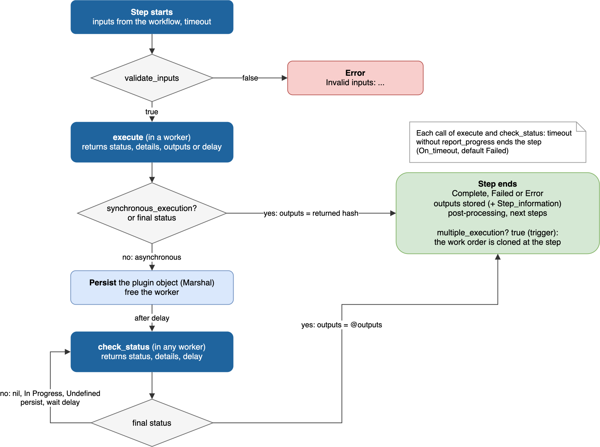
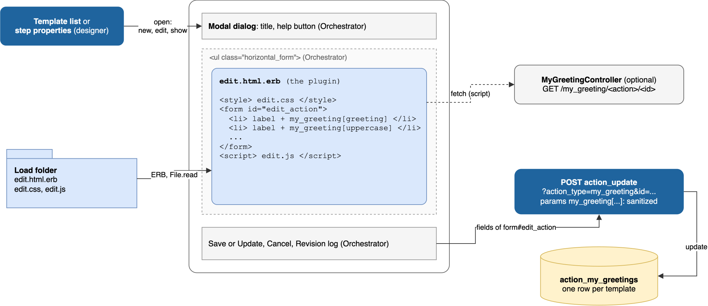
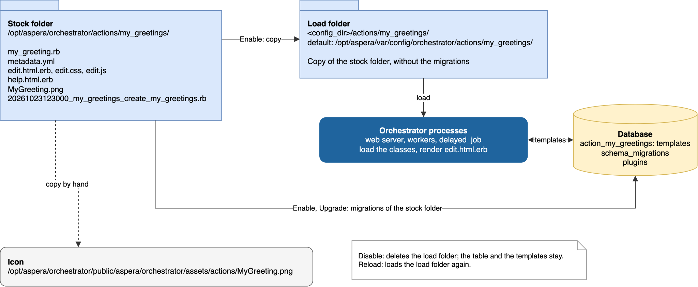

<!-- gfm2pdf
common:
  metadata:
    title: "Aspera Orchestrator Plugin Development Guide"
    author: "IBM Aspera"
-->

# Aspera Orchestrator Plugin Development Guide

## Introduction

This guide explains how to write an action plugin for IBM Aspera Orchestrator: a Ruby class, its database table, its template form and its metadata, and how to install, test and update it.

It is written for people and for AI assistants.
Each rule gives the exact name, method or value expected by Orchestrator.

The content is derived from the Orchestrator 4.1.6 source code (Ruby 3.4, Rails 8.1).
The example plugin of [Quick start](#quick-start) was installed, enabled, and executed in a workflow on Orchestrator 4.1.6, and the steps of [Installing a plugin](#installing-a-plugin) and [Updating a plugin](#updating-a-plugin) were done on that server.

Related documents:

- [Workflow Authoring Guide](workflow-authoring-guide.md): how to write, import and run a workflow that uses a plugin.
- [Action Template Reference](action-template-reference.md): attributes, inputs and outputs of every shipped plugin.
- [Plugin specifications](plugins.yml): the same as data (YAML).
- [Plugin Manual](Orchestrator_Plugin_Manual.md): functional description of each shipped plugin.

The source of the shipped plugins is the best set of examples: folder `/opt/aspera/orchestrator/actions` of an Orchestrator server, one folder per plugin.
`HelloWorld` (`hello_worlds`) is a reference implementation with pause, resume, cancel, rollback and recovery.

### Terminology

| Term | Meaning |
| --- | --- |
| Plugin | A Ruby class that includes module `Action`, for example `MyGreeting`, and its folder. Also called action plugin, action type or step type. |
| Template | A configured instance of a plugin: one row of the plugin table, holding its settings (attributes). Also called action template. |
| Attribute | A column of the plugin table: a setting of the template, edited in the template form. |
| Step | A node of a workflow that runs a template. |
| Work step | One execution of a step, in a work order (one execution of a workflow). |
| Input, Output | Named values received and produced by a work step, declared by the plugin (`inputs_spec`, `outputs_spec`). |
| Stock folder | `/opt/aspera/orchestrator/actions/<folder>`: the source of a plugin. |
| Load folder | `<config_dir>/actions/<folder>`, by default `/opt/aspera/var/config/orchestrator/actions/<folder>`: the copy of the stock folder made when the plugin is enabled, from which Orchestrator loads it. |

## Quick start

The following plugin `MyGreeting` builds a message from a template attribute with placeholders.
When attribute `wait_seconds` is not 0, it waits that long before completing, without holding a worker (asynchronous execution).
Its template form has its own CSS and JavaScript: a live preview of the message.

### Source

```text
my_greetings/
├── my_greeting.rb                                       class MyGreeting
├── 20261023123000_my_greetings_create_my_greetings.rb   database table
├── metadata.yml                                         version, display name, category
├── edit.html.erb                                        template form
├── edit.css                                             style of the form
├── edit.js                                              script of the form
├── help.html.erb                                        help page
└── MyGreeting.png                                       icon, 128 x 128
```

`my_greeting.rb`:

```ruby
require 'yaml'

# Builds a greeting message from a template attribute with placeholders.
# Runs synchronously, or asynchronously when wait_seconds is not 0.
class MyGreeting < ActiveRecord::Base
  include Action

  # Name of the input that replaces attribute greeting when it is blank (default: "Greeting")
  VAR_GREETING = 'Greeting'
  # Default values make the corresponding inputs optional
  DEFAULT_GREETING = 'Hello'
  DEFAULT_UPPERCASE = false
  DEFAULT_WAIT_SECONDS = 0
  POLLING_SECONDS = 5

  OUT_MESSAGE = 'Message'

  def self.version
    return @@plugin_version_loaded if defined?(@@plugin_version_loaded)
    versions = SafeYaml.load_file("#{File.dirname(__FILE__)}/metadata.yml")[:revision_history].map { |change| change[:version].split(".").map { |num| num.to_i } }
    @@plugin_version_loaded = versions.sort_by { |major, minor, revision, patch| [major, minor, revision, (patch.nil? ? 0 : patch)] }.last
    return @@plugin_version_loaded
  end

  def self.display_name
    return 'My greeting'
  end

  def category
    return [CATEGORY_OTHER]
  end

  # greeting: input "Greeting" if blank, else one input per placeholder
  # uppercase, wait_seconds: input if null
  def inputs_spec
    return default_inputs_spec([:greeting, :uppercase, :wait_seconds], {}, {})
  end

  def outputs_spec
    return { OUT_MESSAGE => TYPE_STRING }
  end

  def synchronous_execution?
    return wait_seconds_get.to_i == 0
  end

  def execute
    message = greeting_get
    message = message.upcase if uppercase_get == true
    @outputs = { OUT_MESSAGE => message }
    return STATUS_COMPLETE, message, @outputs if synchronous_execution?

    # Instance variables are kept until check_status (the action is persisted between calls)
    @ready_at = Time.now + wait_seconds_get.to_i
    return nil, "Waiting #{wait_seconds_get} s", POLLING_SECONDS
  end

  def check_status
    return STATUS_FAILED, 'Canceled', nil if must_cancel?
    remaining = (@ready_at - Time.now).ceil
    return nil, "Waiting, #{remaining} s left", POLLING_SECONDS if remaining > 0
    # Outputs are taken from @outputs
    return STATUS_COMPLETE, @outputs[OUT_MESSAGE], nil
  end

  # Defining cancel makes the step cancelable: the cancel request is seen by must_cancel?
  def cancel
    return true
  end
end
```

`20261023123000_my_greetings_create_my_greetings.rb`:

```ruby
class MyGreetingsCreateMyGreetings < ActiveRecord::Migration[8.0]
  def change
    create_table :action_my_greetings do |t|
      t.string :name
      t.string :comments
      t.text :greeting
      t.boolean :uppercase
      t.integer :wait_seconds

      t.timestamps
    end
  end
end
```

`metadata.yml`:

```yaml
---
:revision_history:
  - :author: "<AUTHOR>"
    :change_description: Initial release
    :version: 1.0.0
    :date: "2026-10-23"
    :minimum_server_version: 4.1.0

:display_name: My greeting
:category: Other Utilities
:help: "Builds a greeting message from a pattern with placeholders."
:plugin_name: MyGreeting
:description: Example plugin of the plugin development guide.
```

`edit.html.erb`:

```erb
<%# The CSS and JS files are read from the plugin folder: they are not ERB templates %>
<style><%= raw File.read(File.join(@action.action_dir, 'edit.css')) %></style>

<%= form_with model: @my_greeting, url: action_update_path(action_type: "my_greeting", id: @my_greeting.id), id: "edit_action" do |f| %>
  <li>
    <%= f.label :name %>
    <%= f.text_field :name %>
  </li>
  <li>
    <%= f.label :comments %>
    <%= f.text_field :comments %>
  </li>
  <li>
    <%= f.label :greeting %>
    <%= f.text_area :greeting, rows: 3, placeholder: MyGreeting::DEFAULT_GREETING %>
    <p class="input_help">Text with placeholders, for example <code>Hello &lt;%= who %&gt;!</code>. Blank: input <code><%= MyGreeting::VAR_GREETING %></code>.</p>
  </li>
  <li>
    <%= f.label :uppercase %>
    <%= f.check_box :uppercase %>
  </li>
  <li>
    <%= f.label :wait_seconds %>
    <%= f.number_field :wait_seconds, min: 0, step: 1 %>
  </li>
  <li class="my-greeting-preview">
    <label>Preview</label>
    <output id="my_greeting_preview" data-default="<%= MyGreeting::DEFAULT_GREETING %>"></output>
    <p class="input_help">Inputs from placeholders: <span id="my_greeting_variables"></span></p>
    <button type="button" id="my_greeting_example">Insert example</button>
  </li>
  <% if @view == 'show' %>
  <li>
    <%= f.label 'Required variables' %>
    <%= h Payload.variables(@my_greeting.greeting.to_s).join(', ') %>
  </li>
  <% end %>
<% end %>

<script><%= raw File.read(File.join(@action.action_dir, 'edit.js')) %></script>
```

`edit.css`:

```css
.my-greeting-preview output {
  display: block;
  padding: 4px 8px;
  border-left: 4px solid #0f62fe;
  background: #edf5ff;
  font-family: monospace;
  min-height: 1.5em;
}
```

`edit.js`:

```javascript
// Runs each time the form is opened: everything stays inside the function
(function () {
  var form = document.getElementById('edit_action');
  var greeting = form.querySelector('#my_greeting_greeting');
  var uppercase = form.querySelector('#my_greeting_uppercase');
  var preview = form.querySelector('#my_greeting_preview');
  var variables = form.querySelector('#my_greeting_variables');
  var example = form.querySelector('#my_greeting_example');

  function update() {
    var text = greeting.value || preview.dataset.default;
    var names = [];
    text.replace(/<%=\s*([A-Za-z_][A-Za-z0-9_]*)\s*%>/g, function (match, name) {
      if (names.indexOf(name) < 0) names.push(name);
      return match;
    });
    var shown = text.replace(/<%=\s*([A-Za-z_][A-Za-z0-9_]*)\s*%>/g, '[$1]');
    preview.textContent = uppercase.checked ? shown.toUpperCase() : shown;
    variables.textContent = names.length ? names.join(', ') : '(none)';
  }

  greeting.addEventListener('input', update);
  uppercase.addEventListener('change', update);
  example.addEventListener('click', function () {
    greeting.value = 'Hello <%= who %>!';
    update();
  });
  update();
})();
```

`help.html.erb`:

```html
<h2>My greeting</h2>
<p>Builds a message from attribute <b>Greeting</b>, a text with placeholders <code>&lt;%= name %&gt;</code>: each placeholder is a required input.</p>
<p>If <b>Wait seconds</b> is not 0, the step waits that long before completing (asynchronous execution).</p>
<h3>Output</h3>
<ul><li><code>Message</code>: the message.</li></ul>
```

### Install and run

1. Copy the folder to `/opt/aspera/orchestrator/actions/my_greetings`, owned by `aspweb`, and the icon to `/opt/aspera/orchestrator/public/aspera/orchestrator/assets/actions/MyGreeting.png`.
2. Open the **Plugins** page (`https://<host>/aspera/orchestrator/plugins`): `My greeting` is listed, disabled. Click **Enable**.
3. Restart the web server: `systemctl restart orchestrator_server`, needed to import workflow files that use the new plugin (see [Installing a plugin](#installing-a-plugin)).
4. Use it in a workflow: in the designer, or with a workflow file (see the [Workflow Authoring Guide](workflow-authoring-guide.md)).

A template with `greeting` set to `Hello <%= who %>!` and `uppercase` checked has a required input `who`: with `who` = `Laurent`, the step ends `Complete` with output `Message` = `HELLO LAURENT!`.
A template with `greeting` blank and `wait_seconds` = 70 has an optional input `Greeting`: the step ends `Complete` after 70 seconds, with `Message` = the value of `Greeting`.

## Plugin folder

### Names

All names derive from the class name, with the Rails inflections of Orchestrator:

| Item | Rule | Example |
| --- | --- | --- |
| Class | CamelCase, includes `Action`, inherits `ActiveRecord::Base`. It is the action type and the `Step_type` of steps. | `MyGreeting` |
| Folder | `"<Class>".tableize`: snake case, plural. Orchestrator finds the class from the folder name (`singularize.camelcase`). | `my_greetings` |
| Main file | The folder name singularized, `.rb`. | `my_greeting.rb` |
| Table | `action_<folder>`. | `action_my_greetings` |
| Icon | `<Class>.png`. The shipped icons are 128 x 128. | `MyGreeting.png` |
| Migration file | `<version>_<description>.rb`: see [Migrations](#migrations). | `20261023123000_my_greetings_create_my_greetings.rb` |

Check that the class name converts back from the folder name: `"MyGreeting".tableize.classify == "MyGreeting"` in a Rails console.
Names that end with an irregular plural (`Data`, `Media`) or that contain an acronym declared in `config/initializers/inflections.rb` (`AJAX`, `CGI`, `DBI`, `OS`, `OSX`, `SMTP`, `SSH`, so `SshCopy` becomes `SSHCopy`) do not convert back.

### Files

| File | Required | Content |
| --- | --- | --- |
| `<folder singular>.rb` | yes | The plugin class. |
| `metadata.yml` | yes | Versions, display name, category: see [metadata.yml](#metadata-file). |
| `<version>_<description>.rb` | yes | Migrations: they create the table, see [Migrations](#migrations). |
| `edit.html.erb` | yes | Template form: see [Template form](#template-form). |
| `help.html.erb` | no | Help page, see [Help page](#help-page). Shipped in 204 of the 205 plugins. |
| `<Class>.png` | no | Icon in the designer and the template lists. Without it, a generic icon is shown. |
| `<name>_controller.rb` | no | Controller that serves data to the template form (21 shipped plugins), see [Server data for the form](#server-data-for-the-form). |
| Other `.rb` files | no | Helpers, services (`<name>_helper.rb`, `<name>_service.rb`). |
| `Gemfile` | no | Gems of the plugin, see [Gems and external tools](#gems-and-external-tools). |
| Other files | no | WSDL, payload templates, CSS, JavaScript: read by your code. |

When the plugin is loaded, every file of the folder whose name matches `[A-Za-z]*.rb` is loaded with `load`, shortest path first.
Migration files start with a digit: they are not loaded with the class.
A file must not reference, when loaded, a class defined in a file with a longer name.

## Metadata file

`metadata.yml` describes the plugin and its versions.
Keys are Ruby symbols (`:key:`).

| Key | Required | Content |
| --- | --- | --- |
| `:revision_history` | yes | List of versions, oldest first. |
| `:display_name` | yes | Name in the Plugins page. |
| `:category` | yes | Category in the Plugins page: one of the values of [Category](#category), for example `Other Utilities`. |
| `:plugin_name` | recommended | The class name. Used by the help pages. |
| `:description` | recommended | One sentence. Shown in the help pages. |
| `:help` | recommended | Short help text. |
| `:external_dependencies` | no | Programs required on the server, as `- :bin: "<program>"`. Enabling the plugin fails with `External dependency <program> not found` if `command -v <program>` finds nothing. |

Keys of a revision:

| Key | Content |
| --- | --- |
| `:version` | `major.minor.release`, for example `1.0.0`. Required. |
| `:author`, `:change_description`, `:date` | Shown in the revision history of the Plugins page. |
| `:minimum_server_version` | Oldest Orchestrator version for this plugin version, for example `4.1.0`. |
| `:maximum_server_version` | Newest Orchestrator version. |
| `:is_beta` | `true`: this version cannot be enabled. |
| `:deprecation_orch_version` | Orchestrator version from which the plugin is deprecated. |

The version of the plugin is the highest `:version` (method `self.version`).
Enabling fails if this version is beta, or if the Orchestrator version is out of its `:minimum_server_version` and `:maximum_server_version`.
The Plugins page shows the version of the last entry of the list: keep the list in increasing order.

## Migrations

The table of the plugin is created and changed by migrations: Rails migration files in the plugin folder.
Each template is one row of the table.

Rules:

- File name: `<version>_<description>.rb`, where `<version>` is a number, by convention the date and time of creation as `YYYYMMDDHHMMSS`.
  The shipped plugins name the description `<folder>_create_<folder>` for the first migration, and `<folder>_<x_y_z>_<change>` for the migration of version `x.y.z`, for example `20211213103239_local_file_operations_1_1_0_add_source_no_glob.rb`.
- The class name is the description in CamelCase: `MyGreetingsCreateMyGreetings`.
  It must be unique in Orchestrator: migrations of all plugins are evaluated in the same Ruby namespace.
- The class inherits `ActiveRecord::Migration[8.0]` (600 of the 731 shipped migrations; others use `[6.1]` or `[8.1]`).
- `<version>` must be unique among all migrations of Orchestrator and of all plugins: Rails records applied versions in the table `schema_migrations`, shared by the whole application.
  A migration whose version is already recorded is not run, and enabling the plugin does not report it: the log shows `Table '...' doesn't exist`, and no default template is created.
- The table is `action_<folder>`, written literally (`:action_my_greetings`): Orchestrator replays the migrations on a copy of the table, replacing that name, to find which ones are applied.
- The first migration creates the table with columns `name` and `comments` (strings) and timestamps (`t.timestamps`), and the attributes of the plugin.
- To change the table in a new version of the plugin, add a migration. Never change a migration that may have been applied.

```ruby
class MyGreetings110AddSignature < ActiveRecord::Migration[8.0]
  def change
    add_column :action_my_greetings, :signature, :string
  end
end
```

Migrations run when the plugin is enabled or upgraded, from the stock folder (see [Installing a plugin](#installing-a-plugin)).
If the table does not exist, all migrations run.
Otherwise, Orchestrator finds the last migration that the table already matches (columns, types, defaults, indexes), records the versions up to it as applied, and runs the following ones.

Attribute types and the inputs they give (see [Inputs from attributes](#inputs-from-attributes)):

| Column type | Input type when left null or blank |
| --- | --- |
| `string`, `text` | `string` (or the type of a suffix of the attribute name, see below) |
| `integer` | `int` |
| `float`, `decimal` | `float` |
| `boolean` | `flag` |
| `date`, `datetime` | `date` |

## Plugin class

### Structure

```ruby
class MyPlugin < ActiveRecord::Base
  include Action

  def self.version; ... end   # [major, minor, release], from metadata.yml
  def category; ... end       # [CATEGORY_...]
  def inputs_spec; ... end    # [required, optional]: name => type
  def outputs_spec; ... end   # name => type
  def execute; ... end        # [status, details, outputs]
end
```

The class must not be empty.
Module `Action` includes `ActionTools`, which provides the constants and helpers below.
Methods of the template are available: its attributes as methods (`greeting`, `name`), and `id`.

### Methods

| Method | Required | Default | Called |
| --- | --- | --- | --- |
| `self.version` | yes | `[0, 0, 0]` | When loading and listing plugins. |
| `self.display_name` | no | Class name split into words: `MyGreeting` gives `My greeting` | When enabling, in template lists. |
| `category` | no | `[CATEGORY_OTHER]` | Action directory of the designer. |
| `inputs_spec` | yes | raises an error | Designer, publication of a workflow, action tester, API `workflow_inputs_spec`, validation before execution. |
| `outputs_spec` | yes | raises an error | Same. Orchestrator adds output `Step_information` (`hash`). |
| `validate_inputs(inputs)` | no | `default_inputs_validation` | Before `execute`. |
| `execute` | yes | raises an error | To run the step. |
| `synchronous_execution?` | no | `true` | Before and after `execute`. |
| `check_status` | if asynchronous | returns `@status`, `@status_details` | Polling of an asynchronous step. |
| `multiple_execution?` | no | `false` | When the step ends: `true` repeats it in a new work order (triggers). |
| `timeout` | no | `nil` (server default) | When the step starts. |
| `timeout_help` | no | `Sorry, no timeout explanation provided.` | Timeout dialog of the designer. |
| `pause`, `resume`, `cancel`, `rollback` | no | `false` (not supported) | On user request, see [Pause, resume, cancel, rollback](#pause-resume-cancel-rollback). |
| `cancel_on_request?`, `pause_on_request?`, `resume_on_request?`, `rollback_on_request?` | no | `false` | On user request. |
| `recover` | no | returns `Error` | When a worker finds a synchronous step still `In Progress` after an interruption. |
| `initialize_default_template` | no | nothing | When the default template (`<Class> Default`) is created, at first enable. |
| `dependencies` | no | `[]` | Export of workflows, see [Dependencies](#dependencies). |
| `name` | no | attribute `name`, else `<Class>_<id>` | Lists. |
| `remote_execution?` | no | `true` | Only displayed by the action tester in 4.1.6. |
| `help`, `self.dependencies` | no | | Not used by Orchestrator 4.1.6. |

`self.version` must cache the version in the class variable `@@plugin_version_loaded`: Orchestrator removes this variable when it upgrades the plugin.
Use the code of the [Quick start](#quick-start) (205 of the 205 shipped plugins use it).

### Category

`category` returns an array: the first element is the top category, other elements are sub-categories in the action directory of the designer.

| Constant | Value |
| --- | --- |
| `CATEGORY_ASSET_MANAGEMENT` | `Asset Management` |
| `CATEGORY_FILEOPERATIONS` | `File Operations` |
| `CATEGORY_FILETRANSFER` | `File Transfer` |
| `CATEGORY_FILETRANSFORMATIONS` | `File Transformations` |
| `CATEGORY_INTEGRATION` | `Integration` |
| `CATEGORY_OTHER` | `Other Utilities` |
| `CATEGORY_QUALITY_CONTROL` | `Quality Control` |
| `CATEGORY_RESOURCE` | `Resources` |
| `CATEGORY_SCHEDULING` | `Scheduling` |
| `CATEGORY_SYSTEM` | `System` |
| `CATEGORY_TRANSCODING` | `Transcoding` |
| `CATEGORY_TRIGGERS` | `Triggers` |
| `CATEGORY_USERINTERACTIONS` | `User Interactions` |
| `CATEGORY_VIRUS_SCAN` | `Virus Scan` |

### Types

Types of inputs and outputs, constants of `ActionTools` (from `MultiType`):

| Constant | Value |
| --- | --- |
| `TYPE_STRING` | `string` |
| `TYPE_INT` | `int` |
| `TYPE_FLOAT` | `float` |
| `TYPE_FLAG` | `flag` (boolean) |
| `TYPE_DATE` | `date` |
| `TYPE_ARRAY` | `array` |
| `TYPE_HASH` | `hash` |
| `TYPE_OBJECT` | `object` |
| `TYPE_PASSWORD` | `pwd` |
| `TYPE_ATTACHMENT` | `attachment` |

### Statuses

Constants of `ActionTools`, used as return values of `execute` and `check_status`:

| Constant | Value | Final |
| --- | --- | --- |
| `STATUS_COMPLETE` | `Complete` | yes |
| `STATUS_FAILED` | `Failed` | yes |
| `STATUS_ERROR` | `Error` | yes |
| `STATUS_INPROGRESS` | `In Progress` | no |
| `STATUS_UNDEFINED` | `Undefined`: the status could not be determined | no |
| `STATUS_PAUSED` | `Paused` | no |
| `STATUS_TRUE` | `True` | yes |
| `STATUS_FALSE` | `False` | no |
| `STATUS_OBSOLETE` | `Obsolete` | yes |

`Inactive`, `Activating`, `Pausing`, `Resuming`, `Canceling` and `Rolling Back` are set by Orchestrator.
A step ends with a final status: workflows branch on `Complete`, `Failed` and `Error`.
Use `Failed` for a functional failure (the expected result is not there) and `Error` for a technical error.

## Inputs and outputs

`inputs_spec` returns two maps, required inputs and optional inputs, from input name to type.
`outputs_spec` returns a map from output name to type.

```ruby
def inputs_spec
  return { 'source' => TYPE_STRING }, { 'overwrite' => TYPE_FLAG }
end

def outputs_spec
  return { 'files' => TYPE_ARRAY }
end
```

Rules:

- Both are called on the template, with `@inputs` not set (designer, publication): compute them from the attributes only.
- The inputs and outputs of a step are created when the workflow is published, from the template at that time.
- At run time, `@inputs` is a hash of input values by name.
  Orchestrator also gives the inputs `OUTPUTS` (names and types of the outputs), `WORKORDER_ID`, `ATTEMPT` and `RUNNING_AS`.
- Outputs are taken from the hash returned by `execute`, or from `@outputs` (asynchronous steps).
  Only outputs declared by `outputs_spec` are stored.
- `validate_inputs` is called before `execute`, with the input values.
  The default, `default_inputs_validation`, checks that the required inputs are present and that the values have the declared types.
  To add a check, call it first, and add a message to `@validation_errors` before returning `false`: the step ends with `Error` and details `Invalid inputs: <messages>`.

```ruby
def validate_inputs(inputs_hash = @inputs)
  return false unless default_inputs_validation(inputs_hash)
  if inputs_hash['count'].to_i < 0
    @validation_errors << 'Input count must not be negative'
    return false
  end
  return true
end
```

### Inputs from attributes

Most plugins (186 of 205) let a template attribute come from an input when it is blank, with `default_inputs_spec`, and read it with `default_get`.

`default_inputs_spec(fields, required_inputs, optional_inputs)` adds inputs for the attributes `fields` (default: all attributes except `name`, `comments`, `id` and timestamps) to the two maps, and returns them:

- A text attribute left blank becomes an input.
  Its name is the value of the constant `VAR_<ATTRIBUTE>` if it exists, else the attribute name with its first letter in upper case (`wait_seconds` gives `Wait_seconds`).
  It is optional if the constant `DEFAULT_<ATTRIBUTE>` exists, else required.
- A text attribute that is set gives one input per placeholder (`Payload.variables`): `<%= name %>`, arguments of `<%= function(a, b) %>`, `var(name)` in an expression.
  The input is a `string`, or the type of a suffix `_<type>` of its name, required unless the constant `DEFAULT_<NAME>` exists.
  No input is created for a name that is a method of the template with a value (`name`, a set attribute).
- A non-text attribute left null becomes an input of the corresponding type.
- An attribute name ending with `_<type>` (for example `delay_int`) gives an input of that type, named without the suffix (`Delay`).

`default_get(:attribute)`, or `<attribute>_get` (handled by `method_missing`), returns the run time value of an attribute, the first of:

1. The value of the input that replaces the attribute (name as above), if present.
2. The attribute value, if not blank.
3. The value of the constant `DEFAULT_<ATTRIBUTE>`.

A `string` or `text` value is then expanded with `Payload.expand`: placeholders are replaced by input values.
If the attribute name ends with `_<type>`, the value is converted to that type.
The result is cached in the instance variable `@<attribute>`: `default_get(:attribute, true)` reads it again.

```ruby
DEFAULT_POLLING_FREQUENCY = 5

def inputs_spec
  required_inputs = {}
  optional_inputs = { 'timeout' => TYPE_INT }
  # command: input Command if blank, else one input per placeholder
  default_inputs_spec([:command], required_inputs, optional_inputs)
  return required_inputs, optional_inputs
end

def execute
  command = command_get                     # expanded value
  delay = polling_frequency_get             # attribute, input Polling_frequency, or 5
  ...
end
```

An attribute handled by your own code (for example `required_inputs[VAR_SERVER] = TYPE_STRING if server.blank?`) gets no input for its placeholders: call `default_inputs_spec` for it, or scan it with `Payload.variables`.
The documentation generator of this repository marks an attribute `placeholders: true` in `plugins.yml` only when `<%= variable %>` in its value gives an input `variable`.
See [Placeholders](workflow-authoring-guide.md#placeholders) in the Workflow Authoring Guide for the syntax as seen by workflow authors.

Other constants read by Orchestrator:

| Constant | Effect |
| --- | --- |
| `VAR_<ATTRIBUTE>` | Name of the input that replaces the attribute. |
| `DEFAULT_<ATTRIBUTE>` | Value when the attribute is blank. Makes the input optional. |
| `VALUES_<KEY>` | Allowed values of a key in the hash editor of a form (`constrained_values`). |
| `SKIP_SANITIZATION_FIELDS` | Attributes whose value is saved without HTML sanitization, see [Saved values](#saved-values). |

### Payload

`Payload.variables(text)` returns the input names used by the placeholders of `text`:

| Placeholder | Names returned |
| --- | --- |
| `<%= name %>` | `name` |
| `<%= function(a, b) %>` | `a`, `b` (arguments are input names only) |
| `<%= var(name).upcase %>` | `name` (`var` in an expression) |
| `<%= name.upcase %>`, `<% ... %>` | none |

`Payload.expand(text, @inputs, self)` replaces them with input values:

- `<%= name %>`: the input value, an empty string if missing (or the value of method `name` of `self` if there is no such input), an array in Ruby notation.
- `<%= function(a, b) %>`: `function` is a method of `self` (the template), of `Payload` (`xml`: a hash as XML elements), or a method with its class (`File.basename`).
- If `<%=` remains after that, the text is evaluated as ERB, where a name is the value of the input with that name (`var(name)` returns its argument).
  `<% ... %>` tags are evaluated only in that case.
- `<%= var(name) %>` alone raises an error: `var` is a method of `Payload` class only.

Scan with `Payload.variables` when `default_inputs_spec` does not fit, for example to give all inputs one type:

```ruby
def inputs_spec
  required_inputs = {}
  Payload.variables(command).each do |var_name|
    required_inputs[var_name] = TYPE_STRING
  end
  return required_inputs, {}
end

def execute
  expanded_command = Payload.expand(command, @inputs, self)   # command_get does the same
  ...
end
```

### MultiType

`MultiType` converts values between their text form and their type:

```ruby
value = MultiType.convert_value(string_value, TYPE_INT)   # text to typed value
string = MultiType.convert_to_string(value)                # typed value to text
hash = MultiType.convert_value_hash(string_hash)           # "{'a'=>1}" or JSON to a Hash
MultiType.validate_type(value, TYPE_INT)                   # true if value has the type
```

## Execution



### Synchronous execution

By default (`synchronous_execution?` returns `true`), `execute` does the work in a worker process and returns `status, details, outputs`:

- `status`: a final status, see [Statuses](#statuses).
- `details`: text shown as the status details of the step (at most 255 characters).
- `outputs`: hash of output values.

Orchestrator then stores the declared outputs, adds `Step_information` (step id, name, status, details, attempts, processing time), runs the post-processing code of the step, and activates the next steps.

An exception raised by `execute` ends the step with `Error`, details `Execution error: <message>`.
A `RuntimeError` whose message is a final status (`raise STATUS_FAILED`) ends the step with that status.

### Asynchronous execution

An operation that waits (a transcoding job, a remote transfer, an event) should not hold a worker.
`synchronous_execution?` returns `false`, and the work is split:

- `execute` starts the operation and returns `nil` (or `STATUS_INPROGRESS`), details, and the number of seconds before the first check.
  It can also return a final status at once.
- Orchestrator persists the plugin object, frees the worker, and calls `check_status` later, in any worker.
- `check_status` returns `status, details, delay`: a final status ends the step; `nil`, `STATUS_INPROGRESS` or `STATUS_UNDEFINED` continue, and `delay` is the number of seconds before the next call (`nil` or `0`: as soon as possible).
- The outputs of the step are the hash `@outputs`: set it before returning a final status.
- `STATUS_UNDEFINED` means the status could not be read: after `max_missed_status` (server setting, default 3) consecutive ones, the step ends with `Error`.
- Set `@percent_complete` to show a percentage.

Between `execute` and `check_status`, the plugin object is serialized with `Marshal`, with its attributes and instance variables (`@ready_at` in the [Quick start](#quick-start)).
Instance variables must be serializable: no open connection, file, thread or `Proc`.
Reconnect in each call of `check_status`.

### Triggers

A trigger waits for an event (a file, a message, a database row) and starts the rest of the workflow for each event.
It is an asynchronous plugin, usually in `CATEGORY_TRIGGERS`, whose `multiple_execution?` returns `true`:

- `execute` returns `nil, 'Watching', nil`.
- `check_status` returns `nil, details, delay` while there is no event, and `STATUS_COMPLETE` with `@outputs` describing the event.
- When the step ends with a status other than `Error`, Orchestrator clones the work order at that step: the work order continues with the next steps, the clone waits for the next event.
  `multiple_execution?` is usually `true` when an attribute asks for continuous monitoring (`keep_ongoing`), and `false` once canceled.

To not report an event twice, include `ModuleTriggerTools`, and save the events already reported:

| Method | Content |
| --- | --- |
| `retrieve_triggers(default = {})` | The object saved by the last `persist_triggers`, or `default`. |
| `persist_triggers(object)` | Saves `object` (for example a hash of event ids), returns `true` on success. |
| `clean_up_triggers` | Deletes the saved object. |
| `trigger_file_name` | `<run_dir>/<folder>/<WATCHER_PREFIX>_<scope>_triggers.prst`. |

The scope of the saved object depends on the attribute `trigger_type`, if the table has one: `by workorder group` (default), `by action template`, `absolute`, `by step`, `by workflow`, `none` (constants `TRIG_*`).
Define the constant `WATCHER_PREFIX` to name the files of your plugin (default `Watcher`).
See `DatabaseTrigger` (`database_triggers`) for a complete trigger in about 300 lines.

```ruby
class MyWatcher < ActiveRecord::Base
  include Action
  include ModuleTriggerTools

  WATCHER_PREFIX = 'MyWatcher'

  def synchronous_execution?
    return false
  end

  def multiple_execution?
    return (keep_ongoing == true) && (@is_canceled != true)
  end

  def execute
    @past = retrieve_triggers({})
    return nil, 'Watching', nil
  end

  def check_status
    return STATUS_FAILED, 'Canceled', nil if must_cancel?
    new_ids = list_event_ids.reject { |event_id| @past[event_id] }   # your code
    return nil, "No event at #{Time.now}", 10 if new_ids.empty?
    new_ids.each { |event_id| @past[event_id] = true }
    persist_triggers(@past)
    @outputs = { 'events' => new_ids }
    return STATUS_COMPLETE, "#{new_ids.size} events", nil
  end

  def cancel
    @is_canceled = true
    return true
  end
end
```

### Timeouts

The timeout of a step, in seconds, is the timeout set on the step in the designer, else the value of the plugin method `timeout`, else the server setting `default_step_timeout` (default 60).

- It applies to each call of `execute` and of `check_status`, not to the whole duration of an asynchronous step.
  An asynchronous step can wait longer, as long as each call returns in time.
- It is an inactivity timeout: each call of `report_progress` restarts it.
  A negative value is a hard limit, regardless of progress.
  `0` disables it.
- When it expires, the call is interrupted, and the step ends with `Failed`, or with the status chosen by `On_timeout` of the step (`Error`, `Complete`).
- `timeout` is called when the step starts, possibly before `@inputs` is set: handle `@inputs` nil.

### Progress

`report_progress(status, details, percent = nil)` updates the status details of the step during `execute`, and restarts the timeout.
`status` is `nil` (unchanged), `STATUS_INPROGRESS` or `STATUS_PAUSED`.
A final status ends the execution with that status.

Write logs with `Rails.logger.info`, `Rails.logger.error`: they go to `/opt/aspera/orchestrator/log/production.log`.

### Pause, resume, cancel, rollback

A step can be paused, resumed, canceled or rolled back from the work order page if the plugin class itself defines the method `pause`, `resume`, `cancel` or `rollback` (`pausable?` and the like check that the method is defined in the class, not inherited).
These methods are called in another process (the web server), on a copy of the plugin object restored from its persisted state: they cannot change the running `execute`.

By default (`cancel_on_request?` and the like return `false`), the request is a flag that the plugin must check:

- Cancel: the step shows `Canceling`.
  `execute`, in its loop, or `check_status` checks `must_cancel?`, and returns `STATUS_FAILED`.
- Pause: the step shows `Pausing`.
  The plugin checks `must_pause?`, reports `report_progress(STATUS_PAUSED, ...)`, and waits while `must_pause?` is `true`.
  Resume clears the flag: `must_pause?` returns `false`.

If `cancel_on_request?` returns `true`, Orchestrator calls `cancel` at once and ends the step with `Failed`, details `Canceled at <time>`: use it when the operation can be stopped from outside, for example by an API call to a remote job.
The same applies to `pause_on_request?` and `resume_on_request?`.

`rollback` is called on a step that has ended, to undo its effect.

`recover` is called when a worker finds a synchronous step still `In Progress`, for example after a restart of the worker during `execute`.
It returns `status, details, outputs` like `execute`.
The default returns `Error`, `Recovery after partial execution is not supported`.

`HelloWorld` (`hello_worlds`) implements all of them.

### Helpers

| Method | Content |
| --- | --- |
| `report_progress(status, details, percent)` | See [Progress](#progress). |
| `must_cancel?`, `must_pause?` | `true` if a cancel or a pause is requested. |
| `runtime_basedir` | Folder for runtime files of the plugin: `<run_dir>/<folder>`. |
| `persist_state_file(prefix, suffix, object)`, `retrieve_state_file(prefix, suffix)` | Save and read an object for this work step. |
| `action_dir` | Load folder of the plugin. |
| `state_id`, `work_order_id` | Ids of the work step and of the work order. |
| `default_get`, `<attribute>_get`, `default_inputs_spec` | See [Inputs from attributes](#inputs-from-attributes). |

Modules to include for common integrations:

| Module | Content |
| --- | --- |
| `ModuleTriggerTools` | Persistence of past events, see [Triggers](#triggers). |
| `ModuleSshTools` | Commands on a remote node with SSH: `remote_execute_and_close!(remote_node, command_line)`, `initialize_connection`, `remote_execute`. |
| `ModuleSoapTools` | SOAP clients from a WSDL: `savon_client(wsdl_uri)`, `list_services`, `list_parameters`. |

### Dependencies

A template that refers to other entities declares them with the instance method `dependencies`: a list of hashes `{entity:, id_key:, id_value:, dependent_field:}`.

```ruby
def dependencies
  return [] if remote_node.blank?
  return [{ entity: 'RemoteNode', id_key: 'name', id_value: remote_node, dependent_field: 'remote_node' }]
end
```

They are written in exported workflow files, and the remote nodes (`RemoteNode`) and sub-workflows (`Workflow`) are added to `.wkf` packages exported with dependencies.
73 shipped plugins declare a `RemoteNode`.

## Template form

`edit.html.erb` is the form of a template: Orchestrator renders it to create, edit and display templates, in the template lists and in the step properties of the designer.



### Rendering

`edit.html.erb` is an ERB view of Rails, rendered in a modal dialog, inside a list `<ul class="horizontal_form">`, between the title and the buttons provided by Orchestrator (**Save** or **Update**, **Cancel**, **Revision log**).
It is read from the load folder.

Variables:

| Variable | Content |
| --- | --- |
| `@<class in snake case>`, `@action` | The template, for example `@my_greeting`. A new, unsaved one for a new template. |
| `@view` | `new`, `edit` or `show` (read only: all fields are disabled). |
| `@action_type` | The class name. |
| `@workflow` | Id of the workflow when the template belongs to a workflow (embedded template), else `nil`. |

Rules:

- One form, built with `form_with model: @<snake>, url: action_update_path(action_type: "<snake>", id: @<snake>.id), id: "edit_action"`.
  The id `edit_action` is required: the buttons of the dialog send the fields of the form with this id.
- One `<li>` per field, with `f.label` and the field. A `<p class="input_help">` under a field gives help.
- Field names are `<snake>[<attribute>]`, as made by the form helpers (`f.text_field :greeting`): each one must be a column of the table.
- In an embedded template, Orchestrator disables the name field (`#<snake>_name`).

Form helpers used by the shipped plugins: `f.text_field`, `f.text_area`, `f.check_box`, `f.select`, `f.number_field`, `f.password_field`, `f.hidden_field`.

### Saved values

The buttons send the fields with JavaScript, and Orchestrator saves the template with all the values received (`update`):

- Fields without a `name`, and buttons, are not saved.
- Disabled fields are sent too.
- When creating a template, every field of the form is sent, whatever its state: use `f.check_box` (it adds a hidden field `0`), and use `f.select` instead of radio buttons, whose values would all be sent.
  A multiple select sends only its first value: keep a list in a hidden field (for example as JSON) updated by your script.
- Text values containing HTML tags are sanitized (`script`, `iframe`, `object`, `embed`, `svg`, `math` removed, `on*` attributes and `javascript:` links removed), except for attributes whose name ends with `_code`, `_condition` or `_payload`, and attributes listed in the constant `SKIP_SANITIZATION_FIELDS` of the plugin class.
- Passwords: `f.password_field` does not display the stored value.
  An empty value keeps the stored password only for these attribute names: `password`, `passphrase`, `token`, `apikey`, `node_password`, `node_secret`, `remote_password`, `remote_passphrase`, `remote_node_passwd`, `user_password`, `database_password`, `basic_auth_password`, `http_basic_auth_password`, `origin_password`, `queue_password`, `mediator_password`, `execution_password`, `serving_ssh_password`, `initiating_ssh_password`, `aoc_client_secret`, `files_client_secret`, `oapi_secret`, `console_db_password`, `mq_trust_store_password`, `mq_user_password`.
  For any other name, saving the form with the field empty erases the password: name secret attributes with one of these names.
  A request parameter `clear_<attribute>=true` erases it.
- HTML5 validation attributes (`required`, `min`, `pattern`) are displayed by the browser, but do not prevent saving: the buttons do not submit the form.
  Check values in `validate_inputs`, and show warnings with your script.

### Custom HTML, CSS and JavaScript

The form can contain any HTML5, CSS and JavaScript:

- Orchestrator 4.1.6 sets no Content Security Policy: inline `<style>` and `<script>` elements work.
- Put CSS and JavaScript in files of the plugin folder, and include their content in `edit.html.erb`, as in the [Quick start](#quick-start):

  ```erb
  <style><%= raw File.read(File.join(@action.action_dir, 'edit.css')) %></style>
  <script><%= raw File.read(File.join(@action.action_dir, 'edit.js')) %></script>
  ```

  These files are not ERB templates: `<%=` in them is kept as is.
- In a `<script>` or `<style>` written in `edit.html.erb`, ERB is evaluated: write `<%%=` for a literal `<%=`, and pass server values with `<%= raw value.to_json %>`.
- The shipped plugins include files of Orchestrator (`stylesheet_link_tag 'actions/<folder>_edit'`, `javascript_include_tag 'actions/<folder>_edit'`): they are in the asset pipeline of Orchestrator (`app/assets`), compiled at installation.
  A custom plugin cannot add files there.
- The form is loaded into a page that is already displayed: `DOMContentLoaded` has already fired (a jQuery `ready` callback runs at once), and the script runs again each time the dialog opens, in the same page.
  Keep variables inside a function (`(function () { ... })();`): a top-level `let`, `const` or `class` can fail when the dialog opens a second time.
- Find elements from the form: `document.getElementById('edit_action')`.
  Fields have ids `<snake>_<attribute>` (`my_greeting_greeting`); prefix the ids of your elements with the plugin name.
- A `<button>` must have `type="button"`: without it, it submits the form and leaves the page.
- In `show` view, the dialog disables all fields after rendering: the script still runs.
- Libraries already loaded by the pages that open the form: jQuery 3.7.1 (`jQuery`), jQuery UI 1.14.1, Bootstrap 5.3.3 (`bootstrap`), select2.

### Server data for the form

To fill the form with data from the server or from an external system (lists of profiles, of folders), add a controller to the plugin: file `<name>_controller.rb`, class `<Name>Controller < ApplicationController`.
Orchestrator routes `GET <web_root>/<name>/<action>[/<id>]` to the method `<action>` of `<Name>Controller` (routes `:controller/:action/:id`, `GET` only), with the session of the user.

```ruby
class MyGreetingController < ApplicationController
  def list_profiles
    render json: ['default', 'fast']
  end
end
```

```javascript
fetch('/aspera/orchestrator/my_greeting/list_profiles/0').then(function (r) { return r.json(); }).then(function (list) { ... });
```

In `edit.html.erb`, write the URL with `<%= Rails.configuration.web_root %>/my_greeting/list_profiles/0`.
`CerifyFileVerification` (`cerify_file_verifications`) is an example.

## Help page

`help.html.erb` is the help page of the plugin, opened by the help button of the template dialog.
It is an ERB view, read from the stock folder (`/opt/aspera/orchestrator/actions/<folder>/help.html.erb`).
The help topics also show `:description` of `metadata.yml`.

## Installing a plugin



1. Copy the plugin folder to the stock folder `/opt/aspera/orchestrator/actions/<folder>`, owned by `aspweb`.
2. Copy the icon to `/opt/aspera/orchestrator/public/aspera/orchestrator/assets/actions/<Class>.png`, owned by `aspweb`.
   Upgrades of Orchestrator copy the icons of the stock folders there (`rake actions:refresh_icons`); until then, a new plugin has the generic icon.
3. Open the **Plugins** page: it lists the stock folders, and adds the new plugin, disabled.
4. Click **Enable**. A background job (`delayed_job`):
   - Copies the stock folder to the load folder `<config_dir>/actions/<folder>`, and moves the migration files out of the copy.
   - Runs the migrations of the stock folder (see [Migrations](#migrations)).
   - Loads the classes, records the plugin as loaded, and creates the default template `<Class> Default`.
   - Tells the web server and the workers to load the plugin.
5. Restart the web server, `systemctl restart orchestrator_server` (or `orchestrator restart` for all services), before importing a workflow file that uses the plugin.
   Each process caches the list of plugins allowed in imported YAML files on first use (`SafeYaml`): otherwise the import fails with `Tried to load unspecified class: <Class>`.

Without the Plugins page, the same as user `aspweb`, in `/opt/aspera/orchestrator`:

```shell
sudo -u aspweb env PATH=<ruby bin folder>:/usr/bin:/bin RAILS_ENV=production bin/rails runner \
  'Plugin.load_available_plugins; Plugin.deferred_load_plugins(Plugin.where(action_type: "MyGreeting", is_loaded: false).pluck(:id))'
```

where `<ruby bin folder>` is the one of the service, given by `systemctl cat orchestrator_server`.
The result of the job is in `log/production.log`: `Migrating to <migration class>`, `Initiating install of plugin <Class>`, then `Worker <n> reloading plugin <Class>`.

### Plugin file

The **Import Plugin** button of the Plugins page installs a plugin from a file `<Class>_<version>.plugin` (at most 50 MB): a `tar.gz` archive of the plugin folder.

```shell
tar -czf MyGreeting_1.0.0.plugin my_greetings
```

Imported plugins are stored in `/opt/aspera/orchestrator/actions_imported/<folder>/<n>/`, and enabled like stock plugins.
**Export** and the backups made at upgrade (`<archive_dir>/action_backups`) produce the same format.

## Updating a plugin

| Change | Do |
| --- | --- |
| Code, form or help, same version | Edit the stock folder, then **Disable** and **Enable** the plugin: Enable copies the stock folder again. |
| New version | Edit the stock folder, add a revision to `metadata.yml`, and add migrations for new columns. The Plugins page shows **Upgrade**: it saves the current version to `<archive_dir>/action_backups/<Class>_<version>.plugin`, copies the stock folder and runs the new migrations. |
| Quick test of a code change | Edit the load folder, then **Reload**: it loads the code of the load folder again, without copying the stock folder. The change is lost at the next Enable or Upgrade. |

**Disable** removes the load folder and unloads the classes.
The table and the templates are kept, and workflows that use the plugin cannot run until it is enabled again.
Orchestrator has no function to drop the table of a plugin.

The REST API reloads enabled plugins: `GET api/reload_plugin?action_type=<Class>` (all plugins without `action_type`), `POST api/reload_plugin_set` with `{"plugin_set": ["<Class>", ...]}` and `format=json`.
`GET api/plugin_version/<Class>` returns the version of a plugin.

## Testing and debugging

- Check the inputs and outputs of a plugin without a server, with the probe of this repository: `ruby lib/plugin_probe.rb <folder containing plugin folders> build/<VERSION>/src/lib` prints, as JSON, the fields of the form, the inputs and outputs for several template settings, and the errors.
  It needs the library files extracted by `rake extract_rpm`.
- On the server, open a template and click **Test template**: the action tester runs it with the input values you give.
- Run it in a workflow: see the [Workflow Authoring Guide](workflow-authoring-guide.md), for example with `ascli orchestrator workflows start <id> @json:'{"who":"Laurent"}'`.
- Read `/opt/aspera/orchestrator/log/production.log`: errors of loading, of migrations and of execution, and your `Rails.logger` messages.

| Symptom | Cause |
| --- | --- |
| The plugin is not in the Plugins page. | The folder name is not the `tableize` of the class, `metadata.yml` is missing or invalid, or no version of the plugin fits this Orchestrator version (`:minimum_server_version`, `:maximum_server_version`, `:is_beta`). |
| Enable fails: `External dependency <program> not found`. | A program of `:external_dependencies` is not in the `PATH`. |
| Enable succeeds, but the log shows `Table '...' doesn't exist` and there is no default template. | The version of the migration is already used by another migration, or the migration does not create `action_<folder>`. |
| Import of a workflow fails: `Tried to load unspecified class: <Class>`. | The web server was started before the plugin was enabled: restart it. |
| The step ends with `Error`, `Invalid inputs: Input <name> expected, but not found`. | A required input is not mapped in the step, or the template changed after the workflow was published. |
| The step ends with `Failed`, `Timed Out at <time>`. | A call of `execute` or `check_status` lasted longer than the timeout without `report_progress`. |
| An asynchronous step loses a value between `execute` and `check_status`. | The value is not in an instance variable, or is not serializable with `Marshal`. |
| Save in the template dialog does nothing, or leaves the page. | The form has no id `edit_action`, or a `<button>` has no `type="button"`. |
| A password is erased after editing the template. | Its attribute name is not in the list of [Saved values](#saved-values). |
| The plugin has the generic icon. | The icon is not in the public folder (step 2 of [Installing a plugin](#installing-a-plugin)). |

## Gems and external tools

A plugin can require gems:

- Write them in a file `Gemfile` of the plugin folder, one `gem` line each (`gem 'aws-sdk', '~> 2.11'`).
  The `Gemfile` of Orchestrator evaluates the `gem` lines of `actions/*/Gemfile`: other lines (`source`) are ignored.
- Gems are not installed when the plugin is enabled: run `bundle install` in `/opt/aspera/orchestrator`, then restart Orchestrator (see [Adding a gem to Orchestrator](#adding-a-gem-to-orchestrator)).
- 34 shipped plugins have a `Gemfile`.

Programs used by the plugin (for example `ffmpeg`, `python3`) are declared in `:external_dependencies` of `metadata.yml`: Enable checks that they exist.

## Security

- Template attributes are stored in clear in the plugin table, except where the plugin encrypts them (`OrchCipher.encrypt`, `OrchCipher.decrypt`).
- Inputs come from workflows and from external systems: validate them, quote them in shell commands (`MultiType.shell_doublequote`, or `Open3` with separate arguments), and use bound parameters in SQL.
- Never `eval` an input.
  Code entered in templates (for example `CustomRuby`) runs with the rights of Orchestrator.
- Check that file paths stay in the expected folders.
- Do not put secrets in the plugin files or in `metadata.yml`: use template attributes, or remote nodes.

## Checklist

1. Choose the class name, and check `"<Class>".tableize.classify == "<Class>"`.
2. Create the folder `<folder>` with `<folder singular>.rb`, `metadata.yml`, one migration and `edit.html.erb`.
3. Give the migration a version not used by any other migration: the current date and time.
4. Write `self.version` as in the [Quick start](#quick-start), `category`, `inputs_spec`, `outputs_spec` and `execute`.
5. Prefer `default_inputs_spec` and `<attribute>_get`, with constants `VAR_` and `DEFAULT_`.
6. Return a final status and the outputs from `execute`; for a long wait, use asynchronous execution, and set `@outputs` before the final status of `check_status`.
7. Build the form with `form_with ... id: "edit_action"`, one `<li>` per attribute; keep CSS and JavaScript in files of the folder.
8. Check with `lib/plugin_probe.rb`, install, enable, restart the web server, run in a workflow.

## Annex

### Patterns in the shipped plugins

Counts in the 205 plugins of Orchestrator 4.1.6:

| Pattern | Plugins |
| --- | --- |
| `self.version` from `metadata.yml` with `@@plugin_version_loaded` | 205 |
| `default_get` or `<attribute>_get` | 203 |
| `Rails.logger` | 192 |
| `DEFAULT_` constants | 188 |
| `default_inputs_spec` | 186 |
| `VAR_` constants | 149 |
| `self.display_name` | 100 |
| `check_status` | 92 |
| `MultiType` | 88 |
| `dependencies` (instance method) | 76 |
| `report_progress` | 69 |
| `cancel` | 59 |
| `timeout` | 49 |
| `Payload.expand` | 47 |
| `must_cancel?` | 43 |
| `validate_inputs` | 41 |
| `Payload.variables` | 41 |
| `multiple_execution?` | 38 |
| `pause`, `resume` | 33 |
| `Gemfile` | 34 |
| `recover` | 30 |
| `cancel_on_request?` | 27 |
| `ModuleTriggerTools` | 21 |
| Controller file | 21 |
| `<script>` in `edit.html.erb` | 81 |
| `rollback` | 2 |

### Adding a gem to Orchestrator

Global gem: edit `/opt/aspera/orchestrator/Gemfile`, for example add:

```ruby
gem 'prawn'
gem 'prawn-table'
```

Plugin gem: add the `gem` lines to `/opt/aspera/orchestrator/actions/<folder>/Gemfile`.

Then:

```bash
cd /opt/aspera/orchestrator/
bundle install
orchestrator restart
```

### Learning Ruby and Rails

- [Ruby documentation](https://www.ruby-lang.org/en/documentation/)
- [Rails guides](https://guides.rubyonrails.org/): Active Record migrations, form helpers, Action View.
