<!-- gfm2pdf
common:
  metadata:
    title: "Aspera Orchestrator Workflow Development Practices"
    author: "Laurent Martin, IBM"
-->

# Aspera Orchestrator Workflow Development Practices

## Introduction

This guide collects the practices, rules and pitfalls of workflow development with IBM Aspera Orchestrator: how to design a workflow, how to use the designer, how to pass data, how to branch, handle errors, detect files, limit concurrency, interact with operators and monitor executions.

It is written for people and for AI assistants.
Most rules are stated as **do** or **do not**, followed by the reason.

The rules come from field experience of workflow design on Orchestrator 3.x and 4.x.
A few facts were checked against Orchestrator 4.1.6; they are marked *(4.1.6)*.

Version notes:

- The screenshots show Orchestrator 4.1.6: the user interface and some option names differ in other versions.
  The concepts and rules do not.
- When this guide and the [Workflow Authoring Guide](workflow-authoring-guide.md) differ, the Authoring Guide prevails: it is derived from Orchestrator 4.1.6 and its examples were executed on 4.1.6.
- This guide describes the graphical designer.
  The Authoring Guide shows the same objects as XML (for example `Synch_factor` for the OR operator).

Related documents:

- [Workflow Authoring Guide](workflow-authoring-guide.md): workflow file format, import, publish, REST API, secrets, tested recipes.
- [Action Template Reference](action-template-reference.md) and [plugins.yml](plugins.yml): attributes, inputs and outputs of every plugin.
- [Plugin Manual](Orchestrator_Plugin_Manual.md): functional description of each plugin.
- [Plugin Development Guide](plugin-development-guide.md) and [Portlet Development Guide](portlet-development-guide.md).

### Terminology

| Term | Meaning |
| ------ | --------- |
| Workflow | The definition of a process: steps, links and conditions. Like a class in object-oriented programming. |
| Work order | One execution of a workflow. Like an object, an instance of the class. |
| Step, work step | A node of the workflow that runs one action plugin. A work step is the execution of a step in a work order. |
| Plugin, action | The type of a step, for example `LocalFileWatcher`. Both words are used. |
| Configuration | The settings of a step that belong to one workflow (embedded template, named `W<workflow id>__<step name>`). |
| Template | Settings of a plugin shared by several workflows, created in **Workflows > Workflow Actions**. |
| Trigger, watcher | A step that waits for an event (file, transfer, message, schedule) and starts the processing. |
| Work order group | The work orders cloned from one trigger started with **Continue monitoring**. |
| Worker | A process of Orchestrator that executes steps: synchronous (busy until the step ends) or asynchronous (polls). |
| Parameter | An input of the workflow, given at start time (runtime parameter) or fixed. Linked to **Start**, it is global. |
| Carry through | Option of a step output that passes it to the step after the next one. |

The designer shows the plugin display names.
This guide uses the plugin class names, as in [plugins.yml](plugins.yml):

| Display name | Plugin |
| -------------- | -------- |
| Stored parameter set (formerly mass parameter set) | `MassParameterSetter` |
| Lookup table | `SimpleParameterLookup` |
| Array fan-out (+), funnel-in (−) | `ArrayFanout`, `Funnelin` |
| Sub-workflow, workflow launcher | `SubWorkflow`, `WorkflowLauncher` |
| Work order metadata | `WorkOrderMetaData` |
| Exit status | `ExitStatus` |
| Custom action (Ruby), custom Ruby trigger | `CustomRuby`, `CustomTrigger` |
| Queue stager, load manager, resource manager | `QueueStager`, `LoadManager`, `ResourceManager` |
| Journal log entry, alert entry | `FileJournalLogEntry`, `OrchestratorAlertEntry` |
| Path conversion, file generator, file information | `ConvertPath`, `FileGenerator`, `FileInfo` |

## Rules at a glance

The most important rules, each detailed later:

1. Spend most of the design time away from the designer: split the problem into blocks, and ask for each block "what if something goes wrong?" ([Method](#method)).
2. Separate the **trigger** (when to act) from the **processing** (what to do): the processing workflow takes the detected element as a parameter, and the trigger workflow starts it ([Separate the trigger from the processing](#separate-the-trigger-from-the-processing)).
3. Only one step with **Continue monitoring** from start to end, sub-workflows included ([Rules for triggers](#rules-for-triggers)).
4. Never combine **Continue monitoring** with persistency scope **none** ([Persistency scope](#persistency-scope)).
5. Several links into a step mean AND.
   Mutually exclusive links (complete and failed of a step, if and else) must go through an OR, otherwise the work order never ends ([AND and OR](#and-and-or)).
6. In the designer, a step can map only the outputs of the steps linked to it: carry other outputs through, or use global parameters ([Output visibility](#output-visibility-and-carry-through)).
7. Centralize configuration in templates (stored parameter set, lookup table, remote nodes); never hard-code values in steps or in Ruby code ([Configuration](#configuration)).
8. Exactly one step between a fan-out and its funnel-in: use a sub-workflow for more ([Fan-out and funnel-in](#fan-out-and-funnel-in)).
9. Make every outcome readable: work order label, exit status messages, journals ([Meaningful status](#meaningful-status)).
10. Use `CustomRuby` only when no plugin does the job, or when it saves many steps ([Custom code](#custom-code)).
11. Between the allocation and the release of a resource, put one step or one sub-workflow, and release on every exit ([Resource management](#resource-management)).
12. When a load manager and its queue are in the same work order, map the **expected queued item** ([Queue](#queue)).
13. Test each block alone, and test after each change ([Testing](#testing)).
14. After changing the structure of a workflow, run new work orders (relaunch); reset reruns the old revision ([Changes and revisions](#changes-and-revisions)).

## Designing a workflow

### Method

A workflow automates an end-to-end process that is usually described in one sentence by the person who requests it.
That sentence is not enough to build the workflow.

- Spend most of the time (up to 90 %) at a whiteboard or on paper, not in the designer.
- Break the end-to-end process into macro-actions, and each macro-action into smaller actions, until each block is simple.
  In Orchestrator, a macro-action becomes a sub-workflow, like a function in a program.
  Iterate: the breakdown changes when you learn more.
- For each block, write down its inputs, its outputs and its specifications (file patterns, files to ignore, polling interval).
- For each step, ask **"what if something goes wrong?"**: folder missing, server down, bad content.
  Decide which failures to handle and how (notify, retry, move the file to an error folder), and which ones you accept.
  You cannot handle everything, but an unhandled foreseeable failure is the call you get at 3 a.m.
- Identify the steps that are heavy or long (transcoding, checksum, transfer) and ask what happens if hundreds run in parallel: put resource control around them ([Resource management](#resource-management)).
- Identify what can run in parallel: operations on independent storage, or the same operation on each element of a list.
- Identify where an operator is needed: a decision after an error (retry, skip, fail), or missing information (manual quality control).
  Keep these exceptional.
- Identify what operators need to see: labels, messages, journals, dashboards ([Monitoring and operations](#monitoring-and-operations)).
- Plan the clean-up: move or delete detected files and temporary folders, or the file system fills up.
- Check the network layout: where the remote systems are (safe zone, DMZ, cloud), which side opens connections, which ports, Windows or Linux (paths).
  Triggers poll from Orchestrator: the watched system must be reachable from Orchestrator.
- Identify third-party interfaces early: existing plugin, generic REST or SOAP request, remote command, or Ruby code.
- Run heavy processing on dedicated machines, not on Orchestrator or on transfer servers: Orchestrator coordinates.
- Do not over-engineer: if 10 transfers happen per day, no queue or resource pool is needed.
- Do not use Orchestrator only to start scripts: write the logic as a workflow, so that it is visible, monitored and restartable.

Most integrations need few plugins.
With the generic plugins (REST request, SOAP request, database query, local and remote command execution, file operations) you can do almost everything.
The other plugins wrap the same techniques with a simpler interface.

### Automation levels

| Level | Description | Started by |
| ------- | ------------- | ------------ |
| Fully automated | No human interaction. Every foreseeable error has a way out, even if it is a clean failure. | A trigger. |
| Semi-automated | Automatic, but asks an operator in some cases (decision, missing data, error). | A trigger. |
| One-shot | Runs when called, does its job and ends: maintenance, fix of one file, call from another system. | An operator, another workflow or an application. |

A workflow can be started:

- by a trigger step (file, transfer, message queue, database, e-mail, schedule, REST polling);
- from **Work Orders > New Work Order**, or from the start button of the designer;
- by another workflow: `SubWorkflow`, `WorkflowLauncher`, or `FederatedWorkflow` (on another, standalone Orchestrator);
- by a monitor (auto-start of a workflow that stopped);
- from a dashboard page or a direct start page ([Human interaction](#human-interaction));
- by the REST API ([Integration API](#integration-api));
- by Aspera inline validation, during a transfer ([Inline validation](#inline-validation)).

One-shot workflows are often forgotten but useful: a "fix" workflow that reruns one part of the processing on one file avoids resubmitting the file through the whole chain.

### Separate the trigger from the processing

The first split of any workflow: the **trigger** (when to act: a file arrives) and the **processing** (what to do: process the file).

- Build the **processing workflow** first: it processes one element, received as a runtime parameter (for example `p_file_path`).
- Build the **trigger workflow** last: it detects elements and starts the processing workflow with `WorkflowLauncher`, one work order per element.
  The trigger is the hardest part to test; when you add it, everything else is ready.

Benefits:

- You test the processing with any file, even outside the production folders, without uploading files or writing database rows to fire the trigger.
- You rerun the processing of one element (reset or relaunch of its work order) without touching the trigger.
  In a single workflow, a reset restarts at the first step, the trigger.
- Each work order has its own label and status: operators find an element directly.

A `SubWorkflow` step inside the trigger workflow does not separate the **trigger** from the **processing**: it runs in the same work order, and a relaunch restarts the trigger.

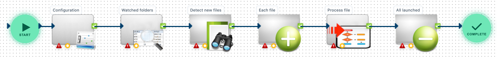

### Sub-workflow or workflow launcher

| | `SubWorkflow` | `WorkflowLauncher` |
| - | --------------- | -------------------- |
| Waits for the called workflow | Yes: blocking, like a function call. | No: fire and forget (an option can wait for completion). |
| Outputs | The outputs of the called workflow that you expose in the step configuration. | The id of the launched work order; its status when waiting. |
| Status | Failure or error of the called workflow fails the step. | Success once launched, error if the launch fails. When waiting: a failure fails the step only with **Fail if launched work order fails**; an error or a cancel always fails it *(4.1.6)*. |
| Work order | Child work order, shown inside the parent. | Independent work order, with its own label. |
| Use for | A block of a larger processing; error handling at the caller level. | Splitting trigger and processing; starting independent workflows. |

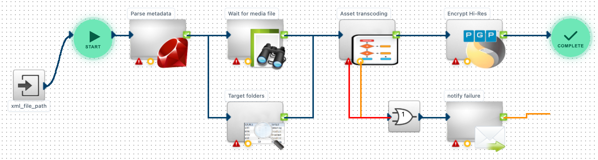

Rules:

- A sub-workflow is a black box: the caller gives inputs and gets the outputs it needs.
  Expose only those outputs.
- Select **End with workorder status** in the sub-workflow step to report the status detail of the called work order, rather than the status of its last step.
- Select **Use true name** to show the workflow name without "launched by ... at ..." in the title.
- With `WorkflowLauncher`, set the label of the launched work order (for example the file name), and set **Master id** to a fixed value (a negative number does not clash with work order ids) to group launched work orders on one line in **View by work order**.
- When the caller must handle the failure of the called workflow (for example to release a resource), use `SubWorkflow`, or a launcher with **Wait for completion** and **Fail if launched work order fails**: without them, a launcher reports success once the work order is started.
- A republished sub-workflow is used by the next execution of its callers; no need to republish them.
- Refer to the called workflow by its UUID (`portable_id`) rather than its numeric id when workflows move between servers by import in the user interface or with `import_with_constraints`: the import keeps the `portable_id` of the file, unless a workflow of the target already has it *(4.1.6)*.
  The `import_workflow` API (`ascli orchestrator workflows import`) always generates a new `portable_id`: there, refer by id (see [Referring to existing entities](workflow-authoring-guide.md#referring-to-existing-entities) in the Authoring Guide).
- Parameters of `WorkflowLauncher` are a hash: `{"param1"=>"value1", "param2"=>true}`; `CollectionManager` can build it.
- Never put a trigger with **Continue monitoring** in a sub-workflow: the sub-workflow is cloned at each event.
  Put it in the top-level workflow, or in a workflow started by a launcher.

### Reusable building blocks

Build a library of tested workflows, each solving one problem: transcoding with a given product, checksum, Aspera transfer, notification.
A new end-to-end workflow is then an assembly of tested blocks plus a trigger and some glue, and is ready quickly.

- Include a block with `SubWorkflow` when it is part of a processing, with `WorkflowLauncher` when it is started by a trigger.
- Make blocks configurable with parameters and lookup tables, so that the same block serves several cases (for example, the transcoding profile chosen from the source folder or from the media properties).
- Keep a workflow to 15 or 20 steps: easier to read, change and troubleshoot, fewer mappings.
- Do not create a sub-workflow for a single step: each call creates a work order.
  Share the step configuration with a template instead.
- Some teams run automated tests of their building blocks continuously against the current revisions.
- Duplicating a production workflow for a one-off variant can be the right choice: it avoids the risk of changing a workflow in production.
  Weigh that risk against the cost of maintaining two copies.

### Naming conventions

Conventions save time, especially when several people work on the same workflows.

- **Workflows**: meaningful names, with a level marker for the call chain, and folders (like a file system) rather than everything at the root.

  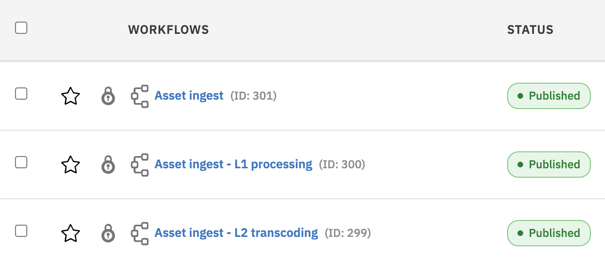

- **Steps**: meaningful titles, unique in the workflow.
  Letters, digits, spaces, dashes and underscores only, no accents.
  **Rename the step before creating its configuration**: the configuration takes the name of the step and cannot be renamed later.
- **Variables and parameters**: ASCII letters, digits and underscore (`A-Za-z0-9_`), no spaces, accents or dashes.
  Do not start a variable name with a capital letter: Ruby treats it as a constant.
  Prefix parameters with `p_`, so that a mapping list shows at once what comes from a parameter and what comes from a step, and write the names of configuration values in UPPERCASE.
- **Inputs**: names that mean something in the context of the workflow (`remote_base_folder` rather than `input_mount_point`).
- **Work order labels**: include the processed element (file or package name) ([Meaningful status](#meaningful-status)).
- **Revision comments**: what changed and who changed it.

## Working in the designer

### Changes and revisions

- **Save** creates a revision, with a comment: write what changed.
  Save often: even a workflow with errors is saved, which protects against browser crashes.
- **Publish** makes the last revision the one that runs.
  Publish also saves, without a comment; the comment of the last change can be edited later in the history.
- A workflow is not checked for logic errors when saved, only for mapping errors (for example a required input not mapped).
  A wrong type conversion, a starvation or a missing value appears only at run time.

Step configurations and workflow revisions are versioned separately.
A workflow revision shows the current values of its steps, not the values at the time of the revision; the history of a configuration or template is in its own **Revision log**.

| What you changed | What to do |
| ------------------ | ------------ |
| A value in a step configuration or a template | Save the step. Effective at the next execution of the step, without publishing. A running trigger uses the new value at its next clone; reset its work order to apply it at once. |
| Steps, links, mappings, retries, timeouts, inputs or outputs | Save and publish. Run **new** work orders (new work order or relaunch). |
| Custom inputs or outputs of a step (for example of `CustomRuby`) | Saved with the step, but the workflow does not know them until you publish. |
| A sub-workflow | Publish it. Its callers use it at their next execution. |
| The designer says there is nothing to publish | Move a step slightly, then publish. |

**Reset** reruns an existing work order with the revision it started with: it ignores new steps and mappings.
**Relaunch** starts a new work order with the latest published revision and asks again for the runtime parameters; it exists only for top-level workflows.
**Bulk restart** (in **View by workflow**) resets a group of work orders.

### Configuration or template

Double-clicking a step offers **New configuration** (settings for this step of this workflow) or an existing template (settings shared by all the steps that select it).

- Use a template for what must be identical everywhere: configuration values, resource allocation and release, connection settings.
  Change it once and all workflows follow, without restart.
  A template survives the deletion of the workflows that use it.
- Use a configuration for settings specific to one step of one workflow (a watcher with its folder and pattern).
  A template that is too specific is dangerous: someone reuses it and changes it for another workflow.
- To change a template from a workflow, you must click **Modify**: a reminder that you change a shared object.
- **Workflows > Workflow Actions** lists the templates of each plugin; hover over the name of a template, or select **Use** in its menu, to see the workflows and steps that use it.
  A new configuration appears there after the workflow is published.

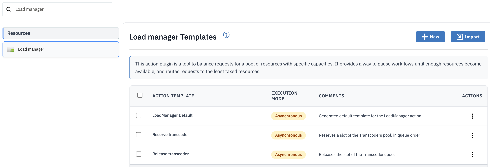

- To turn a configuration into a template: right-click the step, **Change Action Template**, and click **Make Global Template** (globe icon) on the current configuration (its name is shown between stars).
- To detach a step from a template: **Change Action Template**, then **Copy Template** on the template: the step gets an independent configuration.

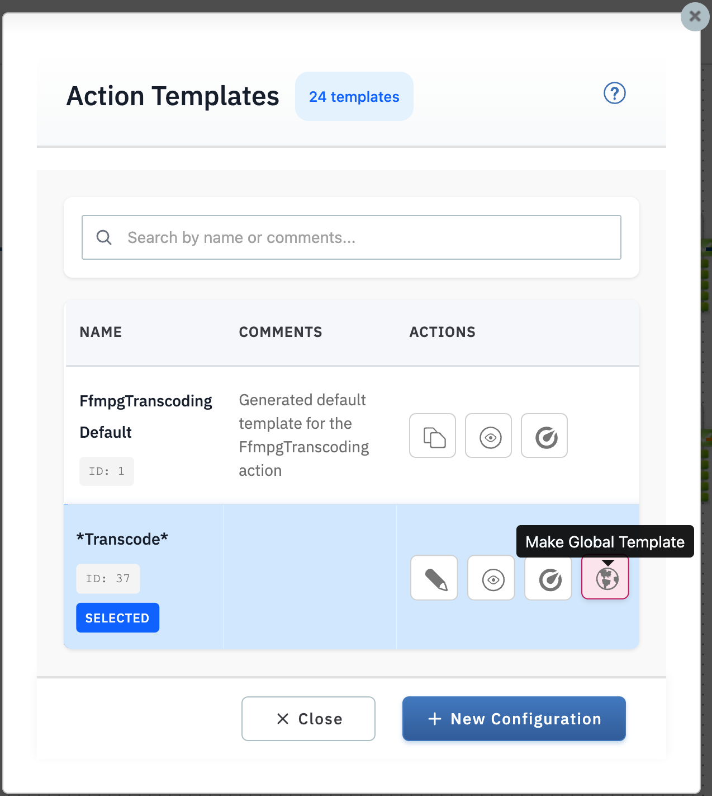

**Duplicate** a workflow (workflow list menu):

- Without **Deep copy**, the copy uses the same templates as the original: changing one changes the other.
- With **Deep copy**, configurations and templates are copied: the two workflows are independent.
  Sub-workflows called by the workflow are not copied; copy them yourself if needed.
- To experiment with a production workflow that you do not fully understand, use a deep copy.
  Otherwise, a deep copy defeats the single point of configuration.

### Testing

- Test each block alone, with parameters, before adding the trigger and the callers.
- Test after each change.
  Link each new step to **Complete** and run the workflow before adding the next one: an error is then easy to locate.
- A step can be tested alone: in its configuration, enter input values, save them as a named test case, and **Execute**.
  The step really runs: a file is really moved, a REST call is really sent.
- To run a workflow up to a step without running the next one (for example a move), leave the next step waiting on a condition that is never met, check the outputs, then cancel the work order.
  Or route around the step with an OR to **Complete**.
- The work order view shows the inputs that a step not yet started will receive: check them before letting it run.
- Use test folders that no production watcher scans.
- Prefer a test server (for example a copy of the production VM with a temporary license and triggers disabled).
  Developing new workflows on a production server is acceptable if production workflows are not touched.

### Designer tips

- The **?** of each step opens the help of its plugin, with all its options.
- Add comments in the **Comments** field of steps: they appear in the printable documentation (**Generate printable documentation**: the workflow and all step settings on one page).
- A **Note** (sticky note) can be placed on the canvas, for example to flag something to discuss.
  It has no effect on execution.
  Do not clutter the canvas with notes.
- Right-click a link to change its line style: **Manhattan Router** (right angles, the default), **Bezier Router** (curve), **NULL Router** (straight line), **Fan Router** (straight lines spread apart when several links join the same two nodes).
  Manhattan links that share a path overlap, and the last one drawn hides the others; a Manhattan line can also cross a step.
  Use a Bezier curve where it makes the graph easier to read: this depends on the graph, it is not a rule.
  Give the failed and error exits of a step the same style: a curve beside a right-angle line looks odd.
- Use absolute paths, and end directory paths with `/`: a directory name without slash can be taken as a file name.
- When several users edit the same workflow, the last save wins.
  Lock the workflow (only administrators can unlock).
- A workflow can be deleted only when none of its work orders runs.
- **Export** the workflow after each major change, as a backup; the export takes the published revision.
- Enable only the plugins you use: the palette is easier to search and the memory footprint is lower.
  After enabling a plugin, click **Engine > Force maintenance**, so that the workers (not only the designer) know it.
- Browser password managers may fill credential fields of step and remote node forms without showing it, which causes authentication failures that are hard to explain.

## Passing data between steps

### Inputs and mappings

The **Inputs** tab of a step (or right-click > **Map inputs**) maps each input to a value, a parameter, or an output of a previous step.

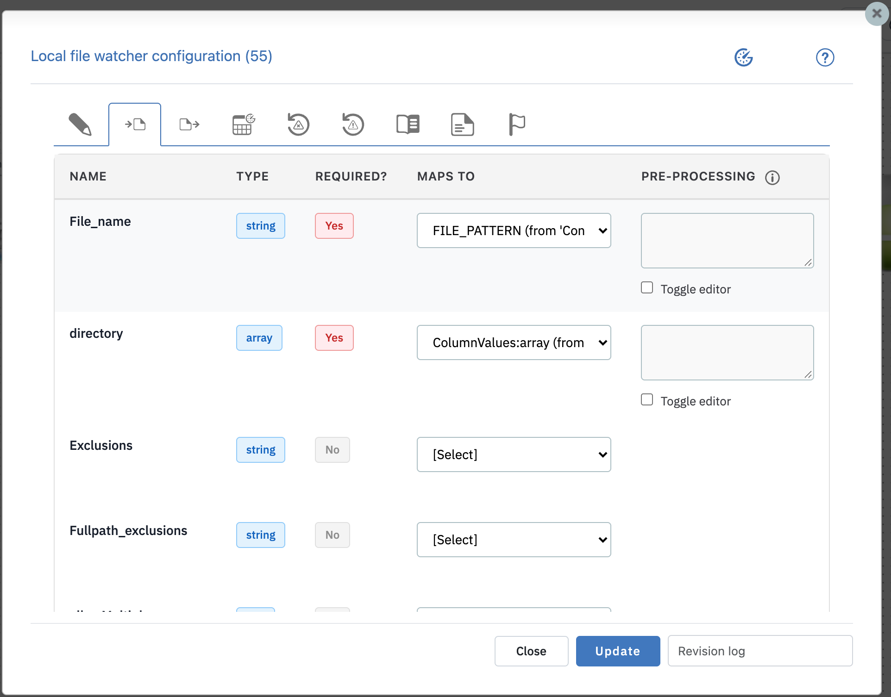

- A value is given either in the step configuration or in the input mapping, not both.
  When both exist, the mapping wins, even when it is no longer displayed (older versions); remove the mapping first.
- The mapping list of a step shows the outputs of the steps linked to it, the outputs they carry through, and the global parameters.
  When an output is missing from the list, check the links first.
- Required inputs must be mapped: the save reports the unmapped ones.
- Removing a step or a link loses the mappings of the following steps.
  To remove a step in the middle of a workflow, change its type to a neutral step and keep its mappings.
  Adding a step does not break mappings, but see [carry through](#output-visibility-and-carry-through).
- When exclusive branches join, map the outputs needed after the join on every branch.
- When two steps produce outputs with the same name, check which one you map.

### Output visibility and carry through

**In the designer, an output is offered only to the step immediately after the step that produces it.**
This keeps mapping lists short.

To pass an output further, open the next step, **Outputs** tab (right-click > **Map outputs**), and tick **Carry Thru?** for that output.
Repeat on each step along the way.

This is a rule of the designer, not of the engine *(4.1.6)*: a workflow written as a file can map an output of any previous step without carry through (see [Outputs](workflow-authoring-guide.md#outputs) in the Authoring Guide).

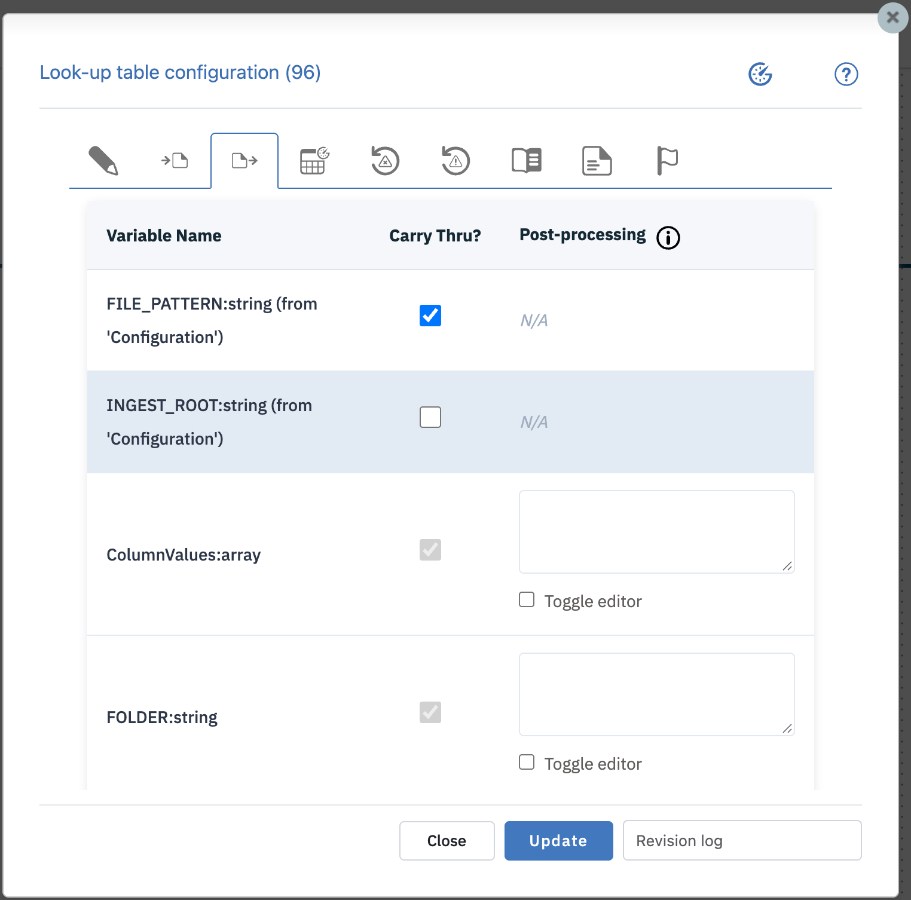

Inserting a step in an existing workflow breaks the chain of carried outputs.
In the new step, tick **Select All Variables** so that all carried outputs continue (except the step information outputs, which are rarely needed).

### Parameters

A parameter has a name, a type and a value.
A runtime parameter is given when the work order starts; it is optional when it has a default value.

- **Link parameters to Start**: they become global, visible to all steps without carry through.
  A parameter linked to a step appears only in the mappings of that step (older workflows); its value is the same for all steps *(4.1.6)*.
- Global parameters are read-only.
  To change a value, produce a new output (for example in `CustomRuby`).
- Give a default value when the parameter has the same value 99 % of the time.
- For an empty default value, leave the field empty; do not write `""`.
- Do not use parameter default values as constants shared by several workflows: use a [configuration template](#configuration).

### Placeholders

In many fields, `<%= expression %>` is replaced at run time by the value of the expression.

- A variable used in a placeholder becomes an input of the step, of type string, to be mapped (for example `<%= p_file_path %>` in a label).
- A suffix in the name gives another type: `_int`, `_float`, `_date`, `_array`, `_hash`, `_flag`, `_pwd` (for example `<%= start_date %>`); the input keeps the suffix in its name.
- A typing error creates an extra input: check the **Inputs** tab after editing.
- Do not name the variable like an input of the plugin (use `<%= recipients1 %>` for a field `recipients`): it would not appear as an input.
- Useful methods: `File.basename(path)` (name with extension), `File.nakedname(path)` (name without extension, an Orchestrator extension), `File.dirname(path)`, `File.join(dir, name)`.
- The variables are found only in simple forms *(4.1.6)*: `<%= name %>`, a call whose arguments are all variable names (`<%= File.join(dir, name) %>`), and `var(name)` in any expression.
  `<%= File.join(dir, 'sub') %>` (a literal argument) or `<%= File.basename(path).upcase %>` creates no input: the value is `nil` at run time (error "no implicit conversion of nil").
  Write `<%= File.join(var(dir), 'sub') %>`.
  Some fields are not scanned at all: see [Placeholders](workflow-authoring-guide.md#placeholders) in the Authoring Guide.
  Check the **Inputs** tab after editing.
- `RestRequest` does not support conditions (`<% if %>`) or method calls such as `gsub` in its body; prepare the values in a previous step.
- Computing a value in a field (for example a target folder `<%= File.dirname(package_dir) %>/transferring/`) saves a step, but the value is visible only when the step runs, and is tested only with real files and servers.
  A dedicated step (`ConvertPath`, `MassParameterSetter`, `FileInfo`) shows the computed value as an output and can be tested alone: prefer it when readability matters.
- The rules of placeholders in template attributes are in the Authoring Guide ([Placeholders](workflow-authoring-guide.md#placeholders)).

### Types and conversions

Orchestrator is strongly typed: string, integer, date, flag (boolean), hash, array, password.
Conversions are not automatic.
They are needed mostly between a single value and a list: a watcher returns a path (string) and the next plugin wants an array; a lookup table returns strings and the next step wants a flag.

**Pre-processing** code on an input converts the value: the variable `input_value` holds the value and can be reassigned.

| Conversion | Pre-processing |
| ------------ | ---------------- |
| String to integer | `input_value = input_value.to_i` |
| Value to array of one element | `input_value = [input_value]` |
| First element of an array | `input_value = input_value[0]` |
| Element of a hash | `input_value = input_value['key1']` |
| Empty to empty array | `input_value = [] if input_value.blank?` |
| String generated as a Ruby hash | `input_value = eval(input_value)` |

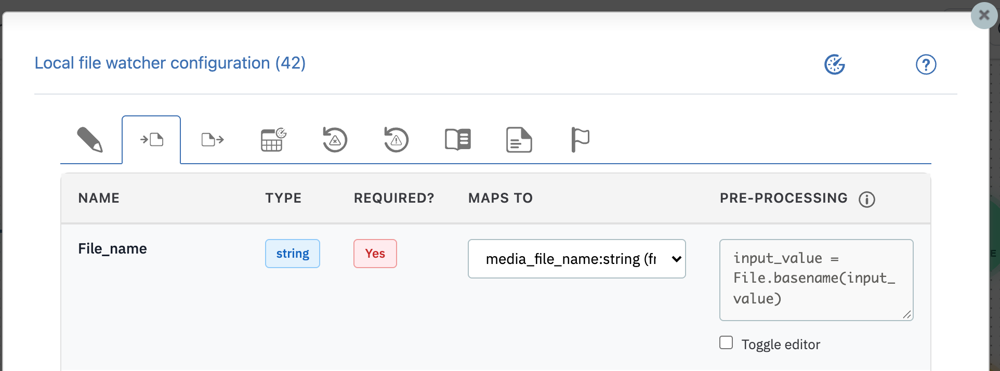

- Keep pre-processing short: it is hidden in the mapping.
  For more, use a step (`CustomRuby`, `InputManipulation`).
- Pre-processing must have no side effect.
  In the work order view, an input with pre-processing has a mark; **Show result of pre-processing** runs the code again.
- Wrong conversions fail at run time, not when saving.
- Inputs are read-only: changing `inputs['myhash']['key']` in Ruby has no effect.
  Produce a new output.
- In a fixed runtime value of a step input, avoid backslashes, quotes and double underscores (`test__1.xml`): put such a value in a `MassParameterSetter` and map it.
- Lookup tables return strings, unless typed outputs are enabled ([Lookup table](#lookup-table)).

### Keep data small

All inputs and outputs of all work steps are stored in the database.

- Do not pass large hashes (for example a global configuration) from step to step and to sub-workflows: use small hashes per workflow, or read the configuration where needed.
- Keep the elements of fan-out lists short (paths, identifiers), and the lists short.
- Many variables or large values make the database and the work order view slow.

## Configuration

A workflow must be configurable: IP addresses, credentials, folders, e-mail lists, patterns, profiles.
**Never bury constants in step settings, in pre-processing or in Ruby code**: when a folder or a server changes, you must find every occurrence.

| Need | Use |
| ------ | ----- |
| Values identical for all executions (folders, e-mail addresses, URLs) | `MassParameterSetter` (stored parameter set), as a template. |
| Values that depend on a key (source folder, customer, variant, server) | `SimpleParameterLookup` (lookup table), as a template. |
| Address and credentials of a server | A remote node. |
| Values that differ between test and production servers | Environment variables in `MassParameterSetter` ([below](#stored-parameter-set)). |
| A secret | See [Secrets](workflow-authoring-guide.md#secrets) in the Authoring Guide. |

### Stored parameter set

`MassParameterSetter` defines named values with a type.
The following steps map the names; the values come from the step at run time.

- Make it a template, so that all workflows share it.
  A workflow may use a couple of configuration steps (for example one per subsystem).
- A value can contain placeholders, computed at run time from inputs, for example `VIDEO_FILE` = `<%= File.basename(package_path) %>`.
  Such a step replaces a `CustomRuby` that only derives paths and names, and a reader sees at once that it is configuration.
  A value cannot refer to another value of the same step: repeat the expression.
- The values can be read from a file under `/opt/aspera/var/config/orchestrator/actions_config/mass_parameter_setters/`, re-read at each execution, with lines `key: value`, the type in the name if needed (`count_int: 1`, `name_string: "222"`, `enabled_flag: true`).
- `<%= ENV["NAME"] %>` reads an environment variable declared in `orchestrator.yml` (`env_vars:`): the same workflow then runs on test and production servers with different values.
- Changing a name, or replacing a configuration by a template, requires redoing the mappings of the following steps.
- At the top level, read the configuration once; in the sub-workflows, use runtime or global parameters rather than carrying all values through.
- Prefer it to a lookup table when you are almost sure that there will be only one set of values: it is easier to read (one value per line) and to edit.

### Lookup table

`SimpleParameterLookup` is one of the most useful plugins of Orchestrator.
The first row holds the column names.
The step searches the rows whose key column matches the input value, and returns the values of the first matching row as outputs.

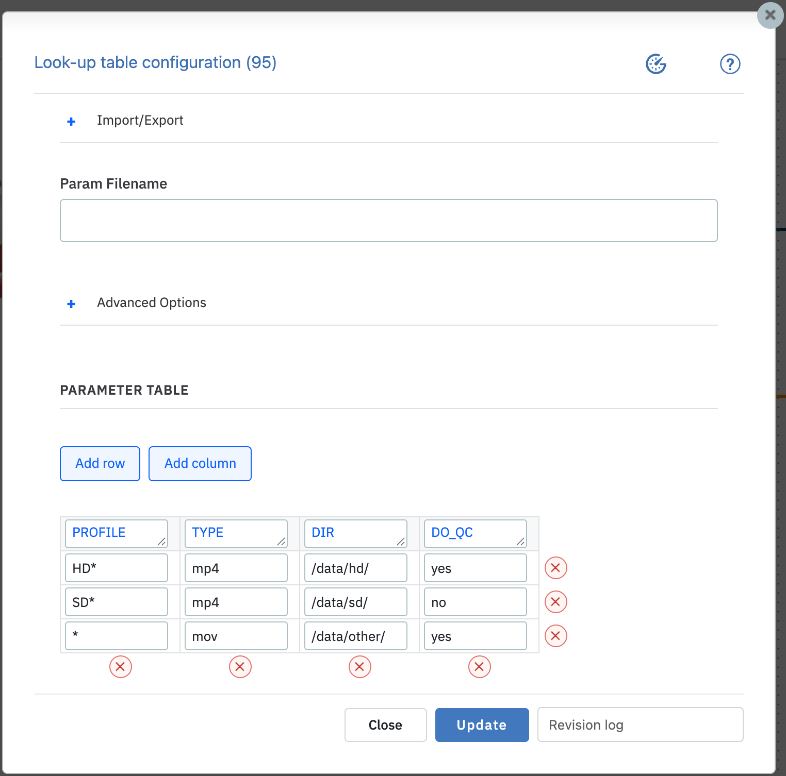

- Map the input of the key column (for example `workflow_prefix`): **without a key, no row matches and the step fails** (`No configuration match`).
- The key is compared as a string: spaces count.
  Glob and regular expressions are supported; `*` as the last row gives a default.
- It replaces nested if-then-else, like a case statement.
- Typical uses: transcoding profile from the source folder or from media properties (height, bit rate, codec from `MediaInfo`), one workflow for several sites or variants (one row per variant), directories to watch.
- `ColumnToListValueFrom` returns all the values of a column as an array (output `ColumnValues`): give it to a watcher with multi-folder search, and add a folder by adding a row.
  Without a key, check **Return array of rows?**: the step then completes (with no row).
- `KeyForTableIndexing` returns the whole table as a hash indexed by a column (`IndexedTable.values` gives one hash per row).
- Fill every cell: empty cells are not handled well (use a default or `NA`).
- Values are strings, unless **Support typed outputs** is set and the column names have a type suffix (`value_int`, `value_flag`, `value_array`, `value_date`); the input stays a string.
- Do not use column names identical to the names of a previous `MassParameterSetter`.
- To add a value, add a column rather than change the meaning of an existing one: existing mappings stay valid.
- For large tables, edit a CSV file: export and import CSV, or set **Param Filename** to a file on the Orchestrator server, re-read at each execution (the UI then shows it read-only).
  Such a file is not in the database backup nor in the workflow export: keep it under `/opt/aspera/var`, which is backed up anyway.
- Write the first row in UPPERCASE, to recognize configuration values in mappings.

### Remote nodes

Define each server once in **Workflows > Remote Nodes**: id, name, address, SSH or API credentials.
Steps and lookup tables refer to the node, not to its address: when the address changes, you change it once.

- Refer to the node by its name or id, not by address.
  As a runtime input of a step, give the node id.
- Do not create two nodes for the same server.
- **Secondary addresses** turn a node into a simple load balancer: random, round robin, or primary/secondary (fallback).
  A **keep-alive port** is checked before use (for example SSH 33001, or the Node API port); without it, each use opens an SSH connection to check the node, which costs time and connections.
  A node has one login for all its addresses.
- With round robin or random, an asynchronous plugin that polls a remote job may poll the wrong node.
- **Generate Certificate** creates an SSH key pair, stored under `/opt/aspera/var/config/orchestrator/certificates/`.
- An SSH user with shell `/bin/aspshell` cannot run remote commands; use `/bin/bash`.
- With Windows nodes, the health check of balancing can leave SSH connections in `CLOSE_WAIT` until the SSH server refuses new ones: set the keep-alive port to `0`.
- In a high-availability setup, check connectivity (TCP, SSH, FASP) from both Orchestrator nodes.

### Values in step settings

- Password masking: the work order view masks values according to type and name; see [Where a secret is displayed](workflow-authoring-guide.md#where-a-secret-is-displayed).
  In Orchestrator 3.x and 4.0, `password_field_definition_regex` added name patterns (`pwd`, `secret`, `key`).
- Do not put credentials in a JSON body or a payload file: map them from a remote node or a runtime parameter.

## Control flow

### Exits and statuses

Each step has one entry and three exits:

| Exit | Status | Meaning | Example |
| ------ | -------- | --------- | --------- |
| Green | Complete | Success. | |
| Yellow | Failed | Expected functional failure: the application says no. | Quality control rejects the file; transcoder cannot convert the format; filter returns false; no row in a lookup table. |
| Red | Error | Unexpected technical error. | Server unreachable; required input missing; Ruby syntax error. |

- The green exit of each step must be linked; the designer requires a path from **Start** to **Complete**.
- Failed and error exits are optional.
  An unlinked failed exit ends the work order as **Failed** with "No behavior defined for step status change to failed" (as if all unlinked failed exits went to **Failed** through an OR); same for errors.
- 80 to 90 % of the time, failure and error are handled the same way.
  The difference helps to notify the right people: the content owner for a failure, IT support for an error.
- Each plugin defines what is a failure and what is an error; check its help.
- Base decisions on the status, not on the text of the status message.
- The position of icons on the canvas has no effect: only links matter.
  Steps linked to the same exit run in parallel, in no guaranteed order.

### AND and OR

**Several links into a step (or an end node) mean AND: the step starts when all of them are activated.**
The OR operator (palette **Connectors**) starts the next step when one of its entries is activated.
Double-click the OR to set how many entries must be activated ("n of m"); `0` means all (the symbol then becomes an AND) *(4.1.6)*.

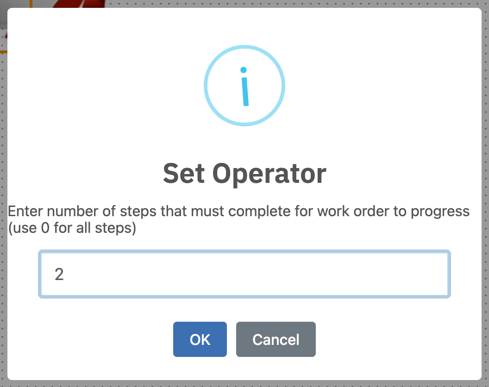

**Starvation**: a step waits on an AND of links that can never all be activated, for example the complete and the failed exits of the same step.
The workflow is published without error, the work order starts, and it never ends.
Almost every workflow developer makes this mistake at least once.
It is the first thing to check when a work order does not complete.
`ascli orchestrator workflows check_import` reports it in a workflow file (`graph.starvation`).

Two exits of a step, joined without OR (never ends), and with an OR (correct):

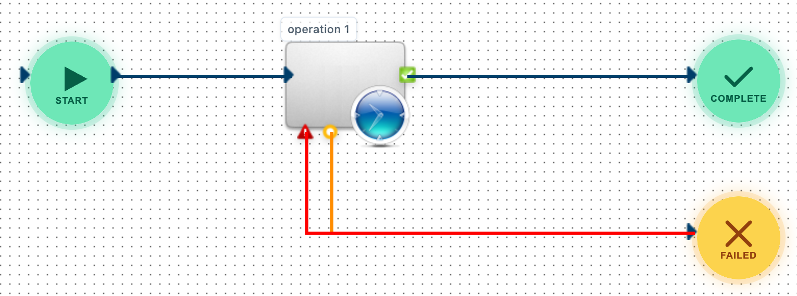

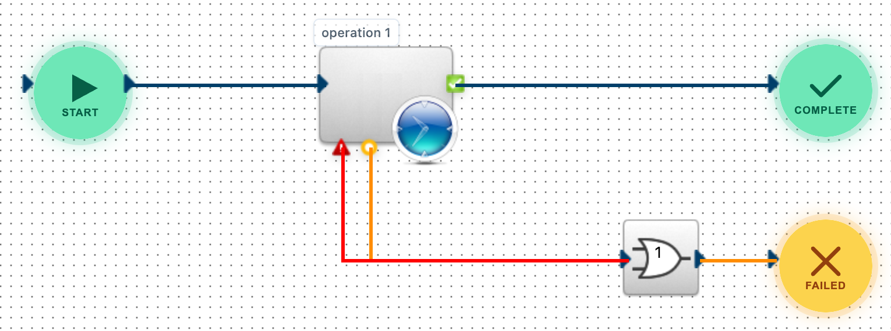

A bypass: the filter skips operation 1 on failure.
Both paths must join through one OR before **Complete**:

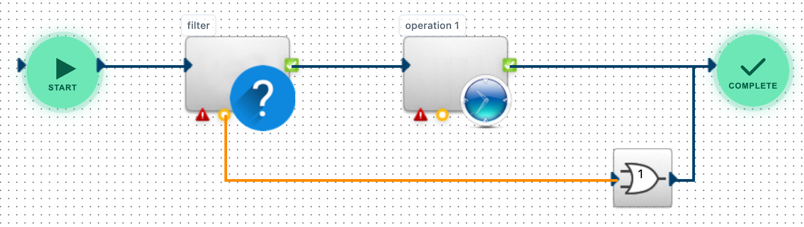

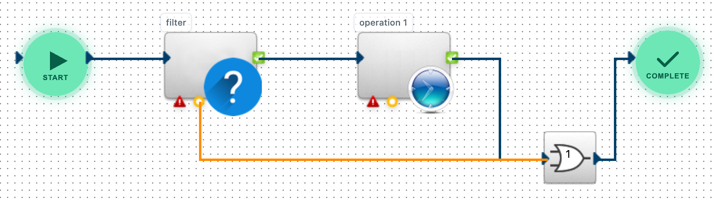

Rules:

- Join mutually exclusive branches (if and else, complete and failed, success path and error path) with an OR.
- All the entries to join go into the same OR: not one into the OR and another directly into the next step.
- Do not chain several ORs into one step: use one OR with the "n of m" setting.
- The designer refuses the last two cases *(4.1.6)*: **Workflow saved with errors** ("Step '...' is connected to a preceeding operator and can not also be connected to preceeding steps", "cannot be connected to more than one preceeding operator"), the links of the step to its other predecessors are not saved, and the workflow cannot be published until it is fixed.

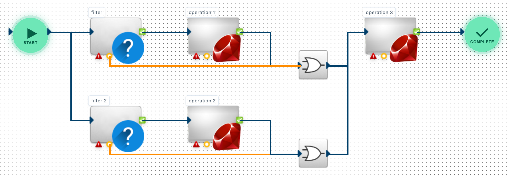

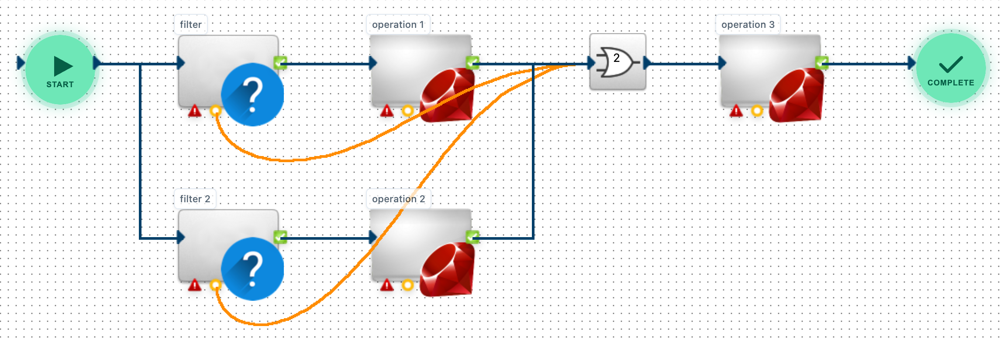

Choose the join by the pattern of the incoming branches:

- **Parallel branches, all of which run** (a fan-out where several tasks run at the same time): leave the join step as an AND (`Synch_factor` `0`). It waits until all the branches have completed.
- **Mutually exclusive branches** (an if and else condition, a route decision between alternative lanes, a nominal branch and an error branch): only one branch runs per execution. An AND would wait forever for the branches that did not run and the work order would never end. Use an OR with `Synch_factor` `1` on the join step (or on `End` or `Fail`), so that it proceeds as soon as any one of the incoming branches completes.

In XML, the OR and its setting are the `Synch_factor` of the following node: see [Prerequisites and branches](workflow-authoring-guide.md#prerequisites-and-branches).

### Conditions

`Filter` is the if-then-else: its Ruby code returns `true` (complete exit) or `false` (failed exit).
Inputs are read with `inputs['name']` and declared as required inputs with a type.
Placeholders also work, but are replaced by text before the code runs: see [Filter](workflow-authoring-guide.md#filter) in the Authoring Guide.

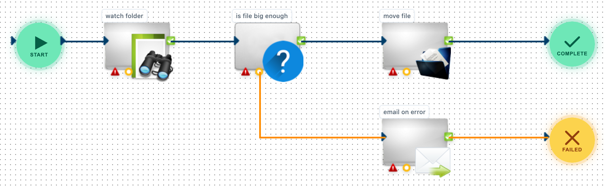

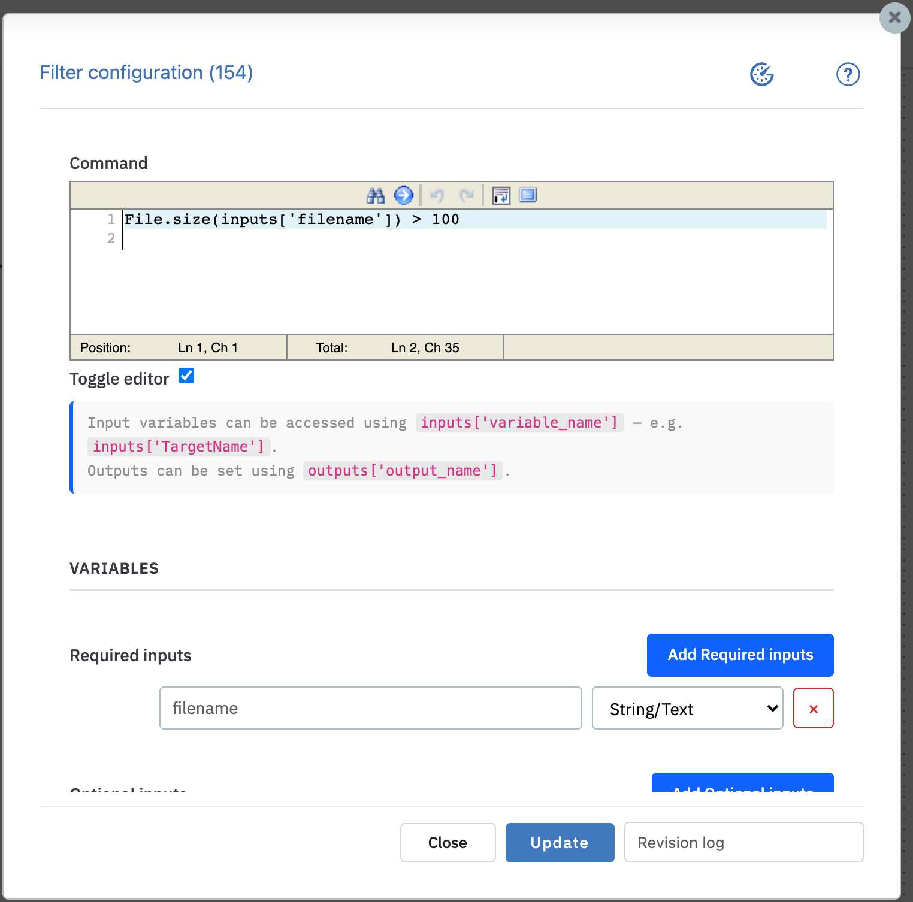

- Name the filter after the question it answers.
  Returning a flag named `should_fail` requires a negation (`return !inputs['should_fail']`), which is easy to get wrong.

  

- The failed exit of any step is also a condition: "if the transcoding fails, do this".
- A lookup table is the case statement ([Lookup table](#lookup-table)).

### Parallel branches

Steps linked to the same exit start in parallel.
"Parallel" means put in execution: the actual concurrency depends on the free workers.

| Join | Success | Failure or error of a branch |
| ------ | --------- | ------------------------------ |
| AND (no operator) | Waits for all branches. | The first unhandled failure ends the work order. Other branches become obsolete. |
| OR | The first branch to complete continues; the others become obsolete. | The first unhandled failure ends the work order, even if the other branch would succeed. |
| OR "n of m" with all exits linked | Waits for all branches, whatever their result. | Same. Add a consolidation step that reads the step information of each branch. |

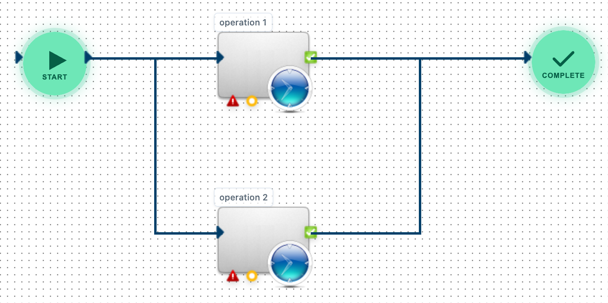

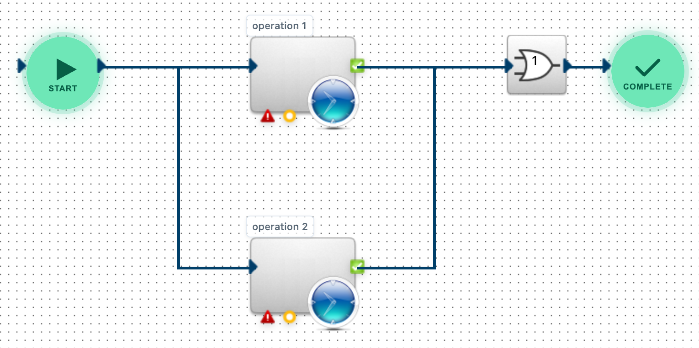

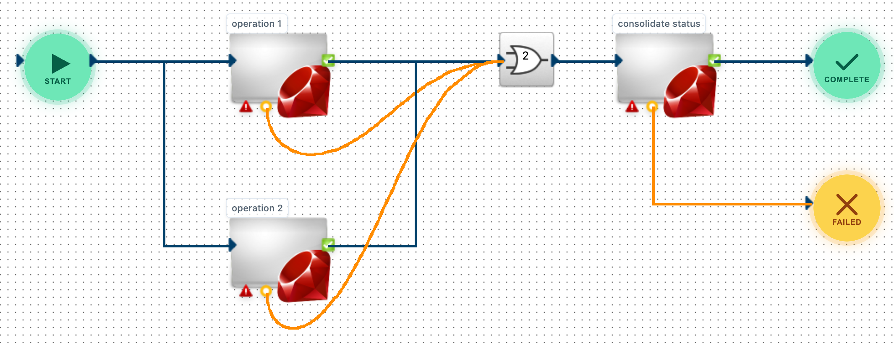

- An obsolete step is no longer followed, but its action is not stopped: a remote job or a synchronous operation goes on.
  An obsolete sub-workflow stops where it is.
- With an OR followed by more steps, a slow branch may still finish while the next steps run.
  To stop the slow branch when the fast one completes, put both branches and the OR in a sub-workflow.

### Loops

**A step that has run cannot run again in the same work order: do not link back to a previous step.**

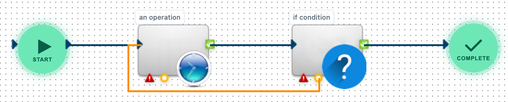

Alternatives:

| Need | Use |
| ------ | ----- |
| The same action on each element of a list | Fan-out and funnel-in ([below](#fan-out-and-funnel-in)). |
| Repeat until a condition is met | A sub-workflow that ends **Failed** while the condition is not met, with retries on failure in the caller. |
| Wait for a condition | A trigger without **Continue monitoring**, or `RestRequest` with a polling stop condition. |
| Wait for a condition with simple code | `CustomTrigger` (repeats Ruby code until it returns a final status); see [Custom code](#custom-code). |
| Re-process a detected file | Change it (for example its modification date): the watcher detects it again. |

Re-queuing an element with a delay to retry later creates many work orders: avoid it for frequent retries.

### Fan-out and funnel-in

`ArrayFanout` (+) runs the step that follows it once for each element of an array input; `Funnelin` (−) waits for all executions and continues.

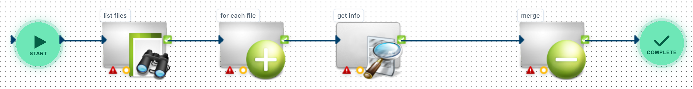

**Exactly one step between the fan-out and the funnel-in.**
With a second step after it, only the first step runs for each element: the second one runs once, after all executions of the first, with the first element, and the funnel-in sees one execution; the work order completes without error, and the other elements are skipped *(4.1.6)*.
To run several steps per element, put them in a sub-workflow and call it between the two.
The sub-workflow is then testable with one element, and the main workflow stays readable.

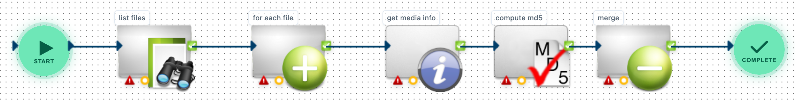

Configuration:

- Fan-out: **Fan-out variable** (the array input, for example `file_paths`) and **Fanned as** (the element, for example `file_path`, with its type).
- Funnel-in: declare the same variable as the fan-out (`file_path`), carry it through the middle step so that the designer offers it, and map it.
  The funnel-in outputs a hash of the status of each execution.
  This is mechanical: declare in the funnel-in what you declared in the fan-out.

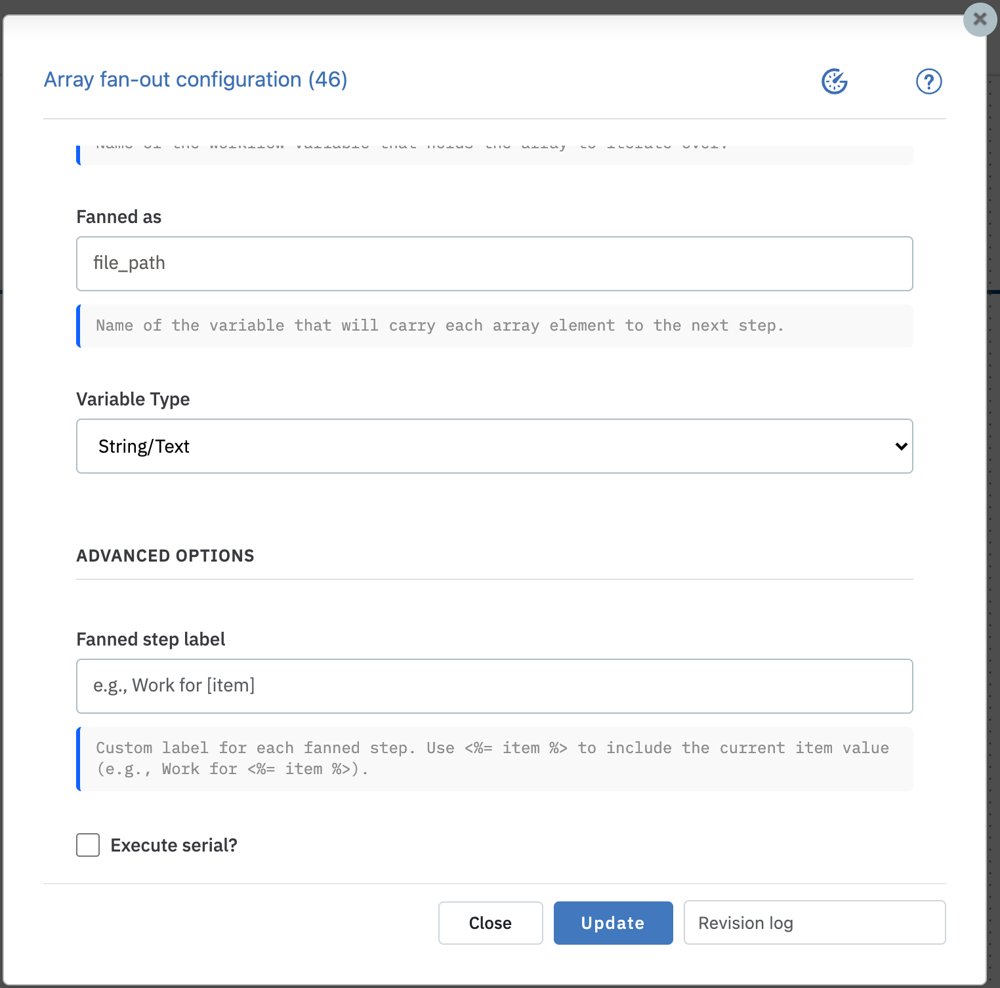

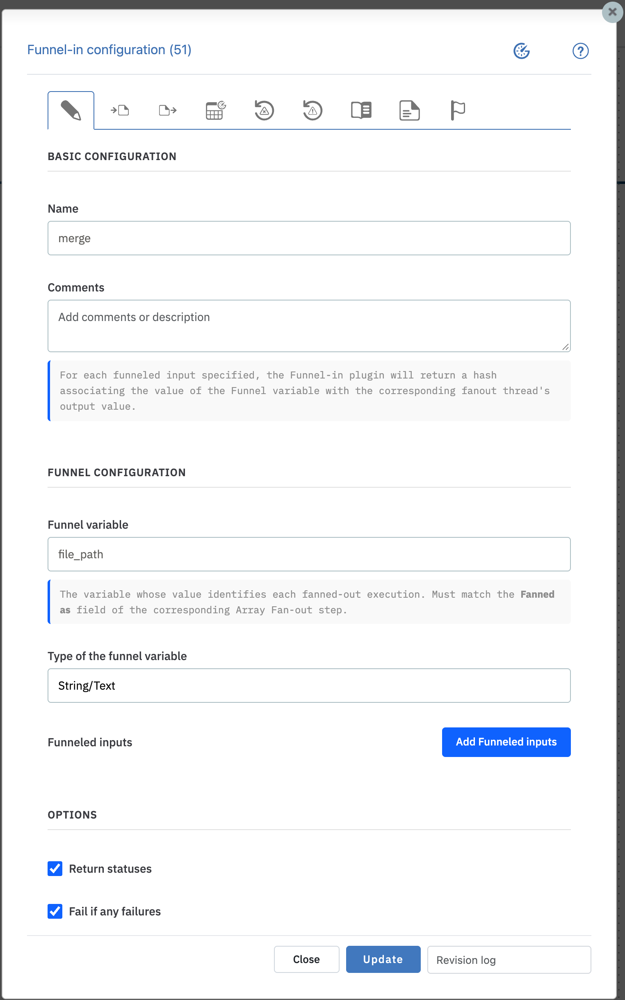

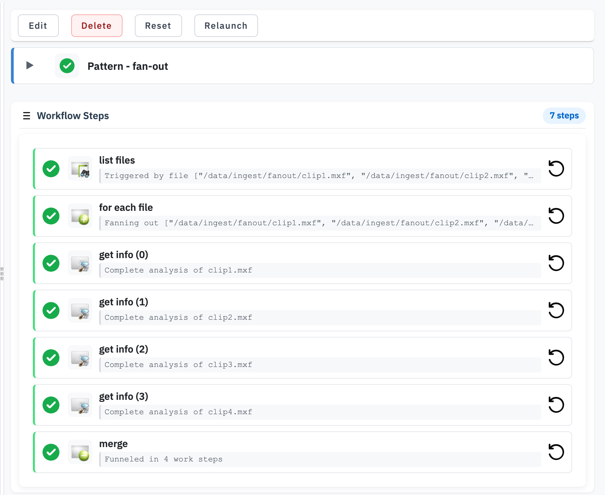

Rules:

- By default the executions run in parallel; **Execute serial** runs them one by one, for heavy steps.
- By default (AND), the first failure ends the loop and the others become obsolete.
  To let all executions finish, link the complete, failed and error exits of the middle step to an OR before the funnel-in, then decide after the funnel-in (fail if one failed, or ignore).
  Select **Fail if any failure** in the funnel-in to report a failure.

  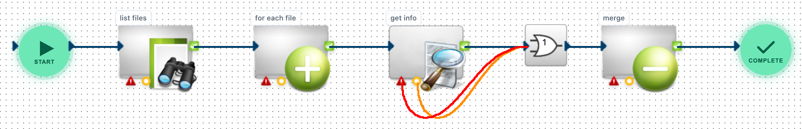

- Handle the errors of each element inside the sub-workflow, not on the links of the sub-workflow step.
- An empty array makes the fan-out fail: test the list before (for example a filter `!inputs['asset_list'].blank?`).
- Several values per element: an array of arrays or an array of hashes.
- A label such as `Processing <%= item %>` shows the element in the step title.
- Do not fan out hundreds or thousands of elements: each creates steps and database rows.
  Split the list, or queue the elements and process them with a resource pool ([High volume](#high-volume)).
- Do not give large lists (hundreds of kilobytes) to a fan-out.
- With `WorkflowLauncher` as the middle step without **Wait for completion**, no OR and no consolidation are needed: it succeeds once each work order is started, unless the launch itself fails.
- With a trigger that returns all matching files as a list, a fan-out processes them in parallel instead of one per polling period.

### Waiting and timeouts

`ScheduleTrigger` has two uses:

- with **Continue monitoring**: a periodic workflow (every hour, every day at 5 p.m.), like cron;
- without: a delay inside a workflow (for example "20 second(s) from now").

Several rules (lines) combine as an AND; for example "20 seconds from now" and "second 1 of the minute".

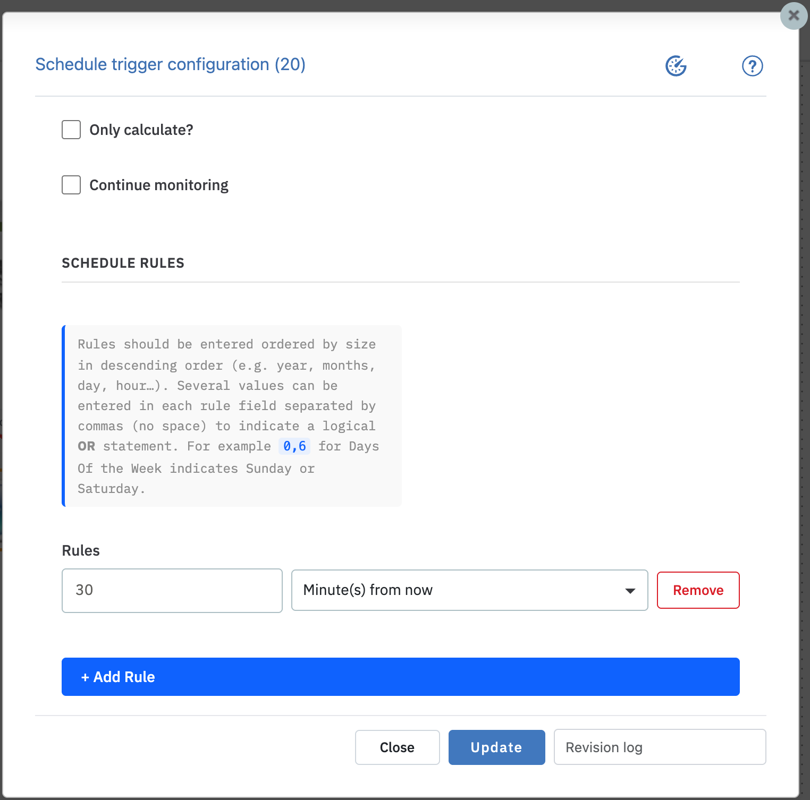

The **timeout** of a step limits one execution of the step: the time without a status update.
For a watcher, one execution is one scan of the folder: the timeout fires only if the scan does not return, never because the file does not arrive.
To limit a wait, or the total duration of several steps, run a `ScheduleTrigger` in parallel:

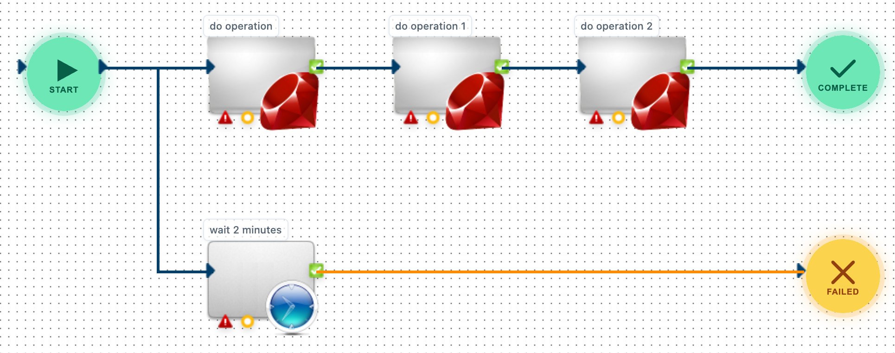

The first branch to reach an end node ends the work order and stops the other branch.
Orchestrator is not a real-time scheduler: do not expect precision to the second.

Escalation: a media file is expected after its XML side file.
After 2 minutes, a reminder is sent and the wait goes on; after one hour, the work order fails:

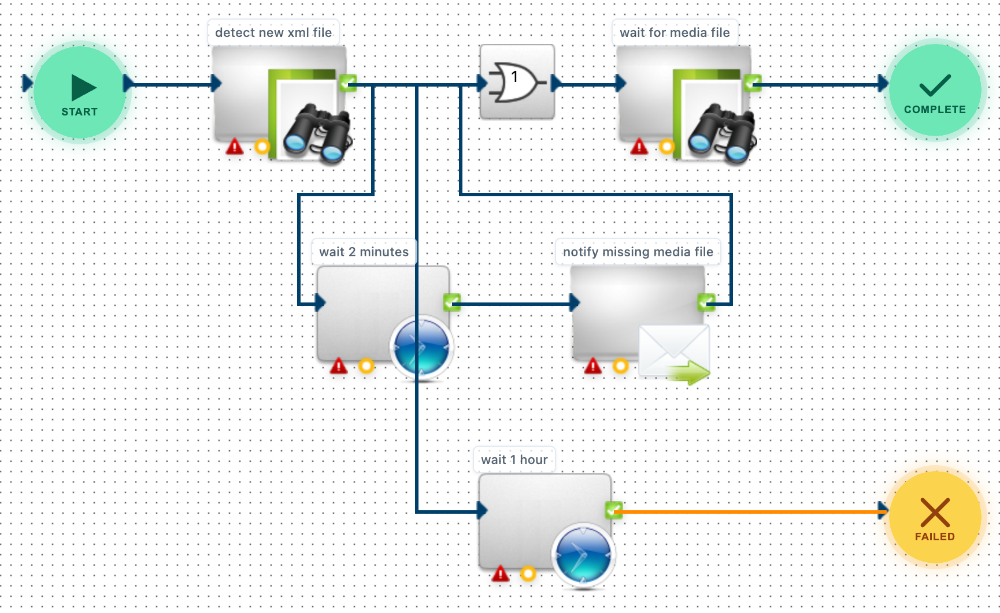

- The step that waits receives several links: if they are exclusive, join them with an OR (in the figure, the OR before "wait for media file").
- The timer runs until the work order ends: the steps after the watched step must not take longer than the timeout, or the timer fires anyway.
  In that case, use the timeout of the step itself.
- When the timer is cancelled because the other branch completed, the timer step ends as failed: link its failed exit so that this does not conflict with the completion.

  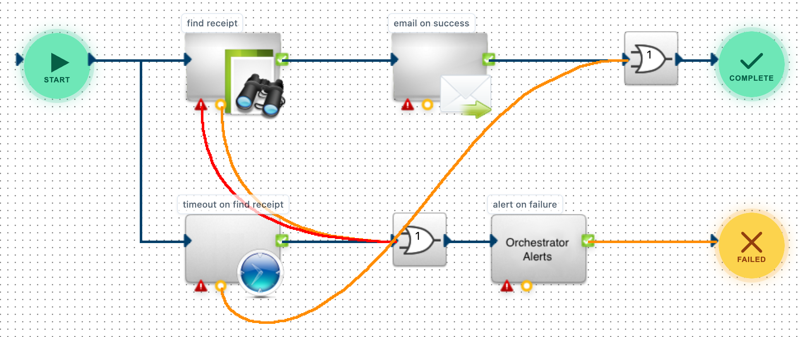

- Do not overuse a periodic `ScheduleTrigger`: each run creates a work order.
  To detect files, use a file watcher.

## Error handling

### Design for exceptions

Plan for the worst: the goal is a workflow that recovers by itself, or fails clearly, without calling support.
If there is one rule to remember: protect yourself.

Ways to report an issue: e-mail, Slack, Jira ticket, journal entry, alert, log file read by a log collector (Splunk, Elastic), metrics database (InfluxDB with Grafana), custom table shown in a dashboard, REST call.
Ways to recover: retry, move the file to an error folder (operators can drop it back), an operator decision ([Human interaction](#human-interaction)), a fallback resource ([Resource management](#resource-management)).

### Retries

The **retry** tabs of a step (one for failure, one for error) set:

| Setting | Meaning |
| --------- | --------- |
| Maximum number of attempts | `0` means unlimited. |
| Retry duration (retry for) | Total time for retries; empty or `0` means no limit. |
| Delay between attempts | Minimum delay in seconds. |

The most restrictive setting wins: 10 attempts, retry for 30 seconds, 10 seconds between attempts makes 3 attempts.

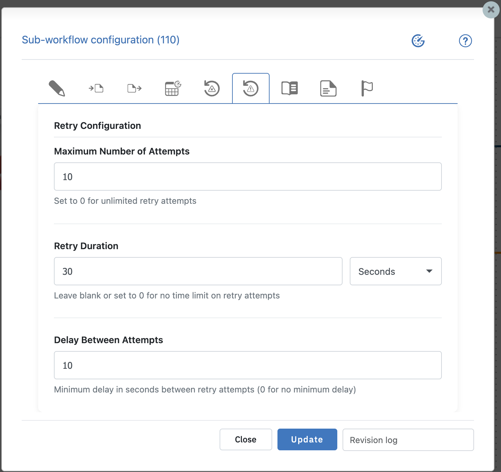

*(4.1.6)* The designer opened from the list of workflows shows **Retry Duration** empty, and saving the workflow there drops it (attempts and delay are kept).
Enter it again before saving, and check it in the **Revisions** tab, which shows it.

- **A retry happens only if the exit is linked**, at least to an OR that leads to an end node.
- A notification linked to the failed exit is sent once, after the last attempt.
  The work order view shows the attempts (for example "Failed (5)").
- Retrying a functional failure is usually useless: the transcoder will reject the same file again.
  Retry errors (network, server restart).
- Synchronous steps interrupted by a restart of Orchestrator cannot resume ("Recovery after partial execution is not supported"): a retry on error covers this case.
- To retry depending on a status code or message, put the action and a filter on the code in a sub-workflow, and set the retries on the sub-workflow step.

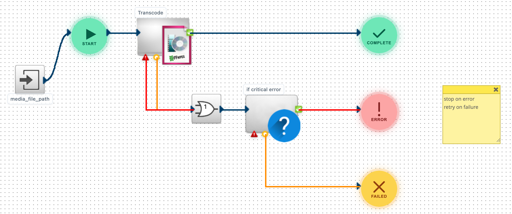

- Some versions retried forever when a required input was missing with retry on error set.
  The workaround is `input_value = "" if input_value.blank?` in the pre-processing of required inputs.

### Timeouts

- Set the timeout of synchronous steps above their expected duration; `0` means no timeout.
  The default is the timeout of the plugin, else 60 seconds (engine setting `default_step_timeout`) *(4.1.6)*.
- On timeout, a step ends as failed by default, or as error.
  For triggers, choose error: a failed trigger with **Continue monitoring** starts a new work order, and a timeout loop follows.
- An absolute timeout cannot be set on a sub-workflow step with retries: use a parallel `ScheduleTrigger` ([Waiting and timeouts](#waiting-and-timeouts)).
- A trigger without **Continue monitoring** with an absolute timeout waits at most that time.

### Cancel

- Cancelling a step stops its action only if the plugin implements cancel (for example `RemoteExecution` with **Is cancelable**, not the FTP plugins); the step and the work order then end as failed, and the failed exit is followed.
- Cancelling the work order does not follow the failed exits of its steps.
- A remote command is not stopped when its work order is destroyed or cancelled, unless it is cancelable.

### Meaningful status

By default, the work order list shows only "Work order ended with status complete", or "No behavior defined for step status change to failed", and the reason of a failure is deep in the sub-workflows.
**Exposing the right information at the right time is as important as getting the job done**: for support, for changes, and for the person who takes over.

**Work order label.**
`WorkOrderMetaData` changes the label (title) and tags of the work order, for example `Processing <%= File.basename(file_path) %>`.
The work order list shows the workflow name and the status message; the label follows the workflow name in the work order view, and the filter **Title** searches it.

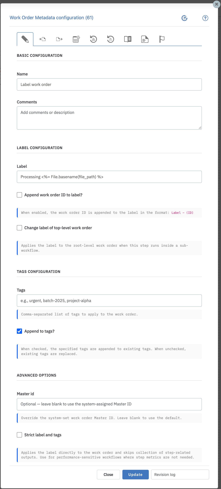

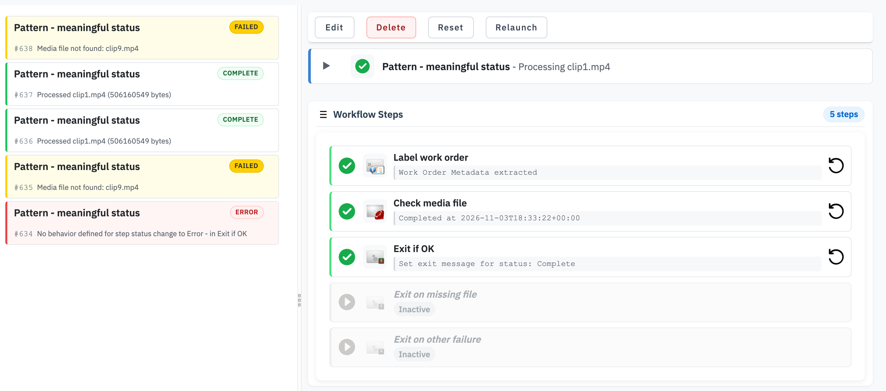

- Filtering the work orders by **title** is fast, even with 100 000 work orders.
  Filtering by **keyword** searches every input and output of every step, and can take minutes.
- In a sub-workflow, select **Change label of top-level work order**: filters see only top-level work orders.
  Do not add tags from sub-workflows called many times when tags are appended (option): the tag field of the top-level work order fills up.
- The label is limited to 255 characters: truncate with `[0...254]`.
- With `WorkflowLauncher`, set the label in the launcher instead.
- Outputs: `master_id` is the id of the top-level work order, `work_order_id` the id of the current one.
- Goal: from the work order list and its filters alone, know which element, which variant and which workflow: name the element in the label and in the status messages ([exit status](#meaningful-status)).

**Exit status.**
`ExitStatus` sets the status message of the work order for complete, failed and error ends (255 characters, with placeholders).

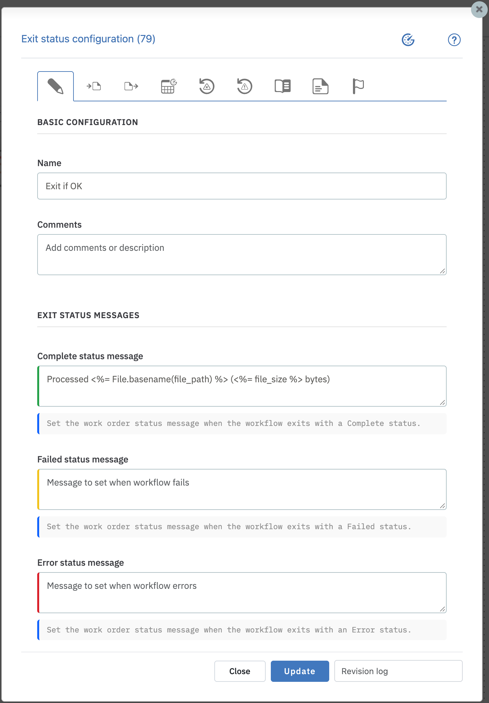

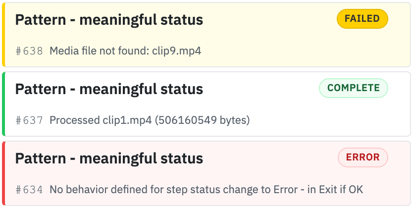

- The message applies only if the `ExitStatus` step ran before the end: a step placed after a failing step never runs.
- Either place one `ExitStatus` early, once the outcomes are known, or (usually clearer) place one before each end: one for complete, one per failure reason.
  Do not multiply them (10 or 15 become confusing).
- Fill only the box that matches the end it precedes.
- In sub-workflows, use **End with workorder status** on the caller and an explicit link to the failed or error end with an `ExitStatus`, so that the message goes up the chain.
- Adding an `ExitStatus` at the end of an existing workflow is low risk: the processing is done before it.
  Changing the beginning of a production workflow is high risk.

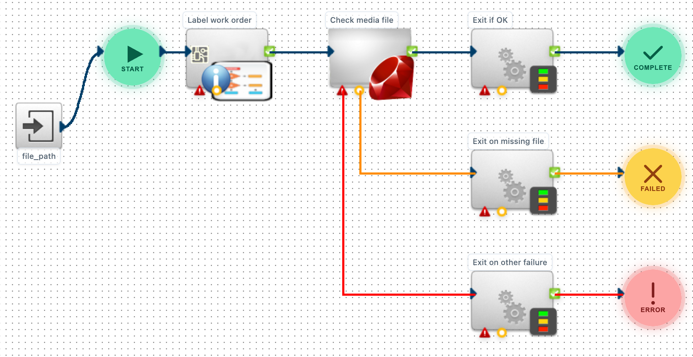

The step information output of a step (`Step_information`) can be customized in its output post-processing, for example `output_value['step_status_details'] = "a message"`, and consolidated in a final step.

### After a failure

- Restart a work order from the work order view: **Reset** (same revision), **Relaunch** (latest revision), or restart from a step (error-prone in a single when-and-what workflow) ([Changes and revisions](#changes-and-revisions)).
- Fix the cause of a work order manually, then **change its status** (work order view: **Edit**, then **Change Status**): this documents the case in Orchestrator instead of e-mails.

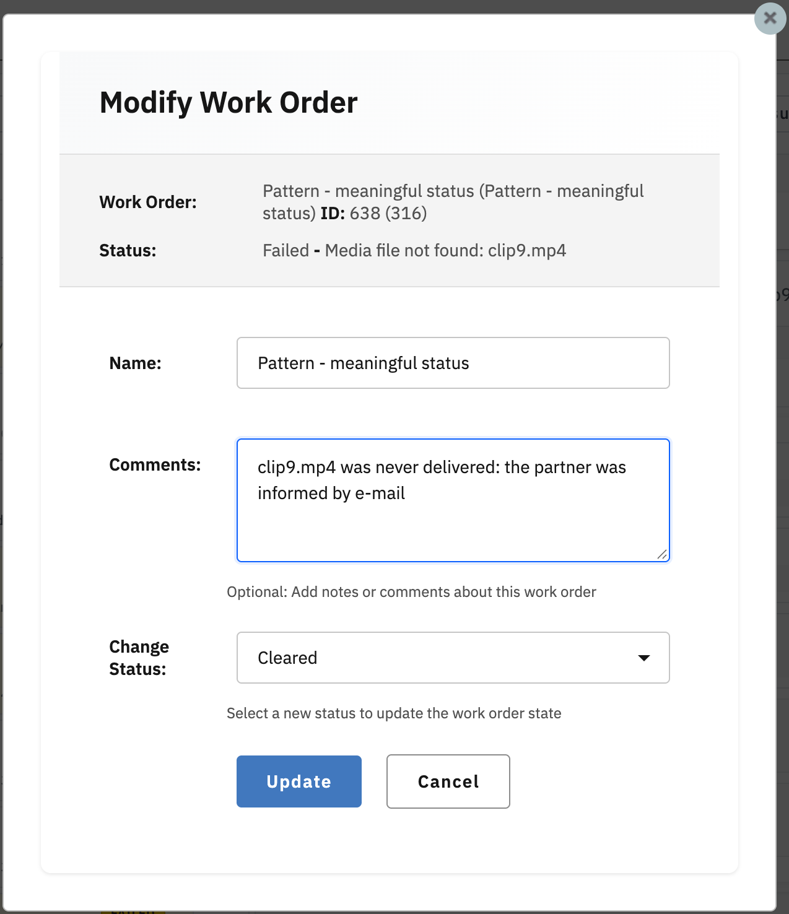

| Status | Use |
| -------- | ----- |
| Cleared | The failure was handled manually; write the resolution in the comment. This is the status used in almost all cases. Do not set Complete when not all steps ran: it is misleading. |
| Flagged | Keep the work order: it is never purged, even with a workflow purge of 0 days. Use it rarely and write down why: thousands of old flagged work orders made a database slow. |
| Rolled-back | The action was undone (for example the file was moved back to the watch folder to be detected again). Rarely used. |

- External monitoring through the API may require a manual status change, for example during maintenance.
- Non-administrators need the permission `Aspera:Orchestrator:WorkOrder:edit` to reset work orders.

## Triggers

### Continue monitoring

All triggers have the option **Continue monitoring** (**Keep trigger ongoing** in older versions).

- **Not selected**: the step waits for its condition, fires once, and the workflow continues.
  Use it inside a workflow to wait for something, for example a folder whose full path is known (even for days).
- **Selected**: when the condition is met, the work order continues with the detected element, and a clone of the work order waits for the next event at the trigger step.
  All these work orders form a work order group.

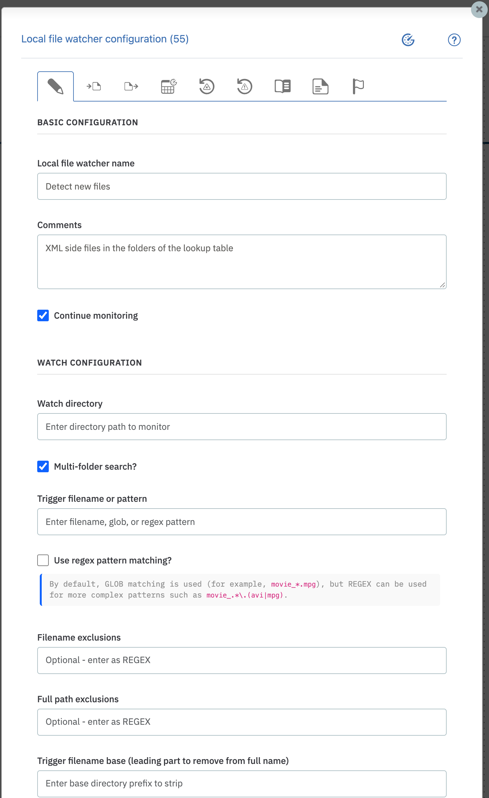

- With **Return all matching files** (or **return elements as a list**), one work order receives all the elements detected in one scan; without it, one work order per element, started one after the other (about two polling periods apart).
  With a long polling period, prefer the list and a fan-out.
- A file watcher detects a file when it is stable: same size and modification date during the stability time (by default the polling period).
  **Trigger on partial** continues as soon as the file exists.
- Polling every 2 seconds is too often, especially for remote watchers (one SSH connection per scan); keep the default (5 seconds) or use 10 seconds.
- A watcher runs forever: only a manual action (cancel, pause, destroy) stops it.
  Add a workflow monitor to restart it ([Monitors](#monitors)).
- After a restart of Orchestrator, watchers start again automatically, and running work orders continue from where they were.

### Persistency scope

The persistency scope sets the memory of a trigger: which elements it has already detected, so that it does not detect them again.
The history is keyed by the element (for example the file path); a file with the same name but a new modification date or content is detected again.

| Scope | History shared by | Use |
| ------- | ------------------- | ----- |
| by workorder group (default) | The work orders cloned from one start of the trigger. A new start (new work order, relaunch) has an empty history. | Files moved out of the watched folder after detection. To reprocess the files left in the folder (after a failure), restart the trigger. |
| by workflow | All the work orders of the workflow. A restart does not detect again. | Files that stay in the folder. Touch a file to detect it again. |
| by step | One step. | Two watchers on the same folder in one workflow, with separate histories. |
| by action template *(4.1.6)* | All the steps that use the same template. | Steps that share a watcher template must not process the same element twice. |
| absolute | All workflows. | Two workflows on the same folder must not process the same file. |
| none | Nothing: the element is detected at each scan while it is present. | Only a trigger **without** Continue monitoring that waits for a file that may already be there. |

**Never use scope none with Continue monitoring**: the same file is detected at each scan, and each detection creates a work order.
In one real case, 15 000 work orders were created for one file within an hour; the server stopped responding, and the license had to be removed so that Orchestrator would start without processing.

- `LocalFileWatcher` keeps a history only when **Remove trigger file** is not selected *(4.1.6)*: a removed file needs none.
  A template written as a file with this option blank (null) has no history at all, whatever the scope: with Continue monitoring, it behaves like scope none.
  See [LocalFileWatcher](workflow-authoring-guide.md#localfilewatcher) in the Authoring Guide.
- Changing the scope erases the history: existing files are detected again.
- The history is stored on disk, or in the database with `persistence_mode: db`, which is needed when several Orchestrator servers share the work.
- Two triggers in the same work order group see the same history: a second trigger on the same element (for example the start and the end of the same transfer) needs scope none, and no Continue monitoring.

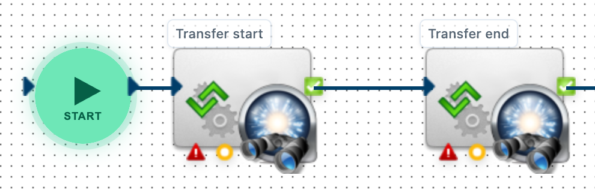

- A trigger called several times in a sub-workflow (without Continue monitoring) returns a different element each time with scope by step.

### Rules for triggers

- **Only one trigger with Continue monitoring from start to end**, in the workflow and all its sub-workflows.
  Two of them clone each other: 1, 2, 4, 8 work orders, and the server collapses.
  Several independent watcher workflows started by a launcher are fine.
- **Only one watcher in progress per detection point**: two watchers on the same folder detect the same files (unless scope absolute).
- Move the detected files out of the watched folder: detection folder, in-progress folder, and one folder per outcome (done, failed, error).
  This is an extremely good design habit.
  If files must stay (existing process), use scope by workflow.
- Ignore files being written: exclude their temporary extensions (`.partial`, `.aspx`) in the pattern.
- When your workflow writes into a folder watched by another system, write the file with a temporary extension or in another folder of the same file system, then rename or move it (atomic on the same file system).
- Handle duplicates if needed (a marker file or a database record): copying the same file again into the folder makes it newer, so it is detected again.
- A trigger with Continue monitoring is usually the first step of a workflow.
  It can be followed by triggers without Continue monitoring that wait for dependent files (`DependencyChecker` checks that all files of a list exist).
- To accept one file or another, link the failed exit of a first `DependencyChecker` to a second one, and join their complete exits in an OR: the work order fails only if both files are absent *(4.1.6)*.
  Set `timeout_in_sec` on both: a `DependencyChecker` fails only on its timeout, and without one (the default) it waits for ever.
  The second check starts when the first one times out.

  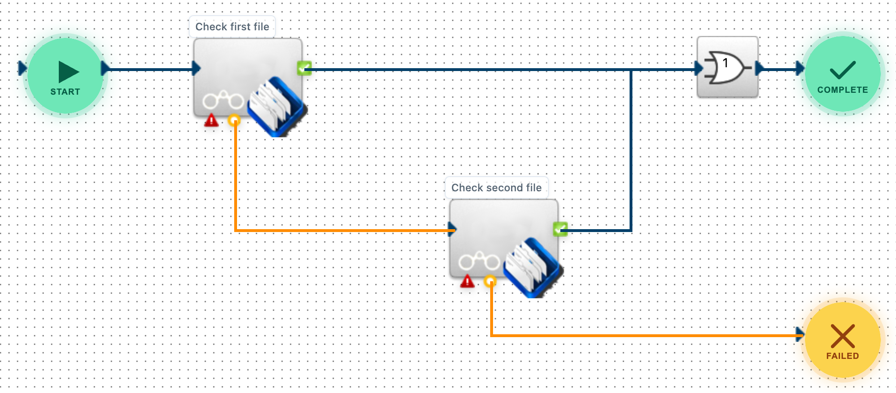

- A watcher configuration change applies to the next clone; reset the waiting work order to apply it at once.
  A code change (new steps) requires cancelling the waiting work order and starting a new one; files still in the folder are then detected again with the default scope.

### Choosing a watcher

| Watcher | Requirements | Notes |
| --------- | -------------- | ------- |
| `LocalFileWatcher` | The folder is local or mounted on Orchestrator (mount manager, `/etc/fstab`). | Glob by default (`**` for subfolders), regular expressions optional; one file by default; multi-folder search. The user that runs Orchestrator (`aspweb` in 4.1.6) must be able to read the folder, and to delete or move the files. |
| `RemoteFileWatcher` | SSH access and the Aspera transfer software (`ascmd`), no transfer license needed. | Regular expressions; **Descend in sub directories**; returns a list; multi-folder search. Paths are relative to the docroot of the SSH user. One SSH connection per scan and per folder. |
| `AsperaNodeFileWatcher` | Node API user on a licensed, running HSTS (HTTPS). | No SSH port to open; REST calls. In 4.0, one folder only. Paths relative to the docroot of the node user. |
| `AsperaNodeApiTransferMonitor` | Node API (HTTPS). | Transfers on a node; tag filters (for example Faspex inboxes). For uploads by clients, direction `receive` and type `download.ended`. May fire again after a relaunch (events are kept). |
| `AsperaCentralWatcher` | Central API (port 40001) or Node API credentials (preferred, HTTPS). | Transfer start or end; can filter error sessions. Needs a monitored remote node. |
| Faspex, Aspera on Cloud package watchers | Application credentials. | Aspera packages, not folders. For a folder that forms a package (for example an `.itmsp` folder), watch for new folders. |
| FTP, SFTP, e-mail, database, message queue triggers | Access to the system. | E-mail when the e-mail is the contract with the provider; database when an application writes orders in a table. |
| `RestRequest` with Continue monitoring | A REST API that lists new items. | Set a record id, else the same records start new work orders forever. |
| `ScheduleTrigger` | | Periodic workflows. |

- Prefer local or Node API watching to SSH watching for performance and security.
  When possible, ask for an SSH user whose docroot is `/`: absolute paths are easier to write and read.
  SSH connection sharing (multiplexing) at the operating system level reduces the cost of SSH watchers.
- A local or remote watcher should not scan more than about 20 folders, especially network mounts, and more than about 20 remote watchers degrade performance.
- One watcher per region with a lookup table of folders is easier to maintain than one watcher per folder.
- A watcher does not detect transfers done by Aspera Sync or Drive (transfer monitors); on a shared storage behind several servers, watch the storage once rather than each server.
- An external application can call the API instead of being watched ([Integration API](#integration-api)): no watcher, no polling.

## Files, transfers and remote execution

### File operations

| Method | Requirements | Notes |
| -------- | -------------- | ------- |
| `LocalFileOperation` | Source and target visible on Orchestrator (mounted). | Synchronous, no progress. |
| `RemoteFileOperation` | SSH and `ascmd` (Aspera transfer software) on the remote host. | Paths relative to the docroot of the SSH user. |
| `AsperaNodeApi` operations | Node API user. | Application-level authentication, REST, no SSH: preferred. |
| `RemoteExecution` of a command | SSH only. | Any command (copy, `ftp`, `sftp`, `robocopy`). |
| `FaspTransfer`, `AsperaNodeApiTransferOperation` | Aspera nodes. | For transfers between servers. |
| `ArchiveManager` | | Delete files older than a period in a folder. |

| Remote plugin | Authentication | Shell | Docroot applies to paths | Uses `ascmd` | Aspera software on the host | Aspera license |
| --------------- | ---------------- | ------- | -------------------------- | -------------- | ----------------------------- | ---------------- |
| Remote file or folder watcher | SSH | `/bin/bash` or `/bin/aspshell` | Yes | Yes | Yes | No |
| Remote file operation | SSH | `/bin/bash` or `/bin/aspshell` | Yes | Yes | Yes | No |
| Remote execution | SSH | `/bin/bash` | No | No | No | No |
| FASP transfer | Node API user (none with Central) | | Yes | No | Yes | Yes |

Pitfalls:

- Copying or moving a folder into an existing folder of the same name nests it: copying `/root/a/` into `/a/` gives `/a/a/`.
  A target ending with `/` moves the source folder into the target folder.
- A move across file systems is a copy and a delete (slow); within a file system it is immediate.
- A local move can report success while the source file remains (no right to delete it on a mount): check with `FileInfo` if needed.
- The output of a remote move is an array of paths: take the element you need.
- On Windows nodes with an SSH docroot `C:\`, refer to `C:\temp\file.txt` as `/temp/file.txt`.
- The FTP plugin runs on Orchestrator and can be slow: running the `ftp`, `ncftp` or `sftp` client of a remote system with `RemoteExecution` spares Orchestrator.

### Transfers

- In `FaspTransfer`, the node is the one that **performs** the transfer (upload or download), not necessarily the destination.
- `FaspTransfer` offers a generic form with all transfer options, or a predefined XML payload file for special cases; after choosing a payload, refresh the step so that its inputs and outputs follow the variables of the payload.
  Keep destinations and credentials as variables, not in the payload.
- Use Node API credentials, and source paths relative to the docroot of the transfer user tied to the node user.
- `AscpClient` reports progress but runs only on Orchestrator.
- Console smart transfers can be started with `ConsoleSmartTransferOperation`; transfers that are not Aspera can be reported to Console with `ConsoleNotification`.
- When a node transfers to itself in a high-availability setup, use the address of one node, not a name that resolves to either.

### Remote execution

`RemoteExecution` runs a command over SSH on a remote system (Linux or Windows with an SSH server), or on Orchestrator itself.

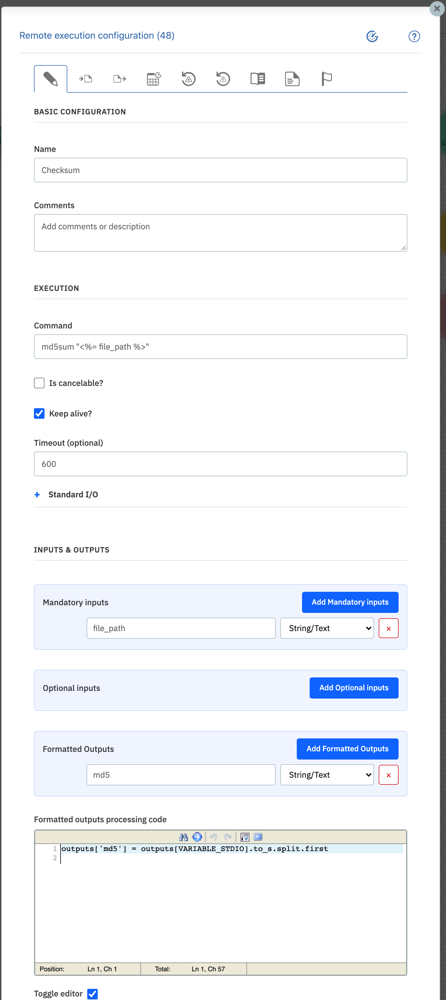

- It is synchronous: a worker is busy for the whole duration, even if Orchestrator does nothing.
  A one-hour command holds a worker for one hour.
- `AsyncRemoteExecution` (Linux targets only) starts the command in the background, disconnects, and polls every few seconds: much more scalable.
  The script can be written in the step.
  In asynchronous mode the exit code is always 0: report errors in the output (for example a line `Error : 1 - text`) and parse it.
- Exit code 0 means success; any other code is an error.
- Set a timeout above the expected duration.
- The whole output is returned as text: parse it in the output processing, for example `outputs['id'] = JSON.parse(outputs[VARIABLE_STDIO])['id'] rescue ""`, and set `@status = STATUS_FAILED` with `@status_details` when needed.
  The script can also print lines that Orchestrator shows as progress (`-#Workflow running -#--progress 50#-`); add `2>&1` to capture errors.
- `{ :keepalive => true }` in the connection options helps when SSH disconnects.
- Arrays and JSON can be passed to a shell script through placeholders, with careful quoting.

### Generating text and calling services

**`FileGenerator`** writes a text file (XML, JSON, text, not binary) from a template with placeholders, or returns the text as an output (**return file content**, no target path).

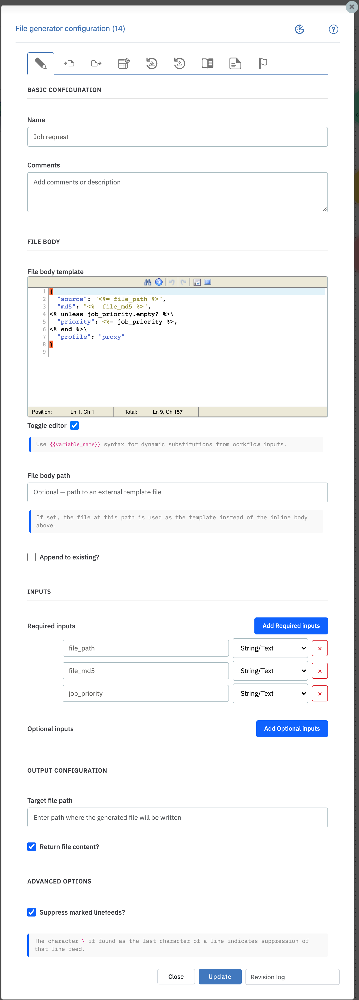

- Prefer it to Ruby code that builds JSON through hash manipulation: anyone reads and edits the payload, and the generated payload is visible in the work order (copy it, send it to the support of the third party: "this is what I'm sending").
  Writing the body directly in `RestRequest` saves a step but hides the payload.
- In templates, end lines of Ruby tags with `%>\` and select **Suppress marked linefeeds** to avoid blank lines; do not indent the tags.
- Required inputs of `FileGenerator` accept empty values.
- The template is ERB (`<%= variable %>`), although the form mentions a `{{variable_name}}` syntax *(4.1.6)*.
- Do not start input names with a capital letter, and do not name an input like a Ruby or Orchestrator method: for example an input `md5` calls the method `md5` of Orchestrator, and the step fails with "wrong number of arguments".

**`RestRequest`** sends one HTTP request (XML or JSON), optionally repeated at a polling frequency until the **polling stop condition** (Ruby) is true.

- To start a job and wait for it: two steps, a start request and a check request with polling.

  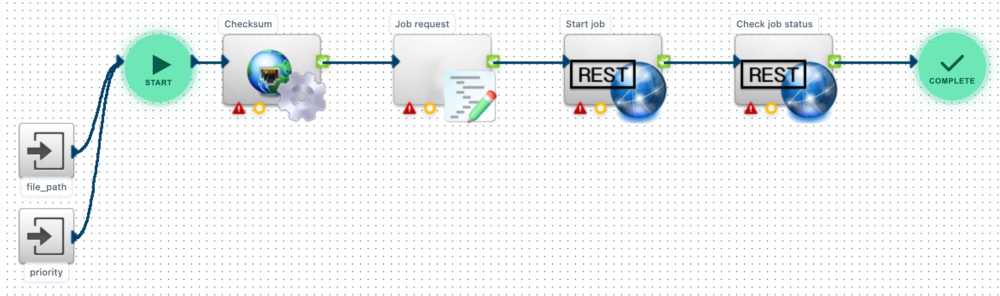

  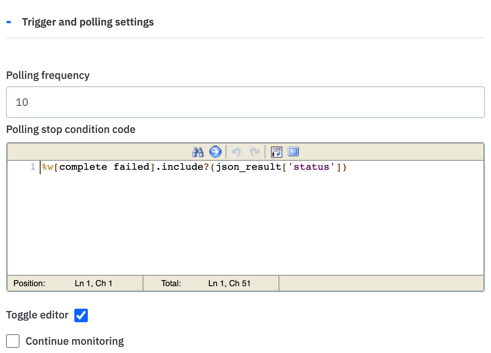

- Extract values from the response in the output processing (additional outputs), rather than in a following `CustomRuby`: one step less, and the request step is self-contained when reused.
- Set `@status = STATUS_FAILED` and `@status_details` in the output processing when the response reports an error: an HTTP 200 can carry an error in the body.
- With **Continue monitoring**, `RestRequest` is a REST watcher: set a record id.
- File uploads (`curl -F`) are not supported: use `RemoteExecution` with `curl`.
- `CollectionManager` converts a JSON string into a hash and extracts elements (one level per step in 4.0).
- `XmlParsing` extracts values with XPath.

Other helpers:

- `ConvertPath`: converts paths between Windows and Linux, or between mount points (for example a transcoder that sees the storage under another path); accepts arrays; does not fail when the path does not match.
  Most transcoders run on Windows and expect Windows or UNC paths; Vantage, for example, expects folder paths that end with a backslash.
- `FileInfo`: base name, name without extension, folder, size, dates, existence, from a path (size and dates for local files only).
- `UuidGenerator`: unique identifiers.

## Custom code

`CustomRuby` runs Ruby code in a step: inputs in `inputs['name']`, outputs in `outputs['name']`, declared with their types.

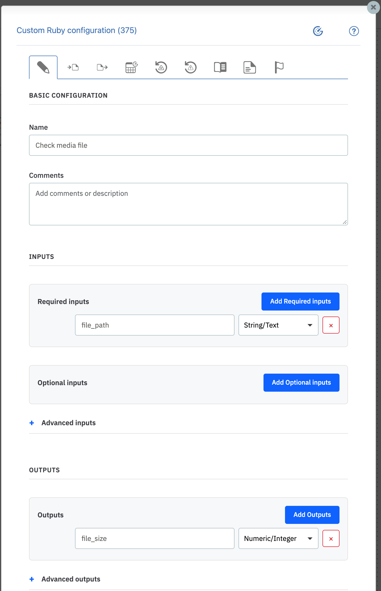

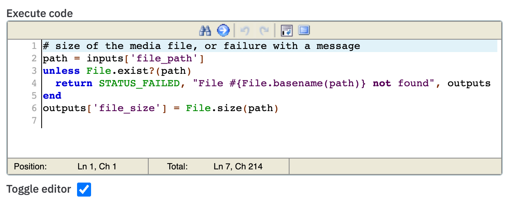

When to use it:

- when no plugin does what you need (often string or path manipulation, or complex rules);
- when it replaces many steps (about 10, or a variable number of steps in a fan-out): fewer steps, smaller database, faster Orchestrator.

When not to:

- to merge two standard steps: standard steps are readable, and their bugs are fixed by Aspera support.
- for constants: use a [configuration](#configuration) step.
- to parse JSON or build payloads: `CollectionManager`, `RestRequest` output processing, `FileGenerator`.

Workflows that put all their logic in Ruby steps are the hardest to support.

Rules:

- Comment the code: what it does, which outputs it produces.
- Use the full-screen editor.
- `CustomRuby` is synchronous: a `sleep` keeps a worker busy.
- `return STATUS_FAILED, "File #{inputs['file_path']} is not a .tar file", outputs` ends the step as failed with a message; use input variables, not placeholders, in the code.
  Without `outputs` as third value, the outputs set before are lost *(4.1.6)*.
- Add `rescue` to expressions that may fail: `outputs['serie'] = xml['Content'][0]['Series'][0]['SeriesTitle'][0] rescue ''`.
- `Rails.logger.info "#{myhash.inspect}"` writes to `orchestrator.log`.
  There is no method `debug` in 4.1.6: calling it ends the step in error.
- Do not name a variable with a capital letter: `WorkOrder = WorkOrder.find(...)` replaces the class.
- A class defined in one step is not available in another step (different workers): define shared code in a capsule (**Engine > Capsules > Import**).
- Use forward slashes in paths, even for Windows paths; `File.windows_to_unix` converts.
- Ruby accepts single and double quotes: choose one style.
- `/opt/aspera/orchestrator/script/cmd.sh` opens a console to try code.
- Since 4.0, `CustomPython` runs Python.
- `CustomTrigger` repeats Ruby code until it returns a final status.
  Avoid it except in rare cases: it is hard to manage.
- `CustomProgressNotifier` runs code when the status of an earlier step changes.

Processing code also exists on inputs (pre-processing), outputs (post-processing) and steps; see [Processing code](workflow-authoring-guide.md#processing-code).

## Resource management

Resource management limits how many times a part of a workflow runs in parallel: "not more than 5 transcodings at a time".
It is the most complex part of Orchestrator, and the only one that requires real thinking; everything else is mechanical.

### Concepts

- A resource is a ticket, not a machine: Orchestrator does not check, ping or monitor anything.
  Naming a resource after a server is only a convention of the workflow.
  Orchestrator guarantees that **it** sends no more than N jobs; jobs submitted to the server by other means are not counted.
- Resource control is also useful without any server: to protect Orchestrator from too many checksums in parallel, for example.
- Load balancing (`LoadBalancer`, or secondary addresses of a remote node) distributes requests (a, b, c, a, ...) without limit or lock.
  Enough for many quick operations.
- Mutual exclusion locks a capacity until it is released: `LoadManager` (current) or `ResourceManager` (legacy).
  **For new workflows, use `LoadManager`**; migrate old workflows when possible.
  `ResourceManager` is supported but gets no new features (queue tags, for example).
  Both use the same resource pools.
- A pool has resources, each with a capacity (number of slots); a request reserves a number of slots (1 by default).

### Resource pools

**Create the pool first, in Workflows > Resources**, before designing the workflow.
Do not create it ad hoc from the workflow step: a pool is not a workflow-level object.
Create it as **Custom** to be able to change resource names and capacities later.

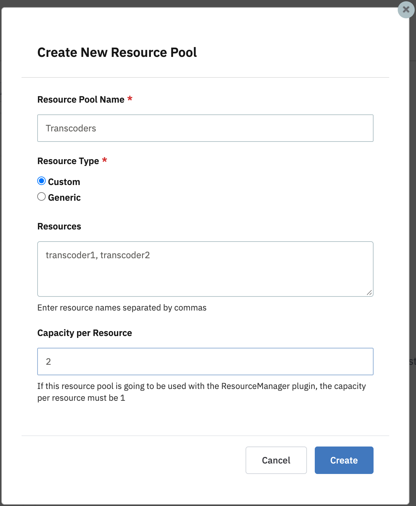

The pool view shows the reservations and the work orders that hold them (by their allocation label), and allows releasing a slot by hand (menu of a resource: **Release a capacity**, **Release all capacities**), taking a resource offline, changing a capacity, or adding a resource; changes apply at once.
A pool cannot be deleted while slots are reserved.
The allocation history shows how busy the pool was: if it is always full, the resource is the bottleneck.

### The pattern

Always the same layout:

1. `QueueStager` (add): puts the element in the queue (optional, see [Queue](#queue)).
2. `LoadManager` (reserve): waits for a slot.
3. **One step, or one sub-workflow** with all the work that needs the resource.
4. `LoadManager` (release) on success, then **Complete**.
5. On failure or error of step 3: OR, `LoadManager` (release), then **Failed**.

- Every path after the reservation must release, or the slot is never freed: **starvation**.
  New work orders wait forever ("No resource to allocate"), and a manual release only delays the next starvation.
  With several steps between reserve and release, every failed and error exit must reach a release: unreadable and fragile.
  With one sub-workflow, the pattern stays the same whatever the sub-workflow does.
- Map the **allocation token** output of the reserve step to **Allocation token to release** of both release steps, carried through the middle step.
  Also select the pool in the release steps, for readers.
- Create templates for reserve and release when a pool is used in several workflows.
- Set an **Allocation label** with the element (for example `Transcoding <%= File.basename(file_path) %>`): the pool view then shows what holds each slot.
- The **Allocation policy** chooses among the resources that have enough free slots: **Fair Distribution** takes one at random, **Sequential Distribution** takes them in turn (round robin).
  Neither fills the first resource before using the next one.
  To use a second server only when the first one is busy (for example the first server has a perpetual license and the second is paid per use), put each in its own pool, and reserve from the second pool after a wait timeout on the first one ([Timeouts and capacity](#timeouts-and-capacity)).

The legacy layout with `ResourceManager` is the same:

### Timeouts and capacity

| Setting | Meaning | Use |
| --------- | --------- | ----- |
| Wait timeout | Maximum wait for a slot; then the step passes (more parallel work than the capacity) or fails (**On wait timeout action**). | Service level: after 50 minutes without a local transcoder, use an expensive cloud transcoder. |
| Hold timeout | The slot returns to the pool after this time, even if not released. The work goes on. | Protection against forgotten releases (cancelled or destroyed work orders). Set it above the longest possible hold (for example twice that time), or more work runs in parallel than allowed. |
| Allocation block size | Number of slots to reserve. | Big files reserve 2 slots, small files 1. |
| Use weight for allocation | The weight of the queued element is the number of slots. | Same, set when queuing. |

- If the element at the top of the queue needs more slots than any resource has free, nothing proceeds until enough slots are free: the queue does not skip to a smaller element.
- Most workflows need neither wait nor hold timeout.

Handling a server failure: when the work on a resource ends in error, the server is probably down.
Releasing the resource sends the next elements to the same server, and they all fail.
Not releasing it limits the failures, but if all servers fail (for example the automatic update of all Windows servers at 3 a.m.), all slots stay taken.
A compromise: on error, notify IT ("resource paused for 30 minutes") and do not release, with a hold timeout of 30 minutes; the slot comes back by itself and is tried again.
Do it only when needed: simpler workflows are easier for operators to understand.

Fallback to another resource when one fails:

### Queue

Without a queue, nobody sees what waits for a slot, the order is not controlled, and nothing can be prioritized.
A queue (FIFO with priorities) between the work and the pool fixes this.

- Create the queue in the **Queues** view (Scheduler group), not ad hoc from the step.
- `QueueStager` with action **add** (90 % of uses) puts a **string** in the queue (a path, not the file).
  Set a **Queued item description** that helps operators: by default it is the item; for example `<%= File.basename(queued_item) %> <%= workflow_description %>` (variables become inputs).

- **Bind the load manager to the queue**: **Advanced parameters > Queue** (by id, or **runtime**), and map **Expected queued item** to the **queued item** output of the add step (and the queue to the queue id when runtime).
  Mechanical rule: select runtime and map both.
  The load manager then waits until its element is at the top of the queue and a slot is free, then removes the element and reserves.

- **Expected queued item is not a required input, but forgetting it in the same work order is a serious bug**: a work order processes the element of another work order ("inversion of context"), which is very hard to detect.
- **Set Auto-purge: On work order stop** on the queue.
  Otherwise, when someone cancels or destroys a work order, its element stays at the top of the queue, and all other work orders wait forever, even with free slots: a very common case.
  A workflow can also remove the element explicitly (`QueueStager` with action remove), for example after a wait timeout.

- **Priority**: 0 is the highest (like process priorities); for example a priority per source folder.
  There is no preemption: priority orders the queue, it does not stop running work.
- **Weight**: an estimate of the work of an element (size, duration); it does not change the order.
  The total weight ahead of a priority (action `list_all`) tells whether a deadline can be met, for example to send an urgent file another way.
- **Tags** (4.0 and later, `LoadManager` only): a tag set on a queued item and on a resource makes the load manager take the first item that matches the tag of a free resource, even if it is not at the top of the queue.
- Operators with the Scheduler group and membership of the queue can reorder, remove and pause elements from the **Queues** view or a dashboard.
- In the **Queues** view, **Delete** deletes the queue definition; **Clear** removes its elements.

### Operating with queues and pools

- **Pause the queue** to stop the work after the queue (maintenance of the transfer or transcoding servers): everything before the queue goes on (watchers, preparation), elements accumulate, and resuming processes them in order.
  This alone is worth adding a queue.
- Take one resource offline (or lower its capacity) to work on one server.
- Add a resource to a pool at any time: it is used at once.
- After destroying work orders by hand, release their slots and remove their queue elements, or set a hold timeout and auto-purge.

### High volume

With the pattern above, each element in the queue is a running work order that waits.
A thousand is manageable; 10 000 or a million overload Orchestrator (for example when a whole storage is migrated to the cloud).

Split into two workflows:

- Workflow 1 detects the elements, adds them to the queue, and **ends**.
- Workflow 2 starts with a `LoadManager` with **Continue monitoring**, bound to the queue **without** expected queued item: each time a slot is free, it takes the element at the top and starts a work order.

- The number of running work orders follows the number of slots (5 slots: at most 6 work orders), not the number of elements.
- No expected queued item, and no auto-purge: the element is not tied to the work order that queued it.
- The load manager polls the queue (every 5 seconds by default): with very short processing, the pool may look idle while the queue is full.
- Try it on a test workflow first: do not put it in production without understanding it.

## Human interaction

### User input

`UserInput` stops the work order and creates a task for users or groups: data to display (mandatory inputs) and data to request (outputs).

- Add at least one user or group; otherwise the step does not wait and its outputs are empty.
  Users see tasks in the **Tasks** tab (Contributor group) and in dashboards.
- Restrict a task to one user by setting only a user.
  With a group, the first user who submits wins; for exclusive work, use two tasks: one to take the task (visible to the group), one to fill it (visible to the user who took it, an output of the first task).
- Assign users or groups at run time with `SingleUserAssignment`, `UserAssignmentsArray`, `SingleRoleAssignment`, `RoleAssignmentsArray`.
- The event description (task title) can use the displayed inputs (`<%= %>`).
- Do not leave tasks open for long: each open task is a waiting work order.
  Set a timeout.
- A task can be completed through the REST API.
- A custom form is an `.html.erb` file named `_<name>.html.erb` in `/opt/aspera/var/config/orchestrator/actions_config/user_inputs/`.
  It is part of an HTML form that already has the submit and cancel buttons.
  Read displayed data from `received_parameters['name']`, and write requested data as `outputs[name]` fields, or with the helpers `draw_input('outputs', 'name', 'string', 'default')`, `draw_input_string`, `draw_input_flag` (types flag, int, string, date, attachment).

See the recipe [operator decision](workflow-authoring-guide.md#recipe-operator-decision) and its [custom form](workflow-authoring-guide.md#custom-form), with a sample, in the Authoring Guide.

### Direct start

A workflow with runtime parameters can have a custom start page: `/opt/aspera/var/config/orchestrator/workflow_start_views/_start_<WORKFLOW_ID>.html.erb`, with fields `external_parameters[<name>]` (`draw_input_string("external_parameters", "<name>")`, or a list built on the server, for example the files of a folder with `Dir.glob`), and an optional JavaScript function `validate_workflow_<WORKFLOW_ID>()` that is called before the start (return `false` to stay on the page).
The page shows these fields after the standard ones (description, comments, execution priority).

- The page is opened at `https://<ORCHESTRATOR_HOST>/aspera/orchestrator/work_orders/direct_start/<WORKFLOW_ID>`, from the work order creation, from a dashboard, or from a link in a custom portlet.
- It starts the work order and does not report its result.
  For a page that starts and follows work orders (a "fast track" page for editors, for example), write a portlet that calls the API ([Portlet Development Guide](portlet-development-guide.md)).
- Avoid credentials in URLs (`login=`, `password=`, with `inline_auth_allowed: true`): URLs are logged.

## Monitoring and operations

### Journals

Journals are a log of workflow activity for operators, in their language, grouped by file and package: the first level of troubleshooting, before the work order view.
They are essential when the processing of one file spans several work orders (launchers, queues).

- Journaling must be on: **Journal On** in **Engine > Configuration** (Journal & Cleanup).
  Otherwise the journal steps end in error and the **Journals** view is not in the menu.
- Create journal books in **Workflows > Journals** before running the workflow: a journal step does not create its book (the entries are written without a book), and an import creates only the books of inline journals.
- Map the file to `<%= File.basename(file_path) %>` and the file path to `<%= file_path %>`.
- A package name groups entries; it is created when it does not exist.
  Here, the package is the folder of the file: `<%= File.basename(File.dirname(file_path)) %>`.
- **Journal milestone** is the progress of the file, in percent: 10 when received, 100 at the end.
- The journal status (in progress, complete, failed) is independent from the step status: write a final entry on success and on failure.
- Map the outputs `journal_file_ID` and `actual_package_ID` of the first entry to the inputs `file_ID` and `package_ID` of the later ones: they append to the same file entry.
  **New file** creates a new entry for the same file (each work order gets its own).
- Do not mix inline journals (step menu **Journal**) and journal steps.
- Packages whose files have all ended (complete, failed or error) are deleted after 7 days by default (**Journal Kept Duration**, `journal_kept_duration`); files still in progress are kept.
  **Delete Journal with Work Order** (`delete_journal_with_workorder`) deletes the entries with their work order.

Alternatives: logs collected by an external tool, a custom database table shown in a dashboard, metrics in InfluxDB with Grafana.
Do not use the Orchestrator database for heavy external monitoring.

### Alerts

`OrchestratorAlertEntry` adds an alert in the **Alerts** tab under the bell icon of the user interface, for the users subscribed to its category (a new user is subscribed to all).

- Put everything in the alert message, which can contain placeholders: 4.1.6 does not save the **Header**.
- Raise an alert for what needs an action of an operator, not for each failure.
  Alerts are shared: deleting one, or **Delete all**, in the bell menu removes them for every user.

### Monitors

| Monitor | Checks | Action |
| --------- | -------- | -------- |
| Workflow | Whether a work order of the workflow runs. | Auto-start the workflow, with given runtime parameters; call a notification workflow. |
| Work order | Work orders of a workflow that complete, fail, end in error or are canceled. | Call a workflow for each (for example to send an e-mail). |
| Folder | Age and number of files (local, mounted, or on a remote node). | Call a workflow (for example to delete old files). Does not detect a missing folder. |
| Script | A command run on a remote node, which prints `<code> <message>`: 0 OK, 2 warning, another code an alert. | Disk, CPU, memory, processes, also on remote servers. |
| Remote node | Reachability. | |

- **Add a workflow monitor to each trigger workflow**: watchers are supposed to run forever.
- Set the **Work Order Name** of the auto-start: the monitor then checks and starts only the work orders of that name,
  so that several monitors can watch the instances of one workflow started with different runtime parameters.
- The runtime parameters of the workflow are listed under the work order name: without a value for a required one, the auto-start is skipped.
- A paused work order is not restarted (the monitor shows a warning).
- **Suppress duplicate events** avoids a notification at each check.
- Turning a monitor off does not stop the work orders it started.
- A notification workflow receives `NotificationType` (`WARNING` or `ALERT`), `NotificationMessage`, `MonitorType` and `MonitorID`.
- **Alert Processing Code** and **Warning Processing Code** are Ruby code run by Orchestrator when the workflow does not run, or stays in another status than in progress: a corrective action.
- A script monitor command must exit with 0 and write nothing on its standard error: otherwise the monitor shows a warning with the error.

### Dashboards

Dashboards are pages of portlets (frames), per user or group: work order statistics, step activity, queues and pools, lookup table editor, custom tables, custom portlets.

- Do not put too many frames on a page, and deactivate unused pages: each open page polls Orchestrator.
  Set a logon timeout.
- To see workflow statistics in a dashboard, a user needs the run permission on the workflow.
- Users see dashboards assigned by an administrator, after activating them.

### Work order view

- **View by workflow** groups work orders by workflow; **View by work order** groups the work orders of a group on one line.
- By default the view shows the last day of completed and failed work orders (`default_filter_days_back`); a filter without status also shows older work orders still in progress.
- Filter by title, not by keyword ([Meaningful status](#meaningful-status)).
- Only top-level work orders can be filtered: put the outcome of sub-workflows in the top-level label.
- Tags can be set when creating a workflow or a work order, and used to filter or to cancel a group.
- **Clean Up** in **View by workflow** removes ended work orders, except flagged ones.
- Elapsed time includes retries; `processingTime` of the step information counts only the last attempt.
- Steps of a work order are not always shown in chronological order; inactive steps have not run (and may never run).
- A work order that stays **Initializing** probably needs its workflow to be republished; one that stays **Created** is probably throttled (workflow throttle setting) behind other work orders of the same workflow.

### Workers and capacity

Steps run in workers.
A **synchronous** worker runs one step until it ends: file operations, script execution, `Md5Checksum` (computed on Orchestrator), `MediaInfo`, FTP transfers, `CustomRuby`.
An **asynchronous** worker starts a job and polls its status, serving many steps: triggers, `FaspTransfer`, transcoder jobs.

- Prefer asynchronous plugins (for example `AsyncRemoteExecution`).
- Limit the number of synchronous steps that run in parallel with resource pools or the workflow throttle: when all synchronous workers are busy, the other steps wait.
- More workers allow more parallel work; each takes 200 to 500 MB of memory.
  Size them for the CPU and memory of the server.
- The engine decides what runs next; if it stops, the workers stay idle.
- The workflow and engine settings **purge after** (workflow) and `purge_cutoff`, `cleanup_cutoff` (engine) delete old work orders; keep them short on busy servers.
  Flagged work orders are never purged.
- Install the third-party tools used by workflows (for example `mediainfo`) on all Orchestrator servers of a cluster.

### Users and permissions

- The groups give access to the tabs: Developer (**Workflows**), Operator (**Work Orders**, **Monitors**), Contributor (**Tasks**), Scheduler (**Queues**), System (**Engine**).
  Only administrators destroy and reset work orders by default.
- To start and follow a workflow, a user needs the run and view permissions on the workflow **and on its sub-workflows**.
- A non-administrator does not get the run permission on the workflows they create: add it.
- A developer who also runs workflows needs the Developer and Operator groups.
- Queues, user input tasks and dashboard pages have their own user and group permissions.
- `WorkflowLauncher` can run the launched work order as a given user, who then sees it without permissions on the workflow.

## Integration API

An external application can start and follow work orders through the REST API, with XML or JSON responses: no watcher needed, which saves polling.

- `initiate` starts a work order, with runtime parameters as `external_parameters[name]`, synchronously or asynchronously.
- Other calls list work orders of a workflow (by status and date), return the status, steps and outputs of a work order, cancel or reset work orders, import workflows, and take resources online or offline.
- **Workflows > API tutorial** in the user interface tests the calls.
- Encode special characters in URLs.
- Pass credentials in the `Authorization` header, never in the URL, and parameters that hold secrets in the body: see [REST API](workflow-authoring-guide.md#rest-api) and [Secrets](workflow-authoring-guide.md#secrets) in the Authoring Guide.
- `ascli` wraps the API: `ascli orchestrator workflows start <WORKFLOW_ID> @json:'{"file_path":"<FILE_PATH>"}'`.
- With several Orchestrator servers, call them through one address (load balancer or DNS).

### Inline validation

An Aspera transfer server can call a workflow for each file it receives, at start, after a number of bytes (threshold) and at end, and reject the file with a message shown to the user.

- The validation URL is `https://<ORCHESTRATOR_HOST>/aspera/orchestrator/external_calls/validate?id=<WORKFLOW_ID>`, with the credentials of a user who has the run permission on the workflow (basic authentication).
- The work order gets two runtime parameters: `File`, the request of `ascp` (a hash: `startstop` is `start`, `running` at the threshold, or `stop`; `file`, `size`, `user`...), and `File_path`, the path of the file.
  Declare them as runtime parameters of the workflow, and test the event with a `Filter` (`inputs['File']['startstop'] == 'start'`).
- The answer is the status message of the work order: set it with `ExitStatus` before **Failed** (the reason of the rejection).
  A work order that ends in error also rejects the file.
- **IFV Skip Start Event** (Orchestrator configuration) answers the start events without starting a work order, when the workflow does nothing at start.
- **4.1.5 and 4.1.6 refuse the call**: the request of `ascp` has no CSRF token, and Orchestrator answers with a redirection to the logon page instead of starting the work order (checked on 4.1.6).
  `ascp` takes any answer other than HTTP 200 as a rejection: with `validation_uri` set, every upload fails.
  On these versions, validate after the transfer instead (`AsperaOtfv`, or a trigger workflow).
- Configure it in the `aspera.conf` of the server: `validation_file_start`, `validation_threshold`, `validation_file_stop` set to `uri`, `validation_uri` set to the validation URL of the workflow, `validation_threshold_kb`.
- The user sees the transfer at 99 % until the validation ends: a slow workflow looks like a stuck transfer.
  Without an answer after `session_timeout_sec` (`aspera.conf`, default 60 seconds), the call fails and `ascp` rejects the file: increase it for long checks such as antivirus.
- Each file of each transfer creates up to three work orders: tune Orchestrator for the HTTP load, or validate after the transfer instead (`AsperaOtfv`), which does not block `ascp`.
- A file does not start before the answer to its start call, and does not end before the answer to its end call; the other files of the transfer go on (`validation_threads` parallel calls, default 5).
- The threshold call does not pause the transfer: a rejection stops it only when the answer arrives.
  If the last block is already written by then, the file stays complete, and the user still gets the error.
  A file smaller than `validation_threshold_kb` gets no threshold call.
- A rejection ends the whole transfer session, not only the file: the files not yet received are not transferred.
- `ascp` does not delete a rejected file: after a rejection at the end, the complete file stays under its final name, and the workflow must move or delete it.
- Rejecting at start (for example on the file name) saves the bandwidth and storage of a file that would be refused.
- Not available with HTTP fallback.
- With a partial file suffix (`partial_file_suffix`), the calls give the final name, but during the transfer the file is on disk with the suffix: at the threshold, a step that reads the file adds the suffix to `File_path`.

## Deploying and changing workflows

- Plan workflow changes: one day before changing a trigger workflow, pause watchers and queues and let running work orders finish.
  A changed sub-workflow may receive wrong inputs from a running parent.
- Move workflows between servers by export and import, or with the deploy feature (3.x), Git integration (4.x), or snapshots.
- An export does not contain the external files of a workflow: parameter set and lookup table files, user input forms, direct start pages, payload files, images, portlets.
  Copy them.
- At import, refer to existing templates and remote nodes rather than overwriting them: overwriting creates a second version of the template, used only by the imported workflow.
- A safe procedure: rename the existing workflows with a backup suffix (or move them to a backup folder), import the new versions keeping existing templates and remote nodes, and start the new top-level workflows with new work orders, not relaunches of the old ones.
- The plugin code is not in the export: the target uses its own plugin versions.
  Import or enable the plugins first.
- Plugins and capsules (hot fixes) are installed by hand; subscribe to the notifications of new capsules, which may fix critical bugs, and force maintenance after installing one.
  Importing a plugin does not activate it: upgrade it to the imported version, and archive the running version first to be able to revert.
  On a cluster, import on one server, then reload the plugins and force maintenance on each server.
- Keep a test server, with the same versions as production.

## Checklist

Design:

- [ ] The **trigger workflow** and the **processing workflow** (with parameters) are separate.
- [ ] Each foreseeable error has a way out, and unhandled cases end with a clear message.
- [ ] Heavy or long steps are protected by a resource pool, when volume requires it.
- [ ] Workflows have 20 steps at most; repeated blocks are sub-workflows or templates.

Trigger:

- [ ] One trigger with Continue monitoring from start to end.
- [ ] Persistency scope chosen; never none with Continue monitoring.
- [ ] Detected files are moved out of the watched folder; temporary files are excluded.
- [ ] Polling period of 5 seconds or more.
- [ ] A workflow monitor restarts the trigger workflow.

Graph:

- [ ] Each join of exclusive branches (if and else, complete and failed, error paths) has an OR.
- [ ] No link back to a previous step.
- [ ] One step between each fan-out and its funnel-in; empty lists are handled.
- [ ] Retries are set only on linked exits.
- [ ] Every path after a resource reservation releases it.

Data and configuration:

- [ ] Parameters are linked to Start.
- [ ] Outputs needed later are carried through; inserted steps carry everything through.
- [ ] No constant, address or credential in steps or code: parameter sets, lookup tables, remote nodes.
- [ ] Lookup tables have their key mapped and no empty cells.
- [ ] Load managers in the same work order as their queue have the expected queued item mapped; queues have auto-purge on work order stop.

Readability:

- [ ] Steps and configurations named before creation; conventions followed.
- [ ] Work order label shows the processed element.
- [ ] Exit status messages for each end.
- [ ] Journal entries or other reports for operators.
- [ ] Comments in steps and Ruby code.

Tests and changes:

- [ ] Each block was tested alone, with test folders.
- [ ] After a structural change, new work orders were started (relaunch, not reset).
- [ ] External files and plugin versions are deployed with the workflow.
